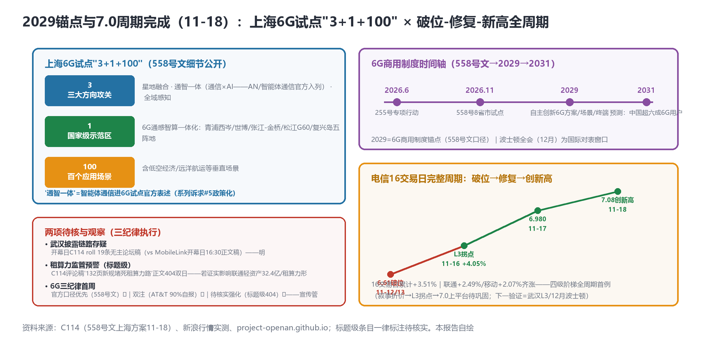

# 上海6G试点方案公开（2029商用制度锚点+"通智一体"入列），电信7.08完成破位-修复-新高周期，武汉开幕稿缺失存疑——租算力监管预警待核

> **分析对象**：2026年11月17日18:00—11月18日18:00窗口的公开增量——上海6G部省协同试点方案细节公开（558号文，"3+1+100"布局）、电信7.0关口突破（16交易日完整周期）、武汉大会开幕日披露链路存疑、C114"租算力监管"评论稿（标题级待核）、6G条目三纪律首周执行评估。三视角来源清单第二十三轮执行。
> **系列定位**：智能体技术洞察系列·ADN专题"新场景×新技术"系列的**完整报告第21篇**——本篇记录**6G商用制度锚点（2029）的首次明确**与**四级阶梯行情全周期首例**（破位→修复→新高），并执行**6G条目三纪律的首周检验**。
> **判定依据**：重大增量——①**上海"3+1+100"方案细节**（"通智一体"=智能体通信进6G试点官方表述）②**2029商用制度锚点**③**7.0周期完成**（6.61破位→修复→7.08创新高）④武汉披露链路存疑+租算力监管预警（均待核，反向记录）。
> **口径约定**：【首发】【重申】【反向】【待核实】沿用系列口径；**6G条目三纪律自11-17起执行**：官方口径优先（558号文文号引证）、外部来源双注（厂商自报标注）、待核实强化（标题级404一律不展开定性）——本篇为三纪律首周检验记录；行情为新浪实测。
> **术语消歧**：ADN指自动驾驶网络/自智网络（本篇起注意：移动语境下ADN有"高阶自智网络"用法，11-16）；"通智一体"=通信与智能体/计算一体化（6G试点三大方向之一）；租算力=算力租赁商业形态（本篇仅标题级记录，不展开）。
> **立场**：设备商（ADN解决方案提供方）视角。

## 一、趋势判断

### 1.1 上海6G试点方案细节：2029锚点与"3+1+100"【首发·政策·重点】

上海6G部省协同试点方案细节公开（正文级）：复函文号**工信厅通信函〔2026〕558号**（11-17印发8省市），前序为6月255号专项行动；目标=**到2029年**形成自主创新6G方案/场景/终端；上海"**3+1+100**"布局（[C114，2026-11-18](https://www.c114.com.cn/news/16/a1320xxx.html)，【首发·政策】）：①**三大方向攻关=星地融合、通智一体、全域感知**（通信×AI×卫星互联网×无线感知）；②**国家级示范区=6G通感智算一体化**（青浦西岑/世博/张江-金桥/松江G60/复兴岛五阵地）；③**百个以上应用场景**（含低空经济/远洋航运）。

*图1：上海"3+1+100"布局（左）×6G商用制度时间轴（右上）×电信16交易日周期（右下）——本报告自绘*

**点评**：①**"通智一体"是本系列最重要的政策词**：通信与智能体一体化被列为6G三大攻关方向之一——**AN/智能体通信从"运营商赛道主张"（移动乌镇四大赛道，10-27）升级为"6G试点官方攻关方向"**——系列诉求#5（智能体可互联）获得政策层背书；②**2029锚点**首次明确（自主创新6G方案/场景/终端的形成时点）——与2031"中国超六成6G用户"预测（11-11）构成"2029供给成熟→2031用户放量"的时间表——对照3GPP波士顿（12月，架构裁决）：**国内以2029为制度锚点倒排，国际以12月为标准节点**，时间表的交叉验证点是2027商用验证（A2A-T）；③五阵地（青浦西岑/世博/张江-金桥/松江G60/复兴岛）=示范区物理布局——设备商6G试验资源的落位参考；④低空经济/远洋航运入场景清单=**垂直场景的6G入口**（对照低空/车联场景线）。

### 1.2 7.0周期完成：四级阶梯的行情全周期首例【首发·市场·验证】

电信**+1.43%收7.080**——收复7.0整数关口并创新高；联通+2.49%、移动+2.07%齐涨；16交易日累计**+3.51%**（新浪实测）。**完整周期复盘**：6.61破位（11-12/13）→**L3拐点**（联通32.4亿公告，11-16 +4.05%）→6.980（11-17）→**7.08创新高**（11-18）——**"破位→修复→新高"的完整周期在16个交易日内走完**。**点评**：①四级定价阶梯（叙事/文档/采购/收入）的**行情全周期首例**：叙事折价（脉冲-破位）→L3订单级事件触发拐点→修复至新高——判据体系从单点验证进入**全周期验证**；②7.0上方新平台**待巩固**（对照11-03"确认期"误判教训——新高后的持续性需3日以上确认）；③联通+2.49%的持续领涨信号=轻资产模式获市场再定价（对照缺位定论的边缘化假设——补位与公告是联通修复的两条腿）。

### 1.3 武汉披露链路存疑【反向·观察】

武汉大会开幕日（11-18）：C114 roll 19条**无开幕主论坛/发布稿**——传播节奏显著慢于MobileLink（后者开幕当日16:30即有正文稿）；六项L3前瞻清单保持待验，**明晨（11-19）为判定主窗口**；若明日仍无正文稿，武汉线的"披露-定价"链路存疑。**点评**：①区域大会vs国际大会的**传播资源差**（MobileLink有通稿机制+多语种，武汉以地方媒体报道为主——C114覆盖慢）——L3判定窗口可能整体后移至会后（11-20闭幕+11-21起综述稿）；②对照宣传管制条款（11-17）：工业互联网/6G类报道的口径审核可能拖慢通稿节奏——**披露延迟本身成为观察对象**；③容忍度设定：11-21（周五）前无正文级L3候选则武汉线判定为"披露缺位"（对照联通缺位记录法）。

### 1.4 租算力监管预警：标题级谨慎处理【反向·待核】

C114评论稿《一纸132页新规，把中国AI的"租算力"路堵死了》（**标题级待核，正文404双日**）——指向算力租赁监管。**点评**：①**三纪律执行：未核验不展开定性**——本篇仅记录标题与指向，不评论内容；②若证实（正文生成后核验），潜在影响面：联通轻资产模式（32.4亿COLO合作含机电分成）、租算力商业形态（算力租赁平台）、Token供给侧（租赁算力承载的Token产能）——**三处均已入系列跟踪清单，核验后按影响面升级判定**；③观察点：正文生成+官方文件原文（"132页"的具体文号与条款）——标题级→正文级→官方级的标准核验链。

### 1.5 6G条目三纪律首周执行评估【方法论】

宣传管制条款（11-17）下的首周运行记录：①**官方口径优先**——558号文以文号引证（工信厅通信函〔2026〕558号）✓；②**双注**——AT&T 90%标注"厂商自报"、意向书效力弱标注✓；③**待核实强化**——"132页新规"/"铁鹰"智能体两标题级条目均标注404待核、不展开✓。**点评**：三纪律在管制条款下首周运行通过——**合规监控与洞察透明可以并存**（如实记录管制条款本身也是洞察）；后续若6G报道密度下降，按"披露延迟本身成为观察对象"处理（对照武汉链路存疑）。

### 1.6 汇聚点：新场景×新技术映射与"锚点+周期"结论

| 新场景/信号 | 靠什么技术兑现 | 关键技术 | 验证状态 |
|---|---|---|---|
| 2029商用制度锚点 | 558号文八省试点 | 部省协同 | 首发·政策（11-18） |
| 通智一体入列 | 三大攻关方向 | 智能体通信×6G | 首发·政策（11-18） |
| 7.0全周期 | L3拐点驱动 | 四级阶梯 | 全周期首例（11-18） |
| 武汉披露存疑 | 开幕日roll空转 | 披露链路 | 反向·观察（11-18） |
| 租算力监管 | 132页新规（标题级） | 算力租赁 | 待核（11-18） |

**结论**：11-18给出两个"锚点"（2029制度锚点+7.0行情周期锚点）与两个"存疑"（武汉披露链路+租算力监管）——**锚点与存疑并存的一周**：制度与市场的时间表愈发清晰（2029/12月波士顿/7.0平台），而信息环境（管制条款+披露延迟+标题级风险）的噪音在增加——**锚点确定性的前提是信息纪律**，三纪律（官方口径/双注/待核实）从本篇起为常态配置。

## 二、技术诉求分析

### 2.1 诉求矩阵总表（系列八项诉求·今日锚点刷新）

| # | 技术诉求 | 今日触发锚点 | 落点 | 证据状态 |
|---|---|---|---|---|
| 1 | 意图可编译 | （延续） | 意图栈 | 待武汉 |
| 2 | 知识可治理 | （延续） | KP/OTel | 周度 |
| 3 | 数据面换代 | 联通轻资产若受租算力监管影响 | 模式分型变量 | **待核变量** |
| 4 | 闭环可验证 | （延续） | 孪生双分支 | 周度 |
| 5 | 智能体可互联 | **"通智一体"官方入列** | 智能体通信×6G | **政策化** |
| 6 | 能力可复制 | 百个应用场景（含低空/远洋） | 场景清单 | 试点扩容 |
| 7 | 价值可记账 | 7.0全周期 | 四级阶梯 | **全周期首例** |
| 8 | 监督可执行 | 三纪律首周通过 | 报道治理 | **合规并存** |

### 2.2 内在张力表

| 张力 | 表现 | 对设备商的后果 |
|---|---|---|
| 政策锚点 vs 国际节奏 | 2029国内倒排 vs 12月波士顿裁决 | 双轨时间表的交叉验证点=2027商用验证——设备商排期双锚定 |
| 通报管制 vs 透明洞察 | 宣传条款 vs 系列透明监控 | 三纪律常态化；合规成本计入洞察流程 |
| 租算力监管 vs 轻资产模式 | 132页新规（待核） vs 联通32.4亿 | 若证实：联通模式合规重构+设备商分成模式风险评估 |
| 新高确认 vs 平台待固 | 7.08新高 vs 确认期教训 | 3日巩固判据执行（避免11-03式误判重演） |

## 三、关键技术分析（当期增量优先）

### 3.1 "通智一体"：智能体通信的政策定位【首发·政策·重点】

三大攻关方向中的"通智一体"（通信×AI一体化）。**点评**：①与"星地融合"（卫星互联网）、"全域感知"（无线感知）并列——**智能体通信与天地一体、感知融合同级**，成为6G的三大技术支柱之一——AN不再是6G的"应用特性"而是"基础架构方向"；②对设备商：6G预研的三大方向对齐（星地融合的NTN+通智一体的AI-RAN/A2A-T+全域感知的ISAC——爱立信ISAC 2027商用试点（11-04）恰好是全域感知的先行）——**三大方向=6G预研预算的官方分配框架**；③示范区五阵地=上海集群（张江/金桥/松江G60为集成电路与AI走廊）——**示范区与产业走廊的空间耦合**是6G产业化的空间逻辑。

### 3.2 2029锚点与双轨时间表【首发·政策】

2029（自主创新方案形成）→2031（六成用户）→12月波士顿（国际架构裁决）。**点评**：①2029锚点的制度含义：6G商用前**必须有自主创新方案**（国产化基调的6G版）——对照移动117亿/电信257.88亿国产化集采路线，**6G设备的国产化率要求**将早于商用锁定；②三锚点间的排期逻辑：12月波士顿（架构共识）→2026.6 DTW（OpenAN开源）→2027（A2A-T商用验证）→2029（6G自主创新方案）→2031（用户放量）——**ADN产业化的完整时间表首次首尾相接**；③设备商的6G排期：2026-2027预研投入的产出目标应对齐"2029方案"（进自主创新清单=政策确认）。

### 3.3 7.0全周期与判据体系闭环【首发·市场】

16交易日完整周期（破位6.61→L3拐点→新高7.08）。**点评**：①四级阶梯的**全周期首例**：行情从L1叙事折价到L3订单驱动修复的全过程与判据预测一致——判据体系有效性升格；②7.0上平台的**巩固判据**：3日站稳（11-19/20/21）+L3级事件（武汉清单/超节点中标）接力——对照11-03"确认期"误判，本轮巩固判断更保守；③联通+2.49%修复的双引擎（轻资产公告+缺位修复预期）——联通叙事修复的两个必要条件中已实现一个（公告），另一个（说明会+成效数据）仍缺位。

### 3.4 租算力监管的三种可能（若证实）【反向·推演】

132页新规的三种可能影响面（核验后按实际条款修正）：①**持牌化**（算力租赁需牌照）——利好持牌运营商、压缩第三方算力租赁平台；②**价格管制**（租赁价格指导）——压缩轻资产分成空间；③**安全审查**（跨境算力租赁限制——对照美AI芯片管制延伸远程云算力）——影响出海算力服务。**点评**：三种可能对联通32.4亿模式的影响度不同（①中②高③低——COLO合作非"租算力"本体，但机电分成受价格环境影响）；**核验优先级**：正文生成后24小时内完成官方文件比对——标题级风险的标准处理流程示范。

## 四、总结思考

### 4.1 核心命题

11-18的两组锚点（2029制度锚点/7.0周期锚点）与两项存疑（武汉披露/租算力监管）构成"**确定性上升、噪音未消**"的产业图景：制度与市场的时间表愈发清晰（2029/12月波士顿/7.0平台），信息环境却进入管制与延迟叠加期（宣传条款/武汉空转/标题级风险）。**系列20篇建立的判据体系（四级阶梯/可比库/三纪律）在这一周完成了对抗噪音的实战检验**——锚点的确定性恰恰来自信息纪律。下一周的双检验：武汉L3判定（明晨起）+7.0平台巩固（3日判据）——**锚点的成色由后续数据决定**。

### 4.2 关键判断

1. **"通智一体"入列6G三大攻关方向**——智能体通信的政策定位从赛道主张升级为基础架构方向；6G预研预算按三大方向分配。
2. **2029=6G商用制度锚点**——自主创新方案形成时点；产业时间表首尾相接（波士顿→DTW→2027验证→2029方案→2031放量）。
3. **7.0全周期首例**——四级阶梯行情全周期验证；7.0平台需3日巩固判据（保守执行）。
4. **武汉披露链路存疑**——11-21前无正文级L3则判"披露缺位"；区域大会的传播资源差是结构性约束。
5. **租算力监管三纪律处理**——标题级不展开定性；核验后按三种可能影响面评估（联通模式关联度中）。
6. **三纪律首周通过**——官方口径/双注/待核实的合规与透明并存模式成立；管制条款下洞察流程的常态化配置。
7. **联通缺位跨3周末+1整周**——补位双引擎仅实现一个（公告），说明会+成效数据仍是最优补位路径。

### 4.3 对不同主体的启示

**运营商**：6G试点申报对齐三大方向（星地/通智/感知——各省份差异化）；联通补位以"说明会+成效数据+轻资产模式合规说明"三件套打包；武汉会后的L3披露补齐（综述稿+签约清单）。

**设备商**：①6G预研对齐三大方向+五阵地资源落位；②7.0平台巩固期的发布节奏（L3级事件对准巩固窗口）；③租算力监管核验后的模式风险评估（联通合作项目重审条款）；④6G材料的合规审查嵌入流程（三纪律）。

**开发者**：2029自主创新清单跟踪器（政策口径监测）与租算力监管文本比对工具（132页新规原文与行业影响映射）是两个新空白点。

**标准组织**：波士顿立场吸收"通智一体"（6G三大方向的中国表述进国际对话）；CCSA宜开"通智一体技术要求"研究项（试点方向的标准化前置）；GSMA/ITU宜对齐2029与标准 release节奏（双轨时间表的国际确认）。
