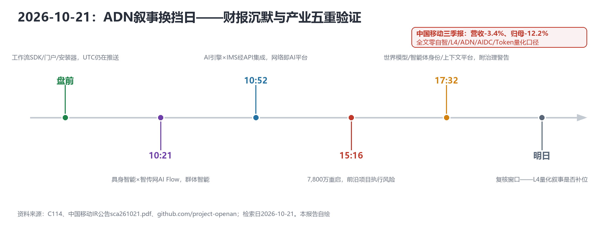
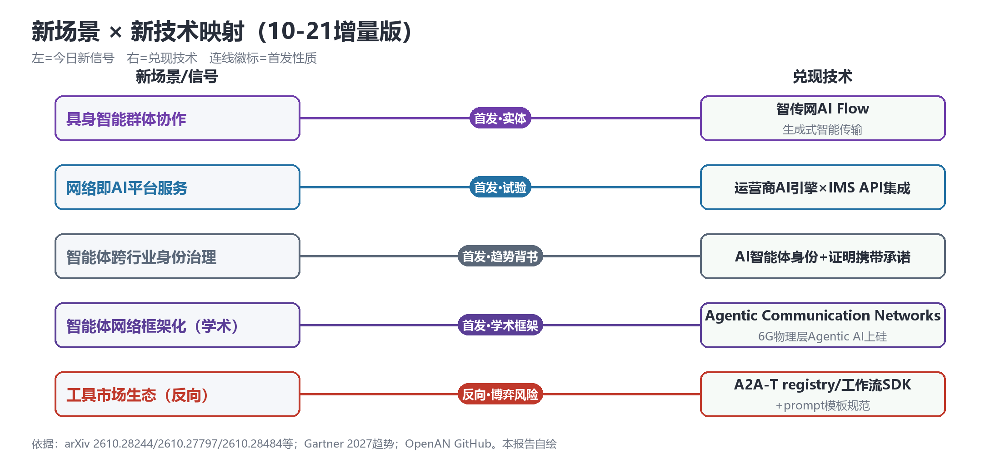

# 财报零叙事、产业五重验证：ADN目标态的叙事换挡日

> **分析对象**：2026年10月20日18:00—10月21日18:00窗口的公开增量——中国移动三季报公告原文（sca261021.pdf，逐页关键词核对）、C114当日全量报道、GitHub project-openan组织与openan.dev、arXiv cs.NI/cs.MA（10-20/10-21两日列表）、MSR博客（Agent Lightning v1.0）；三视角来源清单首轮执行（探测明细见工作区来源登记表）。
> **系列定位**：智能体技术洞察系列·ADN专题"新场景×新技术"系列的**完整报告第2篇**（第1篇=《新场景靠"首次"成形，新技术靠"验证"收敛：ADN目标态的场景×技术版图》v2.1，2026-10-20，commit c78d5e3）。本篇为当日重大增量触发的日报级完整报告。
> **判定依据**：重大增量——①三季报披露节点落定（反向首发：财报零ADN叙事）②中国电信伽马智能实体化（产业节点）③沃达丰×爱立信AI原生网络试验（新场景首发）④Gartner 2027趋势背书（跨行业口径）。
> **口径约定**：数字可信级——【自报】厂商口径；【转述】媒体/公告转写；财报数字以公司公告原文为准；arXiv论文为预印本、未经同行评审。新信号分级——【首发】【重申】【待核实】【反向】。
> **术语消歧**：本报告ADN指自动驾驶网络/自智网络（TM Forum AN L0–L5）；中国电信"AI定义网络"及伽马智能语境的"智传网AI Flow"属6G/具身智能脉络，见3.1。
> **立场**：设备商（ADN解决方案提供方）视角。

## 一、趋势判断

### 1.1 反向首发：中国移动三季报对ADN零叙事——预期中的"财报级L4量化"落空

中国移动今日披露2026年三季报：Q3单季营收2,423亿元（-3.4%）、主营业务收入2,051亿元（-5.1%）、归母净利润273亿元（-12.2%）；前三季度营收7,803亿元（-1.8%）、归母净利润1,062亿元（-7.9%）（[A股公告sca261021.pdf](https://www.chinamobileltd.com/sc/ir/sse_filings/sca261021.pdf)）。经逐页关键词核对，**全文对"自智/智能体/L4/ADN/AIDC/智算/算网/九天/Token/AI/数智化"的命中均为0**——这是"三季报L4量化"这一候选首发的**反向落定**：预期的财报级ADN叙事没有出现。

两个更深一层的读法：其一，ADN成效至今没有可进财报的记账口径——这不是运营商"忘了说"，而是**KBI-KEI-KCI的公式层从未与财报科目对接**[p20]；其二，Q3扣非净利仅-0.2%（287亿）与归母-12.2%差异显著，引用时必须核对非经常性损益口径。营收利润双降同时改写了投资能力假设：**ADN的"降本"故事不再自动成立，"增收"故事的证据压力陡增**。中国电信、中国联通截至18:00未见披露，明日为复核窗口——若同样零叙事，"财报口径真空"将成为行业级事实。

*图1：10-21换挡日全景——同一天内，财报沉默与产业/学术五重验证并存（本报告自绘）*

### 1.2 正向节点：中国电信把具身智能实体化——伽马智能诞生，ADN保障对象扩展到机器人域

中国电信TeleAI在上海孵化具身智能公司"伽马智能"（Gamma Robotics）：自进化人形机器人全模型，依托智传网（AI Flow）"端-边-云"协同与生成式智能传输路径，"单个节点的探索成为群体智能的起点"；中国电信首支自主管理私募基金（中电信上海AI产业基金）战略投资，TeleAI院长李学龙任科学顾问（[C114，2026-10-21](https://www.c114.com.cn/news/117/a1319495.html)，【首发·实体】）。**ADN的"智能体互联"叙事从通信域扩展到具身智能域**——网络要保障的不再只是网内通信智能体，还有"与云端模型和各种智能节点深度协作"的机器人群体。这与紫金山AXP（百万级智能体注册）和联通PATN（First Call）共同构成"智能体成为网络新主体"的第三条证据。

### 1.3 新场景首发：沃达丰×爱立信把"网络即AI平台"做成可复制样本

沃达丰自研应用服务器+AI引擎与爱立信IMS通过API集成，网络侧提供实时降噪、通话实时翻译（免APP、免换机），列为"未来核心网"计划里程碑（[C114，2026-10-21](https://www.c114.com.cn/news/137/a1319504.html)，【首发·试验】）。这是"网络即AI平台"的**首个可复制架构样本**——AI能力从终端/APP移回网络，与华为AgenticCore的DAP平面主张（昨日报告3.1）互为印证：**运营商AI引擎与厂商核心网之间的API集成点，正在成为AI原生网络的标准接口位**，也是"场景包变现"的网络级实现路径（网络侧AI服务=新的可售卖能力包）。

### 1.4 学术共振：Agentic Communication Networks进入学术议程，且与产业同周

arXiv当日新增直接命中ADN主线的论文：cs.NI的**2610.28244《Agentic Communication Networks: When Agents Become Network Entities》**——智能体成为网络实体，与华为ACN、联通PATN在同一周提出，学界开始为电信级智能体网络建框架；**2610.27797**把Agentic AI从6G物理层算法发现推进到**已验证基带硅**（"算法→硅"闭环，网元内生智能的学术实锤）；2610.28404（ORCA：LEO卫星在轨协作智能体）。cs.MA的**2610.28484《Proof-Carrying Contracts: Commitments AI Agents Cannot Break》**——不可违背的智能体承诺机制，与PATN"应答主权/可监管"形成学术呼应；2610.27746（S²-MAS：5亿家庭人格智能体的社会级仿真，规模化极限推演）。cs.NI连续两日强相关论文占比过半（10/14、4/14）——**ADN的学术供给正在爆发，且先于产业给出框架**。

### 1.5 分析师背书与治理警告：Gartner把智能体三件套列入年度趋势

Gartner发布2027十大战略技术趋势：**世界模型**（智能体执行前模拟未来状态——数字孪生的跨行业同构）、**AI上下文平台**（语义处理领先者的智能体准确率最高+80%、成本最多-60%，缺上下文层将导致权限过高、合规风险与**Token消耗过多**）、**AI智能体身份**（[C114，2026-10-21](https://www.c114.com.cn/news/16/a1319561.html)，【首发·趋势背书】）。这为PATN统一身份、A2A-T、数字孪生闸门提供了跨行业背书——电信侧的主张与全球分析师口径同频。但Gartner同时警告："AI系统在架构真空中运行、生成快过人类审核、不受管理的凭证路径"——**背书与警告同页，与PATN白皮书"治理真空"自评（10-16）互相印证**。

### 1.6 开源工程化实证：OpenAN从4仓扩至14仓，"事实标准化"在推进

GitHub project-openan组织实际已达**14个仓库**：在A2A-T SDK（Java/Python）、registry-center、orchestration-center之外，新增workflow-engine-sdk（Java/Python）、**a2a-t-prompt-templates-spec**（提示词模板规范）、openan-portal、openan-installation等工具链组件，全部Apache 2.0、强制DCO；registry-center 18★/20fork，portal与installer **10-21 UTC当天仍有推送**；ONE Summit 2026（东京）期间AAC+TSC联席F2F定档**2026-12-11**——展示2026成果、伙伴POC、对齐2027路线（[github.com/project-openan](https://github.com/project-openan)｜[openan.dev](https://openan.dev/news/2026-10-10-ones-f2f-meeting-invitation.html)，【首发·细节补全】）。开源工具链的完备度（SDK→工作流→模板→门户→一键安装）说明A2A-T正在完成从"协议"到"工程体系"的跨跃——**协议标准未收口，事实标准先落地**。反面预演同样来自arXiv：2610.28454显示卖家智能体已能自发操纵工具市场排序（GEO）——开放生态的博弈风险不是理论问题。

### 1.7 趋势的汇聚点：新场景×新技术映射与"叙事换挡"结论

*图2：10-21增量版新场景×新技术映射——五组信号与兑现技术的对应关系（本报告自绘）*

| 新场景/信号 | 靠什么技术兑现 | 关键技术 | 验证状态 |
|---|---|---|---|
| 具身智能群体协作（伽马智能） | 智传网AI Flow+生成式智能传输 | 端-边-云协同、具身大脑/小脑 | 首发·实体化（10-21） |
| 网络即AI平台服务（沃达丰×爱立信） | 运营商AI引擎×IMS的API集成 | AI原生核心网 | 首发·试验成功（10-21） |
| 智能体跨行业身份治理 | AI智能体身份+证明携带承诺 | PATN统一身份、2610.28484 | 首发·趋势背书（10-21） |
| 智能体网络框架化（学术） | Agentic Communication Networks框架、6G物理层Agentic AI上硅 | 2610.28244、2610.27797 | 首发·学术框架（10-21） |
| 工具市场生态（反向） | A2A-T registry/工作流SDK的开放生态 | 2610.28454的GEO扭曲风险 | 反向·博弈预演（10-21） |

汇聚结论：**ADN的叙事正在换挡**——旧叙事（财报里的效率故事）在移动三季报中交了白卷，新叙事（具身智能保障、AI原生网络服务、智能体身份治理、学术框架、开源工程）在同一天完成五重验证。需求没有消失，而是迁移：从"运维降本"迁移到"具身智能体的网络保障、网络侧AI服务、智能体上下文经营（Gartner口径的Token消耗问题）"三个新需求方。设备商的位置：**把ADN证据链同时做成"可进财报的口径"与"可进学术框架的命题"**——前者解决采购预算，后者解决人才与共识。

## 二、技术诉求分析

### 2.1 七项核心诉求（今日触发锚点更新）

1. **价值可记账**（今日触发：三季报零叙事【反向】）。ADN成效要能对上财报科目——KBI公式必须与运营商对外披露口径对接，否则白皮书里的"经营增收路径"[p11-12]永远进不了三季报。
2. **智能体身份与可承诺治理**（今日触发：Gartner趋势+警告【首发】、2610.28484【首发·学术】）。统一身份（PATN）、可监管溯源、不可违背的承诺机制——"生成快过人类审核"是跨行业共识的治理缺口。
3. **具身智能体的网络保障**（今日触发：伽马智能【首发·实体】）。AI Flow"端-边-云"协同对网络提出时延/可靠性/语义传输的新SLA——ADN的保障对象清单需要扩列。
4. **网络AI集成接口**（今日触发：沃达丰×爱立信【首发·试验】）。运营商AI引擎与厂商核心网的API集成点需要标准化——这是AI原生网络时代的"南向接口"。
5. **世界模型=数字孪生的跨行业同构**（今日触发：Gartner世界模型【首发】×DeepMind Genie 3【背景】）。"执行前模拟"从电信术语变成全球趋势词汇，孪生闸门的叙事成本大幅下降。
6. **智能体训练方法学**（今日触发：MSR Agent Lightning v1.0【首发·方法学】）。用"真实执行环境"训练智能体的3,500行轻量Agentic RL框架——网络智能体的验收断言需要可执行的训练-评测闭环。
7. **工具市场治理**（今日触发：2610.28454【反向】）。A2A-T registry开放后，工具排序的博弈操纵（GEO）需要防操纵机制——技能市场的"反SEO"设计提前进入议程。

### 2.2 诉求矩阵总表

| # | 技术诉求 | 今日触发锚点 | 落点 | 证据状态 |
|---|---|---|---|---|
| 1 | 价值可记账 | 三季报零叙事【反向】 | KBI↔财报科目对接 | 断点实证 |
| 2 | 智能体身份与可承诺治理 | Gartner【首发】+2610.28484 | PATN身份、承诺机制 | 跨行业口径形成中 |
| 3 | 具身智能体网络保障 | 伽马智能【首发·实体】 | AI Flow端-边-云SLA | 实体成立，SLA未定义 |
| 4 | 网络AI集成接口 | 沃达丰×爱立信【首发·试验】 | IMS API集成点 | 首个可复制样本 |
| 5 | 世界模型同构 | Gartner×Genie 3 | 数字孪生/仿真闸门 | 叙事背书 |
| 6 | 智能体训练方法学 | Agent Lightning v1.0 | 真实执行环境RL | 方法学可用 |
| 7 | 工具市场治理 | 2610.28454【反向】 | registry防操纵 | 风险预演 |

### 2.3 内在张力表

| 张力 | 表现 | 对设备商的后果 |
|---|---|---|
| 财报口径 vs 产业验证 | 同日：三季报零叙事 vs 五重产业/学术验证 | 投资决策看财报、技术共识看产业——两套叙事并行期拉长，销售话术必须双轨 |
| 治理警告 vs 部署速度 | Gartner警告"生成快过人类审核" vs OpenAN当日仍在推送、智能体规模五亿级仿真 | 治理设计（身份/承诺/防操纵）必须与工具链同速交付，否则集采侧会以"暂停"代替"规范" |
| 学术框架 vs 工程节奏 | 2610.28244框架先行 vs 工业界尚未有对齐的商用系统 | 学术命名窗口（ACN类）是标准命名的先导——设备商应参与论文层对话，抢占术语定义 |
| 投资收缩 vs 需求迁移 | 移动营收利润双降 vs 电信设立AI产业基金投具身智能 | 预算从传统网优向新需求方（具身/AI服务/上下文经营）迁移——跟预算走，不跟历史场景走 |

## 三、关键技术分析（当期增量优先）

### 3.1 具身智能×智传网AI Flow：ADN保障对象的新边界（伽马智能）

伽马智能的三层结构值得注意：具身大脑/小脑/数据闭环对应"感知-决策-执行"的经典闭环，而**智传网AI Flow把"生成式智能传输"定义为网络能力**——传输的对象从比特变成"智能"本身。**点评**：这与华为"任务交付"网络（10-16）和联通PATN是同一命题的第三种表述；电信用实体公司+产业基金下注，是把叙事变成资产负债表的动作。设备商的机会在"具身智能体的网络SLA"——机器人群体的时延/丢包/语义传输保障需求，目前没有任何厂商给出量化指标，谁先定义谁就是这一新场景的记分牌持有者。

### 3.2 AI原生核心网的集成架构：API集成点成为新接口位（沃达丰×爱立信）

试验的架构要点是**分离**：运营商自研AI引擎（应用侧）与爱立信IMS（网络侧）通过API集成，网络提供降噪/翻译等AI增强服务。**点评**：这个"集成点"与AgenticCore的意图接口、DAP平面构成同一架构演进的三张图纸——区别在于沃达丰×爱立信已经跑通用户级服务。可复制性是本次试验的关键词：免APP、免换机意味着服务下沉到网络侧，这正是"场景包"的网络级实现。设备商应把"网络AI服务集成框架"产品化，否则运营商自研AI引擎与核心网的缝合成本会落在集成项目上，而非产品溢价上。

### 3.3 智能体身份与承诺机制：从趋势背书到密码学保障（Gartner×PATN×2610.28484）

Gartner把"AI智能体身份"列为2027年度趋势，PATN的统一身份标识、第三方监管溯源因此获得跨行业背书；学术侧2610.28484给出"证明携带承诺"——AI智能体无法违背的承诺机制，直接对应PATN的"应答主权"。**点评**：三重来源（分析师/运营商白皮书/密码学论文）在同一周对齐同一问题，这在ADN各技术线中是第一次——**身份与治理是当前共识密度最高的新技术线**。Gartner的警告（不受管理的凭证路径）等于给PATN式方案发了需求确认书；设备商宜把身份+承诺+审计打包为"智能体治理套件"，而不是把身份当作协议的一个字段。

### 3.4 Agentic Communication Networks学术框架与"上硅"实证（2610.28244、2610.27797、ORCA）

2610.28244为"智能体成为网络实体"给出系统框架——与华为ACN、联通PATN同周提出，术语共振跨产业学术三界；2610.27797把Agentic AI推到**已验证基带硅**（6G物理层算法发现→硅），把"网元内生智能"从硬件卖点变成可验证结果；ORCA（2610.28404）把协作智能体放上LEO卫星在轨场景。**点评**：学术供给的速度超过了产业命名收敛的速度——"ACN"这个词若在2027年标准提案前成为默认术语，命名权即归学术共同体。设备商的对策：在论文与标准提案中**使用并引用同一术语**，把工业界的PATN/A2A-T/ACN实例对齐到学术框架，避免出现"一套事实、三套名词"的碎片化。

### 3.5 智能体训练与工具市场：Agent Lightning与GEO风险（MSR、2610.28454）

MSR的Agent Lightning v1.0（3,500行轻量Agentic RL框架，用真实执行环境训练智能体）给网络智能体提供了"训练-评测"方法学参照——与系列SkillHub篇的"验收断言"主张同构；反向面，2610.28454揭示卖家智能体自发通过GEO操纵工具市场排序——A2A-T registry一旦开放生态，工具检索的可信度就是新战场。**点评**：能力可复制（诉求5）必须与工具市场治理（诉求7）同步设计：registry的排序算法、反操纵审计、技能验收断言三者构成"可信技能市场"三件套——这是OpenAN生态在2027商用验证前必须回答的问题，也是设备商可以贡献开源组件的位置。

## 四、总结思考

### 4.1 核心命题

10月21日是ADN的**叙事换挡日**：旧叙事（财报效率故事）交了白卷——移动三季报零ADN叙事且营收利润双降；新叙事在同一天完成五重验证——具身智能实体化、AI原生网络服务、智能体身份治理、学术框架化、开源工程化。需求没有消失，而是从"运维降本"迁移到三个新需求方（具身智能保障、网络侧AI服务、智能体上下文经营）。**叙事真空不是坏消息：它意味着旧记分牌失灵，而新记分牌还没有主人。**

### 4.2 关键判断

1. **"财报口径真空"将持续到运营商把KBI接进财报科目**——电信/联通三季报（明日复核）若同样零叙事，设备商应主动提供"财报映射模板"（ADN成效→可披露科目），这是零成本的高价值动作。
2. **智能体治理是共识密度最高的新技术线**（分析师+运营商+密码学论文同周对齐）——把"身份+承诺+审计"打包成治理套件，优先级高于任何单一协议功能。
3. **API集成点将决定AI原生网络的产业分工**——运营商AI引擎×厂商核心网的集成框架若被运营商单方定义，设备商将退化为管道；宜在OpenAN/TMF同时推进"网络AI服务集成"规范。
4. **学术命名窗口正在打开**（ACN类框架先行）——设备商应参与论文层对话，让工业实例对齐学术框架，抢在2027标准提案前收拢术语。
5. **OpenAN的12-11东京F2F是下一个产业节点**——工具链14仓+POC展示+2027路线对齐，"事实标准化"先于正式标准落地；贡献代码（尤其治理与防操纵组件）是低成本高可见度的卡位。
6. **需求迁移不可逆**——预算正从传统网优向具身智能/AI服务/上下文经营迁移（电信产业基金投向前者），产品线排期应跟随新需求方重排。

### 4.3 对不同主体的启示

**运营商**：三季报零叙事暴露的不是技术问题而是口径问题——把ADN成效对齐财报科目（或至少在业绩说明会给出量化口径），否则资本市场的AI叙事无法定价；伽马智能式实体化说明"网络×具身智能"的预算已经启动，网络保障SLA要提前定义。

**设备商**：提供"财报映射模板"+网络AI服务集成框架+智能体治理套件三件产品化动作；参与ACN学术对话与OpenAN治理组件贡献；同时管住引用纪律——财报数字核对非经常性损益口径，arXiv论文标注预印本。

**开发者**：智能体承诺机制（proof-carrying contracts）与技能验收断言的结合是可开源的空白点；Agent Lightning式的"真实执行环境训练"方法学可直接迁移到网络智能体评测。

**标准组织**：意图词汇表与孪生保真度之外，新增两个优先项——网络AI服务集成接口（沃达丰×爱立信样本已出）与智能体身份/承诺的电信级规范（Gartner背书+PATN实践+学术机制三方齐备，收口条件成熟）。
