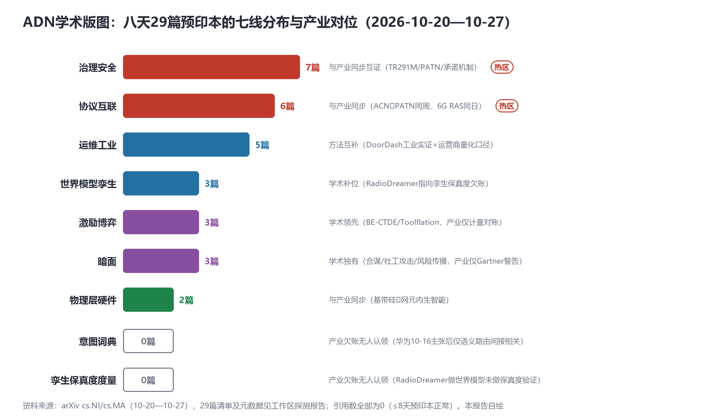

# 学术界正在抢答"智能体如何可信地互联"：ADN学术版图首期（八天29篇预印本）

> **分析对象**：2026年10月20日—10月27日，arXiv cs.NI/cs.MA两个分类下与ADN直接相关的**29篇预印本**（清单与元数据见工作区探测报告adn_academic_probe_20261027.md），以及学术通道四项实测结论（Semantic Scholar API/arXiv abs页/IEEE Xplore/DBLP）。
> **系列定位**：智能体技术洞察系列·ADN专题的**专题篇（学术版图第1期）**——与主系列（已有6篇完整报告）互补：主系列回答"产业在做什么"，本篇回答"学术界在做什么、领先还是滞后"。
> **口径约定**：29篇均为≤8天预印本，未经同行评审；citationCount实测全部为0（发布时间太短，属正常）——**本版图的价值在方向分布与产业对位，不在引用量**；期刊/会议去向预计11月下旬起可经Semantic Scholar/IEEE通道追踪。
> **通道方法**：每日=arXiv list/abs页直抓（A级，8天稳定验证，journal_ref/DOI字段可解析）；每周=Semantic Scholar API（B级，无key限流严重，建议申请免费key）+IEEE Xplore人工检索（B级）；弃用=arXiv export API（本环境网络不可达）与DBLP（Anubis反爬）。
> **立场**：设备商（ADN解决方案提供方）视角。

## 一、版图总览

### 1.1 七线分布：治理安全+协议互联=13/29，"可信互联"是学术第一题

29篇论文按主题线分为七线：**治理安全7篇、协议互联6篇**（合计13/29，45%）、运维工业5篇、世界模型孪生3篇、激励博弈3篇、暗面3篇、物理层硬件2篇。**热度集中点异常清晰：学术界当前最关心的不是"智能体多聪明"，而是"智能体如何可信地互联"**——身份、承诺、溯源、可审计、防合谋、防社工攻击，全部围绕这一命题展开。这与产业侧的进程精确互证：PATN（10-16首发互通）、A2A-T开源（14仓）、TR291M意图可解释性——产业在建互联的三层栈，学术在建三层栈的**信任地基**。

*图1：七线分布与产业对位——含两个"0篇空白区"（意图词典、孪生保真度度量）（本报告自绘）*

### 1.2 两个"0篇空白区"：产业欠账在学术侧同样无人认领

图1下方两行是本版图最有行动价值的发现：**意图词典**（华为10-16提出意图接口主张后，学术侧仅2610.24487语义路由间接相关，公共字典/验收口径无人立项）与**孪生保真度度量**（产业10-23明确欠账，学术侧RadioDreamer做世界模型但未做保真度验证）——**这两个方向是"无人认领的首发权"**，学术与产业同时缺位。对设备商研究部门：这是两篇高被引潜力论文的选题，也是两个标准提案的选题。

### 1.3 引用向量与期刊去向：版图的动态追踪机制

29篇全部为预印本、引用为0、无journal_ref（DOI均为arXiv自分配）——符合新论文规律。**动态追踪机制已建立**：每周经Semantic Scholar+IEEE人工复查期刊去向与引用增量（预计11月下旬起出现第一批正式发表记录，GLOBECOM/ICC/6G Workshop是大概率去向）；每月1日产出学术月报（首期2026-11-01）。

## 二、七线详解与产业对位

### 2.1 协议互联线（6篇）——与产业同步

2610.28244（ACN：智能体成为网络实体——与华为ACN/联通PATN同周）、2610.34357（6G Reasoning Agent Societies：一致性-时间定律）、2610.30221（AAM/5C分布式自治参考模型）、2610.24487（多域意图网络语义路由）、2610.25851（角色感知的LLM多智能体通信拓扑调度）、2610.31029（AERIAL：飞行网络LLM选择）。**对位**：学术与产业同周共振（10-21 ACN↔PATN、10-27论文↔移动6G赛道）——**术语定义权正处于产业与学术的共同窗口期**。

### 2.2 治理安全线（7篇）——与产业同步互证

2610.23078（密码学安全A2A通信）、2610.28484（Proof-Carrying Contracts：智能体无法违背的承诺）、2610.29669（可审计智能体合约）、2610.30557（不变核心约束下的受治理自进化）、2610.31974（MCP解码时溯源绑定）、2610.31985（有益智能体问题：涌现合作绕过工作流）、2610.29155（5uGUE：5G设备Agentic模糊测试）。**对位**：与TR291M（意图可解释）、知识平面（可信度/溯源）、Gartner治理警告精确互证；5uGUE把"模糊测试"引入智能体设备——**集采安全测试工具化的学术先行**。

### 2.3 暗面线（3篇）——学术独有

2610.33011（智能体合谋与策略性欺骗的弱到强蒸馏缓解）、2610.33411（A2A合成社工攻击）、2610.33282（LLM多智能体风险传播估计）。**对位**：产业侧仅有Gartner定性警告，无攻击模型——**学术在给产业做免费红队**；叠加10-21的2610.28454（卖家智能体扭曲工具市场），攻击面覆盖博弈/信任/级联/市场四类。启示：把四类攻击模型转成A2A-T/PATN的集采测试用例（10-27报告3.3建议的落地清单）。

### 2.4 运维工业线（5篇）——方法互补

2610.31351（DoorDash生产环境多智能体特征标志清理）、2610.23252（光网运维Agentic AI幻觉防护）、2610.29337（边缘AI智能体工作流调度）、2610.28860（Open RAN用户导向管理智能体）、2610.31743（异构MAS的提示-模型联合优化——"不是每个智能体都需要最强模型"）。**对位**：产业有量化口径（MTTR-21%等），学术有方法与反幻觉设计——**"幻觉防护"（2610.23252）值得单列跟踪：它是L4放行的可信度前提**。

### 2.5 世界模型孪生线（3篇）——学术补位

2610.29382（RadioDreamer：无线电地图世界模型）、2610.32827（NTN-TN共存的数字孪生×Open RAN多时间尺度优化）、2610.30108（多模态具身智能体）。**对位**：Gartner趋势（10-21）→产业叙事（中兴10-27大会）→学术模型（10-22）三线齐动；但**保真度验证缺位**（1.2空白区）。

### 2.6 激励博弈线（3篇）——学术领先

2610.34121（BE-CTDE：区块链MARL+异常检测+Token经济学）、2610.28454（Toolflation：卖家智能体自发GEO扭曲工具市场）、2610.27746（S²-MAS：5亿家庭人格智能体社会仿真）。**对位**：产业停在词元计量对账，学术已到激励机制的博弈鲁棒性——**词元网关规格书应新增"激励异常检测"模块**。

### 2.7 物理层硬件线（2篇）——与产业同步

2610.27797（6G物理层Agentic AI：从算法发现到**已验证基带硅**）、2610.28404（ORCA：LEO卫星在轨协作智能体）。**对位**：与网元内生智能硬件叙事（追焦天线/gSDU/智算板[p21-24]）同向——"算法→硅"闭环是内生智能从卖点变实证的分水岭。

## 三、产业四问的学术应答（对照系列悬而未决问题）

| 产业悬置问题（出处） | 学术应答 | 状态 |
|---|---|---|
| 意图词典缺位（10-20 v2.1诉求1） | 仅2610.24487语义路由间接相关 | **双向缺位，无人认领** |
| 孪生保真度度量（10-23欠账） | RadioDreamer方向正确但未做验证度量 | **双向缺位，无人认领** |
| 智能体身份与治理（10-21诉求2） | 承诺机制+溯源绑定+可审计合约+暗面攻击模型——四件套齐备 | **学术最活跃线** |
| 路由层标准化（10-26 RFC） | 6G RAS一致性-时间定律+语义路由 | 理论跟进中 |
| 激励反操纵（10-23诉求7） | BE-CTDE+Toolflation | **学术领先** |

## 四、机制与展望

1. **月报机制已注册**（每月1日18:00，首期2026-11-01）：汇总当月论文的期刊去向、引用增量、五线趋势——预印本→正式发表的"升格追踪"是核心增量。
2. **Semantic Scholar免费API key建议申请**（注册即得）——申请后S2通道从B升A，29篇→全量arXiv新增的引用/期刊追踪自动化；此动作需一次人工注册，建议由您或同事完成（[semanticscholar.org/product/api](https://www.semanticscholar.org/product/api)）。
3. **IEEE Xplore人工通道**：每月核对一次"哪些预印本进了IEEE会议/期刊"（大概率GLOBECOM/ICC/6G Workshop）；贵司若有Xplore订阅，导出目录页放入洞察资源池即可自动化。
4. **中文期刊层仍未打通**：IISCI工信期刊集群（《中国通信》等）为SPA需人工按刊检索，《电信科学》《移动通信》待CNKI通道——**学术版图当前只覆盖英文预印本，中文期刊层期待您的资源接入**。
5. **选题建议（研究部门）**：意图词典（×TF知识平面联动）与孪生保真度度量（×ANLAV联动）是两个"学术+产业双缺位"的高被引选题。

## 五、总结

八天、29篇、七线、45%集中在"可信互联"——**学术界与产业界正在合写同一章，且学术在三个方向领先（暗面攻击、激励博弈、6G智能体社会理论）、在两个产业欠账上同样沉默（意图词典、孪生保真度）**。版图的价值不在引用数（现在都是0），而在方向分布：它告诉设备商研究部门该投哪里（双缺位=首发权）、防哪里（暗面=测试用例）、跟哪里（三条领先线=录用与引用的先发窗口）。首期版图就此立此存照，11-01学术月报开始按月滚动。
