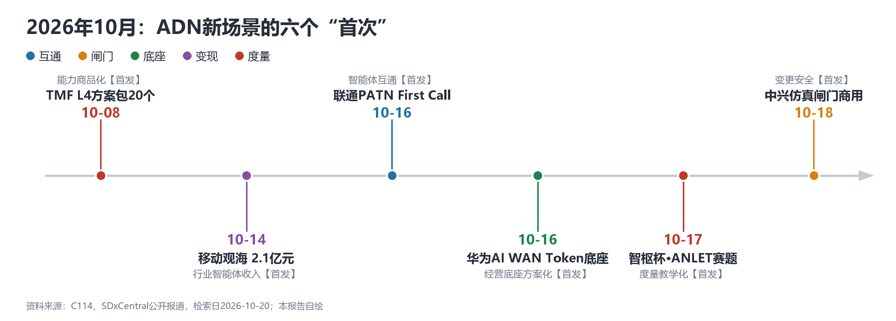
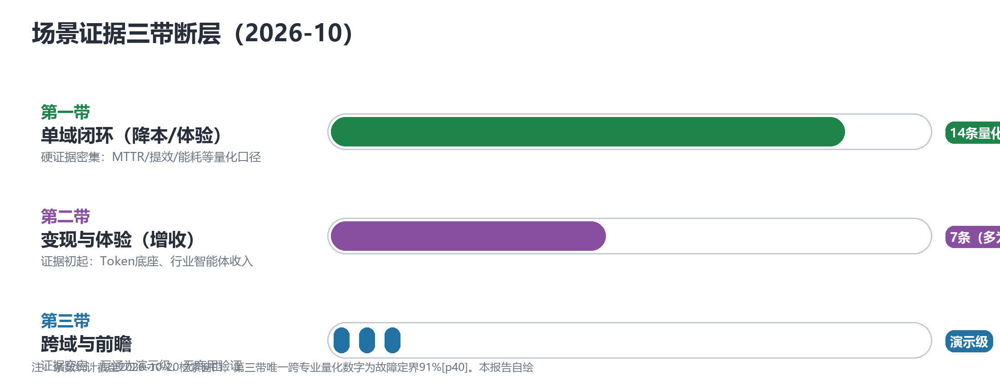
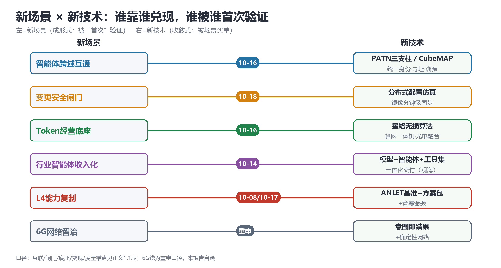

# 新场景靠"首次"成形，新技术靠"验证"收敛：ADN目标态的场景×技术版图

> **分析对象**：①工作区ADN源材料全集——中兴通讯《自智网络白皮书2026——L4高阶自智网络的思考与实践》（50页全文，锚点[pN]为PDF物理页码）、《中国联通自智网络白皮书2026》（第七版，2026/9/10发布；原文未公开，数据出自官方解读转述口径）、工作区基线《ADN自动驾驶网络动态简报（2026-10-15）》；②2026年10月15日以来的公开增量动态（检索日2026-10-20，含当日14:00–18:00窗口，来源以正文链接标注）。
> **版本说明**：本篇为"新场景·新技术"视角重构版（v2.1，2026-10-20晚）——以新场景成形式与新技术收敛线重组全文，并增配插图（3张自绘示意图+4张中兴白皮书原图）；首版（全景综合篇，2026-10-20 14:40发布）见commit 19f606b，视角重构版见commit a67e106。
> **口径约定**：数字可信级三级——【自报】厂商白皮书/新闻稿口径，无独立审计；【转述】媒体或官方解读转写；【推演】研究推演值。新信号分级三级——【首发】首次商用/首次量化/首次互通/首次标准化，附时间锚点；【重申】既有口径的再次表述；【待核实】单一来源未经交叉验证。厂商案例数字横向不可比。插图分两类：自绘示意图为本报告原创；白皮书原图提取自中兴通讯《自智网络白皮书2026》，版权归原刊所有，仅用于研究分析。
> **系列定位**：智能体技术洞察系列·ADN专题的**全景综合篇（新场景×新技术视角）**。此前各篇为单文本深读（《记分牌、沙盘与协议栈：L4高阶自智网络的目标态定义权与证据温差》，中兴样本）、两两对比（《精读：联通自智白皮书2026 vs ZTE自智白皮书2026》）或专题拆解（《Token经济对ADN的诉求与影响》《技能成为网络的第四类资产：电信ADN Skill Hub的目标架构与建设次序》《业界主流智能体注册中心功能分析》）；本篇以"哪些场景首次成形、哪些技术首次收敛"为主线拼接全景。
> **术语消歧**：本报告ADN除6G专节外均指Autonomous Driving Network/自动驾驶网络（中文"自智网络"，TM Forum AN L0–L5分级）；中国电信6G语境另有同名"AI定义网络（ADN）"，两条脉络将在6G标准窗口合流，见3.7与4.2。
> **立场**：设备商（ADN解决方案提供方）视角。

## 一、趋势判断

### 1.1 新场景沿"互通—闸门—底座—变现"成形，2026年10月出现六个"首次"

新场景的成形式不是发布更多白皮书，而是**一项新技术被一个"首次"验证**。2026年10月上中旬，ADN场景前沿密集出现六个首次：

| 新场景 | "首次"锚点 | 首发性质 | 证据强度 |
|---|---|---|---|
| 智能体跨域互通 | 2026-10-16：联通PATN全球首例端到端智能体互通（First Call），注册发现→发起连接→审批→语义交互→数据通道全流程（[C114](https://www.c114.com.cn/news/119/a1319320.html)） | 首次互通 | 演示级【转述】，自评"原型验证阶段" |
| 变更安全闸门 | 2026-10-18：中兴跨厂家分布式配置仿真平台，全球首个分布式配置仿真商用落地，"变更提交—仿真验证—变更授权"（[C114](https://www.c114.com.cn/news/127/a1319321.html)） | 首次商用 | 商用落地+量化【自报】 |
| Token经营网络底座 | 2026-10-16：华为AI WAN给出最完整量化口径并向运营商输出"专网差异化/存算分离训练/Token工厂"三大服务（[C114](https://www.c114.com.cn/news/126/a1319256.html)） | 首次完整方案化 | 厂商口径、案例未具名【自报】 |
| 行业智能体收入化 | 2026-10-14：中移九天观海大模型体系，"模型+智能体+专业工具集"一体化交付20余家客户、经济效益2.1亿元（[C114](https://www.c114.com.cn/news/100/a1319264.html)） | 首批可审计收入样本 | 运营商口径【转述】 |
| L4能力商品化 | 2026-10-08：TM Forum发布业界首个L4可复用蓝图组合，约20个技术方案包，2027夏扩至40个（[SDxCentral](https://www.sdxcentral.com/news/tm-forum-targets-network-autonomy-rollout-with-reusable-l4-blueprints/)） | 首次方案包化 | 标准组织交付物【转述】 |
| 度量衡教学化 | 2026-10-17：第二届"智枢杯"自智网络高校AI挑战赛决赛（南京大学），赛题=无线故障根因定位、时空因果推断，均对应ANLET基准场景；移动+TMF+中兴联合主办（[C114](https://www.c114.com.cn/news/127/a1319450.html)） | 首次竞赛化 | 产学研事件【转述】 |

*图1：2026年10月ADN新场景的六个"首次"——按互通/闸门/底座/变现/度量五线着色（本报告自绘）*

一个月内六个首次、覆盖四条不同场景线——**场景前沿已从"主张期"进入"验证期"**：竞争的度量单位不再是"有没有场景清单"，而是"谁的场景先拿到首次验证"。

### 1.2 收敛线一·意图接口：网络对象从"Token传输"改写为"任务交付"

华为在核心网域给出意图驱动的架构化落点：意图接口（Intent Interface）+新增Data & AI平面（DAP，承载智能/算力/数据三类新网元）+网络流程AI原生（ANF），提出2030年人均约10个智能体、网络从"Token传输"转向"任务交付"（[C114，2026-10-16](https://www.c114.com.cn/news/126/a1319287.html)，【首发·架构主张】）；中信科Auto-RAN的"意图即结果"范式与三级智能体系延续同一方向（[C114，2026-09-22](https://www.c114.com.cn/news/654/a1318203.html)，【重申】）。

*图2：四层全栈Agentic架构——意图驱动闭环的形态底座，网元层Agentic化到商业层价值经营（提取自中兴通讯自智网络白皮书2026，版权归属原刊）*

意图语言至今没有行业标准、意图级KCI缺位——**接口有了，词典没有**，这是意图线的下一个必争点。

### 1.3 收敛线二·孪生闸门："先仿真、后变更"完成首次商用

中兴跨厂家分布式仿真平台把数字孪生推过临界点：网络镜像分钟级实时同步、仿真精度超95%、仿真效率+80%、重大变更事故率-90%【自报】（[C114，2026-10-18](https://www.c114.com.cn/news/127/a1319321.html)，【首发·商用】）；华为变更智能体"1:1在线仿真、错误不入网"（【重申】）；中兴核心网倒换孪生仿真将评估从4小时压至18分钟[p45]（【重申】）；TMF首批方案包将IP变更管理列入（【重申】）。**孪生的买点从可视化大屏变成变更授权的前置证据**；欠账是保真度至今没有公开度量（"1:1还原"[p43]与"边缘域高度简化"[p7]并存）——保真度标准是下一个首发机会。

### 1.4 收敛线三·智能体互联：PATN把"公共基础设施"摆上台面，转换层接近终局形态

电信级智能体互联同时存在三条技术路线：华为A2A-T（GSMA"自智网络智能体开放生态项目"9月23日启动，三大运营商、信通院、CCSA、华为、中兴、亚信、浪潮共同参与，OpenAN开源承载，[C114，2026-09-23](https://www.c114.com.cn/news/126/a1318554.html)，【首发·组织】）；联通PATN（统一身份标识、基于身份的路由寻址、第三方监管溯源三支柱，直指平台私有通道"身份平台化、治理真空、跨域不可达"，[C114，2026-10-16](https://www.c114.com.cn/news/119/a1319320.html)，【首发·互通】）；通用A2A/MCP（平台侧，【重申】）。紫金山AXP以"异构智能体协议统一转换、百万级注册"切入（[C114，2026-10-16](https://www.c114.com.cn/news/16/a1319290.html)，【首发·平台】），本身就是对协议碎片化的对冲。

*图3：UAP统一代理协议——"多协议注册中心+网关"的转换层形态，兼容A2A/A2A-T/ACP/MCP（提取自中兴通讯自智网络白皮书2026，版权归属原刊）*

PATN白皮书罕见克制地自评"尚处于架构设想和原型验证阶段、基础标准有待收敛、商业模式缺乏验证"（【转述】）——三线的分歧是控制权（设备商协议/运营商基础设施/互联网平台），收敛路径大概率是"一个身份与注册标准+若干协议适配器"，收口窗口2027年前。

### 1.5 收敛线四·度量衡商品化：方案包、认证、竞赛三件套齐动

度量衡在10月出现三条商品化路径：TMF把场景包成方案包（10-08，【首发】）；ANLAV评估验证自2025年6月GA以来，公开可查的正式L4验证仅TDC NET与爱立信（RAN能效，全球首例）、NBN Co（澳洲首例，【待核实】）等个位数（[The Fast Mode](https://www.thefastmode.com/technology-solutions/42669-tm-forum-validates-autonomous-network-levels-to-accelerate-ai-driven-telecom-innovation)，【重申】）；GSMA生态项目新提AI-MOS体验评估标准（9-23，【首发·标准提案】）；"智枢杯"把ANLET基准变成66支高校队伍的竞赛赛题（10-17，【首发·教学化】）。对照之下，中兴KBI-KEI-KCI三层+10项公式[p20]仍属厂商自报、无第三方审计。**"谁定义记分牌，谁就定义了什么叫L4成功"——记分牌的争夺已经从白皮书扩散到认证与课堂。**

### 1.6 新场景的证据版图：三带断层没有消失，只是被"首次"重新划界

把五家厂商与三大运营商的场景主张按"域×价值类型×证据强度"拼接，三带结构依然成立：

**第一带·单域闭环（证据密集，降本/体验类）**

| 来源 | 场景 | 域 | 价值类型 | 量化成效（可信级） | 锚点 |
|---|---|---|---|---|---|
| 中兴 | 端到端故障监控智能体（图模型+A2A-T，10+局点） | 跨专业故障 | 降本 | GP：MTTR-12.5%/效率+70%；无线MTTR-21.34%；核心网MTTR-20%+；跨专业定界91%【自报】 | [p40] |
| 中兴 | SPN网络变更智能体 | 传输 | 降本 | 13.9h→3h内、效率+78%【自报】 | [p41] |
| 中兴 | 追焦天线远程RF优化 | 无线 | 降本+体验 | RF调优2h→10min内；卡顿率-10%+【自报】 | [p23] |
| 中兴 | gSDU负荷唤醒自动启停 | 无线/能源 | 降本 | 低峰"0载0耗"、分钟级唤醒【自报】 | [p23] |
| 中兴 | 数字孪生无线网优（福建移动800小区） | 无线 | 降本 | 方案生成3.81h→0.5h；二次优化工单31.45%→12.9%【自报】 | [p44] |
| 中兴 | 核心网资源池倒换孪生仿真 | 核心网容灾 | 降本（风险） | 评估4h→18min内；信令冲击预测92%【自报】 | [p45] |
| 中兴 | 家宽投诉智能体（五段定界） | 家宽 | 体验+降本 | 定界90%+、现场修复历时-20%【自报】 | [p43] |
| 联通 | 宽带投诉AI全链路处置 | 家宽 | 体验+降本 | 工单时长-20%+、重复投诉率-15%【转述】 | 官方解读 |
| 联通 | 集约化运营（96亿条资源集约库） | 集团 | 降本 | 年节电10亿度；投诉前置拦截率超93%【转述】 | 官方解读 |
| 移动(浙江) | 投诉/告警处置智能体 | 投诉/故障 | 降本 | 提效64%/87%【转述】 | 《ADN SkillHub》篇 |
| 华为 | AI WAN四场景L4自治 | IP承载 | 降本 | 南非M运营商"全球首个L4级自治网络"；威胁闭环30分钟内【转述】 | UBBA 2026口径 |
| 华为×AIS | 投诉自动诊断/工单自动创建/RANSpirit | 多域 | 降本+体验 | 投诉自动诊断率70%；工单自动创建率>90%；能耗-3%【转述】 | [C114，2026-10-19](https://www.c114.com.cn/news/126/a1319367.html) |

**第二带·变现与体验（证据初起，价值新前沿）**

| 来源 | 场景 | 域 | 价值类型 | 量化成效（可信级） | 锚点 |
|---|---|---|---|---|---|
| 中兴 | NWDAF分层分级体验保障（广东移动） | 商业层 | 增收+体验 | 几千万VIP开通；抖音速率+35.6%【自报】 | [p46] |
| 中兴 | 差异化体验变现（加速包/上行保障卡） | 体验经营 | 增收 | 普通流量→高ARPU服务【自报】 | [p11-12] |
| 中兴 | 低空经济一体化保障 | 垂直行业 | 增收 | "按航线/架次收费"模式【自报】 | [p12][p36] |
| 电信 | 用户/业务/场景包全时全域保障 | 体验经营 | 增收 | 苏超/大运会场景包套餐已发布【转述】 | 基线简报 |
| 电信 | 智能显标 | 体验经营 | 增收+体验 | 多省试点【转述】 | 基线简报 |
| 移动 | 观海大模型（海洋行业智能体） | 行业智能体 | 增收 | 56项能力、20余家客户、2.1亿元【转述】 | [C114，2026-10-16](https://www.c114.com.cn/news/100/a1319264.html) |
| 华为 | AI WAN Token经营底座 | 算网 | 增收 | 用算成本降4倍、利用率+3倍；医院案例ARPU×5【自报】 | [C114，2026-10-16](https://www.c114.com.cn/news/126/a1319256.html) |

*图4：自智网络经营增收路径——差异化体验变现/垂直行业深耕/数据价值与生态重构，第二带场景的厂商路线图（提取自中兴通讯自智网络白皮书2026，版权归属原刊）*

**第三带·跨域与前瞻（叙事最强、证据最薄）**

| 来源 | 场景 | 域 | 价值类型 | 量化成效（可信级） | 锚点 |
|---|---|---|---|---|---|
| TM Forum | L4方案包20个（→40个） | 跨域 | — | 首批5类场景包化【转述】 | [SDxCentral，2026-10-08](https://www.sdxcentral.com/news/tm-forum-targets-network-autonomy-rollout-with-reusable-l4-blueprints/) |
| 联通 | 30个L4场景+300余项L4细分流程+28类数字员工 | 组织流程 | 降本 | 2026年完成【转述】 | 官方解读 |
| 联通 | PATN+First Call | 智能体互联 | — | 跨网络域互通全流程验证；自评"原型验证阶段"【转述】 | [C114，2026-10-16](https://www.c114.com.cn/news/119/a1319320.html) |
| 紫金山×移动 | AXP智能体互联平台 | 智能体互联 | — | 百万级注册；任务执行耗时-20%【转述】 | [C114，2026-10-16](https://www.c114.com.cn/news/16/a1319290.html) |
| 电信 | 6G ADN原型+AIN通智一体 | 6G前瞻 | — | 原型系统+国际标准推进【转述】 | 基线简报 |
| 中信科 | Auto-RAN意图驱动6G无线自智 | 6G前瞻 | — | 三阶段路线到6G规模商用【转述】 | [C114，2026-09-22](https://www.c114.com.cn/news/654/a1318203.html) |

三带读法在"首次"视角下更新为：**第一带的首次已经用完**（单域降本场景的量化竞赛进入存量比拼）；第二带的首次刚刚出现（Token底座、行业智能体收入），下一步是案例具名化与归因定义；第三带的首次只有"互通演示"级别——**跨域商用验证是唯一还没人拿走的"大首次"**，它与三季报L4量化（三大运营商截至10-20均未披露）构成最近的两个候选首发。宏观侧，国新办发布会披露智能算力2592EFLOPS、同比+146%，5G基站525.4万座（[C114，2026-10-20](https://www.c114.com.cn/news/16/a1319458.html)，【转述】）——第二带场景的需求侧注脚。

*图5：场景证据三带断层——第一带证据密集、第二带初起、第三带空白（本报告自绘）*

*图6：中兴通讯自智网络演进路标——单域场景的存量比拼基线（提取自中兴通讯自智网络白皮书2026，版权归属原刊）*

### 1.7 趋势的汇聚点：新场景×新技术映射表

六条趋势汇聚成一张双向映射——**新场景靠什么技术兑现，新技术被哪个场景首次验证**：

| 新场景 | 靠什么新技术兑现 | 关键新技术 | 被哪个新场景首次验证 |
|---|---|---|---|
| 智能体跨域互通 | 统一身份+身份路由寻址+监管溯源 | PATN三支柱/CubeMAP | 联通First Call（10-16） |
| 变更安全闸门 | 分布式配置仿真、镜像分钟级同步 | 孪生仿真平台 | 中兴商用落地（10-18） |
| Token经营 | 无损运载+算网一体机+路由智能化 | 星络无损算法/光电融合（路线） | 华为AI WAN方案化（10-16） |
| 行业智能体收入化 | "模型+智能体+工具集"一体化交付 | 观海体系 | 移动海洋行业（10-14） |
| L4能力复制 | ANLET基准+方案包模板+竞赛命题 | 度量衡商品化 | TMF方案包（10-08）/智枢杯（10-17） |
| 6G网络智治 | "意图即结果"+确定性列为核心标准 | Auto-RAN三级体系/确定性网络 | 6G试验窗（【重申】，IETF已接纳中国方案） |

*图7：新场景×新技术双向映射——左侧场景靠右侧技术兑现，右侧技术被左侧场景首次验证，连线徽标为首发/口径日期（本报告自绘）*

汇聚结论：ADN目标态=**四层Agentic架构（形态）×意图接口（输入）×孪生闸门（安全）×智能体协议栈（互联）×三层记分牌（度量）**五件套；2026年10月是五件套的"首次密集期"——互通有了首次、闸门有了首次商用、度量有了首次商品化与竞赛化。设备商的位置随之清晰：**把自己的技术装进别人的"首次"，或者定义下一个"首次"的验收口径。**

## 二、技术诉求分析

### 2.1 七项核心诉求（每项标注首次触发锚点）

1. **意图可编译**（首次触发：华为意图接口主张，10-16）。意图从"开通专线"升级为"某类Token服务TTFT<200ms、单Token成本<X、能耗预算Y"；意图语言无行业标准、意图级KCI缺位——接口已立、词典未立。
2. **数据面换代**（首次触发：DAP第三平面主张，10-16）。Token级遥测、账务级计量、智能体流量画像、电价/绿电信号入湖；控制面/用户面之外新增第三平面的主张一旦成立，数据底座主导权即寻优主导权。
3. **闭环可验证**（首次触发：仿真闸门商用，10-18）。先仿真后授权、决策可审计、故障可复盘——验证能力从测试工具升格为闭环组成部分。
4. **智能体可互联**（首次触发：PATN First Call，10-16）。统一身份、注册发现、跨域互通、监管溯源；跨域集成周期月级→天级【自报】。
5. **能力可复制**（首次触发：TMF方案包化，10-08）。场景方法论沉淀为技能资产：中兴智能体工厂四车间[p30]、联通工厂+CubeMAP、TMF方案包——工厂解决"如何造"，方案包与Skill Hub解决"如何不再重复造"。
6. **价值可记账**（首次触发：AI-MOS标准提案+ANLET竞赛化，9-23/10-17）。L4需要能进财报、能过审计的度量衡；KBI-KEI-KCI 10项公式[p20]仍缺第三方审计。
7. **监督可执行**（首次触发：欧盟AI法案2026大限写入路线图[p12]，【重申】）。人工节点（二级复核[p33]、双重监管人）、电子围栏[p29]、合规时限必须成为架构第一类对象。

### 2.2 诉求矩阵总表

| # | 技术诉求 | 内涵 | 落点架构层 | 首次触发锚点 | 证据状态 |
|---|---|---|---|---|---|
| 1 | 意图可编译 | 意图→跨域策略自动翻译 | 意图层（Intent Interface/ANF） | 10-16架构主张【首发】 | 接口已立，词典空白 |
| 2 | 数据面换代 | Token遥测/账务计量/智能体画像/能源信号 | 数据层（DAP第三平面） | 10-16架构主张【首发】 | 主张阶段，未商用 |
| 3 | 闭环可验证 | 先仿真后变更、决策可审计 | 孪生/安全层 | 10-18商用【首发】 | 精度>95%【自报】，保真度无度量 |
| 4 | 智能体可互联 | 统一身份/注册发现/跨域互通/溯源 | 协议与注册层 | 10-16互通【首发】 | 三线竞合，标准未收敛 |
| 5 | 能力可复制 | 场景方法论→技能资产→批量装配 | 智能体工厂/Skill Hub | 10-08方案包【首发】 | 工厂量产，复制设施缺位 |
| 6 | 价值可记账 | 三层指标+第三方认证 | 度量层 | 9-23 AI-MOS/10-17竞赛化【首发】 | 四套口径并存无互认 |
| 7 | 监督可执行 | 人工节点/围栏/复核/合规时限 | 治理层 | 欧盟2026大限[p12]【重申】 | 工程实践成熟、口径未统一 |

### 2.3 内在张力表

| 张力 | 表现 | 对设备商的后果 |
|---|---|---|
| 首次叙事 vs 规模证据 | 六个首次全是单点（一个互通、一个商用、一批方案包），三季报L4量化截至10-20未披露 | 首次之后没有第二例，"首次"就只是新闻；复用证据是下一个战场 |
| 跨域叙事 vs 单域证据 | 架构主打跨域协同，量化证据停在单域，唯一跨专业数字91%[p40] | 跨域承诺无验收基线，集采风险敞口 |
| 开放生态 vs 协议私有 | "打破厂商壁垒"[p7] vs A2A-T/PATN/UAP三线并行 | 标准收口前每版私有扩展都是未来拆解成本 |
| 商用元年 vs 试点攻关 | "2025年成为AN L4商用元年"[p48] vs 路标自书"试点攻关"[p16]；IBM口径仅6% CSP自称L4 | 认证渗透率个位数暴露温差，预期管理失衡 |
| 自报口径 vs 第三方认证 | 案例未审计、KBI公式选择权在实施方[p20]、"新增数智人"计入KBI[p19] | 数字横向不可比；运动员兼计分员透支信任 |
| 增收叙事 vs 归因缺位 | KBI"业务收入提升额"=三项成本之和[p20]；ARPU×5案例未具名【自报】 | 变现故事进不了财报口径，价值证明停在技术层 |
| 内生智能硬件 vs 跨厂商互通 | 智算板/追焦天线/gSDU等新硬件[p21-24] vs 跨厂商互通列"后续"[p21] | L4挂钩网元投资周期；仿真闸门（10-18）恰是跨厂商欠账的对冲产品 |

## 三、关键技术分析（当期有实质增量者优先）

### 3.1 意图接口与DAP第三平面（10-16首发主张）

华为把意图接口、DAP、ANF并列为核心网三大架构动作，QoAIS（AI服务质量）承接算力调度（[C114，2026-10-16](https://www.c114.com.cn/news/126/a1319287.html)）；DAP是继控制面/用户面之后的第三平面主张，智能/算力/数据三类新网元的提法直接指向6G架构卡位。**点评**：DAP的价值不在"多一个平面"而在"数据主权重新划界"——Token遥测、智能体画像、算力状态归谁供给、按什么口径审计，决定意图编译的上限；设备商应在DAP的数据接口标准上抢"词典定义权"（意图词汇表+任务链标识），这比抢翻译引擎更早决定胜负。

### 3.2 智能体互联协议栈：PATN改写竞合格局（10-16首发互通）

First Call的意义不在Demo本身，而在**运营商把智能体互联定义为自己的公共连接基础设施**——统一身份、信令建连、应答主权、互联互通（[C114，2026-10-16](https://www.c114.com.cn/news/119/a1319320.html)）；AXP主打异构协议统一转换（百万级注册，[C114](https://www.c114.com.cn/news/16/a1319290.html)）；GSMA生态项目给A2A-T装上组织载体（9-23）。**点评**：三线竞合的收敛物大概率是"一个身份与注册标准+若干协议适配器"——UAP与AXP的转换层定位反而接近终局。设备商的稳妥姿势：协议双轨下注（A2A-T+MCP）、注册中心开源、把转换层做成产品；PATN的克制自评（"商业模式缺乏验证"）提示这一窗口比宣传口径更长，不必恐慌性站队。

### 3.3 分布式配置仿真闸门（10-18首发商用）

*图8：数字孪生网络——从决策沙盘到变更授权证据链（提取自中兴通讯自智网络白皮书2026，版权归属原刊）*

跨厂家分布式仿真的三个量化口径——镜像分钟级同步、精度>95%、重大变更事故率-90%【自报】——把孪生从"沙盘"（中兴三引擎：仿真SLM+GNN/决策帕累托/可视化[p31-32]，多目标寻优效率2.5倍【自报】）推进到"授权证据链"（[C114，2026-10-18](https://www.c114.com.cn/news/127/a1319321.html)）。**点评**：这是当期唯一"新技术被真实商用验证"的闭环，也是对"跨厂商互通列后续"[p21]欠账的产品化对冲——仿真闸门本质上先在数字空间解决多厂商纳管。下一步竞争点：保真度可测化（镜像时延、配置覆盖率、预测误差上界）与"先仿真后变更"进入集采条款。

### 3.4 Token运营网络底座与光电融合路线（10-16首发方案化）

华为AI WAN口径：Token业务十年十倍、0.1%丢包即致算力空转、星络无损算法Token零丢包（算效损失<5%）、算网一体机8卡→2卡（用算成本降4倍）、大象流识别99%（[C114，2026-10-16](https://www.c114.com.cn/news/126/a1319256.html)）；刘韵洁院士补充物理层路线：光电融合单物理网承载算力与智能体（丢包10⁻⁷、成本约传统六成、400G端口能耗330W→30W）、国家级算力并网标准已制订、IETF已接纳中国确定性方案（[C114，2026-10-20](https://www.c114.com.cn/news/16/a1319452.html)，【重申】）；ION-2030智能光网络推进组成立（10-20国新办口径，【首发·组织】）。**点评**：Token底座的稀缺证据不是性能参数而是**买单方**——"医院用算成本-30%、运营商ARPU×5"案例未具名【自报】；宏观注脚（智能算力+146%）证明需求存在，设备商的下一步是推动案例具名化与"优化结果分成"进合同模板。

### 3.5 度量衡商品化三件套：方案包、认证、竞赛（10-08/持续/10-17）

*图9：KBI-KEI-KCI三层指标体系——厂商记分牌的工程化样本（提取自中兴通讯自智网络白皮书2026，版权归属原刊）*

TMF方案包把"场景×架构×自动化手段"封装成可复用商品（20→40个）；ANLAV维持唯一第三方通道（正式验证个位数，渗透率是最大欠账）；"智枢杯"把ANLET基准变成教学命题（66支高校队）；AI-MOS把体验评估提上标准议程（9-23）。对照系：中兴KBI-KEI-KCI+10项公式[p20]工程化最深但仍属自报。**点评**：度量衡之争的主战场正在转移——从"谁的指标全"转向"谁的指标被复用"（进方案包模板、进认证基准、进竞赛赛题）。设备商最优解：把自家场景指标逐条对齐ANLET、以公式贡献者身份进入TMF，让记分牌在别人的考场里默认使用自己的量表。

### 3.6 网络大模型的交付形态：从"能问答"到"模型+智能体+工具集"

移动观海（56项能力、机理+AI推演、20余家客户、2.1亿元，10-14【首发·收入样本】）与联通元景"万研"科研平台（17家单位联合体，[C114，2026-10-19](https://www.c114.com.cn/other/241/a1319381.html)，【首发·平台】）共同确立行业智能体的交付形态——一体化交付专业工具集，而非裸模型。基线侧中兴星云1+N矩阵[p26]、联通元景网络侧应用延续（【重申】）。

*图10：星云通信大模型1+N矩阵与CO-DA/CO-Tuning工程底座（提取自中兴通讯自智网络白皮书2026，版权归属原刊）*

**点评**：交付形态的变化改写设备商报价单——从"模型授权"变成"行业工作流整包"；中兴Co-Sight工厂的四车间流水线[p30]正是这一形态的供给侧。风险项不变：1+N底座依赖（通义千问/DeepSeek/ChatGPT[p26]）把许可证/停服/后门风险传导进电信级SLA。

### 3.7 AI-RAN与6G确定性：全部为重申或试验口径（防误读）

诺基亚×软银为商用AI-RAN**外场试验**（[C114，2026-10-16](https://www.c114.com.cn/news/16/a1319309.html)）；爱立信×新加坡电信五年协议中AI-RAN吞吐+19%亦为试验口径（[C114，2026-10-20](https://www.c114.com.cn/news/137/a1319439.html)）；爱立信×Verizon完成全球首次室外6G外场通话（[C114，2026-10-16](https://www.c114.com.cn/news/137/a1319267.html)）；6G侧电信推进6G ADN原型（此处ADN=AI定义网络）、中信科Auto-RAN三阶段路线到6G规模商用。**点评**：本节所有条目均为【重申/试验】——防止把试验写成商用是引用纪律；但重申密度本身是信号：确定性网络在IETF与6G标准中的位次持续上升（【重申】叠加），"自动驾驶网络方法论写入6G架构原则"仍是标准卡位的最大单点。同期爱立信利润率承压（Q3调整后EBITA利润率17.0%）与组织收缩（[C114，2026-10-15](https://www.c114.com.cn/news/137/a1319248.html)）提示：自动化投入节奏受盈利周期约束，投入稳定性本身是竞争力。

## 四、总结思考

### 4.1 核心命题

新场景的成形式是**新技术被一个"首次"验证**，新技术的收敛式是**被新场景买单**。2026年10月的六个首次（互通、闸门商用、Token方案化、行业智能体收入、方案包、竞赛化）把目标态五件套从白皮书推进到商品门槛；但首单之后还没有第二单——跨域商用验证与三季报L4量化是最近的两块无人认领的"首发"。设备商的下一步不是再发白皮书，而是制造或定义下一个"首次"。

### 4.2 关键判断

1. **"首次"是新的稀缺资源**。六个首次集中在10月上中旬且分属不同主体——首次密度就是竞争烈度；对手的每一次首发都在收窄你的窗口，跟踪"首次"比跟踪"发布"重要。
2. **下一场"首次"争夺在跨域**。三季报L4量化（下旬可期）+跨运营商智能体互通打通+ANLAV扩容是三个候选首发点；设备商应把资源押在"首次跨域商用验证"，而非单域指标内卷。
3. **"先仿真、后变更"将在1-2个集采周期内成为变更场景门槛条款**。仿真精度、镜像同步时延、跨厂家纳管率是新的竞标硬指标；孪生保真度标准的首发权仍无人认领。
4. **度量衡的主战场转向"复用率"**。谁家的指标进方案包模板、进ANLAV基准、进竞赛赛题，谁就定义L4的人才与方法论——记分牌之争从白皮书扩散到认证与课堂。
5. **Token底座的买单证据决定第二带场景的成色**。智能算力+146%（10-20国新办）证明需求侧成立；下一步是案例具名化与增收归因进KBI公式层[p20]——否则"按结果计费"进不了合同模板。
6. **重申口径的密度也是信号**。确定性网络/IETF/6G口径反复出现=共识正在固化，6G标准窗口（R20）的卡位价值高于任何单点产品；术语陷阱（自动驾驶网络vs AI定义网络）需要在所有对外材料中主动消歧。

### 4.3 对不同主体的启示

**运营商**：用ANLAV认证替换自报口径，L4声明才有对外效力；三季报披露自智网络量化口径时同步给验收方法，避免"首次"沦为新闻；把"先仿真后变更"写进变更类集采条款；Token经营先定计量对账口径再谈商业模式。

**设备商**：把孪生闸门产品化（精度/同步时延/跨厂家纳管率三个硬指标）并申报保真度标准；场景指标逐条对齐ANLET、以公式贡献者身份进TMF；增收案例做成可审计闭环（含归因方法）；协议双轨下注、把转换层做成产品；管住"内生智能硬件"叙事——跨厂商互通承诺必须兑现[p21]。

**开发者**：电信技能供给侧空位仍在——技能名片（输入输出模式+工具依赖+可执行验收断言）是进入TMF方案包体系与运营商集采模板的最短路径；"智枢杯"式竞赛赛题是技能验收断言的现成题库。

**标准组织**：两个最大空白——意图词汇表（意图类型/任务链标识/验收口径公共字典）与孪生保真度度量；一个收敛工程——智能体互联"身份+注册"公共底座与协议适配器规范；ANLAV与厂商口径的互认机制优先立项，否则"六个首次"之后仍将是"30余家实践、个位数验证"的信任赤字。
