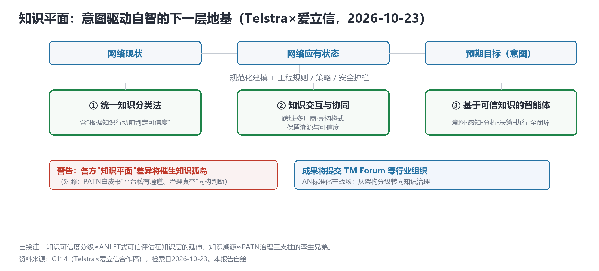
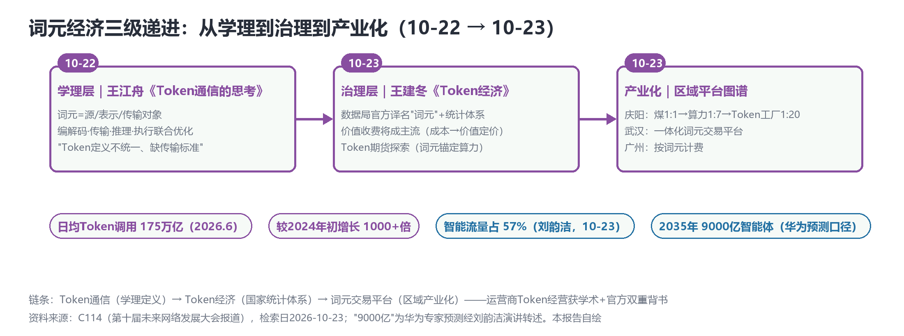

# AN主战场换位：从架构分级到知识治理——知识平面、词元经济学与9000亿智能体锚点

> **分析对象**：2026年10月22日18:00—10月23日18:00窗口的公开增量——C114（第十届未来网络发展大会·南京系列报道、Telstra×爱立信合作稿、PT Expo 2026获奖稿、GTC柏林AI-RAN稿、ABI Research研判稿）、arXiv cs.NI/cs.MA（10-22/10-23列表）、GitHub project-openan。三视角来源清单第三轮执行。
> **系列定位**：智能体技术洞察系列·ADN专题"新场景×新技术"系列的**完整报告第3篇**（第1篇=场景×技术版图v2.1、第2篇=叙事换挡日，均见GitHub main分支）。
> **判定依据**：重大增量——①**"知识平面"（Knowledge Plane）首次进入AN产业叙事并拟提交TM Forum**（新技术线首发）②国家数据局"词元"统计体系成型（Token经营获官方治理背书）③AgenticCore 14奖（AN L4核心网域首个获奖实证）④"2035年9000亿智能体"规模锚点首发。
> **口径约定**：【首发】【重申】【反向】【待核实】沿用系列口径；"9000亿智能体"为华为专家预测、经刘韵洁院士演讲转述【转述】；ABI Research数据为其博客估算【转述】；三季报数字以公告原文为准；arXiv为预印本。
> **术语消歧**：ADN指自动驾驶网络/自智网络（TM Forum AN L0–L5）；"词元"=Token的国家数据局官方译名；"知识平面"（Knowledge Plane）为Telstra×爱立信提出的自智网络新层。
> **立场**：设备商（ADN解决方案提供方）视角。

## 一、趋势判断

### 1.1 收敛线五·知识平面：意图驱动自智的下一层地基【首发·技术线】

Telstra×爱立信扩大自智网络合作（基于2025年10月合作基础）：提出自智网络依托**"知识平面"**——对网络现状、应有状态与预期目标（意图）的规范化建模，以工程规则、策略与安全护栏约束；组建联合工作组覆盖三大领域：①**统一知识分类法**（含"根据知识行动前判定可信度"）②**知识交互与协同**（跨网络域、多厂商、异构格式、时间维度，保留溯源与可信度）③**基于可信知识的智能体**（意图-感知-分析-决策-执行全闭环）；**成果将提交TM Forum等行业组织**；并警告各方"知识平面"差异将催生"知识孤岛"（[C114，2026-10-23](https://www.c114.com.cn/news/137/a1319649.html)，【首发·技术线】）。

*图1：知识平面——三态建模与联合工作组三领域（本报告自绘，依据C114合作稿）*

**点评**：这是系列六条收敛线之外的新线，且来势最猛——它把AN之争从"架构分级/记分牌"（L0-L5、ANLET/ANLAV）推进到**"知识治理"**层：知识从各厂商的私有资产变成需要互操作标准的公共对象。三个直接映射：知识可信度分级≈ANLET式可信评估在知识层的延伸；知识溯源≈PATN治理三支柱（统一身份/溯源）的孪生兄弟；"知识孤岛"警告与PATN"平台私有通道、治理真空"判断同构。**意图词典（系列2.1诉求1）的下一个名字，可能就是"知识分类法"。**

### 1.2 词元经济学：Token经营获官方统计背书【首发·治理】

国家信息中心王建冬在第十届未来网络发展大会发布《Token经济：人工智能时代的价值基石》：**国家数据局（刘烈宏）已给出Token官方译名"词元"，并初步形成词元调用量统计体系，相关政策正在成型**；我国日均Token调用量超**175万亿**（2026年6月，较2024年初增长1000多倍）；中美"非对称调用"（美国性能驱动/高附加值，中国产业化/基础场景）；三种模式——按量计费/包月/**价值收费（将成主流：成本定价→价值定价）**；Token期货已现探索（"词元锚定数据和算力"）；产业链=上游算力→中游Token工厂→**下游AI Agent**；区域图谱：庆阳"煤1:1→算力1:7→Token工厂1:20"、武汉筹建一体化词元交易平台、广州按词元计费（[C114，2026-10-23](https://www.c114.com.cn/news/16/a1319687.html)，【首发·治理】）。

*图2：词元经济三级递进——学理（王江舟）→治理（数据局）→产业化（区域平台）（本报告自绘）*

**点评**：与10-22王江舟《Token通信》构成**"学理→治理→产业化"三级递进**（昨日1.2/3.4两条线的合流）。对运营商"Token经营"（系列第二带场景）的影响是双重的：统计体系=计量对账口径有了国家级参照（系列4.3建议"先定计量对账口径再谈商业模式"被官方采纳的前奏）；价值定价成主流=华为"按结果计费"（10-16）从厂商主张升格为政策方向。**"下游AI Agent"被官方划为Token产业链的终端环节——智能体互联网络从技术叙事变成了产业链叙事。**

### 1.3 L4实证链补强：AgenticCore 14奖与核心网L4自闭环【首发·实证】

华为AgenticCore获"ICT中国(2026)"14项奖（PT Expo 2026）：一等奖含**"核心网故障L4级自闭环实践"**（故障自动感知、诊断与修复）、"业界首个网络原生AI降噪"（与沃达丰×爱立信10-21试验同型）、"CallingClaw"——**将OpenClaw智能体置于实时通话**（意图识别+任务全流程闭环）；华为云核心网刘智："核心网将成为连接人与人、**人与智能体、智能体与智能体**的智能底座"（[C114，2026-10-23](https://www.c114.com.cn/news/126/a1319661.html)，【首发·实证】）。**点评**：AgenticCore从MWC26概念（10-16）到获奖量产实践只用了5周——"意图接口+DAP"主张首次拿到可引用的第三方评奖实证；"智能体与智能体连接"进入核心网官方叙事，与PATN/ACN同频。 CallingClaw尤其值得拆解：它把"网络即AI平台"（沃达丰×爱立信）推进到"通话即智能体入口"——场景包变现又多一个网络级载体。

### 1.4 智能体规模锚点：智能流量57%、2035年9000亿【首发·锚点】

刘韵洁院士（同论坛）：**智能流量已占57%、超过人类流量**（"人类发展50年的互联网流量，短短三四年被智能体取代"）；**华为专家预测2035年将有9000亿智能体**；GW级算力中心互联从百G推向T级；同时警告一体化算力网"底层技术思想还不够统一，把握不好可能走弯路甚至造成损失"，算力利用率仅30%-40%与高端GPU一卡难求并存（[C114，2026-10-23](https://www.c114.com.cn/news/16/a1319685.html)，【首发·锚点】）。**点评**：华为10-16主张"2030年人均约10个智能体"，如今有了更激进的总量口径（9000亿≈届时人均50+）——智能体规模锚点首次见公开报道，PATN/AXP/A2A-T的"百万级注册"（紫金山）在9000亿面前只是0.01%。流量结构拐点（57%）则给"Token通信"（王江舟）与"智能体互联网络"提供了最底层的规模假设。

### 1.5 AI-RAN现网化的双面读法：近20家运营商 vs COTS削平护城河【首发·补充】

英伟达GTC柏林（10/21）补全10-22诺基亚Q3稿细节：**T-Mobile US在华盛顿州商用现网完成全球首次AI-RAN通话**（英伟达ARC服务器+诺基亚anyRAN+Massive MIMO+5G SA+在售智能手机）；**全球近20家运营商宣布采用ARC**；黄仁勋："电信网络原本为承载全世界的沟通对话而建，现在还要承载全世界的智能"——定位"电信网络→分布式智能平台"，基站站点重塑为通信+AI推理共享计算平台（[C114，2026-10-23](https://www.c114.com.cn/news/16/a1319636.html)，【首发·补充】）。**点评**：AI-RAN从"试验口径"（10-21）到"现网+20家规模"（10-23）只隔两天——昨日报告3.7的引用纪律按新事实更新完毕；但ABI（1.6）的同页警告必须并读。

### 1.6 产业格局反向信号：ABI"AI抽走电信投资"与3GPP参与度此消彼长【首发·反向】

ABI Research：AI正把资本/注意力/产品投入从核心电信市场抽走，多元化成生存必需但挤压利润率——四厂商对照：诺基亚Q2 AI/云订单28亿欧、中兴H1算力营收+55%（占35.1%，反而挤压毛利率）、爱立信企业业务亏损扩大至8亿SEK、华为H1营收+9.6%但净利-37%（研发+25.2%达1213.8亿，投向AI芯片/汽车/终端/算力）；**"厂商更长远的机会是帮助运营商成为主权AI与分布式推理的提供者（低时延、数据境内、受监管负载）"；中国厂商3GPP参与度下降、中国运营商参与度提高**；英伟达COTS AI-RAN削弱定制芯片差异化；6G 2030年后才放量且比5G更慢（[C114，2026-10-23](https://www.c114.com.cn/news/16/a1319704.html)，【首发·反向，原文口径待核实】）。**点评**：三条警示直接命中设备商ADN战略的财务前提——①多元化挤压利润（ADN投入的内部竞争者正是AI基础设施）②COTS化侵蚀RAN定制护城河（英伟达ARC+anyRAN组合正是样本）③3GPP参与度此消彼长意味着**标准话语权的供给侧在换人**。但ABI也给出了对冲答案："帮助运营商成为主权AI与分布式推理提供者"——这与DAP、AI-RAN、Token底座完全同向。

### 1.7 汇聚点：新场景×新技术映射与"主战场换位"结论

**三季报说明**：电信/联通三连日落空属**正常错峰**（A股法定截止10/31，两家历年多落10/22-10/28，无延期公告），预计10/24-10/28披露——"投入侧进财报是否成为行业惯例"的核对模板（移动基线：智能网络投资89亿+19.8%）已备好，连续跟踪。

| 新场景/信号 | 靠什么技术兑现 | 关键技术 | 验证状态 |
|---|---|---|---|
| 知识驱动的自智网络（Telstra×爱立信） | 统一知识分类法+可信度判定+溯源交互 | 知识平面（Knowledge Plane） | 首发·技术线，拟提交TMF（10-23） |
| 核心网L4自闭环（AgenticCore获奖） | 意图接口+DAP+故障自闭环智能体 | AgenticCore | 首发·评奖实证（10-23） |
| Token经济基础设施（区域） | 词元统计体系+价值定价+交易平台 | 词元经济 | 首发·官方治理（10-23） |
| 通话即智能体入口（CallingClaw） | OpenClaw智能体×实时通话 | 核心网智能底座 | 首发·评奖实证（10-23） |
| AI-RAN分布式智能平台 | ARC+anyRAN现网 | COTS AI-RAN | 首发·现网（近20家，10-23） |

汇聚结论：**AN的主战场正在换位**——从"架构分级与记分牌"（L0-L5、ANLAV认证）转向两个更深的层：**向下的知识层**（知识平面：分类法、可信度、溯源——谁定义知识治理谁就卡住意图闭环的地基）与**向上的经济层**（词元经济学：官方统计体系、价值定价、交易平台——谁定义词元计量谁就卡住Token经营的财务通道）。设备商在这两个新战场上的位置都还未定，但窗口都很短：知识平面已拟提交TMF，词元统计体系已在成型。

## 二、技术诉求分析

### 2.1 诉求矩阵总表（系列八项诉求·今日锚点刷新）

| # | 技术诉求 | 内涵 | 今日触发锚点 | 证据状态 |
|---|---|---|---|---|
| 1 | 意图可编译 | 意图→跨域策略自动翻译 | **知识平面三态建模**（10-23）——意图的"预期目标"需知识分类法支撑 | 词典层有了候选载体 |
| 2 | **知识可治理**（新增） | 统一分类法/可信度分级/跨域溯源交互 | Telstra×爱立信联合工作组（10-23）【首发】 | 工作组成立，标准未立项 |
| 3 | 数据面换代 | Token遥测/账务计量/智能体画像 | **词元统计体系成型**（10-23）——计量口径有了国家级参照 | 政策成型中 |
| 4 | 闭环可验证 | 先仿真后变更、决策可审计 | （今日无新触发） | 保真度度量仍缺位 |
| 5 | 智能体可互联 | 统一身份/注册发现/跨域互通 | OpenAN连续三日推送（10-23） | 东京F2F（12-11）临近 |
| 6 | 能力可复制 | 场景方法论→技能资产→批量装配 | CallingClaw/OpenClaw入通话（10-23）——智能体任务的"网络级交付"样本 | 评奖实证 |
| 7 | 价值可记账 | 三层指标+第三方认证 | **词元计量体系**（10-23）——Token经营的财务通道有了官方底层 | 三季报核对顺延（10/24-28） |
| 8 | 监督可执行 | 人工节点/围栏/合规时限 | 知识平面"安全护栏"+可信度前置判定（10-23） | 治理设计进入知识层 |

### 2.2 内在张力表

| 张力 | 表现 | 对设备商的后果 |
|---|---|---|
| 知识孤岛 vs 统一分类法 | 各方"知识平面"差异将催生孤岛 vs 工作组推统一分类法 | 知识层的协议私有化苗头已现——先参与分类法定义者免于未来拆解 |
| COTS AI-RAN vs 定制芯片护城河 | 近20家运营商采用ARC vs "定制芯片不再是核心差异化" | 网元内生智能硬件叙事（系列3.7）面临英伟达挤压——差异点须转向"电信级SLA+知识/意图层" |
| AI抽走投资 vs 设备商利润 | 华为净利-37%（研发+25.2%）/中兴算力占35.1%压毛利 vs ADN持续投入 | ADN投入节奏受AI基础设施竞争挤压——"帮助运营商成为主权AI提供者"是唯一对冲路径 |
| 9000亿智能体叙事 vs 算力利用率30-40% | 智能体规模叙事狂飙 vs 刘韵洁"思想不统一、走弯路"权威警示 | 智能体互联网络的容量规划要按"低利用率"现实设计，警惕过度承诺 |

## 三、关键技术分析（当期增量优先）

### 3.1 知识平面（Knowledge Plane）：意图闭环的地基层【首发·重点】

Telstra×爱立信的三领域设计在工程上环环相扣：**分类法**解决"知识是什么"（本体问题——亚信AN-Ontology已是同类工程实践，系列Ontology4AI篇）、**可信度判定**解决"知识能不能用"（质量门槛——ANLET思路的知识层平移）、**溯源交互**解决"知识从哪来到哪去"（治理问题——PATN三支柱的孪生兄弟）、**可信智能体闭环**解决"知识怎么变成动作"（意图-感知-分析-决策-执行）。**点评**：这四个问题恰好是系列2.1诉求矩阵里"意图可编译+监督可执行"的地基——知识平面若进TMF成为正式工作项，将同时改写意图层与治理层的标准议程。设备商的卡位动作：把自家网络知识资产（拓扑/工参/策略库）按"可信度分级+溯源"结构重组，以贡献者身份进入TMF分类法草案；同时警惕知识层私有化——"知识孤岛"警告说明运营商已经看到了这个风险，先亮出开放立场者获得议程主动权。

### 3.2 词元经济学：官方治理框架下的Token经营【首发】

三块拼图：**官方译名与统计体系**（"词元"入国家统计=Token调用量成为可引用的宏观指标，类比"5G基站数"）、**价值定价**（成本定价→价值定价=按结果计费的政策背书，KBI公式层的诉求有了政策出口）、**区域平台**（庆阳1:20价值跃迁、武汉交易平台、广州计费——Token经营的"省级样板"出现）。**点评**：系列此前判断"Token经营先定计量对账口径再谈商业模式"——官方统计体系正是这个口径的国家版。设备商机会：词元计量网关/对账工具（网络侧Token遥测→统计体系接口）是空白点；风险：Token期货等金融化探索若过热，电信级计费的确定性诉求会被反向放大。

### 3.3 AgenticCore评奖实证与CallingClaw：核心网的智能底座化【首发·实证】

核心网故障L4自闭环（感知-诊断-修复）拿到第三方评奖实证，使"意图接口+DAP+ANF"从主张变为可引用实践；CallingClaw把OpenClaw智能体嵌入实时通话（意图识别+任务闭环），配合"网络原生AI降噪"（与沃达丰×爱立信同型），核心网官方叙事明确为"连接人与智能体、智能体与智能体的智能底座"。**点评**：核心网正在成为智能体互联的"第一落地域"——因为它是网络中数据最全、闭环最短、权威最高的域。对设备商的含义：核心网智能体网关（注册/身份/任务编排）将是AgenticCore类产品的下一个竞争点；"通话即智能体入口"则可能成为消费者侧首个大规模感知的ADN应用。

### 3.4 AI-RAN的COTS化与产业格局【首发·反向并读】

ARC+anyRAN现网组合与近20家运营商采用，把AI-RAN推入规模轨道；但ABI同时指出COTS正在削平定制芯片护城河、AI抽走电信投资、设备商利润承压、中国厂商3GPP参与度下降（原文口径待核实）。**点评**：把1.5与1.6并读才是完整图景——AI-RAN的规模化红利属于"现网可复制"者（英伟达生态），而成本属于承担多元化挤压的设备商。设备商的理性策略：在AI-RAN上以"电信级可靠性+站点工程+运营商主权AI框架"为差异点，避开芯片参数内卷；同时把6G投入节奏与ABI的"2030年后放量且更慢"校准，避免ADN与6G双重提前透支。

### 3.5 学术增量：分布式自治的参考模型与治理模式（10-23）

arXiv四篇：**2610.30221 AAM/5C分布式自治参考模型**（可为PATN/AgenticCore类体系提供架构学参照——继ACN（2610.28244）后第二个体系化框架）；**2610.30557"不变核心"约束下的受治理自进化多智能体**（智能体自治系统的治理模式样本——与知识平面"安全护栏"同构）；2610.31351（DoorDash生产环境多智能体运维的工业实证——特征标志清理，网络自智运维可类比）；2610.31029（飞行网络LLM智能体任务感知选择——低空场景线延伸）。**点评**：学术侧开始给"受治理的智能体自治"提供模式库（不变核心/护栏/审计）——与知识平面的产业议程形成双向奔赴；"治理先行"正在成为学术与产业的共同语法。

## 四、总结思考

### 4.1 核心命题

AN的主战场正在换位：架构分级与记分牌之争（L0-L5/ANLAV）之上，出现了**向下的知识层之争**（知识平面：分类法/可信度/溯源——Telstra×爱立信已拟提交TMF）与**向上的经济层之争**（词元经济学：官方统计体系/价值定价/交易平台——数据局已入场）。同一天，AgenticCore给意图线补上评奖实证、"9000亿智能体"给互联线补上规模锚点、ABI给设备商补上财务警示——**目标态的拼图在加厚，而设备商在两个新战场上的位置都还未定**。

### 4.2 关键判断

1. **知识平面是2027年前最重要的标准窗口**：它同时卡住意图层（词典/分类法）、治理层（可信度/溯源）与互联层（跨域知识交互）——以贡献者身份进入TMF知识分类法草案是当期最高优先级动作。
2. **"词元"入官方统计是Token经营的分水岭**：计量对账有了国家口径，价值定价有了政策背书——运营商Token经营从商业实验进入基础设施叙事；词元计量网关是设备商的空白点机会。
3. **核心网是智能体互联的第一落地域**（数据最全、闭环最短、评奖实证先行）——核心网智能体网关与"通话即智能体入口"是下一个产品竞争点。
4. **AI-RAN的红利与代价必须并读**（ARC现网规模化 vs COTS削平护城河）：差异点转向电信级SLA与知识/意图层，芯片参数内卷没有赢家。
5. **9000亿锚点改变容量规划口径**（智能流量57%→智能体互联网络的流量假设），但按刘韵洁警示以30-40%算力利用率为约束设计，防过度承诺。
6. **三季报核对顺延至10/24-28**（正常错峰非风险）——电信/联通若披露智能网络/算力投资口径，"投入侧进财报"从个例升级为行业惯例。

### 4.3 对不同主体的启示

**运营商**：知识平面的"可信度判定"与自家ANLAV认证可以合并建设（知识质量门槛=能力验收门槛的延伸）；词元计量对账按国家统计体系提前对齐；在算力网建设中吸收刘韵洁"思想统一"警示，先定标准再扩规模。

**设备商**：以知识分类法贡献者+词元计量网关+核心网智能体网关三线进入新战场；AI-RAN以电信级SLA差异化避开COTS内卷；对ABI警示做财务压力测试——多元化投入的毛利结构需要ADN叙事来支撑，这正是知识层/经济层两战的内部动因。

**开发者**：知识可信度分级（来源/时效/置信度元数据规范）与词元对账SDK是两个可开源的空白组件；AAM/5C参考模型值得映射到电信智能体架构做对照研究。

**标准组织**：TMF宜尽快把"知识平面"立项为正式工作项（工作组已备好三领域草案）；CCSA可同步"词元计量对账"行业规范（衔接国家统计体系）；3GPP参与度此消彼长需要正视——标准供给侧的换人风险比任何单一技术缺口更结构化。
