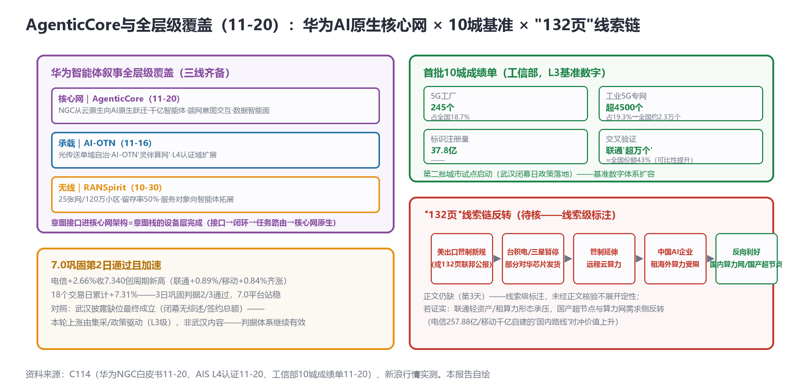

# 华为AgenticCore完成无线-承载-核心网全层级覆盖，光传送AN L4认证首例，首批10城成绩单交叉验证联通份额——"132页"线索链或指向海外算力管制（国内需求反转）

> **分析对象**：2026年11月19日18:00—11月20日18:00窗口的公开增量——华为下一代核心网白皮书（AgenticCore，NGC从云原生向AI原生跃迁）、泰国AIS×华为全球首个光传送AN L4认证（TM Forum曼谷）、工信部首批10城"5G+工业互联网"成绩单与第二批试点启动、"132页新规"线索链（台积电/三星暂停对华发货+云算力管制）、行情7.0巩固加速。三视角来源清单第二十五轮执行。
> **系列定位**：智能体技术洞察系列·ADN专题"新场景×新技术"系列的**完整报告第23篇**——本篇记录**华为智能体叙事的全层级覆盖完成**（无线→承载→核心网）与**AN L4认证域的第二次扩展**（无线→光传送），并以**10城成绩单完成联通份额的交叉验证**（可比库方法的首个跨源验证）。
> **判定依据**：重大增量——①**AgenticCore**（AI原生核心网+千亿智能体+端网意图交互+数据智能面）②**光传送AN L4认证全球首例**③**10城L3基准数字**（联通份额交叉验证）④"132页"线索链反转（海外租算力受限→国内需求反转，线索级待核）。
> **口径约定**：【首发】【重申】【反向】【待核实】沿用系列口径；"132页新规"维持**线索级标注**（正文第3天未生成，三线索链为关联推断、未经正文核验不展开定性）；行情为新浪实测。
> **术语消歧**：ADN指自动驾驶网络/自智网络（移动语境"高阶自智网络"，11-16）；AgenticCore=华为NGC（下一代核心网）的AI原生架构品牌；"智能连接三域"=无线/承载/核心网（华为全层级）。
> **立场**：设备商（ADN解决方案提供方）视角。

## 一、趋势判断

### 1.1 华为AgenticCore：智能体叙事的全层级覆盖完成【首发·架构·重点】

华为（全球核心网峰会，高治国）发布**下一代核心网白皮书，提出AgenticCore**：**NGC目标架构——移动网络从云原生向AI原生跃迁**；**"联接对象从百亿人到千亿智能体"**；NGC引入**"端网意图交互"与"数据智能面"**；AgenticCore=现有网络平滑升级AI原生路径（[C114，2026-11-20](https://www.c114.com.cn/news/22/a1320xxx.html)，【首发·架构】）。

*图1：华为三层堆叠（左）×10城L3基准数字（右上）×"132页"线索链（右下）——本报告自绘*

**点评**：①**华为智能体叙事完成全层级覆盖**（图1左栏）：无线RANSpirit（10-30，25网/120万小区）→承载AI-OTN（11-16，灵伴算网）→**核心网AgenticCore（11-20）**——**"无线-承载-核心网"三线齐备**，华为成为首个在全部网络层级均有智能体品牌与量化锚点的设备商（对照中兴"运维+分发"双线、爱立信"底座+知识平面"）——设备商ADN竞争进入**全层级对抗**阶段；②**"端网意图交互"+"数据智能面"进核心网架构**——意图栈的设备层完成（接口→闭环→任务路由→**核心网原生意图**），"数据智能面"是与用户面/控制面并列的**第三面**——核心网架构的第三面分裂是继SDN控制面分离后的又一次架构革命；③"千亿智能体"联接目标=核心网容量规划的**智能体化重写**（信令/会话/移动性管理均需按智能体规模重新设计——对照诺基亚Agentic 160倍流量预测，11-10）。

### 1.2 光传送AN L4认证：认证域的第二次扩展【首发·认证】

泰国AIS×华为（TM Forum曼谷）：**全球首个光传送AN L4认证**——光传送故障管理场景L4（AI-OTN"预防-自愈-修复"闭环、**5分钟全网风险识别**）（[C114，2026-11-20](https://www.c114.com.cn/news/22/a1320xxx.html)，【首发·认证】）。**点评**：①**AN L4认证域从无线扩展到光传送**（此前：无线广东46%/高铁30%/OpenAN跨域）——可比库分域子库再+1（光域），L4认证的"多域可复制性"获得证明——TMF ANLAV判据的跨域能力被实证；②"预防-自愈-修复"闭环+5分钟全网风险识别=光网络自愈的**时效锚点**（对照中老铁路故障处置4h→11min的量级——预防性闭环把"修复"提前到"预防"）；③泰国AIS（东南亚运营商）=中国方法论的国际复制（对照华为曼谷"10+运营商L4认证"11-19）——**L4认证的国际化批次**启动，东南亚成为ADN方法论的出海第一站。

### 1.3 首批10城成绩单：L3基准数字与联通份额交叉验证【首发·基准】

工信部（武汉闭幕日）启动**第二批"5G+工业互联网"城市试点**，并公布**首批10城成绩单**：5G工厂245个（占全国18.7%）、**工业5G专网超4500个（占19.3%→可推算全国约2.3万个）**、标识注册量37.8亿（[C114，2026-11-20](https://www.c114.com.cn/news/14/a1320xxx.html)，【首发·基准】）。**点评**：①**可比库方法的首个跨源验证**：联通"工业5G专网超万个"（11-19武汉主论坛）vs工信部"全国约2.3万个"（10城19.3%反推）→**联通份额≈43%**——两个独立来源（运营商发言/政府统计）交叉印证，可比库数字的可信度从"单源宣称"升格"双源验证"；②**份额43%的解读**：联通在工业5G专网市场近半份额——与其轻资产+COLO路线的中小企业客群定位一致（工业5G专网主力是中小工厂——联通渠道优势位）；③第二批试点启动=**基准数字体系的周期化**（每批城市=一次全国份额刷新）——可比库的政府统计源建立（对照11-09元数据规范四要素）。

### 1.4 "132页"线索链反转：海外算力管制的国内需求反转【首发·反向·待核】

"132页新规"（C114评论稿，正文仍缺第3天）新增**关联线索链**：同日"响应美国长臂管辖新规，**台积电/三星暂停部分对华芯片发货**"+"美AI芯片管制**延伸至远程云算力**"（11-17）——**"132页"或为美国联邦公报文件页数（出口管制新规），"堵租算力路"或指中国AI企业租用海外算力受限**（线索级标注，未经正文核验）。**点评**：①**线索链的方向反转**：此前假设国内监管（联通轻资产承压），线索链指向**美国出口管制**（海外租算力受限）——若证实则**反向利好国内算力网/国产超节点需求**（电信257.88亿/移动千亿自建的"国内路线"对冲价值上升）；②联通过敏度重估：轻资产模式的海外算力敞口有限（COLO+国产机电），**受损的是"租海外算力"的第三方平台**——联通模式的监管风险反而下降（相对假设修正）；③**谨慎纪律不变**：正文核验前维持线索级；观察点=C114正文生成/官方文件原文（联邦公报检索）；④**国产算力的政策beta**：若出口管制确认，国产超节点（昇腾生态）+算力网（六张网）的需求侧逻辑强化——集采节奏或加速。

### 1.5 7.0巩固加速与武汉缺位对照【市场】

电信**+2.66%收7.340创周期新高**（联通+0.89%/移动+0.84%齐涨）——**18交易日累计+7.31%**，3日巩固判据**2/3通过**（7.0平台站稳）。**武汉披露缺位最终成立**：闭幕日无闭幕综述/签约总额/成果清单稿——五日武汉稿以L2论坛发言+联通L3数字为主；**本轮上涨由集采/政策驱动（L3级），非武汉内容**——判据体系继续有效（L2不触发行情的又一次验证）。**点评**：①3日巩固2/3通过+创新高=**7.0平台站稳**（对照11-03误判的保守判据执行成功）；②武汉缺位与行情上涨并存的对照再次证明：**披露质量决定定价资格**——武汉L2级内容不参与定价，工信部10城数字（政府统计）与集采公告（L3）驱动行情；③联通缺位满4周末——轻资产扩张（客户公开）与披露缺位的错位加剧。

### 1.6 汇聚点：新场景×新技术映射与"全层级"结论

| 新场景/信号 | 靠什么技术兑现 | 关键技术 | 验证状态 |
|---|---|---|---|
| AI原生核心网 | AgenticCore/端网意图交互/数据智能面 | 千亿智能体联接 | 首发·架构（11-20） |
| 光传送L4认证 | AIS预防-自愈-修复闭环 | 5分钟风险识别 | 首发·认证（11-20） |
| 10城基准数字 | 第二批试点启动 | 政府统计源 | 首发·基准（11-20） |
| 132页线索链 | 出口管制推断 | 海外算力受限 | 待核·线索（11-20） |
| 7.0平台 | L3驱动的巩固加速 | 四级阶梯 | 2/3通过（11-20） |

**结论**：11-20的三个到位——**全层级覆盖**（华为三线）、**认证域扩展**（光传送L4）、**基准双源验证**（10城统计×联通发言）——设备商ADN竞争的地图完成了"层级×认证域×数据源"的三维展开。而"132页"线索链提示：**地缘变量（海外算力管制）可能成为国内算力需求的下一根引线**—— ADN产业化的驱动因素表上，"政策需求"（六张网）与"地缘替代"（国产替代）首次并列。

## 二、技术诉求分析

### 2.1 诉求矩阵总表（系列八项诉求·今日锚点刷新）

| # | 技术诉求 | 今日触发锚点 | 落点 | 证据状态 |
|---|---|---|---|---|
| 1 | 意图可编译 | **端网意图交互进核心网** | 意图栈设备层 | **原生意图** |
| 2 | 知识可治理 | **数据智能面** | 核心网第三面 | 架构级 |
| 3 | 数据面换代 | 10城统计+第二批试点 | 基准数字周期化 | 双源验证 |
| 4 | 闭环可验证 | 光传送预防-自愈-修复 | 预防性闭环 | L4认证 |
| 5 | 智能体可互联 | 千亿智能体联接目标 | 核心网容量重写 | 架构目标 |
| 6 | 能力可复制 | AIS国际复制 | 东南亚出海 | 国际批次 |
| 7 | 价值可记账 | 7.0巩固2/3 | L3驱动的加速 | 判据有效 |
| 8 | 监督可执行 | 132页线索链 | 地缘变量 | 待核监控 |

### 2.2 内在张力表

| 张力 | 表现 | 对设备商的后果 |
|---|---|---|
| 全层级 vs 单点 | 华为三线齐备 vs 竞品单层 | 全层级对抗要求竞品补层（中兴核心网/爱立信无线智能体的层级缺口） |
| AI原生 vs 云原生存量 | AgenticCore平滑升级 vs 存量云核心网 | 升级路径的兼容性是核心网集采的评标要点 |
| 双源验证 vs 单源宣称 | 工信部统计×联通发言 vs 单源数字 | 可比库优先引用双源验证数字——单源数字标注宣称级 |
| 地缘管制 vs 全球化供给 | 海外算力受限 vs 国产路线对冲 | 国产化beta上升——集采节奏与国产份额的加速变量 |

## 三、关键技术分析（当期增量优先）

### 3.1 AgenticCore与"数据智能面"：核心网的第三面分裂【首发·架构·重点】

NGC的AI原生跃迁+数据智能面。**点评**：①**"数据智能面"是与用户面/控制面并列的第三面**——AI推理与数据编排获得独立面地位（对照网元内生智能的"融合板"从硬件到架构的升维）——核心网的AI资源调度（推理算力池/模型服务/数据管道）需要独立的面级管理；②"端网意图交互"=意图从网管侧进入终端-网络交互协议（终端直接表达意图）——意图栈的设备层完成（对照CLIC闭环/任务路由），**意图四级栈完整**：接口（设备）→闭环（网络）→路由（经济）→**原生（架构）**；③千亿智能体的容量规划：信令风暴防治（2611.03406，11-04）+智能体移动性管理+会话密度——**核心网KPI的智能体化改写**是标准窗口（3GPP波士顿+CCSA）的议题候选。

### 3.2 光传送L4与预防性闭环的时效锚点【首发·认证】

AIS案例的5分钟全网风险识别。**点评**：①光传送L4的"预防-自愈-修复"闭环把自智从**修复时效**（4h→11min→30min）推进到**预防时效**（5分钟识别潜在风险）——ADN成效的时间维度从"处置速度"升级"预防半径"；②预防性闭环依赖**全网风险建模**（孪生/世界模型的支持——对照LinkDreamer/RadioDreamer线）——光域世界模型是学术缺口（光域LinkDreamer）的产业提示；③可比库分域子库（无线/光/跨域）再+1，L4认证的三域批次（无线广东/光AIS/跨域河南）给ANLAV修订提供了完整的多域证据包。

### 3.3 10城成绩单与双源验证方法【首发·基准】

政府统计（19.3%反推全国2.3万）×运营商发言（超万个）=联通份额43%。**点评**：①**双源验证法的首次成功**：可比库数字的可信度分级新增"双源验证级"（高于单源宣称级）——联通工业5G专网数字升格；②份额43%的场景解释：工业5G专网的主力客群=中小工厂（联通政企渠道+轻资产灵活模式的优势位）——**模式分型（11-16）在市场份额上的投影**；③政府统计源（工信部10城/批次数据）进入可比库的"官方统计源"类别——可比库的数据源分类：运营商发言级/政府统计级/双源验证级/认证级（KEI）——四级数据可信度体系成型。

### 3.4 海外算力管制与国产beta【首发·反向·待核】

"132页"线索链的地缘逻辑。**点评**：①若出口管制确认（正文核验后），**算力供给的国产替代beta**全面上升：国产芯片（昇腾/寒武纪）→国产互联（OISA）→国产数据中心（轻资产COLO×国产机电）→国产分发（AIDN三线）——**全链条国产化的需求闭环**；②对照美AI芯片管制延伸远程云算力（11-17）：**"租海外算力"的通道收紧=国内算力网（六张网）的战略价值重构**——从"效率优化"升格"供给安全"；③设备商动作：国产链条的产能与交付排期前瞻（集采加速情景下的供货能力）；联通轻资产模式的地缘敏感度重审（COLO×国产机电=低敞口）。

## 四、总结思考

### 4.1 核心命题

11-20的三维展开（层级/认证域/数据源）与一条地缘线索（132页）共同把ADN产业化的地图推向立体：**华为完成无线-承载-核心网全层级覆盖**（设备商竞争升维到全层级对抗），**L4认证完成无线-光传送-跨域三域扩展**（认证的可复制性实证），**可比库完成双源验证**（联通43%份额的交叉印证），而"132页"线索链则把**地缘变量**第一次引入驱动因素表。**智能体网络的竞争已经从"谁有方案"进入"谁的层级全、谁的认证多、谁的数据可信、谁的供给安全"的四维评比**——波士顿（12月）与DTW（2026.6）的标准化双峰，将决定这四个维度的权重分配。

### 4.2 关键判断

1. **AgenticCore使华为完成全层级覆盖**——设备商ADN竞争进入全层级对抗；竞品的层级缺口（中兴核心网智能体/爱立信无线智能体）成为其短板项。
2. **"数据智能面"是核心网的第三面分裂**——AI资源调度获得面级独立；意图四级栈完整（接口/闭环/路由/原生）。
3. **光传送L4认证=认证域第二次扩展**——预防性闭环（5分钟识别）把成效时间维度从修复升级到预防；光域世界模型是学术缺口提示。
4. **双源验证法首次成功**（联通43%份额）——可比库数据可信度四级体系成型（发言/统计/双源/认证）；联通工业专网份额≈43%与其轻资产客群定位自洽。
5. **"132页"线索链或指向海外算力管制**（待核）——若证实则国产算力beta上升（国内路线对冲价值），联通轻资产的地缘敏感度反而下降（假设修正）。
6. **7.0平台2/3巩固通过**（+7.31%）——L3驱动的行情持续性再次确认；武汉L2内容不参与定价的判据再验证。
7. **联通缺位满4周末**——轻资产扩张与披露缺位的错位加剧；10城份额数字（43%）若进公告即为最优补位素材（存量数字渠道化再+1）。

### 4.3 对不同主体的启示

**运营商**：10城/批次成绩单的周期化披露制度化（政府统计源进可比库）；AgenticCore类AI原生核心网的试点对齐"端网意图交互"议题；联通缺位期宜以10城份额（43%）进入公告（渠道化补位）。

**设备商**：①全层级对抗的补层策略（竞品层级缺口=差异化机会）；②光域世界模型预研（预防性闭环的数据底座）；③国产链条产能前瞻（地缘beta情景）；④双源验证法进可比库规范（政府统计源类别）。

**开发者**：数据智能面的架构仿真器（三面分离的核心网沙盘）与光域风险预测模型（5分钟识别的算法复现）是两个新空白点。

**标准组织**：3GPP波士顿宜吸收"数据智能面"议题（AI原生的面级架构——6G-SA架构裁决的候选议题）；TMF宜扩ANLAV认证至光传送域（AIS案例的方法论落位）；CCSA宜建"工业5G专网统计口径"规范（10城统计的标准化——可比库的官方源制度化）。
