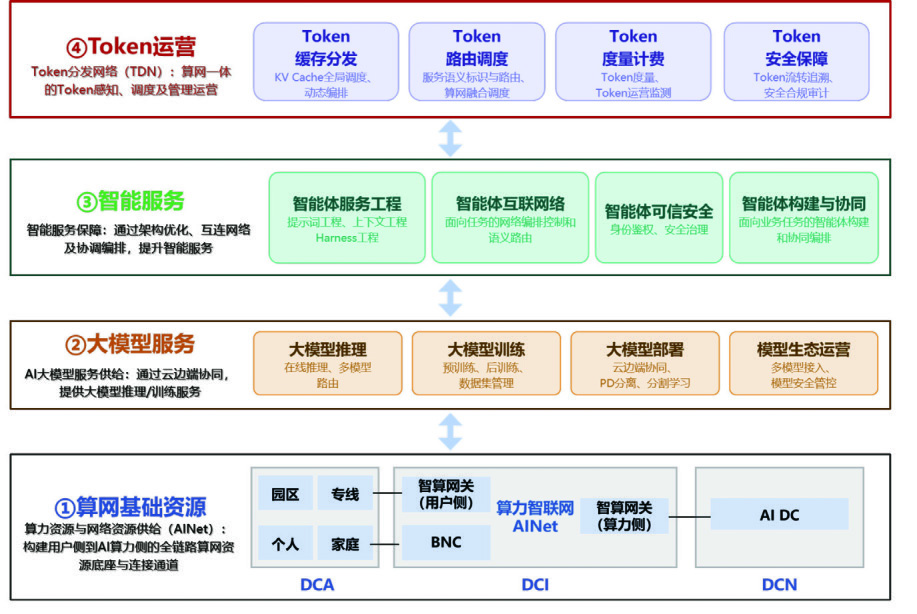
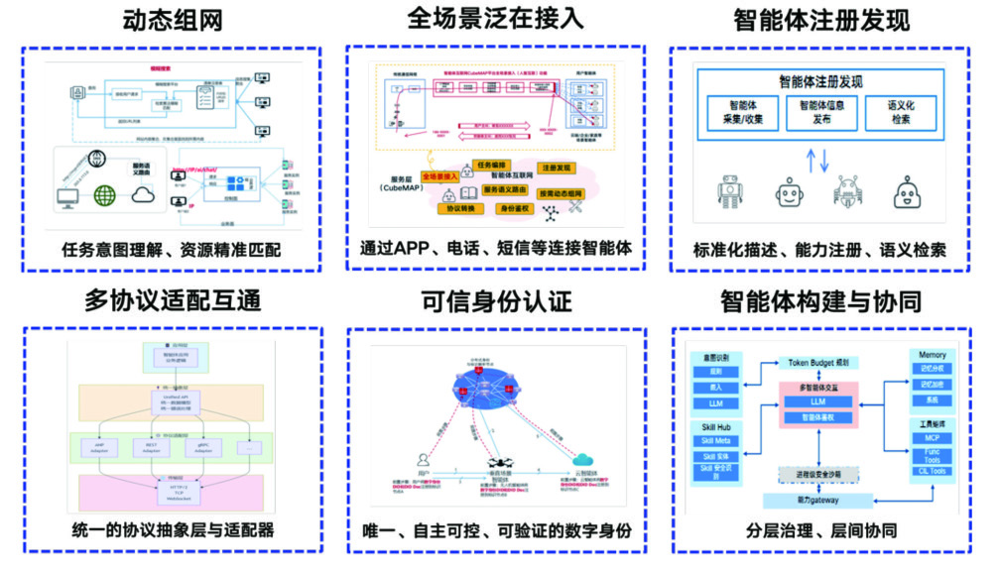

# Token经济洞察：业务背景、发展趋势与智能体技术要求推导

> **报告定位**：系列总纲篇。前五篇分别从网络、价值、自治、接入、智能体五个视角展开，本篇把全部结论收拢为一条可追溯的推导链：**业务背景与发展趋势 → Token对网络的要求 → 对智能体/多智能体（含互联协议）的技术要求**。每一项要求均可回溯到《通信世界》2026年第7期原文依据与前五篇的分析，核心推导成果见4.4总表。

---

## 一、业务背景

### 1.1 政策背景：智能经济成为国家议程
- 2026年3月《政府工作报告》首次提出"**打造智能经济新形态**"，部署超大规模智算集群、算电协同等新基建工程，加强全国一体化算力监测调度，支持公共云发展；
- 《国务院关于深入实施"人工智能+"行动的意见》逐步落实，AI成为塑造竞争新优势的核心引擎；
- 三部门《智能体规范应用与创新发展实施意见》促使AI能力释放"不再依赖单点算力突破，转而寻求**多个算力节点间的高效协同**"；
- 工信部办公厅《关于开展城域"毫秒用算"专项行动的通知》（工信厅通信〔2025〕54号）：构建确定低时延城域网络，实现城域毫秒级"**一跳入算**"，光网络设备向综合接入点和产业园区等用户侧部署；
- 2026年3月国家数据局确定Token中文译名"**词元**"，定位为"智能时代的价值锚点、连接技术供给与商业需求的'结算单位'"。

### 1.2 产业事实：一条被数据确认的爆发曲线
| 指标 | 数据 |
|---|---|
| 日均Token调用量 | 2024年初1000亿 → 2026年3月140万亿（**增长超1000倍**） |
| 智算规模 | 1882 EFLOPS（截至2026年3月底，全年同比有望超50%） |
| 算力中心用电量 | 2025年约1960亿kW·h（+18.1%）→ 2030年预计5000~7000亿kW·h |
| 全球地位 | 中国大模型Token调用量连续6周全球第一（OpenRouter，6月数据） |
| 单任务消耗 | 智能体单次模型调用数千至数万Token，**任务周期可达百万量级** |

### 1.3 Token升维：从技术术语到价值锚点
Token（词元）是大模型处理信息的基本单元——原始数据须转化为Token序列方能计算；文本、图像、音频、视频皆可Token化，跨模态统一性使其成为统一计量基础。其角色完成三级跳：**面向模型的计量单位 → 面向用户的计价单位 → 智能经济的结算单位与价值锚点**；产业界称之为"新的大宗商品"。数据、服务、资产"Token化"后可实现开放调用和实时交易——**Token既是智能的计量单位，也是智能经济的流通货币**。

### 1.4 基础设施演进背景：TokenNet等新范式
- **网络范式四阶段演进**：宽带联网（尽力而为）→ 弹性云网（"IPv6+"：SRv6、切片、随流检测）→ 智能算网（AI WAN：广域无损，数百千米跨域计算性能损失<5%、200km+拉远训练效率25%→97%）→ **原生智网（Token运营驱动）**；
- **Token Net**（联通，2026）：继2024年AINet之后提出的技术概念与架构体系，以**算网资源、大模型服务、智能服务、Token运营**四层打通"算网资源→AI大模型→智能服务→用户"的价值闭环，推动互联网从"连接信息"向"连接智能"跃迁；
- **TDN（Token分发网络）**作为运营层核心：多要素路由、Token Hub多供应商聚合、KV缓存三类分发（跨DC长期流转/短周期热点复用/实时高速复用）、统一度量计费、全链路安全——以"**算网存**"协同支撑Token规模化生产、分发和治理；
- **接入侧**：万兆光网50G-PON承载"最后一米"算力接入（单帧多突发、上行开窗优化、秒级弹性通道），现网验证样本入算时延27ms→4ms、带宽2G→20G弹性；
- **能源侧**：算电是智能经济的输入端（"电力提供燃料、算力中心是厂房"），Token是输出端（标准产出品）——算电协同成为新基建工程。

*图1 中国联通Token Net技术体系*

### 1.5 商业模式背景：从"卖流量"到"卖Token"
- 运营商从管道提供者向AI时代数字基础设施运营商转型，商业模式从"卖流量"到"卖Token"体系化重构；
- 三条演进路径：**套餐直售**（低附加值）→ **能力平台**（Token Hub聚合调度，掌握议价权）→ **智能体生态**（高附加值区）；
- Token Hub汇聚多家供应商Token资源，全网聚合、多要素路由——**掌握聚合权即掌握智能经济的分配权**。

---

## 二、业务发展趋势

| 维度 | 趋势 | 关键数据/事实 |
|---|---|---|
| 需求侧 | **推理主导、智能体化** | 日均调用两年千倍；智能体任务周期消耗百万量级Token |
| 供给侧 | **能效竞争、算电协同** | MoE降耗50%~70%；超大型模型>1kW·h/百万Token；2030年用电5000~7000亿kW·h |
| 网络侧 | **确定性下沉、弹性SLA** | 接入段确定性达数十微秒；样本入算27ms→4ms、2G→20G弹性 |
| 运营侧 | **Token经营、L4自治** | Token Hub聚合；账务级计量；Token运营域"出生即L4" |
| 生态侧 | **智能体互联网启动** | 六大能力定义；身份/审计/责任治理三支柱提上日程 |

### 2.1 需求侧：推理主导与智能体化
AI产业从训练主导转向推理主导，智能体成为核心应用形态——消耗逻辑从"人的提问"变为"智能体的任务"，增长公式为**智能体规模 × 多轮调用 × 长上下文**的乘数级增长。智能体是Token的主要生产者和消费者。

### 2.2 供给侧：能效竞争与算电协同
单位Token能耗成为核心竞争指标，降耗分化为两条路线（软件路线：MoE+量化；硬件路线：自研芯片）；Token实际成本中设备折旧占50%~70%、电力占12%~15%；能效改善被需求增长部分吞噬（杰文斯悖论），用电绝对量仍将增长2.5~3.5倍——**能源供给侧改革（绿电直连、源网荷储）与转化侧降耗必须同步推进**。

### 2.3 网络侧：确定性供给与弹性服务
"微秒级响应"成为下一代光网能力标尺（训练参数同步微秒级/推理Token交互毫秒级/Agent状态同步低抖动）；50G-PON把确定性下沉到接入网；"确定性SLA+秒级弹性带宽"成为可计费的新商业产品。

### 2.4 运营侧：Token经营体系成型
Token Hub聚合调度、多要素路由、账务级计量结算、全链路安全构成Token运营体系；Token运营域没有人工过渡期，**自治等级直接按L4设计**——ADN从网络运维工具升格为"网×算×存×电"四域闭环的Token供应链自动驾驶体系。

### 2.5 生态侧：智能体互联网启动
智能体互联网六大能力（动态组网、全场景泛在接入、注册发现、多协议适配互通、可信身份认证、智能体构建与协同）定义新生态边界；治理三支柱（身份、审计、责任认定）必须与功能建设同步；协议与语义标准的碎片化竞争已经展开——**标准窗口期就是生态卡位期**。

---

## 三、Token对网络的要求

推导起点：Token区别于传统流量（网页/视频/下载）的**四个本质特性**，直接推导出网络的七项要求。

### 3.1 Token的四个本质特性
- **T1 微观性**：Token是极细粒度的计量与交互单元——单次模型调用数千至数万Token，对应网络上"海量、小颗粒、高并发"的请求流；
- **T2 交互性**：推理是多轮往返过程（Prefill→Decode→工具调用→再调用），TTFT与抖动直接决定体验与任务成败——"快一下"没用，要"每一下都快且稳"；
- **T3 流动性**：Token的生产（推理）、分发（TDN/缓存）、消费（智能体）分布在算网存全域——样本入算、存算拉远、KV缓存跨DC流转都是Token价值链的跨域流动；
- **T4 经济性**：Token是计价结算单位——每一次流转都必须可计量、可结算、可审计，否则商业模式不成立。

### 3.2 由特性推导网络要求（N1~N7）
| Token特性 | 网络要求 | 具体内涵 | 依据锚点 |
|---|---|---|---|
| T1 微观性 | **N1 大带宽与海量并发** | 50G-PON接入、DCI 400G/800G、DCN高吞吐无损；海量小流高并发承载 | 联通篇算网资源层；万兆光网篇 |
| T2 交互性 | **N2 确定性低时延** | 接入段数十微秒（单帧多突发/零开窗）、城域毫秒级"一跳入算"、TTFT与抖动全程保障、任务链SLA分解 | 万兆光网篇；联通篇高质量需求 |
| T2+任务链 | **N3 弹性与感知** | 业务级弹性通道（秒级扩缩）、智能体级业务识别、SLO表达与就近调度 | 万兆光网篇弹性验证；联通篇智算网关 |
| T3 流动性 | **N4 算网存协同** | PD分离、KV缓存三类分发（网存换算）、跨域调度、云边端协同与分割学习 | 联通篇TDN |
| T4 经济性 | **N5 可计量可结算** | Token级遥测（区分类型）、账务级精度、防篡改存证、SLA自动举证 | 联通篇度量计费；信通院篇成本模型 |
| 治理需要 | **N6 安全可信** | 全链路纵深防御（生成-传输-分发-计费-运维）、提示词注入/缓存泄露/模型滥用防护 | 联通篇安全保障 |
| 供给侧约束 | **N7 能效优化** | 最优负载区间运行、算电协同、网存换算降耗 | 信通院篇四环节协同 |

**点评**：网络要求的实质是——网络从"尽力而为地搬运比特"变为"**有确定性保障地搬运智能**"：每个Token流都可承诺（SLA）、可计量（计费）、可追踪（审计）、可优化（能效）。这正是"网络成为Token供应链神经中枢"的具体含义，也是N1~N7必须作为一个整体交付的原因——缺任何一条，Token经济的微观基础就塌一角。

---

## 四、由网络要求推导智能体/多智能体的技术要求

推导逻辑：网络提供N1~N7的能力，但**网络能力的兑现依赖智能体侧的配合**——智能体必须"声明意图、暴露身份、携带预算、优化消耗"才能被网络差异化服务；多智能体互联之后，这些要求必须沉淀到**互联协议**中，成为"线上强制约定"而非"道德呼吁"。

*图3 智能体服务关键能力（智能体互联网六大能力模块）*

### 4.1 对单个智能体的技术要求（M1~M6，与N逐条对应）
| 网络要求 | 推导出的智能体技术要求 | 内涵 |
|---|---|---|
| N1/N2 海量并发+确定性 | **M1 任务链SLA声明能力** | 智能体按任务链声明TTFT/抖动/优先级意图——"自报家门"才能被差异化承载，沉默者只配尽力而为 |
| N2 确定性 | **M2 缓存亲和与上下文管理** | 提示词前缀稳定化（提高KV缓存命中率）、多轮上下文一致性——与网络侧KV缓存分发形成"两端配合" |
| N3 弹性与感知 | **M3 任务事件驱动的弹性声明** | 训练/样本入算任务的启停事件主动通知网络（触发带宽弹性）；请求携带智能体ID+任务类型+优先级标识 |
| N4 算网存协同 | **M4 成本感知推理调度** | 分级模型调用（简单子任务用小模型）、动态深度推理（提前退出降深40%~50%）、KV缓存服务消费接口 |
| N5 计量结算 | **M5 身份与计量配合** | 主体-代理双层身份（谁授权+谁执行）、Token计量数据配合上报、调用链审计日志、结算主体明确 |
| N6 安全可信 | **M6 安全内建** | 提示词注入自检、工具调用权限边界、行为可追溯——安全不是外挂而是运行时属性 |

### 4.2 对多智能体系统的技术要求（M7~M9，群体性叠加）
在单个智能体要求之上，多智能体叠加三条群体性要求：
- **M7 群体预算治理**：调用深度限制（TTL式）、预算逐跳递减、循环检测与熔断——防范多智能体互调引发的Token消耗风暴；执行点在网络网关，但元数据必须由协议携带；
- **M8 协作会话管理**：临时协作拓扑的建立/维护/释放（动态组网），任务上下文共享与一致性保障（角色边界清晰、中间结果格式标准）；
- **M9 一致的身份与审计链**：跨智能体调用全程凭证传递、存证延续——**审计链不能在智能体边界断掉**，否则责任链断裂。

### 4.3 对多智能体互联协议的技术要求（重点）

互联协议是把上述要求"固化为线上强制约定"的载体。**协议栈必须三层齐备**：

**（1）语法层——互通的基础**
- 统一消息格式与传输适配（协议映射、消息适配）；
- 轻量化消息封装——对应N1海量并发：调用消息必须轻，协议开销会被百万量级调用次数放大成巨大的Token与带宽浪费。

**（2）语义层——理解的基础（最难的攻坚战）**
- 能力词表与能力标签标准（注册发现的语义基础——没有可信的能力描述，发现机制退化为关键词搜索）；
- 意图描述与任务分解格式（编排一致性的基础）；
- 中间结果标准格式（多智能体结果聚合，防止理解偏差沿协作链放大）。

**（3）经济层——治理与结算的基础（智能体互联网独有的新层）**
- **预算元数据**：每次跨智能体调用携带"剩余Token预算+跳数"，逐跳递减、超限熔断——把"调用风暴"防范做进协议而非依赖自觉；
- **SLA标签**：任务链时延/抖动预算随消息传递，网络据此提供确定性承载（对接N2/N3）；
- **计量与结算字段**：调用级Token计量、费用归属规则（调用方/被调方/任务发起人）、对账接口（对接N5）；
- **身份凭证传递**：主体-代理双层凭证端到端传递、逐跳验证（对接N5/N6）；
- **存证延续**：审计日志跨智能体边界连续，责任链不断裂。

**（4）协议功能要求汇总**
| 协议功能 | 对应网络要求 | 传统互联网类比 |
|---|---|---|
| 注册与发现（能力目录、语义标签） | N3 感知调度 | DNS |
| 动态组网（临时拓扑、会话生命周期） | N4 跨域协同 | 路由/信令 |
| SLA协商与预算声明 | N2 确定性 | RSVP资源预留 |
| 预算递减与熔断 | N5/N6 治理 | IP TTL |
| 凭证传递与行为存证 | N5/N6 可信 | CA/PKI |
| 计量结算接口 | N5 结算 | 计费网关 |

**点评**：传统互联网协议只解决"语法互通"，智能体互联协议必须同时解决**语义互通**（机器之间的理解）与**经济互通**（结算与信任）——这是智能体互联网区别于传统互联网的两大增量，也是标准竞争的主战场。**经济层协议要素（预算、SLA标签、计量、凭证）是网络要求"传导"到智能体侧的唯一接口：没有协议层的经济要素，网络的确定性、计量、治理能力都触达不了智能体。**

### 4.4 推导链总表（全报告核心）
| Token特性 | 网络要求 | 智能体要求 | 互联协议要素 |
|---|---|---|---|
| T1 微观性 | N1 大带宽海量并发 | 分级调用、任务预算管理 | 轻量消息封装 |
| T2 交互性 | N2 确定性低时延 | M1 任务链SLA声明、M2 缓存亲和 | SLA标签随消息传递 |
| T3 流动性 | N3 弹性感知 / N4 算网存协同 | M3 任务事件弹性声明、M4 成本感知调度 | 动态组网、服务发现 |
| T4 经济性 | N5 计量结算 / N6 安全可信 | M5 双层身份与计量配合、M6 安全内建 | 预算递减+熔断、凭证传递、计量结算字段、存证延续 |
| 群体性（T3+T4叠加） | N3/N5/N6 治理执行 | M7 群体预算治理、M8 协作会话、M9 审计链 | 跳数限制（TTL式）、语义词表、中间结果格式 |

---

## 五、总结思考

### 5.1 推导链回顾
本报告建立了一条四段推导链：**Token四特性（微观/交互/流动/经济）→ 网络七要求（N1带宽、N2确定性、N3弹性感知、N4算网存协同、N5计量、N6安全、N7能效）→ 智能体九要求（M1~M9）→ 互联协议三层（语法/语义/经济）**。链条的意义在于：智能体的技术要求不是凭空罗列的清单，而是从Token经济的业务本质层层推导——**每一项智能体要求都能回答"它服务于哪条网络要求、支撑哪个Token特性"**，反之，每一项网络投入也都能定位到它使能的智能体能力。

### 5.2 三个关键判断
1. **"自报家门"是智能体被服务的前提**：网络的确定性、弹性、计量能力都以"智能体声明身份/任务/预算"为触发条件——声明能力（M1/M3）是智能体接入Token经济的第一张门票；
2. **经济层协议是智能体互联网的分水岭**：语法层各家趋同只是时间问题，语义层与经济层的标准将决定生态归属——**预算元数据与计量结算字段是网络价值触达智能体的唯一通道**，缺席者游离于可治理、可结算的经济体系之外；
3. **治理必须建在规模化之前**：调用风暴、身份伪造、责任断裂的治理成本随智能体规模指数上升——协议层的TTL与熔断机制、身份与存证体系必须与首批规模应用同步上线，事后补建的代价是生态性的。

### 5.3 对不同主体的行动启示
- **运营商**：以N1~N7为纲规划Token承载网，把"智能体任务链SLA"设计为标准产品；推动经济层协议要素（预算/计量/凭证）进入行业标准；
- **设备商**：智能体网关/智算网关按"三合一"定义产品——语法转换+经济元数据执行+安全过滤；测试仪表覆盖预算递减、熔断、SLA协商等协议行为验证；
- **智能体开发者**：把M1~M6内建到运行时（SLA声明、缓存亲和、成本感知、安全内建）——**声明与配合的程度，决定能获得的网络服务等级**；
- **标准组织**：语义层（能力词表）与经济层（预算/计量/凭证）是两个最优先的标准方向，且二者不可分割——语义让智能体互相理解，经济让智能体互相信任。

---

*说明：本报告为系列总纲篇，综合《通信世界》2026年第7期原文（联通篇、信通院篇、万兆光网篇）与系列前五篇洞察报告独立推导整理；图1、图3提取自原文。系列其他报告见同目录索引。*
