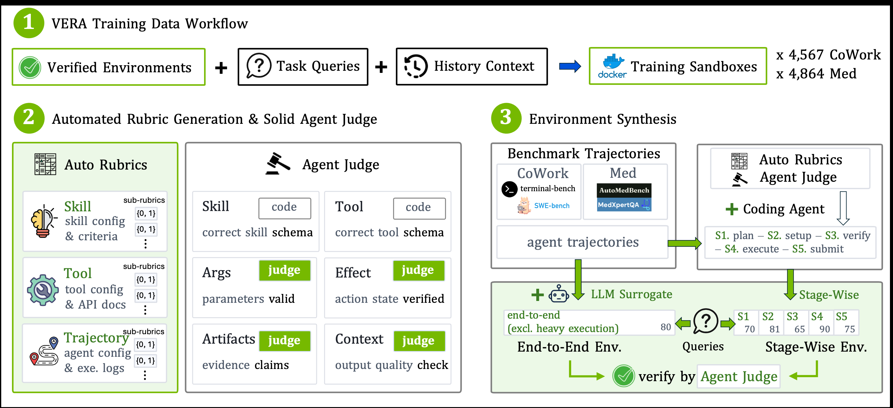
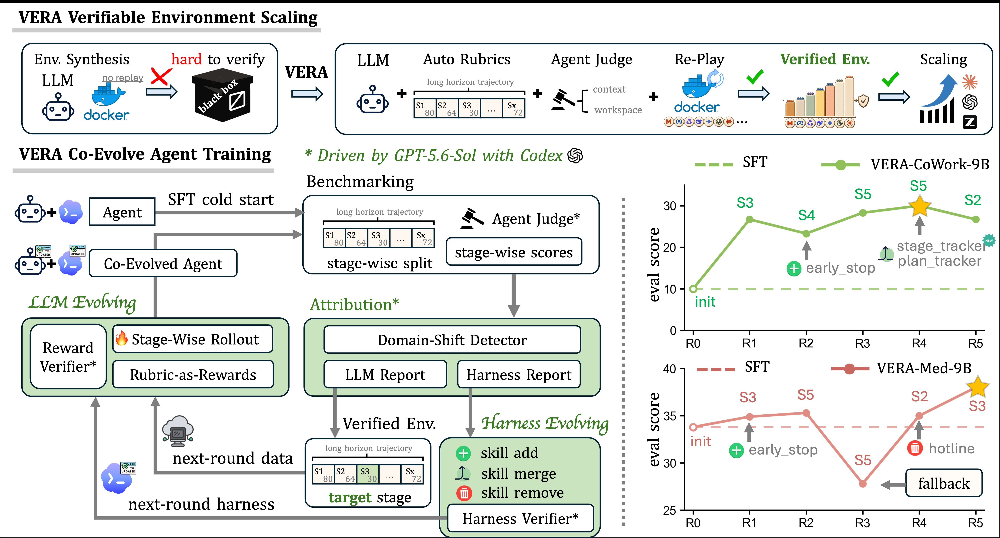
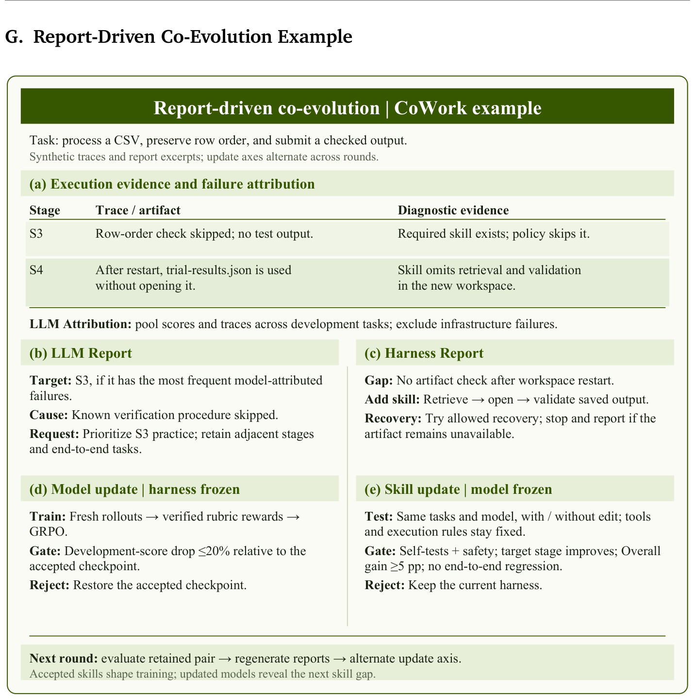
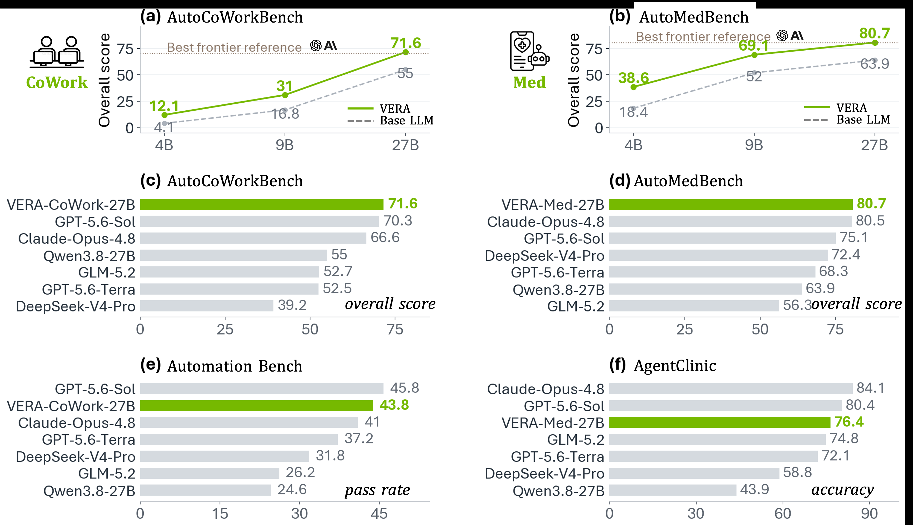
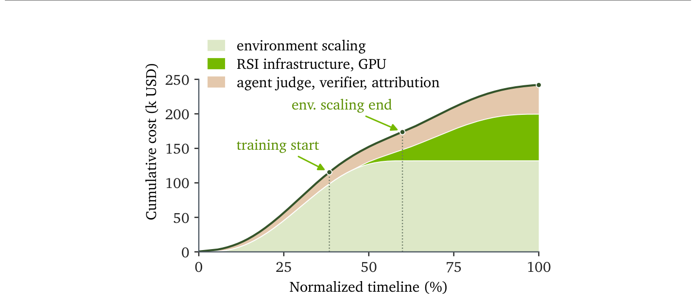

# 可验证环境是智能体自我进化的真正瓶颈——VERA把环境做成可量产、可验收的训练资产

> **分析对象**:arXiv:2610.05923v1《VERA: Scaling Verifiable Environments for Agentic co-Evolution》(NVIDIA牵头,联合UC Santa Cruz、UIUC、新加坡国立大学、清华大学、西安交通大学、宾夕法尼亚大学,2026-10-05,27页;开源9,000+长程可验证训练环境)
> **核心结论**:自我进化缺的不是算法,是可验证环境——环境必须可量产、可准入、可重启,奖励必须锚定可观测证据,每次更新必须可验收、可回滚;模型与harness双轴协同进化,9B超最强单轴基线10.3/13.0分,27B达71.6/80.7。
> **系列定位**:智能体技术洞察系列。承接《对智能体/多智能体的技术诉求分析》(回答智能体对基础设施的诉求)与《Agensh洞察》(arXiv:2609.26781,回答千级智能体的组织扩展),本篇回答**智能体自我进化的环境供给问题——训练环境从哪里来、凭什么可信、如何支撑模型与harness一起进化**。
> **立场说明**:设备商视角贯穿全文,第四章按运营商/设备商/开发者/标准组织分述启示。文中五张插图均取自原文,版权归属原作者。

---

## 一、趋势判断:自我进化的瓶颈不在算法,在环境

### 1.1 瓶颈在环境,不在算法——现有环境"只奖结果、不可重启、失败不可归因",长程任务根本没法训练

自我进化卡在环境上,不卡在算法上。环境供给现在只有两条路,都撑不起长程工作流:手工构造的任务环境用测试套件定义成功,只存在于有测试的领域;评测基准人工策展,只打终点分。三个缺陷直接锁死训练:

- **只奖结果**:医学研究智能体要"定位发现→分类→成文"跑几十个依赖步骤,一次早错全盘作废,但分数只看终点——中间的失败不产生任何学习信号;
- **不可重启**:任务中途失败只能从头整段重跑;
- **失败不可归因**:不知道错在第几步、错在模型还是错在harness,改进只能靠猜。

Qwen3.5-9B在AutoCoWorkBench上,纯结果奖励GRPO只把Overall从4.2拉到5.8——不是算法不行,是环境给不出可用信号。**谁掌握可验证环境,谁握有智能体进化的入场券;环境供给侧是自我进化的第一性瓶颈。**

### 1.2 环境可以量产:轨迹就是原料,准入决定可信度

benchmark轨迹里已经天然包含可验证环境的全部原料:初始状态、工具交互及其可观测效果。Auto-Rubric管线自动把轨迹转化为可重启沙箱:编码智能体写rubric与可执行检查→判官逐沙箱验证→跑不起来或打不了分的环境一律不得入库。9,000+环境开源;一次医学研究管线的递归自我改进(RSI)估算总成本约24万美元,其中**环境规模化与策展占54.7%**,训练基础设施占27.9%,验证/判官/归因占17.3%。**环境准备是最大成本项,环境工程正在成为与数据工程并列的新工种,环境资产是下一场开源军备竞赛的标的。**

### 1.3 结果奖励退位:五阶段切分让过程可计分、失败可定位

长工作流切为plan→setup→verify→execute→submit五个功能阶段,每个阶段沙箱可从该阶段起始状态重启、独立练习、独立计分;每阶段配一组{0,1}二值rubric项,锚定行动参数、执行效果、产物与输出质量,**可执行检查失败一票否决判官给出的任何分数**。端到端奖励=硬门×[λ×过程分+(1−λ)×验证完成信号],CoWork取λ=0.2、Med取λ=0.5。**从"结果可验证"到"过程可验证"是RLVR之后的下一个默认形态:过程奖励既提高信号密度,又让失败第一次变得可归因。**

### 1.4 模型与harness必须一起进化,但一次只动一个轴——归因决定动哪里

双轴一起动,收益就没法归因。VERA每轮先评估当前"模型+harness"组合,LLM归因读取阶段分数与执行轨迹,产出两份报告:LLM Report定位失败最集中的目标阶段,Harness Report列出缺失、冗余或有害的技能;随后模型轮冻结harness、全参GRPO训练,harness轮冻结模型、对技能增/并/删。消融给出硬证据:冻结任一轴损失约一半收益——CoWork上模型轴18.9、harness轴18.2,双轴31.0;Med上43.3、56.1对69.1。**归因决定动哪根轴,验收决定变更留不留;这是协同进化能持续涨分而不崩的机制。**

### 1.5 骨干不强,进化亏本:27B是自我进化的能力门槛

4B在AIME上掉56.4~59.7分,9B掉15.8~55.8分——小模型的领域进化直接以牺牲通用能力为代价;27B则全线保住甚至反超:CoWork智能体AIME +10.0、ALFWorld +3.8、GPQA-Diamond +7.7、IF-Bench +1.8,Med智能体最大回撤仅4.0分。**领域强化与通用能力的冲突要靠骨干容量来吸收;模型选型必须先于自进化投入——骨干不够强,自进化是亏本买卖,训推算力配比也要为"进化型模型"重新设计。**

### 1.6 harness是一等性能变量,"harness摩擦"真实存在

Claude Opus 4.8用productivity harness得80.5,换benchmark默认runner得81.9——**排名随harness配置反转**;部分模型换上productivity harness后分数反而下降,附加指令、工具接口适配、上下文管理与执行控制都在产生摩擦。VERA harness自身的工程规格(262,144 token上下文、200,000触发压缩、MCP stdio工具、调用预算原子持久化、完成信号只能由host核发)表明harness已是精细工程学科。**模型–harness匹配度是长程任务性能的一等变量,换harness不是中性操作。**

### 1.7 趋势的汇聚点:环境资产+归因机制+验收治理

三条线索汇聚成一个可工程化的自我进化架构:**可验证环境**(资产层,可量产、可准入、可重启)+**归因驱动的双轴更新**(机制层,证据决定动哪根轴)+**开发集显式验收**(治理层,每个变更可验证、可回滚)。自我进化从"刷分竞赛"变成证据驱动、带验收门禁的工程流程——这正是它从实验室走向生产系统(包括网络运维这类高风险场景)的前提条件。

---

## 二、技术诉求分析:自我进化对"环境供给体系"的六项诉求

### 2.1 诉求逐条展开

**诉求1:环境可重启(restartable)**
- **诉求内容**:沙箱能在任意阶段恢复工作区与状态——每个阶段沙箱绑定该阶段的查询、交互历史与起始工作区;RL行数据附两条重置记录,证明是"无答案的干净工作区"且状态哈希一致,同一起始状态可支撑全新rollout。
- **洞察**:没有可重启性,长任务失败只能整段重跑,成本不可承受;重置记录+状态哈希是环境资产可复用的"产权凭证",这一设计值得直接抄进任何训练环境平台。

**诉求2:奖励必须锚定可观测证据**
- **诉求内容**:每条rubric项定义成功判据、证据要求与显式打分锚点;智能体回复中的口头声称不构成证据,行为必须有执行记录或工作区产物支撑;可执行检查失败或官方校验失败,覆盖判官的任何评分。
- **洞察**:把"信任边界"从模型侧移到host侧——完成信号、预算、防循环标志全部由host核发,actor无权自证。这是对抗reward hacking的结构性设计,而非提示词层面的补丁。

**诉求3:失败过程可归因**
- **诉求内容**:阶段级分数+执行轨迹喂给LLM归因,产出目标阶段定位与技能缺口清单;基础设施故障被剔除,不污染归因。
- **洞察**:归因是连接"环境证据"与"训练决策"的转换器——没有它,过程分数只是一堆无法行动的数字;**训练平台需要把"归因"做成一等组件,而不是人肉看曲线。**

**诉求4:每次更新可验收、可回滚**
- **诉求内容**:模型候选检查点在开发集上相对掉幅≤20%才接受,否则回退到上一个已接受检查点;harness编辑须满足同任务成对重跑、目标阶段改善、端到端不回归、自测通过、安全检查、Overall增益≥5个百分点,每轮最多接受3条;技能使用频率不算证据,只有成对比较算数。
- **洞察**:两条验收准则刻意不对称——模型更新允许短期持平(能力在累积),harness编辑必须即插即赢(它是纯外挂)。**"回退机制+显式接受准则"应成为一切自进化系统的标配治理设计。**

**诉求5:奖励可防操纵**
- **诉求内容**:医学线设独立强模型做hacking复核,验证到reward操纵即硬门清零;证据缺失、判官响应畸形、基础设施故障都不算失败,只阻断奖励准入。
- **洞察**:"有效失败"与"无效评估"被严格区分——诚实承认失败保留为训练样本,证据缺失不算失败。**这条证据有效性规则是过程奖励体系能长期运转的防腐剂。**

**诉求6:成本结构可规划**
- **诉求内容**:环境准备54.7%/训练基础设施27.9%/验证与归因17.3%;协同进化在环境准备完成约75%时启动,训练与策展重叠推进。
- **洞察**:环境先行、训练跟进的流水化排程,把"环境是前置依赖"变成"环境与训练并行";**这是可复制的项目排期模板。**

### 2.2 诉求矩阵总表

| 诉求 | 核心内容 | 关键锚点 | 缺失后果 |
|---|---|---|---|
| 环境可重启 | 任意阶段恢复工作区+状态哈希对齐的重置记录 | 五阶段沙箱、干净重置记录 | 长任务失败只能整段重跑,训练成本失控 |
| 奖励锚定证据 | 二值rubric+证据要求+可执行检查一票否决 | 口头声称不算证据 | 分数与真实行为脱钩,reward hacking |
| 失败可归因 | 阶段分数+轨迹→LLM/Harness双报告,剔除基建故障 | 归因决定目标阶段与课程 | 有分数无行动,更新靠猜 |
| 更新可验收 | 模型≤20%回退;harness成对重跑+≥5pp+安全+自测,每轮≤3条 | 双Verifier+回退机制 | 回归无法拦截,进化不可持续 |
| 奖励防操纵 | 独立hacking复核+host侧完成信号+硬门清零 | 有效失败/无效评估之分 | 刷分式崩溃 |
| 成本可规划 | 环境54.7%/训练27.9%/验证17.3%,75%后训练启动 | 约$24万RSI成本拆解 | 排期失真,预算黑洞 |

### 2.3 内在张力表

| 张力 | 一方 | 另一方 | 现实的折中 |
|---|---|---|---|
| 规模 vs 质量 | 9,000+环境的量产诉求 | 双重准入(可执行检查+判官)逐个验证 | 准入循环过滤后入库;环境数量对效果的影响未消融,规模收益仍是开放问题 |
| 自动化 vs 判官依赖 | 全管线无人工标注 | 判官/归因/验收全押单一前沿模型GPT-5.6-Sol | 可执行检查约束判官裁量权;判官敏感性未测——单供应商依赖是隐性风险 |
| 过程奖励 vs 操纵面 | 阶段级分数提高信号密度 | 可打分的环节越多,可操纵面越大 | 硬门清零+独立复核+证据有效性规则 |
| 双轴收益 vs 归因清晰 | 双轴协同带来+10.3/+13.0 | 归因要求冻结另一半 | 交替更新、每轮单轴变更、不对称验收 |
| 9B可比性 vs 27B有效性 | 全基线对比只在9B(算力约束) | 结论要在27B上成立 | 27B只跑关键对照,一轮完整协同进化约5,000~8,000 GPU小时 |

---

## 三、关键技术分析

### 3.1 Auto-Rubric:把benchmark轨迹变成可验证环境的数据管线

*原文图3:Auto-Rubric三步——训练沙箱构造(环境+任务+恢复所需交互史);rubric生成与证据验证(编码智能体写二值rubric,可执行检查验证技能/工具schema,Agent Judge检查参数有效性、执行效果、产物证据与输出质量);阶段级与端到端环境合成(轨迹按plan/setup/verify/execute/submit五段切分,端到端沙箱用LLM代理模拟耗时工具调用)。两类环境必须通过可执行检查与判官验证才进入训练库。(取自原文,版权归属原作者)*

管线的原料是现成benchmark轨迹(Terminal-Bench、SWE-Bench、MLE-Bench构造CoWork;AutoMedBench与MedXpertQA工作流构造医学线),产出分两类:阶段级沙箱(每阶段独立练习与计分)与端到端沙箱(LLM代理模拟耗时工具调用,保留完整工作流)。数据策展有硬规则:SFT行只监督一个决策动作、隐藏后续验证结果;RL行只保留起始状态与验证器绑定、不带教师答案;每任务×阶段×起始状态组合至多保留一个候选;两次盲审+确定性检查不过即剔除。

**点评**:这条管线真正的创新不是"自动造环境"(SWE-Gym们已经在做),而是**把"准入"做成了环境生产的一部分**——跑不起来或打不了分的环境根本进不了训练库。环境的质量门槛前置到生产环节,后端的奖励才敢信。数据策展"SFT监督单步、RL留裸状态"的对称设计也干净:SFT学单步修复,RL练从头续做,同一任务两种形态互不污染。

### 3.2 五阶段可重启沙箱与rubric契约

CoWork每阶段10项等权二值rubric(6项共享工作流检查+4项领域特定),Med每阶段6项;rubric按"领域×阶段"索引,权重与硬门在rollout之前写入版本化契约,判官只打分、无权改权重加门槛。证据有效性规则:有有效证据支撑的失败是有效低分/零分(保留为训练样本);证据缺失、判官响应畸形、基础设施故障则阻断奖励准入直至解决。

**点评**:"rubric契约先于rollout版本化"是整个体系最容易忽视却最关键的一环——**评分标准在智能体行动之前就锁死,判官只执行不打折**,这从制度上排除了"先看答案再定标准"的事后合理化。医学端到端过程rubric允许{0, 0.5, 1}部分分而阶段表保持二值,粗细搭配:阶段表管训练稳定性,端到端表管最终质量。

### 3.3 归因驱动的双轴交替进化循环

*原文图1:顶部为环境准入(自动rubric、Agent Judge工作区检查、容器回放);左下为归因(阶段分数+轨迹→LLM Report选训练阶段,Harness Report提议技能增/并/删);Reward Verifier核查rubric奖励、Harness Verifier测试技能编辑;更新交替进行、另一半冻结、通过的变更向前携带,未通过的检查点回退;右侧为两域分数随轮次上升曲线。(取自原文,版权归属原作者)*

模型轮:全参GRPO,奖励来自阶段rubric,课程聚焦归因定位的目标阶段,同时保留相邻阶段与完整任务(阶段级收益必须经受完整工作流的检验);执行与训练分离(Agent Lightning式)。harness轮:同一LLM既做归因又起草技能编辑(增补缺失技能、合并重叠技能、删除有害技能),工具与执行规则冻结不动;验收靠同任务、同冻结模型的成对重跑。两轴互喂:被接受的技能改变下一轮训练分布,变强的模型暴露下一个技能缺口。

*原文图5:CoWork实例全流程——(a)执行证据与失败归因(S3跳过行序检查、S4重启工作区后未打开trial-results.json就使用);(b)LLM Report定位目标阶段S3;(c)Harness Report提议新增"取回→打开→校验已保存产物,缺失则走恢复流程"技能;(d)模型更新门禁:开发集掉幅≤20%否则回退;(e)技能更新门禁:自测+安全+目标阶段改善+Overall≥5pp+端到端不回归,否则维持现状。(取自原文,版权归属原作者)*

**点评**:双轴协同并不新鲜(ADAS、DGM、COS-PLAY都在做),VERA的差异点在**归因的证据化**——不是让另一个LLM看总分猜瓶颈,而是让阶段级rubric分数+执行轨迹直接指认"第几阶段、什么证据缺失"。接受准则的不对称(模型≤20%可接受、harness必须+5pp即插即赢)体现了对两类更新失败模式的清醒认知:模型能力是累积量,harness是外挂件,坏了就得立刻摘。

### 3.4 奖励函数与防作弊设计

阶段奖励 r_k = h_k × Σ(w_j·z_j)/Σw_j:h_k是硬门,阶段内任一强制检查失败即整段清零;z_j∈{0,1}为rubric项得分。端到端奖励 R = g×[λ·p+(1−λ)·c]:CoWork取λ=0.2,p为五阶段奖励均值,g=1;Med取λ=0.5,p为判官过程分,c为经认证的完成信号,验证到reward hacking或硬门失败时g=0。组内优势按轨迹计算一次,平局组零优势,全零信号批次不更新。防作弊三重防线:完成候选标志只能由host在官方检查实际通过时设置;独立强模型做hacking复核;判官操纵测试中"诚实承认失败"被放行、"索要满分掩盖缺步骤"被标记并清零,64条抽检rollout的完成记录与执行检查全部一致。

**点评**:R = g×[λp+(1−λ)c]是给过程奖励装上"总闸"的通用公式——过程分给梯度方向,硬门与完成信号管底线,两个领域的差别只在λ(工作流式任务0.2、研究式任务0.5)。**独立hacking复核模型是这套设计中最值得复制的组件**:奖励的裁判和奖励的审计分离,如同财务上的出纳与会计分离。

### 3.5 实验结果与成本结构

*原文图2:(a-b)4B/9B/27B三个骨干上协同进化均优于基座;(c-d)27B在两个基准的Overall领先;(e-f)迁移到未见的Automation-Bench与AgentClinic分别提升19.2与32.5个百分点。(取自原文,版权归属原作者)*

核心数字:9B上双轴协同31.0/69.1,超最强单轴基线10.3/13.0分;SWE-Bench Verified Pass@1 54.2、MedXpertQA Text 50.8——评估协议与训练rubric不同,说明收益不是对rubric的过拟合。27B上71.6/80.7,CoWork超过Claude Opus 4.8(66.6)、距GPT-5.6-Sol(72.6)仅1.0分,Med距Claude(81.9)1.2分,Med Agentic分94.1全场最高;迁移到未参与建环境的Automation-Bench 43.8%(第2)、AgentClinic 76.4%(第3)。

*原文图4:医学研究管线RSI成本结构——环境规模化与策展54.7%、训练基础设施27.9%、验证/判官/归因17.3%;协同进化在环境准备约75%时启动,训练与策展重叠推进。(取自原文,版权归属原作者)*

成本侧:RSI总估算约$240k,环境54.7%/训练27.9%/验证17.3%,CoWork线约5,000 H100小时、Med线约8,000 H100小时。

**点评**:两点必须读进数字背后。其一,**27B上单轴配对出现"技能与模型须配套进化"的信号**——VERA-Med技能装配到未进化的基座模型上,Med分数从65.1跌到54.2;为进化后模型调好的技能,搬到裸模型上是有害的。其二,基线公平性有边界:ADAS的40个候选中27个可评,开发集上全部0分,按最早注册规则取其一参赛;COS-PLAY是论文作者的适配实现而非原作复现——这组对比比较的是学习方法大类,不是逐算子的严格消融。

### 3.6 VERA harness的工程底座

基于Codex v0.153.4,think模式开启且保持、推理力度xhigh,SGLang推理服务;262,144 token上下文,200,000触发压缩、保留16,384,摘要提示禁用工具且强制四段(当前任务/观察状态/持久笔记/剩余工作),压缩后重读的memory文件永远不算完成证据。工具经MCP stdio(JSON-RPC 2.0)服务:调用预算在派发前预留并原子持久化(重启无法续杯);每条工具观察携带host注释——剩余预算、host验证的完成候选标志、防循环标志、变更操作交付账本;裸模型工具名在飞行中改名空间;失败的调用返回一条失败观察而不杀死stdio管道。每任务强制工具调用/墙钟/停滞三类预算,停止原因枚举化(recovery_required/stall/completion_candidate/output_limit/tool_transport_failed)。

**点评**:这份harness规格是一份"可信执行体"设计模板——**原子预算、host侧完成信号、交付账本、枚举化停止原因**,每一条都是把不可信的模型输出关进可审计的执行框架里。对要做智能体管控的设备商而言,这四件套几乎可以直接映射为产品需求:配额管理、完成判定权、操作审计、异常分类。

---

## 四、总结思考

### 4.1 核心命题

自我进化的稀缺资源不是算力、不是算法,而是**可从可观测证据打分的环境**。环境是资产(可量产、可准入、可重启、可定价),验证是治理(准入门禁、双验收、回退、防操纵审计)。当环境被资产化、更新被流程化,递归自我改进第一次同时具备可扩展性与可审计性——这是它进入生产系统的门票。

### 4.2 关键判断

1. **环境工程将固化为一门独立工种**,与数据工程并列;9,000+环境开源只是宣言,环境资产的规模化生产与准入标准是下一阶段竞争焦点。
2. **过程级可验证奖励+双验收会在两三年内下沉为智能体训练平台标配**;"结果奖励+大模型判官"的组合将被"阶段rubric+可执行检查+判官+独立审计"四层结构取代。
3. **判官依赖是新的中心化风险**:一条进化流水线的训练信号、归因、验收全部系于单一前沿模型(GPT-5.6-Sol),供应商锁定、成本波动、裁判偏差三重暴露;可执行检查占比是衡量一个环境体系健康度的关键指标。
4. **网络运维是天然的"可验证环境富矿"**:工单、拓扑、配置、遥测都是可观测证据,运维流程天然分阶段,数字孪生提供可重启沙箱——ADN的运维智能体需要自己的VERA。

### 4.3 对不同主体的启示

| 主体 | 启示 |
|---|---|
| 运营商 | 运维智能体的进化能力取决于环境供给:把网络数字孪生升级为"可重启、可打分"的训练沙箱,给工单配rubric;将环境资产纳入数据资产盘点与智算采购目录;27B门槛意味着模型选型要先于自进化投入——骨干不强,进化亏本 |
| 设备商 | 三层机会:①环境工厂——把网元仿真/数字孪生做成可验证环境生产线(该环节占RSI成本54.7%,是明确的市场);②harness工程——可信执行体四件套(原子预算、host侧完成信号、交付账本、停止原因枚举)直接产品化;③进化训练平台——归因+双验收+回退流水线。风险项:判官依赖催生第三方可审计验证服务的需求,应提前布局 |
| 开发者 | skill/harness是新的可优化资产类别;成对重跑验收、证据有效性规则、可执行检查一票否决是可以直接复用的设计模式;领域rubric贡献是进入智能体生态的低成本入口 |
| 标准组织 | "什么算可验证环境"尚无标准:环境可重启性、证据链格式、验收准则、判官审计应进入智能体标准体系;benchmark组织应考虑供给过程分,而不只给结果分 |

---

*报告完。数据锚点均出自arXiv:2610.05923v1原文及其附录;五张插图(原文图1–图5)均提取自原文PDF,版权归属原作者。*
