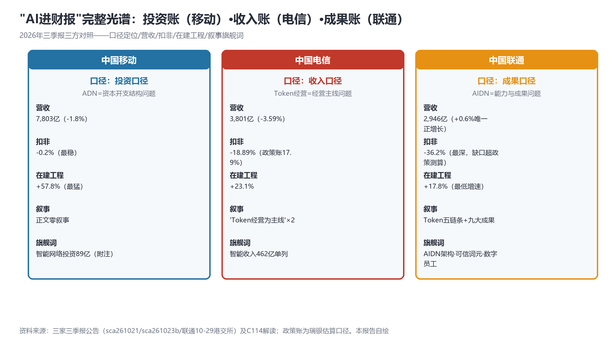
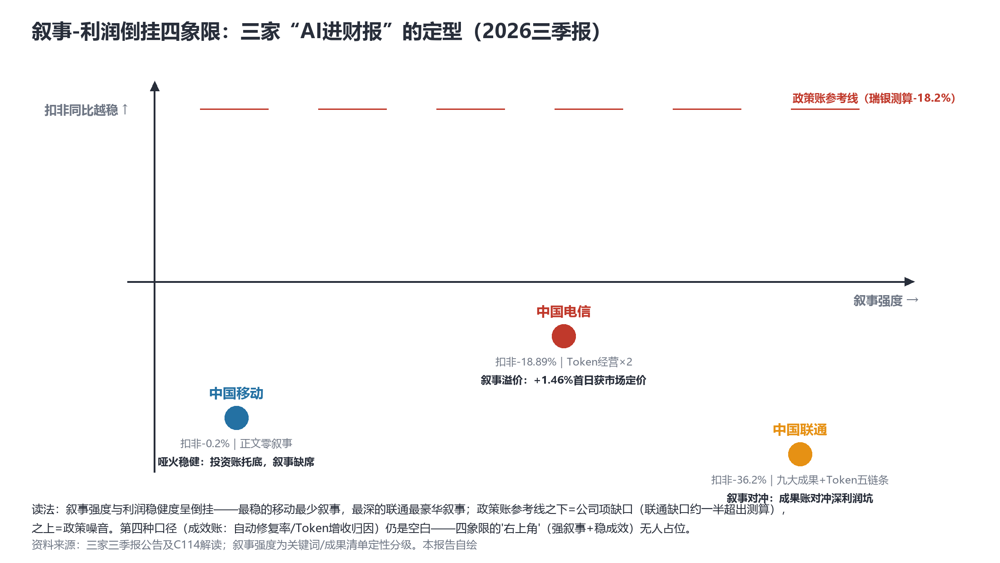

# 三方口径齐备：投资账（移动）、收入账（电信）、成果账（联通）——"AI进财报"光谱闭环与叙事-利润倒挂四象限

> **分析对象**：中国联通2026年三季报（10-29盘后港交所披露，25页PDF全文核对）及公告全文、工信部"加快新一代通信网建设发展座谈会"（10-29）、三家财报口径的系统性对照、行情第四日实测。三视角来源清单第八轮执行（DDG限流第五日，东财公告API+港交所PDF为有效通道）。
> **系列定位**：智能体技术洞察系列·ADN专题**对照篇**（与主系列7篇完整报告互补）——兑现10-24以来四次预告："三方口径凑齐即出对照篇"。
> **判定依据**：重大增量——①**联通披露闭环三方**：营收2,946亿（+0.6%，三家唯一正增长）、扣非-36.2%（三家最深）、叙事三家最豪华（Token五链条+九大成果+AIDN架构+可信词元+数字员工）②三方路径分型齐备（投资账/收入账/成果账）③工信部"六张网"从方向到落地机制。
> **口径约定**：【首发】【重申】【反向】【待核实】沿用系列口径；C114"净利133亿"为合并口径（混改少数股东），归母口径为58亿；政策账为瑞银估算【转述·非官方】；"治理交接期"仍为推测待证（10-22决议→10-26总裁辞任→10-29盘后披露的时间线如实呈现，不作归因）。
> **术语消歧**：ADN指自动驾驶网络/自智网络（TMF口径）；**AIDN为中国联通对自治网络的自有命名**（首次进入财报）——AN/ADN/AIDN/AI-DN四术语并存的消歧问题正式显性化；"词元"=Token官方译名；"五链条"=联通提出的Token创造/存放/转运/清洗/应用。
> **立场**：设备商（ADN解决方案提供方）视角。

## 一、趋势判断

### 1.1 联通披露：唯一正增长营收+最深扣非+最豪华叙事的三重组合【首发·财报】

联通三季报（10-29盘后，港交所25页PDF）：前三季营收**2,946亿元（+0.6%，三家唯一正增长**；移动-1.8%/电信-3.59%）；**归母净利58亿元（-33.8%）、扣非48.7亿元（-36.2%，三家最深**：移动-0.2%/电信-18.89%）；利润总额161亿（-34.6%）；经营现金流596.9亿（+2.3%）；在建工程359亿（**+17.8%，三家最低增速**）。叙事为**三家最豪华**：正文提出"增强**Token创造、存放、转运、清洗、应用**全链条能力，**做高价值Token的经营者**"（Token五链条），并列出"九大守正创新成果"——**联通AIDN创新架构**（联通版ADN命名首进财报）、**联通云8.0可信词元基础设施**（"可信词元"概念进财报）、**联通元景数字员工**（白皮书强项如约入账）、元景MaaS、墨攻3.0等；算力收入+12.2%、智算中心+10.4%；自智/L4字面零命中（以AIDN变体出现）。

*图1：三方口径光谱——投资账/收入账/成果账的六维对照（本报告自绘）*

### 1.2 三方口径光谱闭环："AI进财报"的完整定型【首发·定型】

三家各押一种口径（图1）：**移动=投资账**（附注在建工程明细——ADN是资本开支结构问题）；**电信=收入账**（正文主线+智能收入462亿单列——Token经营是经营主线问题）；**联通=成果账**（九大成果清单+AIDN架构+Token五链条——智能化是能力与成果问题）。**对照篇核心判断**：三种口径分别回答"钱花哪了（投入）、钱从哪来（收入）、长出了什么（能力）"——财报叙事的光谱在2026年三季报季完成闭环，**但第四种口径仍然空缺：成效账**（自动修复率、Token增收归因、智能体处置量——KBI式指标）没有任何一家披露。成果账（联通）是最接近成效账的形态，但其"九大成果"仍是能力清单而非量化成效——**"右上角"（强叙事+可验证成效）无人占位**。

### 1.3 叙事-利润倒挂四象限：定型与政策账缺口的反身性【首发·定型】

三家在"叙事强度×扣非表现"平面上呈**完美倒挂**（图2）：叙事最弱的移动扣非最稳（-0.2%），叙事最豪华的联通扣非最深（-36.2%），电信居中（-18.89%）。

*图2：叙事-利润倒挂四象限——政策账参考线之下的公司项缺口与"右上角"空位（本报告自绘）*

**政策账缺口的反向警示**：瑞银测算联通政策敏感度约-18.2%，其实际扣非-36.2%——**缺口约一半（≈18个百分点）超出政策测算**，属公司项（转型投入/竞争压力/成本结构），引用时必须双注（政策账+公司项缺口），不能全归因政策也不能全归因转型。**市场裁决的微妙之处**：联通披露日+0.92%收涨——市场对三家最深的扣非未负反馈（政策账已预期，且"+0.6%唯一正增长"的营收信号+成果账叙事被正面定价）；电信第四日**+1.60%创披露后新高**（四日累计+2.19%）——"叙事溢价"第四日仍在确认期。四象限的定型意味着：**下一阶段的竞争不是"谁叙事更强"而是"谁能先填补右上角"——把成果账升级为可验证的成效账。**

### 1.4 工信部座谈会："六张网"从方向到落地机制【首发·政策】

工信部"加快新一代通信网建设发展座谈会"：**"六张网"正式列名落实**（水网/电网/管网/物流网/算力网/新一代通信网），配套**要素保障**（用地/用电/管线廊道/频率）+**财政金融支持**+"支持企业加大投资力度"，七部委+六大企业参会（[C114，2026-10-29](https://www.c114.com.cn/news/16/a1319867.html)，【首发·政策】）。**点评**：10-28报告1.4判断的"ADN升格国家工程"今日获得机制层落实——从4月政治局方向到10月七部委座谈会，**政策资源通道（要素+财政金融）正式打通**；对设备商的含义是集采节奏与预算确定性的双升，"六张网×ADN五件套×定价体系"对齐文档的优先级再+1。

### 1.5 学术线延续与集采信号【重申·学术/商用】

记忆管理线延续：2610.37624《How Memory Fails LLM Group Decisions》补入"记忆四联"（存-炼-追-审+失败模式）——记忆资产的失败模式研究开始出现，"记忆审计"设计约束（10-28建议）再+1。商用侧：移动**117亿AI超节点集采**（国产化）落地、MaaS市场增长9倍、MobileLink 2026参展预热稿出现（11-5/7广州）。**点评**：集采与学术在"国产化+记忆治理"两点交汇——AI超节点国产化集采是网元内生智能硬件线（系列3.7）的第一个百亿级确认。

## 二、技术诉求分析

### 2.1 诉求矩阵总表（系列八项诉求·对照篇总清算）

| # | 技术诉求 | 对照篇触发锚点 | 落点 | 证据状态 |
|---|---|---|---|---|
| 1 | 意图可编译 | AIDN架构进财报（联通口径） | 意图接口×AIDN对齐 | 术语消歧显性化 |
| 2 | 知识可治理 | **可信词元基础设施进财报（联通云8.0）** | 知识/词元可信度 | 概念入财报首例 |
| 3 | 数据面换代 | Token五链条（创造/存放/转运/清洗/应用） | 词元全生命周期 | **最完整表述** |
| 4 | 闭环可验证 | （仍无人认领） | 孪生保真度/成效验证 | 欠账持续 |
| 5 | 智能体可互联 | 数字员工入财报（元景） | 智能体运营实体化 | 白皮书强项确认 |
| 6 | 能力可复制 | 九大成果清单形态 | 成果→模板 | 成果账定型的素材 |
| 7 | 价值可记账 | **三方口径闭环，成效账仍空缺** | 归因→成效 | **"右上角"无人占位** |
| 8 | 监督可执行 | 政策账/公司项缺口双注纪律 | 审计归因 | 方法论确立 |

### 2.2 内在张力表

| 张力 | 表现 | 对设备商的后果 |
|---|---|---|
| 成果账 vs 成效账 | 联通九大成果=能力清单，无量化成效指标 | "成果→成效"的指标化咨询（把九大成果映射到KBI）是即时商机 |
| 政策账 vs 公司项缺口 | 联通-36.2%中约18个百分点超出政策测算 | 引用纪律双注；对联通的转型投入有效性评估需独立分析 |
| 术语分叉 | AN/ADN/AIDN/AI-DN四名并存（AIDN首进财报） | 术语消歧从建议升级为必要——对外材料主动对齐+TMF归一提案 |
| 叙事-利润倒挂 | 叙事与扣非呈反向关系 | "右上角"（强叙事+稳成效）的战略价值被三家竞争态势放大 |

## 三、关键技术分析（对照篇重点）

### 3.1 联通Token五链条与可信词元基础设施：数据面诉求的最完整表述【首发·重点】

"创造、存放、转运、清洗、应用"五链条覆盖Token全生命周期——与系列词元经济线的对应关系：**创造**=模型侧产出（TokenHub）、**存放**=词元存储/缓存基础设施、**转运**=算力路由（RFC/CATS）、**清洗**=计量对账与质量治理、**应用**=消费品与行业调用。"做高价值Token的经营者"则是定价体系的经营表述。**可信词元基础设施**（联通云8.0）更是把"可信"直接绑定到词元——**词元计量对账的枢纽位置被两家（电信TokenHub+联通可信词元）同时卡位**。设备商机会：五链条的**转运与清洗**两环节（路由+对账）是设备商传统强区，应在联通AIDN架构中寻找接口位。

### 3.2 AIDN命名与术语消歧的最后一环【首发·术语】

联通以自有命名AIDN把自治网络写进财报——AN/ADN/AIDN/AI-DN四术语并存至此全部出现在正式文件中。**点评**：术语分叉进入财报层意味着客户侧的RFQ将出现命名混乱，设备商对外材料的"术语对齐表"（每一术语的口径、出处、对应关系）必须在一周内成稿；更积极的做法是在TMF知识平面立项文件中附术语归一提案（10-27建议的落地形式）——**谁定义对应关系，谁在四术语间占枢纽位**。

### 3.3 数字员工入财报：智能体运营实体化的财务确认【首发·口径】

元景数字员工（白皮书强项）以成果名目进入财报正文——智能体从"技术能力"变成"财务对象"。**对位**：与移动投资账（买什么）、电信收入账（卖什么）并列，联通成果账回答"长出了什么"——数字员工、AIDN架构、可信词元设施都是"资产型"成果。**点评**：三种口径映射三种设备商商机——投资账对"预算规划咨询"、收入账对"增收归因工具"、成果账对"成果指标化与KBI映射"——后者恰好是成效账的前置。

### 3.4 政策账缺口：联通的18个百分点之谜【首发·反向】

扣非-36.2%超出政策测算-18.2%约一倍，公司项缺口（≈18pp）与电信的政策敏感度（-17.9%）量级相当——可能构成：竞争性降价、转型费用化、成本结构刚性。**待核实**：需联通业绩说明会/年报口径拆解。**点评**：这18pp是"成果账"叙事的代价或竞争压力的信号，两种读法对设备商含义相反（前者=投入期合作窗口，后者=预算收紧风险）——**11月初联通业绩说明会（若开）是关键核对点**。

## 四、总结思考

### 4.1 核心命题

2026年三季报季以联通盘后披露收官，"AI进财报"的口径光谱就此完整：**移动的投资账、电信的收入账、联通的成果账**——三家分别回答了钱花哪了、钱从哪来、长出了什么，唯独没有一家回答**"到底产生了多少可验证成效"**。四象限的"右上角"（强叙事+稳成效）空着，这正是全系列从10-21"零叙事"断点一路追踪至今的终点形态：**叙事竞赛已分出三种打法，成效竞赛尚未开赛——KBI式成效披露是第四种口径，也是唯一无人认领的口径。**设备商财报映射模板的"成效版"（KBI公式×三家口径的映射矩阵）由此从"预研"升格为"立即开工"。

### 4.2 关键判断

1. **三方口径定型后，"口径竞赛"进入深水区：成果→成效的指标化**——把九大成果映射为KBI（自动修复率/Token增收归因/数字员工替代工时）是联通口径的自然下一步，也是设备商咨询切入的黄金窗口。
2. **词元计量对账被两家同时卡位（电信TokenHub+联通可信词元+五链条"清洗"环节）**——标准化窗口收窄至数周级，TMF/CCSA提案宜立即启动。
3. **AIDN命名进财报使术语消歧升级为必答题**——一周内成稿"术语对齐表"并随TMF提案归一。
4. **政策账/公司项缺口的双注纪律确立**——联通18pp缺口待业绩说明会拆解，两种读法对应合作窗口或预算风险，11月初核对。
5. **"六张网"机制落地+117亿AI超节点集采=国产化确定性双升**——网元内生智能硬件线进入百亿集采兑现期。
6. **市场已完成第一轮口径教育**（电信四日+2.19%、联通披露日+0.92%）——第二轮定价将围绕11月业绩说明会的成效数据展开。

### 4.3 对不同主体的启示

**运营商**：三家口径已各自定型，下一步比拼"成效披露"——建议在业绩说明会给成果清单配量化指标（联通九大成果×KBI、电信智能收入的归因方法、移动投资的投产节奏），把"右上角"占住。

**设备商**：三个立即可开工交付物——①财报映射模板成效版（KBI×三口径映射矩阵）；②术语对齐表（AN/ADN/AIDN/AI-DN）；③词元五链条的"转运+清洗"接口方案（对齐联通AIDN与电信TokenHub）。MobileLink 2026（11-5/7）是三线同台首秀。

**开发者**：公告API监测（东财+港交所）与"成果-KBI映射"开源模板是两个空白点；记忆审计中间件（记忆四联+失败模式2610.37624）继续有效。

**标准组织**：TMF知识平面立项文件宜附"术语归一提案"+"词元五链条参考模型"（联通已给出产业表述，TMF吸收成本低）；CCSA"智能收入统计口径"规范因三方分化而紧迫度再升。
