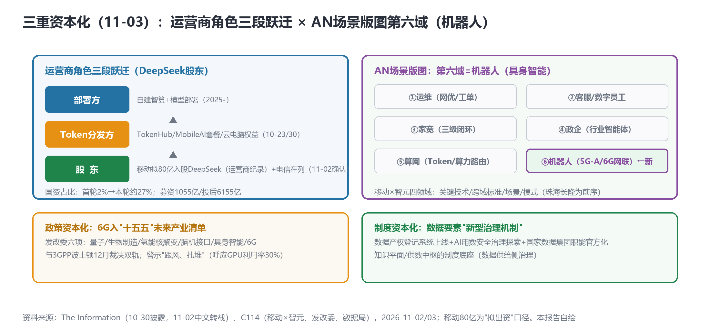

# 三重资本化日：Token供给侧入股（移动80亿投DeepSeek）、6G入"十五五"未来产业、数据要素治理上线——AN第六场景域同步开启

> **分析对象**：2026年11月2日18:00—11月3日18:00窗口的公开增量——DeepSeek二轮融资确认（移动80亿/电信入列）、中国移动×智元网联具身智能合作、发改委"十五五"未来产业清单、国家数据局"数据要素×"三年行动、行情实测、OpenAlex收录滞后实测。三视角来源清单第十三轮执行。
> **系列定位**：智能体技术洞察系列·ADN专题"新场景×新技术"系列的**完整报告第12篇**——本篇是"词元经济"线的**供给侧资本化日**记录：Token经营的股权层落地。
> **判定依据**：重大增量——①**移动拟80亿入股DeepSeek**（运营商投资国内大模型规模纪录，电信在列）——运营商角色三段跃迁：部署方→Token分发方→股东②**AN第六场景域（机器人）开启**：移动×智元"蜂窝网联成为具身智能机器人必备能力"跨域标准③**6G入官方未来产业清单**④数据要素"新型治理机制"上线（知识平面制度底座）。
> **口径约定**：【首发】【重申】【反向】【待核实】沿用系列口径；移动80亿为"**拟出资**"口径（The Information 10-30披露、11-02中文转载，未见两大集团公告——**传闻转正文级但未官方**）；行情为新浪实测。
> **术语消歧**：ADN指自动驾驶网络/自智网络；具身智能=Embodied AI（物理载体智能体）；MRSS/CLIC等沿用前篇口径。
> **立场**：设备商（ADN解决方案提供方）视角。

## 一、趋势判断

### 1.1 Token供给侧资本化：移动80亿入股DeepSeek——三段跃迁完成【首发·资本·重点】

DeepSeek二轮融资确认（The Information 10-30披露）：募集**1055亿元**、投后估值**6155亿**、近30家投资方；**中国移动拟出资80亿元**（运营商投资国内大模型规模纪录）、**中国电信在列**；国资占比首轮约2%→本轮约27%；资金流向=自建智算集群/高端芯片/推理服务（[C114中文转载，2026-11-02](https://www.c114.com.cn/news/16/a1319981.html)，【首发·资本，"拟"口径未官方】）。

*图1：运营商角色三段跃迁×AN场景版图第六域——三重资本化的产业结构（本报告自绘）*

**点评**：自10-23财报季以来追踪的Token经营五级渗透（财报→建网→标准→计费→终端）+话语层（第六站），今日抵达**股权层（第七站）**——运营商从"部署方→Token分发方→**股东**"完成三段跃迁：入股上游模型商意味着**Token供给侧的资本绑定**——"做高价值Token的经营者"（联通语）不仅是经营表述，更是资本配置决策。三个衍生判断：①**联通缺席**（假设与扣非-36.2%的投入约束相关，待业绩说明会验证）——**资本能力分化**成为继"叙事-利润倒挂"之后三家分化的第二个轴；②国资占比2%→27%=模型供给侧的国资结构化——与国家数据集团（股权+人事）构成"**词元治理三层结构**"（国家层→集团层→市场层）之上的第四层：**模型公司股权层**；③资金流向（自建智算/高端芯片/推理服务）=运营商资本直接进入DCI与推理基础设施——**空芯光纤（11-02）与昇腾超节点（获奖）的采购确定性再+1**。

### 1.2 AN第六场景域：机器人（具身智能）开启【首发·场景】

中国移动×智元启动**5G-A/6G网联具身智能合作**：四大领域——关键技术共研/**跨域标准制定（"推动蜂窝网联成为具身智能机器人必备能力"）**/场景共育/模式共创；前序为9月珠海长隆**全球首个大规模5G-A具身智能应用**（[C114，2026-11-02](https://www.c114.com.cn/news/16/a1319979.html)，【首发·场景】）。**点评**：ADN场景版图从五域（运维/客服/家宽/政企/算网）扩展至**第六域：机器人**——蜂窝网联机器人是"网络服务对象从人向智能体拓展"（华为10-30）之后的**服务对象实体化**：网络不仅要服务软件智能体（数字员工/社会），还要服务物理智能体（机器人）。跨域标准目标（必备能力）意味着**5G-A/6G的机器人联网KPI（时延/可靠性/算网协同）将进入标准文本**——与3GPP"AI原生RAN"、A2A-T互联、MidLink（无人区）同构，设备商的机器人联网模组/边缘算力产品线获得明确需求锚点。移动6G智能体通信赛道（乌镇）至此有了**实体场景（机器人）+标准路径（跨域标准）+资本（DeepSeek推理服务）**的三角支撑。

### 1.3 6G入"十五五"未来产业清单：政策资本化【首发·政策】

发改委明确"十五五"重点发展**量子科技、生物制造、氢能核聚变、脑机接口、具身智能、第六代移动通信**——6G从研究展望升级为官方未来产业清单项；同时警示"**跟风**""**扎堆**"苗头（[C114，2026-11-02](https://www.c114.com.cn/news/7/a1319968.html)，【首发·政策】）。**点评**：6G的政策资本化与3GPP波士顿裁决（12月）形成"**国内政策+国际标准**"双轨——6G-ADN的投入确定性在中国侧显著上升；"跟风扎堆"警示与GPU利用率30%（11-01）构成同构信号——**建设热的另一面是运营冷**，政策侧已开始打预防针。设备商的6G投入节奏宜"清单内布局+利用率指标绑定"，避免重复5G时代"覆盖先行、变现滞后"的路径。

### 1.4 数据要素"新型治理机制"：知识平面的制度底座【首发·制度】

国家数据局新一轮"数据要素×"三年行动：**数据产权登记系统已上线**、**AI用数安全"新型治理机制"探索**、国家数据集团职能首获官方表述（[C114，2026-11-02](https://www.c114.com.cn/news/7/a1319969.html)，【首发·制度】）。**点评**：知识平面（Telstra×爱立信三领域）此前缺"制度供给"一环——数据产权登记与AI用数治理机制补上：**供数中枢的合规底座**（谁能供数、怎么计费、如何审计用数）有了制度接口。设备商的知识平面产品（含可信度判定/溯源交互）应尽早对接数据产权登记系统——**登记ID可能成为知识资产确权的最小单元**，这是"知识资产入表"（系列10-26建议）的制度通道。

### 1.5 行情：电信披露后最大单日，联通抢跑【重申·市场】

电信**+3.27%收7.270——披露后最大单日涨幅**，七日累计**+6.29%**；联通**+2.25%两连强**（说明会缺位下市场抢跑）；移动+0.85%（新浪实测）。**点评**：叙事溢价的斜率变陡——电信从"确认期"进入"加速期"，7.27元已超10-24起五份报告累计追踪的所有短期目标；联通两连强（+1.37%/+2.25%）与说明会第5天缺位组合=**市场在"抢跑"一个尚未定档的成效披露**——若说明会数据不及预期，回吐风险集中；"抢跑-兑现"剪刀差是下周行情主线。

### 1.6 汇聚点：新场景×新技术映射与方法论

| 新场景/信号 | 靠什么技术兑现 | 关键技术 | 验证状态 |
|---|---|---|---|
| Token供给侧入股 | 移动80亿/电信入列DeepSeek | 词元经济·股权层 | 首发·资本（11-02） |
| 机器人联网（第六域） | 蜂窝网联跨域标准 | 具身智能×5G-A/6G | 首发·场景（11-02） |
| 6G政策清单化 | "十五五"未来产业六项 | 6G-ADN双轨 | 首发·政策（11-02） |
| 数据要素治理 | 产权登记+AI用数机制 | 知识平面制度底座 | 首发·制度（11-02） |
| 具身智能商用前序 | 珠海长隆大规模5G-A | 机器人联网 | 重申·场景 |

**方法论与负结果**：①**OpenAlex新论文收录滞后1-2天**（2610.40744/40927/42068三连404实测）——学术月报"跟进密度"指标需**T+3查询规则**；CLIC/免副本破题后第2天无跟进信号属收录延迟而非学术空白；②联通说明会第5天未定档；③TR291M第10日pending；④江苏有线原董事长被查（治理第四起）；⑤昇腾950超节点获世界互联网大会领先科技奖（国产化锚点+1）、Marvell×Lumentum 1150亿美元合并（光器件整合——空芯/硅光供应链信号）。

汇聚结论：**11-03是"资本化日"——资本、政策、制度三个层面同日完成对智能体经济的资产化确认**：股权层（DeepSeek）、清单层（6G/具身智能）、制度层（数据产权）。产业含义一致：**智能体经济从"叙事"进入"资产负债表"阶段**——设备商的对应动作是把"AI投入"从费用语境改为资产语境（算力/数据/知识/股权四种资产形态）。

## 二、技术诉求分析

### 2.1 诉求矩阵总表（系列八项诉求·今日锚点刷新）

| # | 技术诉求 | 今日触发锚点 | 落点 | 证据状态 |
|---|---|---|---|---|
| 1 | 意图可编译 | （CLIC跟进待T+3） | 意图一致性 | 破题后跟进观察 |
| 2 | 知识可治理 | **数据产权登记上线（11-02）** | 知识资产确权 | **制度底座补齐** |
| 3 | 数据面换代 | DeepSeek资金流向（智算/推理） | Token供给侧 | **股权层绑定** |
| 4 | 闭环可验证 | （无新触发） | 孪生两分支 | T+3观察 |
| 5 | 智能体可互联 | **机器人跨域标准（11-02）** | 网联具身智能 | **第六域开启** |
| 6 | 能力可复制 | 珠海长隆大规模应用 | 场景复制 | 第六域前序 |
| 7 | 价值可记账 | 股权层+政策清单 | 资产化确认 | 资产负债表阶段 |
| 8 | 监督可执行 | "跟风扎堆"警示 | 投入纪律 | 政策预防针 |

### 2.2 内在张力表

| 张力 | 表现 | 对设备商的后果 |
|---|---|---|
| 股东角色 vs 设备商中立性 | 运营商入股模型商 vs 网络设备采购的中立性 | 设备商需证明"网联开放性"（多模型/多芯片适配）——绑定单一模型商的方案风险上升 |
| 投资约束 vs 叙事雄心 | 联通缺席DeepSeek vs "成果账"叙事 | 资本分化第二轴确认；对联通方案报价宜保守（预算弹性收窄） |
| 跟风警示 vs 清单效应 | 6G/具身智能官方清单 vs "扎堆"预防针 | 清单内布局但绑定利用率/KBI指标——"建设热"周期的反周期设计 |
| 具身热 vs 网联标准缺位 | 长隆大规模应用 vs 蜻窝网联标准在研 | 跨域标准窗口=设备商模组/边缘算力规格先行占位的机会 |

## 三、关键技术分析（当期增量优先）

### 3.1 DeepSeek股权层的产业结构【首发·资本·重点】

移动80亿+电信入列（拟口径）=模型供给侧的运营商资本绑定。**点评**：①Token经济学的"三层治理结构"（国家数据集团/运营商TokenHub/市场电商）之上新增**模型股权层**——四层齐备后，词元经济的治理拓扑完整：国家（制度）→集团（股权）→运营商（分发）→市场（消费）；②"推理服务"为资金流向之一=**入股与Token分发形成闭环**（股东身份保障推理供给→自营渠道分发Token→终端权益触达用户）——运营商AI产业链纵贯完成；③设备商机位：推理基础设施（昇腾超节点/DCI空芯互联/边缘推理）是这条闭环的物理载体——**"资本进入推理"必然转化为"设备订单"**，投标时点预计在2026Q4-2027Q1。

### 3.2 蜂窝网联机器人：第六域的规格入口【首发·场景·重点】

"推动蜂窝网联成为具身智能机器人必备能力"的跨域标准目标是本条的核心增量——**机器人联网从"可选外设"升格为"必备能力"**。规格入口三件：①**连接KPI**（指令时延/断线重连/群组协同带宽——机器人群场景的组播需求）；②**算网协同**（机器人端侧推理+云端模型更新的混合架构——RAMA式记忆路由（2610.42068）的产业对应）；③**安全域**（物理智能体的意图闭环——CLIC（2610.40744）在机器人场景的镜像问题：LLM驱动机器人动作的意图一致性校验）。**点评**：第六域把学术三大线（记忆路由/意图闭环/世界模型）同时接上实体场景——**ADN学术线与产业线的最大交汇点可能就是机器人**。

### 3.3 数据产权登记与知识资产确权【首发·制度】

数据产权登记系统上线=知识平面"统一知识分类法/可信度判定/溯源交互"三领域的**制度接口**。**点评**：设备商的知识平面方案应加入"登记兼容"模块：知识资产（网络知识库/故障案例/意图模板）的登记ID、确权主体、使用授权——**"知识资产入表"从会计建议变为流程可能**；与AI用数安全机制（谁可用数训练/推理）结合，构成企业级供数中枢的合规双件套。

### 3.4 OpenAlex T+3查询规则【首发·方法论】

实测OpenAlex新论文收录滞后1-2天（三篇破题论文404、旧论文正常）。**点评**：学术月报的"跟进密度"指标（破题后跟进论文数）需**T+3查询**；S2（无key抽检）与OpenAlex（主通道）的组合排程：**D+0 arXiv命中→D+3 OpenAlex元数据→D+7起引用追踪**——三层时间尺度覆盖预印本全生命周期。

## 四、总结思考

### 4.1 核心命题

11-03把"智能体经济"写进了三本账：**股权账**（移动80亿/电信入列DeepSeek——Token供给侧资本绑定）、**清单账**（6G/具身智能入"十五五"未来产业——政策资本化）、**制度账**（数据产权登记+AI用数治理——知识资产确权通道）。自10-23财报季开启的"AI进财报"追踪，至此抵达最深一层：**AI不再是财报里的叙事行，而是资产负债表里的资产项**——算力资产（智算集群）、数据资产（产权登记）、知识资产（知识平面+登记兼容）、股权资产（模型商）。ADN目标态的"价值可记账"命题，从运营商侧的成效披露（四口径）扩展为全社会侧的资产化确认。**场景版图第六域（机器人）在同一周开启**——软件智能体（数字员工）与物理智能体（机器人）的双主体时代，是"网络服务对象从人向智能体拓展"的最终形态。

### 4.2 关键判断

1. **运营商三段跃迁完成（部署→分发→股东）**——Token供给侧闭环成形；设备商推理基础设施订单窗口预计2026Q4-2027Q1（昇腾/DCI/边缘）。
2. **联通缺席=资本分化第二轴**——与叙事-利润倒挂轴正交；对联通的方案报价与账期管理趋保守，说明会验证后再校准。
3. **机器人是学术-产业最大交汇点**——跨域标准（必备能力）+RAMA记忆路由+CLIC意图闭环在机器人场景三点会合；网联模组/边缘算力规格先行占位。
4. **6G双轨（政策清单+3GPP波士顿）确立投入确定性**——"跟风扎堆"警示要求利用率/KBI指标绑定，反周期设计。
5. **数据产权登记是知识资产入表的制度通道**——知识平面方案补"登记兼容"模块（登记ID/确权/授权）。
6. **OpenAlex T+3规则确立**——学术月报指标的三层时间尺度（D+0命中/D+3元数据/D+7引用）。
7. **电信溢价进入加速期（+3.27%最大单日，七日+6.29%）**——联通抢跑-兑现剪刀差是下周行情主线；说明会数据是唯一解除条件。

### 4.3 对不同主体的启示

**运营商**：入股后的推理服务定价宜与MobileAI套餐口径统一（避免双轨定价）；机器人联网KPI宜纳入5G-A行业专网报价模型；联通说明会宜尽快定档——市场抢跑的兑现风险在累积。

**设备商**：①推理基础设施方案包（昇腾适配/DCI空芯/边缘推理）瞄准2026Q4-2027Q1订单窗口；②网联机器人规格书三件（连接KPI/算网协同/意图安全域）对齐跨域标准；③知识平面"登记兼容"模块；④方案比选增加"多模型适配"声明（对冲运营商股东绑定风险）。

**开发者**：机器人群组协同的组播协议栈与登记ID钱包（知识资产确权客户端）是两个新空白点；OpenAlex T+3监控脚本可复用学术探测管线。

**标准组织**：3GPP波士顿前的6G-SA立场宜吸收"清单效应"（6G入未来产业=中国侧投入确定性）与"跟风警示"（利用率绑定）双向输入；CCSA宜开"蜂窝网联机器人"研究项（与移动×智元跨域标准衔接）；CCSA"智能收入统计口径"规范同步覆盖股权投资收益的统计归口。
