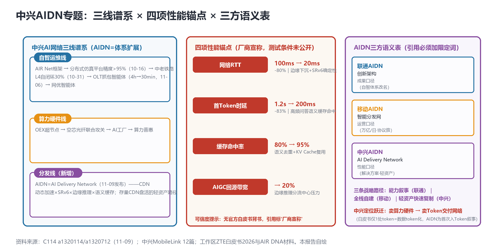

# 中兴AIDN专题：从卖算力硬件到卖Token交付网络——AI Delivery Network的谱系定位、性能锚点与三方消歧

> **分析对象**：中兴通讯AIDN解决方案（AI Delivery Network，MobileLink 2026期间发布，11-09 C114两稿通稿a1320114/a1320712）+ 中兴MobileLink全部12篇稿件 + 工作区存量中兴材料（ZTE自智白皮书2026、_notes_zte2026、AIR DNA专题）——**系列专题第3篇**（用户专项洞察，前两篇：学术版图首期、三方口径对照篇）。
> **专题定位**：对11-09主报告中"中兴AIDN"条目的深度展开——回答四个问题：AIDN是什么（架构与锚点）、从哪来（谱系定位）、意味着什么（Token立场跃迁与战略路径）、怎么引用（三方消歧规范）。
> **口径约定**：四项性能锚点均为**厂商宣称口径**（测试条件未公开、无官方白皮书背书——引用必须标注）；AIDN发布无具名高管引语（通稿式传播）；"体系扩展而非战略转向"为置信度中高的判断（证据链见1.2）。
> **术语消歧**：**AIDN为三方同名异指词**——联通AIDN=创新架构（10-29）、移动AIDN=智能分发网（11-05）、中兴AIDN=AI Delivery Network（11-09）——**任何引用必须加限定词，禁用裸"AIDN"**（语义表见1.4）。
> **立场**：设备商（ADN解决方案提供方）视角——中兴路径对所有设备商的分发层战略均有参照意义。

## 一、趋势判断

### 1.1 AIDN是什么：架构解构与四项锚点【首发·架构解构】

中兴AIDN（AI Delivery Network，智能分发网络）的架构可解构为**三协同**（[C114，2026-11-09](https://www.c114.com.cn/news/127/a1320712.html)，通稿式发布、无具名高管引语）：①**CDN动态加速×SRv6确定性保障**——立足运营商现有CDN基础设施盘活（轻资产起点），SRv6提供转发路径确定性（与1-5-20ms三级时延圈（11-07）、400G OTN骨干同一张网络底座）；②**边缘下沉**——接入/安全/轻量推理/缓存四能力下沉边缘节点；③**语义缓存+KV Cache复用**——高频问答的语义去重与推理上下文复用（图1中栏）。

四项量化锚点（**厂商宣称口径，测试条件未公开**）：网络RTT **100ms→20ms**（-80%，边缘下沉+SRv6确定性）；**首Token时延1.2s→200ms**（-83%，高频问答+边缘语义缓存命中）；缓存命中率**80%→95%**（语义去重+KV Cache复用）；AIGC中心到边缘带宽**降至20%**（边缘推理分流中心压力）。场景演示：AI智能加速+赛事视频分析；定位语："推动业务模式从**带宽、流量经营**向**AI加速、边缘推理、视频智能分析**拓展"+"加快AIDN规模化商用"。

*图1：中兴AI网络三线谱系（左）×四项性能锚点（中）×AIDN三方语义表（右）——本报告自绘*

### 1.2 谱系定位：体系扩展而非战略转向（置信度中高）【首发·谱系】

中兴AI网络体系呈**三线并存**（图1左栏）：①**自智运维线**——AIR Net框架→跨厂家分布式仿真平台（精度>95%，10-16）→中老铁路L4现网自闭环率30%（10-31）→OLT抓包分析智能体（疑难故障4h→30min、优化超90%，11-06）→网优智能体；②**算力硬件线**——OEX超节点/空芯光纤联合攻关/AI工厂/算力普惠；③**分发线（11月新增品牌）**——AIDN。

**关系判断：体系扩展，非战略转向**（置信度中高）。五条证据链：①AIDN发布同期（11-5/7）中兴仍在MobileLink供自智网络成果（AIR Net品牌共存，E1）；②"方案vs网络"的互补定位声明（与移动AIDN为智能分发**网络**相对，中兴为智能分发**方案**，E2）；③AIDN构件复用AIR Net既有能力（毫秒级感知/边缘推理，E3）；④ZTE自智白皮书2026第2.8节经营章为叙事前身（E4）；⑤更名/停更等转向信号为零（E5，AIR DNA专题10-20仍在访）。**结论：AIDN是AIR Net体系向分发层的扩展品牌**——中兴的自智叙事从"智能运维"（AIR Net）扩展为"智能运维+智能分发"双轮，与华为（RANSpirit无线智能体+OpenAN开源）、爱立信（智能网络底座+知识平面）的"平台型"路径不同，中兴选择"**运维+分发**"双方案型路径。

### 1.3 Token立场跃迁：从卖算力硬件到卖Token交付网络【首发·立场】

**工作区证据链**：ZTE自智白皮书2026全文仅1处token（"专有高效token化"——指**数据token化**，非Token经营）；中兴近3个月表态集中在算力供给侧（OEX超节点/算力普惠/AI工厂/大模型出海）与自智网络协作。**AIDN是中兴首次将Token经营写入方案叙事**："助力运营商迈入Token经营新时代"+首Token时延锚点——**定位跃迁：从"卖算力硬件"升级为"卖Token交付网络"**（图1右栏）。

**点评**：这一跃迁的深意在于**设备商对词元经济（系列五级渗透）的第一次正面回应**：运营商五级渗透（财报→建网→标准→计费→终端）+话语层+股权层之后，设备商侧的Token叙事一直缺位（华为RANSpirit讲成效、OpenAN讲开源，均未以Token命名）——中兴以"AI Delivery Network"+首Token锚点补上**"交付性能供给方"**的角色。但缺口同样明确：**中兴在Token的计量/定价/对账三环节仍空白**（未提计量网关、未提分账规则、未提对账审计）——AIDN目前只回答"怎么把Token快而稳地送到"（性能），未回答"Token账怎么算"（经济）。对照Two-Ledger双账本（11-07）与语义缓存分账命题（11-09），中兴的分发方案若不补计量层，将成为"快而不可账"的管道——**计量接口是AIDN v2的必答题**。

### 1.4 三方语义表：三条战略路径的分野【首发·消歧·规范】

**AIDN三方语义表**（引用规范，图1右栏）：

| 限定词 | 全称 | 所指 | 口径 | 战略路径 |
|---|---|---|---|---|
| **联通AIDN** | （未展开） | 创新架构 | 成果口径（自智体系改名，九大成果之一） | **能力叙事**——以架构品牌承载成果账 |
| **移动AIDN** | 智能分发网 | 网络层实体 | 运营口径（Token万亿/日+协议簇OISA/MoMA/IoA/G-SRv6） | **全栈自建**——网络与生态双握 |
| **中兴AIDN** | AI Delivery Network | 解决方案 | 性能口径（四锚点+存量CDN盘活） | **轻资产快速复制**——性能工程差异化 |

**点评**：三条战略路径的分野是本轮MobileLink最有价值的产业观察：①联通以架构品牌承载**成果叙事**（但缺成效数据支撑）；②移动以全栈自建（算力+网络+协议簇+运营量级）走**重资产闭环**；③中兴以存量CDN盘活+性能锚点走**轻资产快速复制**——三者对应完全不同的报价结构（架构授权/网络建设/方案交付）与交付周期。**对其他设备商的参照**：轻资产路径（盘活存量+性能差异化）是中小设备商在分发层对抗全栈自建（移动）与开源生态（华为OpenAN）的现实选项；但轻资产的前提是**锚点可信**——中兴四锚点暂无官方文档背书（见1.5），轻资产路线的信任成本反而更高。

### 1.5 传播与背书缺口：通稿式发布的信号【反向】

**传播状态**：AIDN仅以C114两稿通稿传播（a1320114/a1320712关系待核）；中兴官网press-list未见AIDN独立稿挂网（仅"算力基础设施"栏目页）；SDxCentral/Fast Mode无ZTE命中；**无具名高管引语**（对比移动董事长陈忠岳亲自发布智能网）。**点评**：①AIDN的发布规格低于移动智能网两个量级（无主论坛具名/无官方挂网/无白皮书）——**投入程度的真实信号**：中兴对分发线的资源承诺尚在"试水"档（vs 移动"战略"档）；②四锚点无官方文档背书=引用风险（本系列引用全部标注"厂商宣称"）；③中兴企业稿固定news/127栏目（监控枚举法新增锚点，工程备注）。**观察点**：AIDN白皮书/数据表挂网（若有）是投入升格的信号；3个月内无官方文档则锚点可信度降级。

### 1.6 中兴MobileLink全场速览：三线的集中展示【重申·锚点】

12篇稿件（4篇正文级）：①**6G数据信道编码方案已被3GPP采纳**（方榕乌镇主旨——标准实力锚点）；②**移动×中兴自智联合发布**（三省联动：广东汛期应急三位一体/山东投诉预处理；副总裁郑鹏"**全球自智网络协作第一梯队**"）；③**OLT抓包分析智能体**（福建移动：疑难故障**4h→30min、优化超90%**——"OLT算力+网络智能体=新一代通信网智能运维核心方向"）；④AIDN发布。**点评**：中兴以"标准（3GPP编码）+运维（自智联创+OLT智能体）+分发（AIDN）"三件套完成MobileLink亮相——运维线的OLT智能体（4h→30min）是**自智成效可比库的新增行**（与中老铁路30%/广东46%并列为第三类场景：接入网故障排查），场景元数据齐备后入库。

### 1.7 汇聚表与专题结论

| 维度 | 判断 | 证据状态 |
|---|---|---|
| AIDN定位 | AIR Net体系向分发层的扩展品牌 | 五条证据链（置信度中高） |
| Token立场 | 首次入Token叙事（交付性能供给方） | 白皮书仅1处token（数据token化）对照 |
| 战略路径 | 轻资产快速复制（存量CDN盘活） | 架构组件+发布规格推断 |
| 锚点可信度 | 厂商宣称、无官方背书 | 传播缺口实测 |
| 计量缺口 | 计量/定价/对账三环节空白 | 方案内容比对 |
| 谱系缺口 | AIR DNA与AIR Net关系未研读 | 官网专题待深读 |

**专题结论**：中兴AIDN的本质是**"交付性能供给方"的定位声明**——在词元经济的五级渗透（运营商）完成之后，设备商侧的第一份Token经营答卷。它的价值不在四锚点的绝对值（无背书），而在**三重示范**：①示范了设备商Token叙事的正确切口（性能锚点而非概念）；②示范了轻资产路径的可行性（存量CDN盘活vs全栈自建）；③示范了三方同名化的术语风险（消歧必要性）。它的缺口（计量/定价/对账空白+背书缺失）则恰好圈出了设备商分发方案的**下一步竞争面**：性能锚点会很快被追平（华为/爱立信具备同等边缘能力），**计量接口与官方背书才是分水岭**。

## 二、技术诉求分析

### 2.1 诉求矩阵总表（系列八项诉求·中兴AIDN视角）

| # | 技术诉求 | AIDN触发锚点 | 落点 | 证据状态 |
|---|---|---|---|---|
| 1 | 意图可编译 | （无直接触发） | 意图栈 | 中兴未入局意图层 |
| 2 | 知识可治理 | （无直接触发） | 记忆/知识 | 缺口 |
| 3 | 数据面换代 | **AIDN分发三协同（CDN×SRv6×边缘）** | Token交付网络 | **设备商首例** |
| 4 | 闭环可验证 | （OLT智能体为运维闭环） | 孪生/闭环 | 运维线延续 |
| 5 | 智能体可互联 | （未提IoA/A2A-T对接） | 互联接口 | **缺口** |
| 6 | 能力可复制 | 存量CDN盘活模式 | 轻资产复制 | 路径示范 |
| 7 | 价值可记账 | **计量/定价/对账三空白** | Token经济层 | **最大缺口** |
| 8 | 监督可执行 | （无安全/治理表述） | 治理 | 缺口 |

### 2.2 内在张力表

| 张力 | 表现 | 后果 |
|---|---|---|
| 性能锚点 vs 官方背书 | 四锚点无白皮书 | 引用降级为"厂商宣称"；轻资产路线信任成本上升 |
| 方案定位 vs 网络定位 | 中兴AIDN（方案）vs 移动AIDN（网络） | 互补or竞争待观察——若运营商自建分发网，方案空间被压缩 |
| Token叙事 vs 计量空白 | 首Token锚点 vs 无计量层 | "快而不可账"——v2必答题 |
| 试水规格 vs 战略话术 | 无具名高管/无官方挂网 vs "Token经营新时代" | 资源承诺与话语强度的错配——观察3个月 |

## 三、关键技术分析

### 3.1 四锚点的工程解构与可信度分层【首发·解构】

四锚点对应的机制与可信度：①**RTT 100→20ms**：机制=CDN节点下沉+SRv6显式路径（可信度：中高——SRv6时延压缩为成熟工程，20ms对应省干级可达）；②**首Token 1.2s→200ms**：机制=**边缘语义缓存命中**（可信度：中——命中的是"语义等价的历史响应"，非真实推理；200ms是缓存路径而非模型路径，**高频问答场景的窄口径**——开放域对话命中率会骤降）；③**命中率80%→95%**：机制=语义去重+KV Cache复用（可信度：中低——95%依赖场景高度重复，需标注场景）；④**回源带宽→20%**：机制=边缘推理分流（可信度：中高——结构性效果）。**点评**：四锚点中②③的口径最窄（场景依赖），引用时必须带场景限定；**"首Token 200ms"的真实含义是"缓存命中时的首Token"**——这与Two-Ledger的分账命题（回源Token vs 缓存Token）在同一处相遇：缓存命中不应按全价Token计费，AIDN若对接运营商计费体系，**语义缓存的对账规则是第一个拦路虎**。

### 3.2 语义缓存与KV Cache复用：Token分账的三轨难题【首发·规格】

AIDN的缓存体系使Token计量从"回源/缓存"二分扩展为**三轨**：①**回源推理Token**（模型算力费）；②**语义缓存命中Token**（分发缓存费——语义等价但非原文复用）；③**KV Cache复用Token**（推理上下文复用——部分计费？）。**点评**：三轨计量的费率与归属规则是AIDN对接运营商计费（MobileAI/TokenHub）的前置规格——对照中兴空白（1.3），**建议中兴/设备商阵营将"三轨计量接口"写入AIDN v2规格书**，否则分发方案将停留在"性能层"而无法进入运营商的词元会计体系（Two-Ledger双账本，11-07）。

### 3.3 轻资产路径的战略推演【首发·战略】

中兴"存量CDN盘活"路径与移动"全栈自建"路径的竞争推演：①**成本结构**：轻资产（CDN改造+边缘升级）CapEx约为全栈自建（算网大脑+OISA+GSE+空芯）的零头——快速复制到存量CDN覆盖的城域网；②**控制点差异**：移动握协议簇与运营量级（Token万亿/日），中兴握性能工程与多运营商可达性（方案可卖给任何拥有CDN的运营商）——**中兴路径的天花板是"被运营商集成"，移动路径的天花板是"自建即标准"**；③**时间窗**：轻资产的窗口在运营商自建完成前（移动智能分发网铺开需要数年）——中兴的3-12个月是黄金复制期。**点评**：对其他设备商（爱立信/诺基亚）的启示：分发层的"方案型"定位是避免与运营商自建正面冲突的现实路径——**"运营商建网、设备商供方案、双方在计量接口握手"**是可能的均衡，前提是计量接口标准化（TMF/CCSA窗口）。

### 3.4 中兴自智体系完整拼图：运维+分发双轮【首发·体系】

OLT智能体（4h→30min）+中老铁路L4（30%）+广东可比库（46%为华为侧样本）+AIDN（分发）——中兴体系的完整图景。**点评**：中兴MobileLink三件套（标准3GPP编码/运维自智联创/分发AIDN）显示其ADN竞争策略=**"以标准实力背书运维线，以运维线客户基础带分发线"**——OLT智能体的"OLT算力+网络智能体"表述（接入网算力复用）与AIDN边缘推理共享同一逻辑（**网元算力的二次利用**）——接入网设备（OLT/路由器）的算力复用是中兴区别于华为（无线侧RANSpirit）的差异化战场。

## 四、总结思考

### 4.1 核心命题

中兴AIDN的产业意义不在于一个新方案，而在于**设备商阵营对词元经济的第一份答卷**：当运营商完成五级渗透+话语层+股权层的Token叙事之后，中兴以"AI Delivery Network"+首Token锚点宣告设备商进入Token叙事——定位是"交付性能供给方"。这份答卷的三重示范（性能切口/轻资产路径/消歧必要）与三重缺口（计量空白/背书缺失/互联接口未提）共同画出了设备商分发层竞争的地图：**性能锚点将在数月内被追平，计量接口与官方背书才是分水岭**。三方同名化（AIDN三家异指）则是这套叙事的副产品——它标志着"AIDN"已从企业品牌上升为**行业通用词**，而通用词的定义权（消歧标准）尚未被任何一方认领。

### 4.2 关键判断

1. **AIDN=体系扩展非战略转向**（置信度中高）——AIR Net+OEX+AIDN三线并存；中兴ADN策略="标准背书运维线，运维线带分发线"。
2. **中兴Token立场=交付性能供给方**——首次入Token叙事（白皮书仅1处数据token化对照）；计量/定价/对账三空白是v2必答题，"三轨计量接口"（回源/语义缓存/KV复用）是规格书核心。
3. **四锚点可信度分层引用**——RTT与带宽（中高）、首Token（中，窄口径"缓存命中时"）、命中率（中低，场景依赖）；无官方背书前一律标"厂商宣称"。
4. **轻资产vs全栈自建的路径分野**——中兴3-12个月黄金复制期（运营商自建铺开前）；"运营商建网、设备商供方案、计量接口握手"是可能的均衡。
5. **消歧标准是低成本高杠杆的标准动作**——三方语义表本周内成稿并随TMF/CCSA提案分发；通用词定义权待认领。
6. **观察点**：AIDN官方文档挂网（投入升格信号）+首Token锚点被竞品追平的时点+OLT智能体4h→30min入可比库。

### 4.3 对不同主体的启示

**运营商**：评估AIDN类方案时要求厂商补交三轨计量接口（回源/缓存/复用）与锚点测试条件——性能与可账性同时验收；联通/电信的CDN存量同样可按中兴路径改造（轻资产选项）。

**设备商**：①分发方案的计量接口先行（对照中兴空白反向竞争）；②锚点发布须配官方文档（中兴缺位的教训）；③轻资产路径（存量设施盘活）是差异化现实选项；④OLT类接入网算力复用是中兴验证过的差异化战场（竞对应对位）。

**开发者**：语义缓存命中率测试基准（多场景口径）与三轨计量SDK（Two-Ledger三轨扩展）是两个新空白点。

**标准组织**：TMF宜将"分发层Token计量三轨模型"纳入计费架构议程（Two-Ledger缓存扩展）；CCSA宜立项"智能分发网络术语与接口"（AIDN消歧的标准化通道——通用词定义权的中国答案）。
