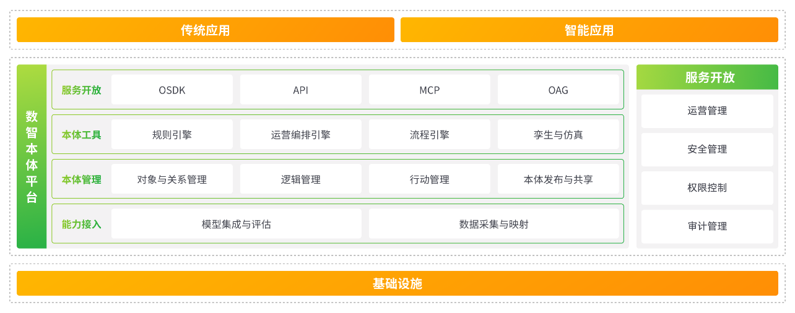
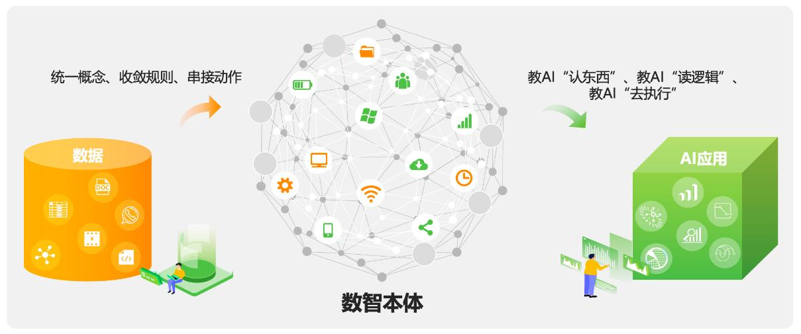
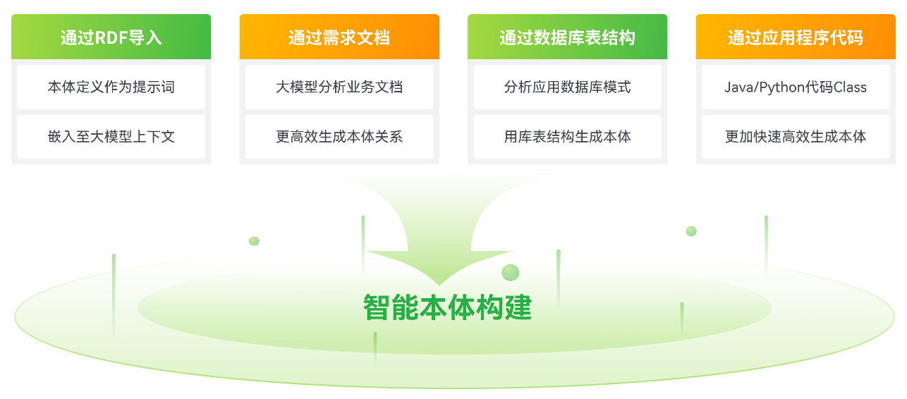
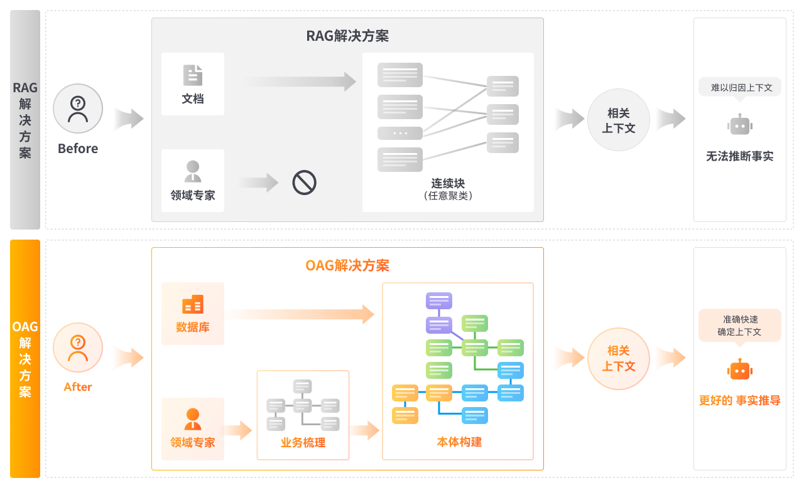
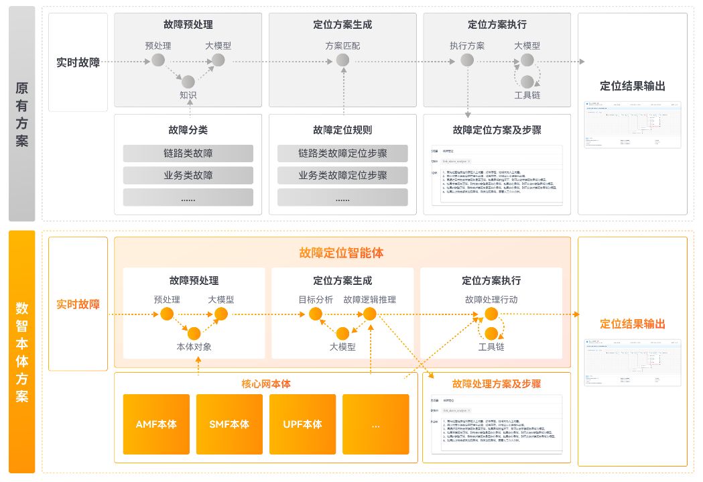
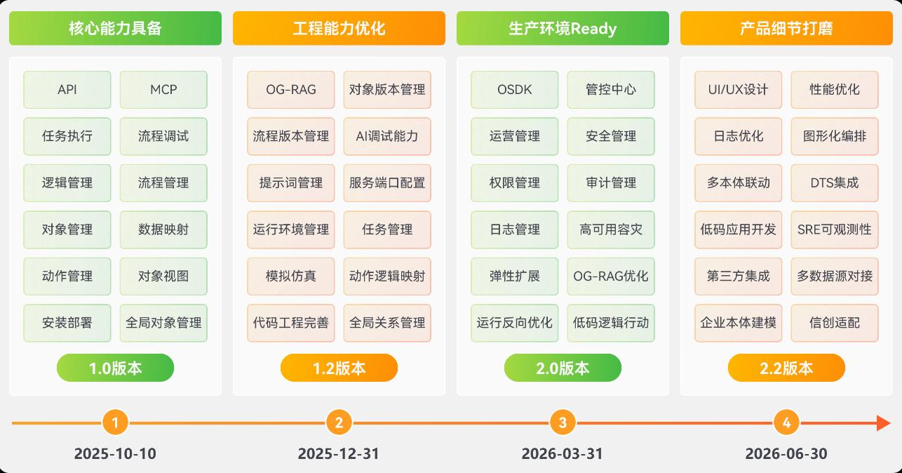

# 本体上了货架——亚信数智本体的三层模型、建见演用四步与开源双线

> **分析对象**:亚信科技《AISWare Ontology Platform 数智本体平台V1.0白皮书》(2025年11月,34页,含三大场景量化案例)、亚信科技官网数智本体平台产品页、Ontology4AI开源项目(ontology4ai.github.io站点、github.com/ontology4ai平台开源仓库、github.com/asiainfo下AN/ODLM/CRM三个本体仓库)、亚信科技FY26中期业绩公告(2026-08-11)
> **核心结论**:对象/逻辑/动作三层建模、"建见演用"四步闭环、API/OAG/MCP/OSDK四路开放,是Palantir范式在中国电信软件业最完整的产品化落地;亚信的护城河不在建模方法,在三十年BSS/OSS场景存量、FDE交付体系与开源联盟卡位;与Palantir的代差收敛到动作围栏粒度与一致性语义两处;本体已嵌入亚信"智能体互联网三位一体"(数智本体平台+编排操作系统+Token计费运营)并进入IEEE P3931标准轨道。
> **系列定位**:智能体技术洞察系列·Ontology专题第三篇。第一篇《Ontology工程化与企业AI受控执行》(2026-10-15)答"Ontology是什么、怎么工程化",第二篇《Palantir本体论六篇联合分析》答"中国怎么落地、反对者怎么说、华为做过什么",本篇答"中国厂商怎么把它做成产品、做成生意"——以亚信科技为完整样本,并与前两篇的工程标准逐项对标。
> **立场说明**:设备商视角贯穿全文,第四章按运营商/设备商/开发者/标准组织分述启示。文中标注"厂商口径"的量化数据出自白皮书与官网,未经独立信源复核;六张插图取自白皮书原文,版权归亚信科技所有,仅用于研究分析。

---

## 一、趋势判断:本体从方法论文变成货架产品,竞争换轨到交付体系与生态卡位

### 1.1 本体不再停留在概念层,已经完成产品化闭环

2025年11月,亚信科技发布《AISWare Ontology Platform数智本体平台V1.0白皮书》,同一时期产品进入官网数智产品体系货架,提供在线试用入口、白皮书与宣传单页下载。宣传单页列出数博会领先科技成果奖、信通院评测、DCMM成熟度三级、ITSS成熟度二级等资质,以及海光CPU、中科方德、飞腾处理器、达梦数据库四项信创兼容认证。产品的问题意识直指AI投资的回报鸿沟:麦肯锡2025年3月《The State of AI》显示78%的企业已在至少一个业务职能应用AI、71%常态化使用生成式AI,但AI应用在与核心业务流程结合时遭遇业务复杂性应对不了、决策过程不透明、决策与行动脱节三类问题。**本体在中国已经走完"概念引入—方法论讨论—产品上架"三级跳;接下来比的不是谁讲得对,而是谁的货架产品先跑出可复制的交付记录。**

### 1.2 三层模型收敛为行业最大公约数:对象、逻辑、动作

数智本体定义为"连接数据与业务的桥梁,将业务数据、逻辑和动作统一建模,让AI以结构化的方式理解并准确执行业务",由三个逐级深化的层级构成:对象层统一业务术语,为AI系统建立跨系统、跨部门的"业务词典"——客户在CRM中是客户、在ERP中可能是下单实体,对象层统一概念并保证与各系统数据的映射;逻辑层把业务专家的决策经验与流程逻辑转化为AI可以严格执行的决策规则库;动作层把决策结果与业务系统操作联系起来,形成"决策—执行闭环"。一句话概括产品哲学:教会AI"认东西、懂逻辑、去执行"。对照第一篇报告的Data/Semantic/Action/Security四层与Palantir官方定义,结构同源——名词(对象)、动词(动作)、约束(逻辑)一体的运行层,各家表述已高度趋同。**三层模型不再是Palantir的专属叙事,而是中国厂商的通用起跑线;真正的分野出现在围栏粒度、一致性语义与推演工程这些深处,后文逐项对标。**

### 1.3 "演"被做成一等公民:仿真推演进入本体标配

白皮书把"演本体"与建本体、见本体、用本体并列为四大基础功能:在关键决策前,基于本体模型模拟真实业务流程,预测不同策略的可能结果,输出比对结果、可视化图表、业务流程图与最优决策建议,价值表述为"在一个与真实业务逻辑完全同步的语义环境中进行高保真推演"。引爆案例是运营商营销应急决策:2025年国庆前夕台风"桦加沙"逼近华南,某运营商需在iPhone 17上市推广(覆盖10+城市、200+门店、5000+户外广告资源)与台风安全之间决策"广州线下门店是否临时停业并转线上履约"——本体提供统一语义表达("广州天河旗舰店"在CRM与销售系统中的同一实体识别)、明确业务逻辑("关店损失评估模型"直接调用而非凭空捏造公式)、安全业务操作("关闭门店"封装后自动执行)。**"先模拟后执行"在第一篇报告里是工程建议,在亚信这里已经是产品功能位;仿真推演与数字孪生正在合流,推演能力成为本体平台的验收硬指标。**

### 1.4 OAG从社区词汇变成产品功能,RAG与OAG的分野被写进商用白皮书

白皮书术语表正式收录OAG(Ontology Augmented Generation)并给出自己的定义:"基于本体引导的检索增强生成,优先检索与当前上下文语义相关的规则、案例与数据,实现精准检索和推理"。作为特色功能,OAG被定位为解决"复杂场景中大量对象和关系导致大模型找不到最优执行方案"的问题,工程手段四件套:路径剪枝(自动剔除无效推理分支)、规则优先级(按业务重要性动态排序执行规则)、上下文感知(结合场景选择最优逻辑路径)、执行回溯(推理错误时自动回退并重试)。对照第二篇报告引述的OAG能力光谱——第0代免SQL报表到第3代运营语义层——亚信直接把OAG做成了产品功能与开放接口名(API/OAG/MCP/OSDK四路开放之一)。**OAG正在从社区概括词变成厂商接口词;"检索质量的分水岭在语义描述"上升为"执行质量的分水岭在路径优化",本体平台的价值主张从供知识转向供最优执行路径。**

### 1.5 开源成为本体竞争新战线:平台与本体库双线并进

亚信主导的Ontology4AI开源项目(ontology4ai.github.io)走的是"平台+本体库"双线:平台侧,github.com/ontology4ai/ontology以Apache 2.0+MIT双协议开源数智本体平台核心版,Java(Spring Boot)+Python微服务架构,本体管理服务、图谱交互服务、后台路由服务、扩展开发工作台四个模块开源源码,APISIX网关、Redis、MySQL、MinIO、Code Server一键Docker编排,数据集成与高级任务调度留给商业版;本体库侧,github.com/asiainfo下开源自智网络本体(AN-Ontology)、数据治理本体(ODLM)、客户关系管理本体(CRM-Ontology)三大库,采用OWL(RDF/XML/TTL)标准发布,全部文件带版本化IRI标识符,本体文件采用CC BY 4.0协议。联盟阵容直接决定标准的权重:主办亚信科技,联合单位包括中国移动、中信科移动、Intel、高通、昇腾、清华AIR、同济大学、中山大学、紫金山实验室、香港理工、阿尔伯塔大学、IEEE等。**平台开源抢开发者,本体库开源抢行业标准;OWL本体库加版本化IRI是"语义公共品"的标准占位动作——与GB/T 48000.3、OSI形成三条并行的语义公共品供给线,设备商现在不占位,以后只能在别人的本体库里挂名。**

### 1.6 汇聚点:本体嵌入"智能体互联网三位一体",成为智能体经济的地基资产

FY26中期业绩公告(2026-08-11)给出了本体在亚信战略版图中的确切位置:在智能体互联网领域,构建由"数智本体平台、智能体互联网编排操作系统、Token计费与运营"组成的三位一体基础设施,并牵头成立IEEE智能体互联网P3931国际标准工作组。同期的业务事实链完整:智能数据运营业务收入4.92亿元、同比增长65.2%、占比22.4%;公司正逐步建立可复制的FDE交付模式;Token运营产品"天枢·元衡"正式发布并在某运营商平台上线,"从话单到Token单的计费基因在AI时代完成迁移"。三条线索汇成一个判断:本体是智能体的世界模型与围栏(第一篇结论),Token计费是智能体经济的价值度量(用户Token经济系列结论),而把两者焊在同一个厂商货架上的产品组合,已经出现在中国电信软件业。**本体不再是AI项目的配套件,而是智能体互联网的地基层;三十年BSS/OSS积累的"计费基因"让运营商出身的软件厂商在这场地基竞争中握有别人没有的商业模式抓手。**

---

## 二、技术诉求分析:把本体做成货架产品对工程体系的七项诉求

### 2.1 诉求逐条展开

**诉求1:跨系统语义统一**
- **诉求内容**:建立跨部门、跨系统、跨岗位的通用业务语言体系,同一业务实体在各系统中获得唯一识别("华南体验中心"与"广州天河旗舰店"指向同一对象),本体空间支持版本管理。
- **结论**:语义统一是本体平台的第一交付物;做不到实体消歧,后面所有推理都在放大"张冠李戴"式幻觉。

**诉求2:建模降本与多源摄取**
- **诉求内容**:传统本体构建依赖专家访谈与文档梳理,周期长成本高;平台需从RDF导入、需求文档、库表结构、应用代码四类源材料中用大模型提取实体与关系,自动生成本体草图,并支持智能推荐属性、本体智能优化。
- **结论**:构建成本是本体普及的第一瓶颈;四路摄取把存量资产(文档、库表、代码)变成建模原料,攻的是"从0到1"的成本,但业务口径的共识仍需人来对齐。

**诉求3:决策可仿真**
- **诉求内容**:本体模型接入实时业务数据,在语义环境中高保真推演,比对不同策略的潜在结果,生成决策建议;"演本体"与建/见/用并列为一级功能。
- **结论**:仿真把本体从"描述世界"升级为"预演世界";推演保真度取决于本体与实时数据的同步机制——这正是设备侧遥测可以做出差异化的位置。

**诉求4:能力可服务化、建模即交付**
- **诉求内容**:设计完成的本体模型一键发布,自动转化为RESTful API与MCP服务;对外提供API/OAG/MCP/OSDK四种粒度的开放方式;本体描述文件与封装为MCP服务的逻辑、动作直接导入智能体。
- **结论**:本体资产的价值兑现靠服务化;开放粒度谱系(API粗、OSDK细)决定了从业务人员到专业开发者的覆盖宽度。

**诉求5:推理可优化**
- **诉求内容**:OAG四件套——路径剪枝、规则优先级、上下文感知、执行回溯——确保大模型在大量对象、关系、逻辑中找到并走通最优执行路径。
- **结论**:对象规模上去之后,推理优化从锦上添花变成可用性前提;执行回溯对应第一篇报告的状态时效校验,两者都指向"推理错了要能退回来"。

**诉求6:知识可沉淀为公共资产**
- **诉求内容**:领域本体以OWL标准、版本化IRI开源发布(CC BY 4.0),形成跨行业本体模型库;自智网络本体定位为AN Agent的长期记忆组件与世界模型,支撑多厂商设备互操作与跨OSS系统语义统一。
- **结论**:本体资产化的终点是公共品化;谁的本体库成为行业默认引用,谁就握住跨组织语义对齐的起草权。

**诉求7:运行可管控**
- **诉求内容**:管控中心统一提供运维管理、安全管理、权限控制与审计管理;智能执行精准的价值表述为"每一步决策都可追溯、可解释"。
- **结论**:管控是本体进生产的安全底线;但"权限控制与审计"一句带过的深度,与Palantir"特权临时、可收回、可观测"的细粒度围栏之间,仍隔着一个产品代差(详见第三章对标)。

### 2.2 诉求矩阵总表

| 诉求 | 核心内容 | 关键锚点 | 缺失后果 |
|---|---|---|---|
| 跨系统语义统一 | 业务词典+实体消歧+本体版本 | CRM客户vs ERP下单实体统一 | 张冠李戴式幻觉,数据统计失真 |
| 建模降本 | 大模型四路摄取+草图生成+智能优化 | RDF/需求文档/库表/代码 | 专家访谈式建模,周期以月计 |
| 决策可仿真 | 语义环境高保真推演+结果比对 | 台风应急决策,关店损失评估模型 | 决策靠经验拍板,错了才回调 |
| 能力可服务化 | 一键发布API+MCP,四路开放 | "建模即交付,发布即可用" | 本体锁死在建模工具里 |
| 推理可优化 | OAG四件套 | 路径剪枝/规则优先级/上下文感知/执行回溯 | 对象一大,大模型迷失 |
| 知识公共品化 | OWL+版本化IRI+CC BY 4.0 | AN/ODLM/CRM三大本体库 | 语义锁死在单一厂商 |
| 运行可管控 | 管控中心:运维/安全/权限/审计 | 每步决策可追溯可解释 | 本体进不了生产环境 |

### 2.3 内在张力表

| 张力 | 一方 | 另一方 | 现实的折中 |
|---|---|---|---|
| 开源核心 vs 商业增值 | 平台开源抢生态 | 数据集成、任务调度留在商业版 | open-core分层:建模与服务化开源,数据与调度收费 |
| 构建自动化 vs 业务问透 | 大模型四路摄取提速 | 业务口径共识需人对齐 | 机器生成草图,人类裁决确认;工具压缩技术验证不压缩共识 |
| 通用模型库 vs 行业专有 | 跨行业本体库讲规模 | 领域本体天然专有 | 骨架开源公共品化,行业语义资产化,CC BY 4.0划清引用边界 |
| 推演保真 vs 推演速度 | 与真实业务逻辑完全同步 | 实时同步成本高 | 演本体接实时数据,但同步分级机制未公开 |
| 平台开放 vs 执行安全 | API/OAG/MCP/OSDK四路开放 | 写操作需围栏 | 开放的是本体能力,执行依托外部智能体平台;围栏深度未产品化 |
| 标准公共品 vs 竞争卡位 | OWL本体库开源共建 | 起草权即话语权 | 以联盟阵容+IEEE P3931+TMF推广,把公共品做成卡位 |

---

## 三、关键技术分析

### 3.1 产品定位与五层功能架构:数据基础设施与数智开发工具之间的认知层

*素材:《数智本体平台V1.0白皮书》第4-5章*

产品定位表述为"位于数据基础设施层与数智开发工具层中间",向下通过能力接入层承接数据平台的数据处理能力与智能平台的大小模型能力,向上以服务开放层(OSDK、API、MCP、OAG四种粒度)支撑智能应用。功能架构自上而下五层:服务开放层承载开放功能;本体工具层提供规则引擎、运营编排引擎、流程引擎、孪生与仿真引擎;本体管理层承载语义建模(对象与关系建模、逻辑建模、行动建模及模型管理);能力接入层对接数据与模型;管控中心横切运维、安全、权限与审计。产品自述目标是"为企业构建一个可进化、可协同、可信赖的'企业大脑'"。

*白皮书图5-1:数智本体平台功能架构——服务开放层/本体工具层/本体管理层/能力接入层纵向叠层,管控中心横切(取自白皮书原文,版权归亚信科技所有)*

**点评**:这张五层图与第一篇报告"Data、Semantic、Action/Logic、Security四层一体的运行层"几乎逐层对应,差异有两处,都值得设备商注意。其一,工具层里"孪生与仿真引擎"与本体并列——数字孪生在本体平台内部化,印证第一篇"孪生、Ontology、受控执行三者互为前提"的判断;其二,管控中心独立成层而非嵌在动作里,说明动作治理在亚信的产品叙事里是"平台级管理功能"而非"动作级属性"——这正是与Palantir把前置条件/权限/审批建模进Action本身的代差所在。

### 3.2 三层模型的工程语义:对象有版本、关系有基数、流程可执行

*素材:《数智本体平台V1.0白皮书》第3、6章*

对象层的工程细节:建立本体空间及版本;对象类型定义业务实体语义并关联数据集;属性提取建立属性与数据源字段的映射关系并支持智能推荐;关系构建定义从概念到数据的关联、关系的语义描述与实体间基数。逻辑与动作的分工:"逻辑"定义业务规则、"动作"定义执行的行为、"流程"定义可执行本体——流程作为第三种建模原语,把规则与动作串成可运行的编排。见本体提供图谱探查,节点类型覆盖对象、逻辑、动作、接口四类,支持图谱钻取、语义检索与条件筛选。

*白皮书图3-1:数智本体使能AI——对象层统一业务概念、逻辑层明确业务规则、动作层驱动业务闭环(取自白皮书原文,版权归亚信科技所有)*

**点评**:"本体空间及版本"与"关系基数"这两个细节表明建模深度在向软件工程纪律靠拢(第一篇的Git/版本/测试主张)。真正有信息量的是"流程定义可执行本体"——流程升为建模原语,意味着亚信把电信行业最重的存量(流程)直接当作本体的第一公民,这是BSS/OSS厂商的本能,也是与互联网系厂商(从数据出发)的路线分歧。对设备商,网管侧的对应物是工单流程、割接流程、变更流程——流程本体的建模权同样值钱。

### 3.3 建见演用四步闭环与多路摄取:构建成本的一次系统压缩

*素材:《数智本体平台V1.0白皮书》第6章*

四步构成产品的完整生命周期:建本体(本体设计器定义对象、属性、关系、规则与行为)、见本体(图谱化呈现与探查)、演本体(实时数据驱动的动态推演与预测)、用本体(本体描述文件与MCP服务导入智能体,提供本体知识服务与多粒度逻辑服务)。特色功能之一是大模型辅助构建:从RDF导入、需求文档、库表结构、应用代码四类源材料提取实体与关系,自动生成本体草图,辅以文本自动提取、库表自动提取、代码自动提取(从业务代码中抽取词汇)与本体智能优化,白皮书对价值的表述是"攻克了传统的自上而下本体构建的难题"。

*白皮书图6-6:本体构建方式——RDF导入、需求文档、库表结构、应用代码四路源材料经大模型提取生成本体草图(取自白皮书原文,版权归亚信科技所有)*

**点评**:四路摄取里最被低估的是"代码自动提取"——三十年BSS/OSS的系统代码与库表就是行业语义的最大化石层,把代码词汇抽取成本体素材,等于让存量系统自己交出业务词典,这是对第二篇报告"把本体构建成本打到接近零"路线的具体实现。保留意见同样明确:摄取解决结构的从0到1,解决不了语义描述的从0到1——severity写成"漏洞严重等级"还是九项语义扩展,工具替代不了业务问透;厂商口径中"构建效率提升"没有量化基线,引用需谨慎。

### 3.4 OAG四件套:从检索增强到执行路径优化

*素材:《数智本体平台V1.0白皮书》第2、6章*

RAG与OAG在白皮书里被并列对比:RAG将查询转为向量、相似性搜索取top-k指导生成;OAG作为"基于本体引导的检索增强生成",优先检索与当前上下文语义相关的规则、案例与数据。工程实现四件套:路径剪枝剔除无效推理分支;规则优先级按业务重要性动态排序执行规则;上下文感知结合场景选择最优逻辑路径;执行回溯在推理错误时自动回退重试。OAG同时是服务开放层的接口之一,与API、MCP、OSDK并列。

*白皮书图6-7:RAG与OAG解决方案对比——RAG向量检索top-k指导生成,OAG基于本体引导优先检索规则、案例与数据(取自白皮书原文,版权归亚信科技所有)*

**点评**:这是中国厂商第一次把OAG写成产品术语表条目并配架构图——第二篇报告预判的"OAG光谱第3代:运营语义层"有了明确的厂商实现。四件套的实质是把确定性算法叠加在本体推理之上:剪枝、排序、路径选择、回溯全是经典搜索技术,本体提供搜索空间与评估依据,大模型提供意图翻译。对设备商,这套四件套可以直接移植为运维Agent的执行引擎设计清单——告警风暴下的根因搜索正需要路径剪枝与执行回溯;差距在于白皮书未给出与第一篇四档校验(PASS/WARN/CLARIFY/REJECT)对应的写操作围栏,推理优化只覆盖"怎么找对路",未覆盖"这条路能不能走"。

### 3.5 场景实证:营销、CEM与自智网络的量化答卷

*素材:《数智本体平台V1.0白皮书》第7章*

三个场景给出量化结果(均为厂商口径):

| 场景 | 本体用法 | 厂商口径收益 |
|---|---|---|
| 智能营销(某省政企全光产品) | 业务对象与关联关系结构化,融合多专家经验,本体+大模型生成千人千面话术,营销决策仿真 | 营销转化率1.2%→3.1%,方案采纳率4.9%→10.5% |
| 客户体验管理(某省CEM) | 客户满意度原因分析本体,自动生成本体提示词与MCP服务,修复方案仿真推演,联动工单一键执行 | NPS提升33%,服务响应时间提升85%,单处理周期提升75% |
| 自智网络运维(某专网核心网) | 核心网本体+大模型生成故障定位方案,调用工具执行并根据中间结果输出下一步骤,轻量人工确认 | 故障定位准确率74%→89%,定位时长58分钟→27分钟 |

自智网络场景的方案结构最完整:本体突破规则库覆盖限制(推理溯源、场景适配性广),本体提供最优定位方案,智能推理结合轻量人工确认压缩时长;白皮书将其定性为"自智闭环网络"体系,运维模式从"被动响应"向"主动自愈"跃迁。

*白皮书图7-5:基于本体的自智网络——核心网本体+大模型推理生成故障定位方案并执行(取自白皮书原文,版权归亚信科技所有)*

**点评**:自智网络是三个场景里唯一"本体+大模型+工具执行+人工确认"全链路跑通的场景,也是对设备商信号最强的场景:故障定位时长58→27分钟、准确率74%→89%的直接变量是把"故障定位专家规则"升级为"核心网本体上的大模型推理"——规则库的天花板(覆盖有限)被本体的推理能力顶开,这与第二篇灭火图案例"对象-状态-下钻"的运行时语义层殊途同归。三点保留:一是"轻量人工确认"的确认边界没有定义,写操作围栏仍是黑盒;二是案例对象是专网核心网,复杂度低于公网多厂商环境;三是所有数字为厂商口径,立项对标时应要求POC复测口径。

### 3.6 开源双线与标准卡位:平台open-core、本体库OWL化、联盟与标准三线并进

*素材:ontology4ai.github.io、github.com/ontology4ai/ontology、github.com/asiainfo/AN-Ontology、《数智本体平台V1.0白皮书》第8-9章*

平台线:开源版聚焦本体全生命周期管理——可视化语义建模、本体一键发布为RESTful API与MCP服务("建模即交付,发布即可用")、图谱数据交互引擎、集成Code Server的扩展开发工作台;四个开源模块(ontology管理态核心Java源码、ontology-graph图谱交互Python、ontology-backend路由中枢Python、code_gen工作台Python)加编译包提供的common/dataps/links组件,Apache APISIX做网关,Redis/MySQL/MinIO/Code Server一键编排;部署门槛Docker 20.1+、32GB内存、200GB磁盘;开源版默认产出"标准的提示词输出与MCP Server输出",执行依托外部智能体平台——官方推荐亚信自有AAP或Dify(≥1.9.0)。本体库线:AN-Ontology仓库已发布物联网投诉工单本体(TTL文件1048行,含约30个owl:Class声明、18个对象属性、16个数据属性),核心网故障本体与网络资源本体在路线图中(2025年Q3启动设计验证、Q4发布正式版本);AN Ontology的自述定位——"充当机器的世界模型,为智能体提供精确推理依据,将高层业务意图转化为可执行的网络策略,是实现L4/L5级自智网络自动化与闭环决策的核心基石",并明确支撑"统一不同OSS系统的语义表达、促进多厂商设备的互操作性";标准化路径为TMF推广、开源社区共建、W3C本体最佳实践。联盟与标准线:Ontology4AI联合单位覆盖运营商(中国移动)、芯片(Intel/高通/昇腾)、高校(清华AIR/同济/中山/港理工/阿尔伯塔)、研究机构(紫金山实验室)与IEEE;亚信牵头IEEE智能体互联网P3931国际标准工作组,累计参与制定国际国内标准410项。

*白皮书图8-1:数智本体平台演进路线——在核心能力基础上向工程化、生产化演进,优化性能、UI与信创适配(取自白皮书原文,版权归亚信科技所有)*

**点评**:三条线拼出亚信本体战略的完整棋路——平台开源解决"别人为什么用",本体库开源解决"别人为什么按我的词说话",联盟与标准解决"行业为什么认"。AN-Ontology把"多厂商设备互操作"写进本体定位,直接触碰设备商最敏感的语义主权:OSS语义层的公共品一旦由BSS/OSS厂商主导起草,设备商的网元语义就要在别人的命名空间(http://asiainfo.com/an-ontology#)里安家。对设备商,这不是要不要参与开源的问题,而是以什么身份参与——贡献方、共治方还是被定义方;IoT投诉工单本体1048行TTL约30类34属性的规模也提示,现有本体库仍处早期,现在进入起草成本最低。

---

## 四、总结思考

### 4.1 核心命题

本体竞争已经换轨:从"方法论是否正确"(第一篇的议题)与"该不该祛魅"(第二篇的议题),进入"产品成熟度、交付体系、生态卡位"的三线作战。亚信科技用一份34页白皮书、一个可试用的V1.0产品、一套open-core开源平台和三大OWL本体库,把Palantir范式翻译成了中国电信软件业的货架产品;其护城河不在三层模型——那已是行业通用起跑线——而在三十年BSS/OSS场景存量、从话单到Token单的计费基因、可复制的FDE交付体系与产学研标准联盟。

### 4.2 关键判断

1. **三层模型(对象/逻辑/动作)已成中国厂商最大公约数,代差收敛到两处深处**。一处是动作围栏粒度:Palantir把前置条件、权限、审批、审计建模为Action一等属性,"特权临时、可收回、可观测";亚信版把权限审计放在平台管控中心,动作本身不带围栏属性。另一处是一致性语义:第一篇的System of Record单向写路径与属性级STRONG_ON_READ分级,在亚信白皮书中没有对应物,本体与业务系统之间的写路径主权未明确。这两处是后续所有中国本体产品的分档线。
2. **"演本体"标志仿真推演成为本体标配,数字孪生与本体合流**。台风应急决策案例证明推演价值的场景强度;设备商的孪生体若不与本体语义层打通,就只是可视化壳,推演保真度取决于孪生与实时遥测的同步质量——设备商在此有独家筹码。
3. **OAG成为语义层产品的标准接口词,与MCP构成"语义×连接"双协议**。OAG管"在本体里怎么找最优执行路径",MCP管"怎么发现并调用能力";写进术语表与接口清单意味着商业产品已经开始用协议词汇占领开发者心智,后来的语义层产品要么兼容这两个词,要么自费解释自己。
4. **开源双线是本体赛道的降维打法,语义公共品的起草权竞争已经开场**。平台open-core降开发者门槛,OWL本体库+版本化IRI+CC BY 4.0造行业引用标准,联盟阵容(运营商+芯片+高校+IEEE)给公共品背书;AN-Ontology明写"促进多厂商设备的互操作性"——OSS语义层的定义权正在被BSS/OSS厂商主动认领。
5. **电信BSS/OSS是本体产品化的天然孵化场,但网络域本体是设备商必须回应的敞口**。亚信的本体场景(营销、CEM、核心网故障)全部长在自己的存量交付域;自智网络本体一旦在TMF与运营商侧形成默认引用,设备商的网元/告警/性能语义就成了公共品里的二等词汇——回应方式只能是拿出自己的网络域本体资产并进入共治,而不是旁观。

### 4.3 对不同主体的启示

| 主体 | 启示 |
|---|---|
| 运营商 | 本体平台选型看四件事:动作围栏是否建模进Action(而非只在平台层管控)、本体与业务系统的写路径与一致性语义是否明确、构建摄取是否覆盖存量库表与代码、领域本体库是否开放可迁移;试点按白皮书路径从营销/CEM/故障定位选一,要求厂商给POC量化口径(白皮书数字均为厂商口径);警惕本体平台与智能体平台捆绑锁定——开源版已证明本体层可以独立部署(对接Dify亦可),采购时把两层解耦 |
| 设备商 | 三个动作:一是盘点自有网络语义资产(网元模型、告警语义、工单流程、遥测指标),映射而非重建成网络域本体;二是决定AN-Ontology类开源库的参与姿态——以共治方身份把设备侧语义(OAG视角下的"动作反馈真源")写进标准,而非被定义;三是产品化两个差异化点——设备侧实时遥测压本体投影时差(演本体的保真度来源),写操作围栏(四档校验+特权临时可收回可观测)补全"动作层"的安全深度,这两点是BSS/OSS厂商与纯软件厂商都拿不出的 |
| 开发者 | OAG四件套(剪枝/优先级/上下文感知/回溯)是运维与决策Agent执行引擎的现成设计清单;OWL+TTL是本体资产的可携带格式,版本化IRI与CC BY 4.0是参与开源本体库的合规常识;ontology4ai开源平台(Java+Python微服务,32GB/200GB可跑)适合作为本体工程的低成本实验床;四路摄取中"代码自动提取"是冷启动存量系统的最快路径 |
| 标准组织 | 三个空白点值得立项:网络运营域本体参考模型与TMF AN/意图标准的衔接(避免本体标准与意图标准两套话语)、Agent写操作围栏的语义规范(校验分级、特权生命周期、审计溯源的跨厂商互认)、本体库之间的对齐机制(第二篇"对齐而非统一"的公理化落地);IEEE P3931(智能体互联网)与GB/T 48000.3(标准数字化本体建模)之外,通信网络运营域的公共本体标准仍无人认领 |

