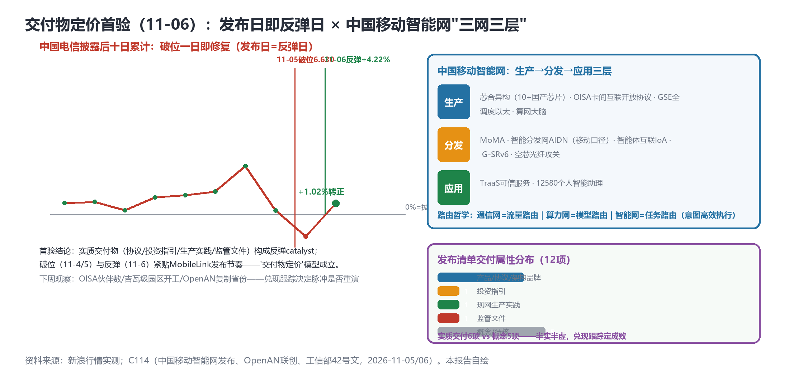

# 发布日即反弹日（电信+4.22%修复破位）：移动"三网三层"任务路由、OpenAN跨厂商对接1天、智能体进网42号文——交付物定价新规则首验成立

> **分析对象**：2026年11月5日18:00—11月6日18:00窗口的公开增量——MobileLink 2026发布清单（中国移动智能网"三网三层"/2027算力投资指引/河南移动×华为OpenAN联创/工信部42号文）、行情止跌反弹（电信+4.22%修复破位）、arXiv暗面工程化（Airlock遏制）。三视角来源清单第十六轮执行。
> **系列定位**：智能体技术洞察系列·ADN专题"新场景×新技术"系列的**完整报告第15篇**——本篇是"交付物定价新规则"（11-05提出）的**首次验证日**：发布日=反弹日，且首份交付属性判定清单成形。
> **判定依据**：重大增量（四重正文级）——①**中国移动智能网正式发布**（三网三层路由哲学+Token生产/分发/应用三层+OISA开放协议）②**OpenAN二期首个联创试点**（A2A-T跨厂商现网生产、对接周期1天内）③**工信部42号文**（智能体终端进网管理：国标唯一身份码）④**发布日即反弹日**（电信+4.22%收6.910修复破位）。
> **口径约定**：【首发】【重申】【反向】【待核实】沿用系列口径；行情为新浪实测；**AIDN同名异指警示：移动AIDN=智能分发网，联通AIDN=创新架构**（同名异指，引用必须区分）。
> **术语消歧**：ADN指自动驾驶网络/自智网络；本篇起"AIDN"为**同名异指词**（中国移动智能分发网/中国联通创新架构），单独列出；OISA=开放互联服务架构（GPU卡间互联开放协议）；IoA=智能体互联（Interconnection of Agents）；TraaS=可信智能体即服务。
> **立场**：设备商（ADN解决方案提供方）视角。

## 一、趋势判断

### 1.1 发布日即反弹日：交付物定价新规则首验成立【首发·市场·验证】

电信**+4.22%收6.910**——破位（11-04/5两日-9%）一日即修复，6.5技术位未触及，十日累计**转正+1.02%**；移动+3.23%、联通+1.13%齐涨（新浪实测）。**"交付物定价"首验成立**（图1左）：破位（11-4/5）与反弹（11-6）紧贴MobileLink发布节奏——实质交付物（协议/投资指引/生产实践/监管文件）构成反弹catalyst。**定价模型的完整形态**：叙事溢价→脉冲→破位→**交付物定价**——市场对"智能经济"话语的回应不是抛弃，而是**要求以交付物兑现**。**下周兑现跟踪三指标**：OISA伙伴数量、吉瓦级园区开工数、OpenAN复制省份数——兑现则定价模型稳固，跳票则脉冲-破位重演。

*图1：电信十日累计的破位-反弹V型（左）×移动智能网三层架构与交付属性分布（右）——本报告自绘*

### 1.2 中国移动智能网"三网三层"路由哲学：意图的最高层表述【首发·架构·重点】

陈忠岳主旨发布**中国移动智能网**：**三网三层路由哲学——通信网=流量路由、算力网=模型路由、智能网=任务路由（意图高效执行）**；Token三层体系：**生产层**（芯合异构平台10+国产芯片/**OISA国内首个GPU卡间互联开放协议**/GSE全调度以太网/算网大脑）→**分发层**（MoMA/**智能分发网AIDN**/智能体互联IoA/G-SRv6/空芯光纤攻关）→**应用层**（TraaS可信服务/12580焕新个人智能助理）（[C114，2026-11-05](https://www.c114.com.cn/news/16/a1320078.html)，【首发·架构】）。**点评**：①"任务路由"是意图驱动（系列诉求#1）的**最高层表述**——从意图接口（设备层）→意图闭环（网络层，CLIC）→**意图作为路由对象**（任务路由，经济层）：任务成为可路由的单元，网络从"传数据"进化为"派任务"；②OISA是异构算力互联的**开放协议主张**（对标NVLink封闭生态）——10+国产芯片的卡间互联若成事实，**国产推理集群的组网自由度**将大幅提升（设备商机：OISA兼容的交换/网关产品线）；③**AIDN同名异指正式显性化**：移动AIDN=智能分发网（Intelligent分发Network），联通AIDN=自治网络创新架构——**同名异指词诞生，术语对齐表必须在一周内增加消歧行**（否则客户RFQ与投标文件将出现混用事故）。

### 1.3 OpenAN商业生产首验：跨厂商对接周期1天【首发·商用·重点】

河南移动×华为**OpenAN二期首个联创试点**："全球首个通信智能体开源框架"表述确认；**A2A-T为纽带**的两个现网生产级智能体：①**跨域协同投诉智能体**（与无线网优/故障等跨厂商智能体动态自协商，贯通10086/EOMS）；②**动态节能智能体**（阶梯电价场景包，**跨厂商对接周期压缩至1天内**）；"OpenAN加速从技术开源迈向商业生产"（[C114，2026-11-05](https://www.c114.com.cn/news/16/a1320079.html)，【首发·商用】）。**点评**：①**OpenAN通道从GitHub监控升级为商业交付追踪**——开源栈进入现网生产（vs 中老铁路L4的设备商私有栈），"开源→商业"路径首次打通；②"跨厂商对接1天"是**A2A-T互通价值的第一次量化锚点**（此前互通收益多为定性）——跨厂商对接周期从周/月级到1天，意味着**智能体互联的边际成本趋近于零**，IoA/A2A-T的规模化临界点临近；③两个场景（投诉协同/动态节能）都是"跨域能力互补"型——与中老铁路"跨域L4协同保障"（下一步）同构，**跨域=OpenAN商业化的第一战场**。设备商动作：OpenAN社区投入从"跟踪"升级为"贡献"（提交跨厂商对接测试用例），抢占开源→商业通道的头部位置。

### 1.4 工信部42号文：智能体进网监管框架落地【首发·监管·重点】

工信部《智能体终端设备进网管理通知》（工信厅信管〔2026〕42号）：**适配验证/进网检测/智能体互联国标唯一身份码/OTA现网升级报备/涉诈评测**（[C114，2026-11-06](https://www.c114.com.cn/news/14/a1320081.html)，【首发·监管】）。**点评**：智能体的"**身份-升级-分发**"三重监管框架落地——监管跟随产业进入智能体时代：①**国标唯一身份码**=智能体互联的身份基础设施（与A2A-T身份层、PATN应答主权同构——**监管为互联协议提供了国家强制力背书**）；②OTA现网升级报备=智能体版本治理（对应暗面"静默失败"与记忆注入的攻击面收敛）；③涉诈评测=智能体内容安全（影响力操纵治理的监管镜像——与2611.04556量化测量同题）。设备商机：**进网测试工具链**（身份码适配/OTA报备接口/涉诈评测套件）是42号文的直接产品化窗口；A2A-T设备资质申报宜提前启动。

### 1.5 投资指引对冲与交付属性分布【重申·投资】

2027算力投资指引（陈忠岳）：总采购5000亿+/**算力1000亿+**/终端1000亿+；智算两年连续翻番、**吉瓦级园区总数将达7个**（今年开工3个）；连算成网（400G OTN+空芯光纤+算网大脑）（【首发·指引】）。**点评**：千亿指引与10月AIDC骤降（40.2亿）形成"指引vs节奏"张力——指引是承诺上限，月度招中标是实际节奏；两者差额=**供给弹性储备**（需求确认后可快速放量），对设备商是"订单波动性上升、总量有底"的新常态。交付属性分布（图1右下）：实质交付6项（产品协议4+指引1+生产1+监管1）vs概念5项——**半实半虚**，"兑现跟踪"是下周判定主线。

### 1.6 arXiv：暗面从威胁模型到遏制工程【首发·学术】

arXiv周四批次：**2611.06727《Airlock》多智能体爆炸半径遏制**（暗面从威胁模型进入**遏制工程**——攻击发生后的隔离/止损设计）；**2611.05832《StarWorld》星链跨层世界模型**；2611.05392不确定性感知资源编排（AI-RAN对标）；2611.05390证据门控人机权限（arXiv，11-05批次，【首发·学术】）。**点评**：暗面研究进入第三阶段（威胁模型→量化测量→**遏制工程**）——治理三件套的技术栈完整化：检测（四联威胁模型）→测量（影响力量化）→**遏制（爆炸半径控制）**。"爆炸半径"概念直接可用于IoA/A2A-T跨域规格：**单个智能体失陷的最大影响范围**应有架构级上限——与42号文身份码、OTA报备组合成"身份-遏制-报备"安全闭环。

### 1.7 汇聚点：新场景×新技术映射与"首验成立"结论

| 新场景/信号 | 靠什么技术兑现 | 关键技术 | 验证状态 |
|---|---|---|---|
| 发布日=反弹日 | 实质交付物清单 | 交付物定价模型 | **首验成立**（11-06） |
| 任务路由 | 智能网三层（生产/分发/应用） | OISA/AIDN/IoA/TraaS | 首发·架构（11-05） |
| 跨厂商对接1天 | OpenAN联创（A2A-T纽带） | 投诉/节能智能体 | 首发·商用（11-05） |
| 智能体进网监管 | 42号文身份码/OTA/涉诈 | 进网测试工具链 | 首发·监管（11-06） |
| 爆炸半径遏制 | Airlock | 暗面遏制工程 | 首发·学术（11-05） |

汇聚结论：**11-06是"首验成立日"**——交付物定价新规则经市场验证（发布日=反弹日），中国移动给出"三网三层"的智能经济基础设施总图，OpenAN打通"开源→商业生产"路径，42号文补上监管底座。**"任务路由+身份码+爆炸半径"三词构成下一阶段产业化的技术三角**：任务可路由（经济层）、智能体有身份（监管层）、失陷可遏制（安全层）——智能体经济的三大前提一天内全部出现。

## 二、技术诉求分析

### 2.1 诉求矩阵总表（系列八项诉求·今日锚点刷新）

| # | 技术诉求 | 今日触发锚点 | 落点 | 证据状态 |
|---|---|---|---|---|
| 1 | 意图可编译 | **任务路由（智能网）** | 任务=可路由单元 | **最高层表述** |
| 2 | 知识可治理 | （无新触发） | 登记兼容 | 待兑现跟踪 |
| 3 | 数据面换代 | **OISA卡间互联开放协议** | 国产异构互联 | 协议主张首发 |
| 4 | 闭环可验证 | StarWorld跨层世界模型 | 跨层保真 | 学术延续 |
| 5 | 智能体可互联 | **IoA+A2A-T跨厂商1天对接** | 互通边际成本趋零 | **量化锚点首个** |
| 6 | 能力可复制 | OpenAN二期联创→复制省份 | 开源→商业 | 复制跟踪开启 |
| 7 | 价值可记账 | 发布日=反弹日 | 交付物定价 | **首验成立** |
| 8 | 监督可执行 | **Airlock爆炸半径+42号文身份码** | 身份-遏制-报备闭环 | 监管+工程齐备 |

### 2.2 内在张力表

| 张力 | 表现 | 对设备商的后果 |
|---|---|---|
| AIDN同名异指 | 移动=智能分发网 vs 联通=创新架构 | 术语对齐表一周内增补消歧行；对外文档禁用裸"AIDN"（必须加限定词） |
| 指引上限 vs 月度节奏 | 2027千亿指引 vs 10月40.2亿骤降 | 订单波动性上升、总量有底——产能与现金流按波动口径规划 |
| 开放协议 vs 封闭生态 | OISA开放 vs NVLink封闭 | OISA兼容产品线（交换/网关）是国产推理集群组网自由度的钥匙 |
| 监管跟随 vs 创新速度 | 42号文三重监管 vs 智能体迭代速度 | 进网测试工具链提前布局；A2A-T设备资质申报前置 |

## 三、关键技术分析（当期增量优先）

### 3.1 任务路由：意图驱动的经济层完成【首发·架构·重点】

三网三层把路由对象从流量（通信网）→模型（算力网）→**任务（智能网）**逐层抽象——任务路由=意图高效执行的最终形态。工程含义：①**任务的可路由表示**（任务描述/SLA/资源需求/信任等级的四元组——对应意图词典空白区的经济层入口）；②任务路由的计费单元（按任务而非按Token——TraaS的定价基础）；③任务路由与词元计量的关系（任务消耗Token，Token计费是任务路由的底层账本）。**点评**：系列诉求#1"意图可编译"至此形成完整栈：意图接口（设备）→意图闭环（网络）→**任务路由（经济）**——三层各有独立规格，设备商的意图产品线应明确标注所在层并预留跨层接口。

### 3.2 OISA与国产异构互联的组网自由度【首发·协议】

国内首个GPU卡间互联开放协议（10+国产芯片参与）对标NVLink封闭生态。**点评**：①OISA把"异构算力互联"从厂商私有接口升格为开放协议——**国产推理集群的组网自由度**（跨厂商芯片混布/算网大脑统一调度）取决于OISA落地质量；②设备商机位：OISA兼容交换机/互联网关/卡间链路质量监测——**卡间互联的网络化**（把GPU互联当作网络问题解决）与GSE全调度以太网衔接；③与空芯光纤攻关（分发层）组合=国产算力集群的"卡-机-园"三级互联体系。设备商动作：加入OISA生态（若开放）、提交互联性能测试用例、发布兼容性白皮书。

### 3.3 OpenAN"开源→商业生产"与A2A-T量化锚点【首发·商用·重点】

跨厂商对接周期1天=智能体互联边际成本趋零的第一个量化锚点。**点评**：①对比历史：传统网元跨厂商对接（北向接口联调）以周/月计——智能体互联的1天化是**数量级改善**，IoA/A2A-T规模化的经济临界点由此打开；②两个生产场景（投诉协同/动态节能）的共同结构=**跨域能力互补**（A域智能体调用B域能力闭环业务）——跨域是OpenAN商业化的第一战场，与中老铁路"跨域L4协同"（下一步）呼应；③设备商的OpenAN策略升级：跟踪→贡献（测试用例/场景包提交）→商业（对接服务报价）三级推进；"1天对接"应成为设备商智能体产品的**出厂承诺指标**（Marketing可用）。

### 3.4 42号文与"身份-遏制-报备"安全闭环【首发·监管·重点】

身份码（互联准入）+OTA报备（版本治理）+涉诈评测（内容安全）+Airlock爆炸半径遏制（工程遏制）——**智能体安全的技术栈与监管栈同日对齐**。**点评**：①国标唯一身份码使"智能体是谁"成为可验证问题（与A2A-T身份层/PATN应答主权互认）；②"爆炸半径"应进入IoA互联规格（单智能体失陷的最大影响范围上限）；③42号文的进网检测=**设备商合规能力的产品化窗口**（测试工具链/适配服务）；④监管栈与治理套件（十类测试用例）的映射表一周内可成稿——**合规即卖点**的新阶段。

## 四、总结思考

### 4.1 核心命题

11-06以"首验成立"收束了11-04/05的两日修正：**交付物定价模型成立（发布日=反弹日），且MobileLink交付了配套的三大件**——中国移动"三网三层"智能网（智能经济的基础设施总图）、OpenAN跨厂商1天对接（互联经济性的量化证明）、42号文身份码（监管底座）。自10-21首篇至今的16天，系列追踪的主线从"叙事有无"（零叙事断点）到"叙事差异"（三口径）到"叙事定价"（脉冲-破位）走到今日的"**交付物定价**"——市场的注意力完成了从概念到交付的闭环，产业的注意力完成了从单点到"任务路由+身份+遏制"三角的展开。**智能体经济的三大前提（任务可路由、智能体有身份、失陷可遏制）在同一天齐备**——这是比任何单日发布更重要的结构性信号。

### 4.2 关键判断

1. **交付物定价模型首验成立**——下周兑现跟踪三指标（OISA伙伴/园区开工/OpenAN复制省份）决定定价模型稳固与否。
2. **任务路由是意图驱动的经济层完成**——意图栈三层（接口/闭环/路由）齐备；TraaS定价基础=按任务计费。
3. **AIDN同名异指是术语紧急事项**——对齐表一周内增补消歧行；对外文档禁用裸"AIDN"。
4. **"跨厂商对接1天"是互联经济性的首个量化锚点**——设备商智能体产品宜以"1天对接"为出厂承诺；OpenAN策略升级为跟踪→贡献→商业三级。
5. **"任务可路由+智能体有身份+失陷可遏制"三角同日齐备**——智能体经济的前提条件闭合；进网测试工具链与A2A-T资质申报是合规产品化窗口。
6. **暗面进入遏制工程阶段（Airlock）**——治理三件套技术栈完整（检测/测量/遏制）；爆炸半径进入IoA互联规格。

### 4.3 对不同主体的启示

**运营商**：兑现跟踪机制（OISA伙伴/园区/OpenAN省份的月度披露）宜制度化——指引与节奏的差额管理；OpenAN复制省份数是"开源→商业"的规模指标，宜纳入年度考核。

**设备商**：①术语对齐表增补AIDN消歧行（本周内）；②OISA生态卡位（兼容白皮书+互联测试用例）；③智能体产品"1天对接"出厂承诺+进网测试工具链（42号文产品化窗口）；④爆炸半径上限进入互联规格；⑤OpenAN从跟踪升级为贡献。

**开发者**：OISA互联质量监测探针与任务路由计费原型（按任务SLA计费）是两个新空白点；42号文合规检查清单开源化。

**标准组织**：CCSA宜开"智能体进网检测方法"项目（42号文配套）；TMF宜将"任务路由"纳入知识平面/计费架构议程（与TraaS衔接）；3GPP波士顿立场文件吸收"任务路由"概念（6G-SA的智能经济入口）。
