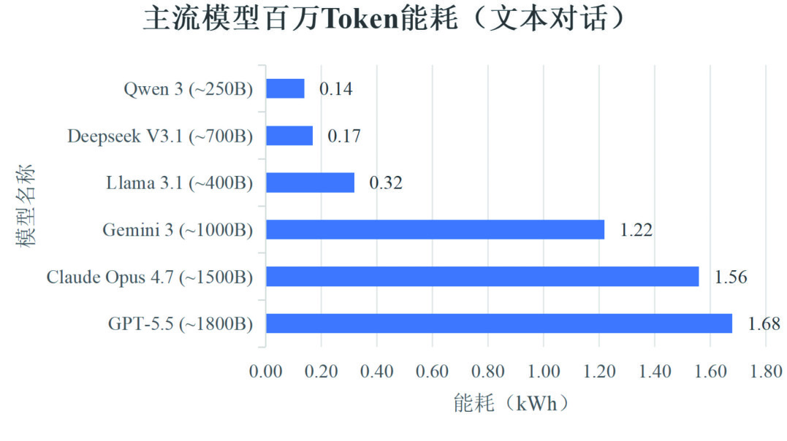
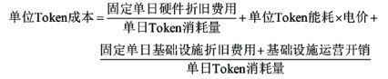
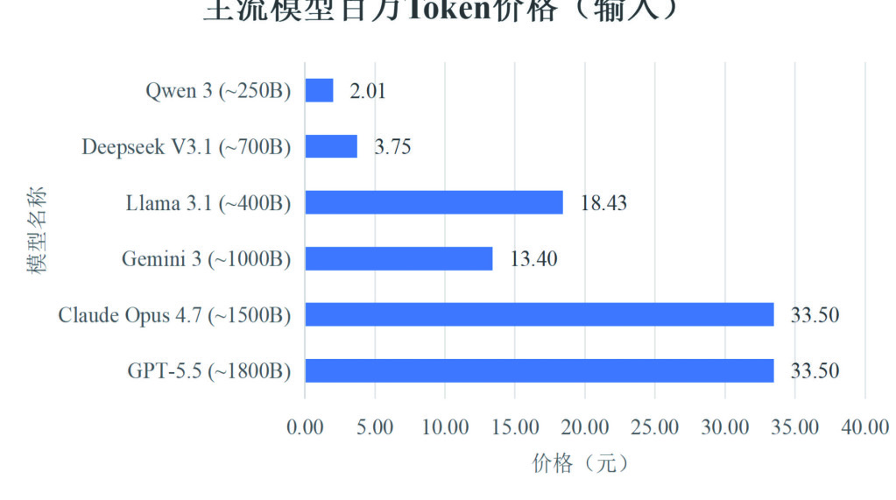

# 《从"算电"到"Token"——智能经济新形态的底层逻辑与普惠之路》洞察报告

> **分析对象**：《通信世界》2026年第7期 专题"Token变革"，第16–19页（中国信息通信研究院 王月、朱国君、白莉婷）
> **主题概述**：2026年3月《政府工作报告》首次提出"打造智能经济新形态"，部署超大规模智算集群、算电协同等新基建工程。原文以"算电为输入、Token为输出"构建智能经济的价值转换框架：用"百万Token能耗"量化算电与Token的关系，提出"三维匹配、全栈优化"的降耗路径与Token实际成本/价格计算模型，最终给出能源供给、电力—算力转化、用算、市场定价四环节的普惠路径。本报告在通读原文并结合同期专题（联通篇）的基础上，给出独立的趋势判断、诉求解构、技术点评、战略思考与**设备商影响专章（第五章）**。
> **姊妹篇说明**：本报告与《〈面向Token运营的互联网基础设施演进思考〉洞察报告》构成"一体两面"——联通篇回答"Token如何流动"（网络与运营视角），本篇回答"Token值多少钱、从哪里来"（能源与价格视角）。

---

## 一、趋势判断

### 1.1 智能经济新形态进入国家议程，算电升级成为增长新着力点
2026年3月《政府工作报告》首次提出"打造智能经济新形态"，并作出四项关键部署：深化拓展"人工智能+"、实施超大规模智算集群与算电协同等新基建工程、加强全国一体化算力监测调度、支持公共云发展。政策语义清晰：**推动电力、算力等基础设施升级，支撑AI规模化、普惠化应用，已成为经济增长新的着力点**——基础设施投资逻辑从"网络基建"扩展到"算电基建"。

### 1.2 价值链条被重新定义：算电是输入，Token是输出
智能经济"工厂"模型成型：**电力提供"燃料"，算力中心是"厂房"，大模型是"流水线"，Token是"标准产出品"**。供给侧，算电是价值链核心输入；应用侧，智能体通过多轮调用改写消耗逻辑——单次模型调用消耗数千至数万Token，整个任务周期消耗可达百万量级。产业竞争的核心要素随之从"单一算力规模"转向**"输入-输出"两端的转化效率**：谁把电力更高效地转化为Token，谁就赢得智能经济。

### 1.3 Token大宗商品化：计量单位 → 计价单位 → 价值锚点
三个标志性事件在同一个月（2026年3月）发生：日均Token调用量突破140万亿（两年增长超千倍）；黄仁勋在英伟达GTC将Token定义为"**新的大宗商品**"；国家数据局确定Token中文译名"词元"，并定位为"**智能时代的价值锚点、连接技术供给与商业需求的'结算单位'**"。Token完成了"面向模型的计量单位→面向用户的计价单位→国家层面价值锚点"的三级跳，能源属性（与电力挂钩）和金融属性（可结算、可交易）同时确立。

### 1.4 规模剪刀差：能耗增速远低于Token增速，但绝对缺口将扩大2.5~3.5倍
关键数据对比：智算规模已达1882 EFLOPS（截至2026年3月底，全年同比增长有望超50%）；2025年算力中心用电量约1960亿kW·h（同比+18.1%），预计2030年达5000~7000亿kW·h。而日均Token调用量两年增长超千倍（OpenRouter 6月数据：中国大模型Token调用量连续6周全球第一）。**能耗增速（~18%）远低于Token增速（~1000%/2年）**，说明能效在快速改善；但用电绝对量仍将增长2.5~3.5倍——**能源约束将先于芯片约束成为智能经济的硬瓶颈**。

### 1.5 能效竞争的中美分野：两条降耗路线已经定型
同等参数规模下，中国模型百万Token能耗更低（DeepSeek-V3.1参数量多于Llama 3.1但能耗更低，得益于MoE架构的普及）；美国在超大型模型上保持性能优势，以高能耗换取高价值复杂任务能力。降耗路线分化为两条：**DeepSeek走软件路线**（模型架构改进：MoE+量化），**Google走硬件路线**（自研TPU v6基础设施，大规模并发能效优异）——能效优化已从"单点技术"进入"全栈工程"时代。

### 1.6 硬件垂直整合 = 定价权
国内大模型百万Token价格显著低于国外（能耗、电价、供应量三重优势）；美国阵营中Gemini 3（超大型模型）单位Token价格甚至低于Llama 3.1（大型模型），最可能的原因是**Google具备自主可控的硬件生态，支撑"降本不降效"的商业模式**。这是对全行业的标志性启示：在Token经济中，掌握硬件-软件全栈者掌握定价主动权。

### 1.7 Token定价进入"战略定价"阶段
当前Token计价规则不统一、定价权限私有化，市场价值与实际成本存在很大差异。厂商定价不是被动的成本反应，而是利益驱动的主动选择：**技术降本派选择永久折扣以构筑生态壁垒**（DeepSeek 5月对V4-Pro永久降价75%，同期多数主流厂商涨价），**资本投入派采取短期大额补贴**（日后面临涨价压力）——价格战与生态战同步进行，成本透明化将成为监管与市场的共同诉求。

---

## 二、技术诉求分析

Token的规模化普惠应用，对产业链提出四项核心诉求：

### 2.1 统一能效度量诉求——度量先于市场
- **技术诉求**：以"百万Token能耗"（模型调用百万Token的能耗，kW·h/百万Token）作为算电与Token量化关系的统一单位。选择理由有三：多数模型以"百万Token"为性能评估基准；符合计量与结算习惯；将复杂的算电能效关系简化为单一可测量指标。
- **洞察**：**没有统一度量就没有可比性，没有可比性就没有交易，没有交易就没有市场**——Token要成为大宗商品和结算单位，能效与成本的度量审计体系必须先行。当前各厂商标称口径不一，是Token市场透明度的最大短板。

### 2.2 全栈系统优化诉求——"软硬协作、任务感知"
- **技术诉求**：降低单位Token能耗不能依赖单一技术突破，需要三个层面的匹配——**模型与硬件匹配、模型与任务匹配、任务与硬件匹配**。
- **洞察**：这是把"能效"从芯片规格书指标升格为"系统工程指标"——同型号硬件在不同模型/任务/调度组合下，单位Token能耗可以相差数倍（后文数据：4~6倍、3.1倍）。**能效的另一半藏在软件与调度里，这部分恰恰是设备商可产品化的空间**。

### 2.3 成本结构透明诉求——成本模型是定价治理的基础设施
- **技术诉求**：Token实际成本 = **硬件折旧（占比最高，50%~70%）+ 电力消耗（12%~15%）+ 基础设施开销**（网络带宽、数据中心运维、冷却系统）三大部分，各部分均与算电投入密切相关。
- **洞察**：当前Token市场价与实际成本背离大，价格信号失真；公开的成本模型让"补贴式定价"与"技术降本式定价"可被识别、可被审计——这是Token从"营销价格"走向"商品价格"的前提。

### 2.4 可持续定价与普惠诉求——四环节协同
- **技术诉求**：Token规模化应用依赖单位Token价格降低，需要四个价值环节协同发力——**能源供给环节**（绿电直连、"源网荷储"、参与电力市场交易）、**电力—算力转化环节**（算电协同技术、多维匹配降耗）、**用算环节**（提高设备与基础设施利用率、运行在最优负载区间、减少空置）、**市场定价环节**（遵循供需、可持续商业模式、良性竞争）。
- **洞察**：普惠=能效下降×电价下降×利用率提升×良性竞争，四者相乘、缺一环即卡住——单靠模型降价或单靠能源降价都无法独立实现"普惠"。

### 2.5 诉求矩阵的内在张力
| 张力对 | 矛盾表现 | 化解方向 |
|---|---|---|
| 性能 ↔ 能耗 | 超大型模型能耗>1 kW·h/百万Token，但掌握高价值任务主动权 | 分级调度：简单任务下沉小模型（"简单翻译"降本50%+） |
| 降价 ↔ 盈利 | 永久折扣构筑生态 vs 补贴后涨价压力 | 以技术降本（而非资本补贴）支撑降价 |
| 自主 ↔ 开放 | Google垂直整合降本 vs 开放生态分工 | 硬件-软件全栈协同能力成为新竞争维度 |
| 能效改善 ↔ 需求爆发 | 千倍级Token增长吞噬能效红利（杰文斯悖论） | 四环节协同+能源供给侧扩容（算电协同新基建） |

**四大诉求的共同指向：把"每Token"变成像"每kW·h"一样可度量、可定价、可优化的商品单位。**

---

## 三、关键技术分析

### 3.1 单位Token能耗的三因子模型
单位Token能耗主要与模型、任务、硬件三方面有关：

| 因子 | 关键数据 | 工程含义 |
|---|---|---|
| 模型规模与架构 | 万亿参数模型每Token浮点运算次数可能是千亿参数模型的**10倍以上**；DeepSeek-V3等MoE相比稠密模型可降低**50%~70%**能耗 | 架构选型（稀疏化）是第一降耗杠杆 |
| 任务类型 | GPT-4o处理代码调试、数学证明等复杂推理任务的能耗是简单对话任务的**4~6倍** | 任务分级调度存在巨大套利空间 |
| 硬件配置与精度 | 多模态推理场景下，消费级RTX 4090处理单位Token的平均能耗是企业级H100的**3.1倍**；低精度计算可大幅减少芯片存储读写与数据传输的电路损耗 | 硬件选型与精度对齐是第二降耗杠杆 |

### 3.2 六款主流模型能耗实测对比（图1）
选取中美6款主流大模型（美国：GPT-5.5、Claude Opus 4.7、Gemini 3、Llama 3.1；中国：DeepSeek-V3.1、Qwen 3）处理文本对话任务的百万Token能耗：

*图1 主流模型处理文本对话任务时的百万Token能耗情况*

三条结论：
1. **规模规律**：超大型模型（>1000B）百万Token能耗高于1 kW·h；大型模型（100B~1000B）低于0.5 kW·h——能耗与参数规模正相关；
2. **国别规律**：同等规模下中国模型能耗更低（MoE架构普及）；美国以高能耗换超大型模型的性能优势；
3. **路线规律**：DeepSeek能耗综合最优、Gemini在美国阵营优势明显——前者靠**模型架构改进**（MoE+量化，软件层面），后者靠**硬件性能突破**（自研TPU v6，大规模并发能效优异）。

**点评**：这张图实质是一张"能效竞争地图"——它证明降耗不存在唯一正解，软件路线与硬件路线都可以做到阵营最优；对设备商而言，这决定了"能效优化"必须提供软硬一体的组合方案而非单一硬件。

### 3.3 三维匹配、全栈优化的技术栈
**（1）模型与硬件匹配**——核心是"稠密度感知"：
- 稠密模型每次推理激活全部参数，对计算密度和显存带宽敏感，适合**大带宽内存的通用大算力GPU**；
- MoE等稀疏模型每次仅激活部分参数，更依赖**芯片间通信和随机访存能力**——TPU v5p为此集成高效All-to-All通信单元，大幅降低跨芯片通信时延和单位Token能耗；
- **计算精度对齐**：已量化压缩的模型不必使用高精度科学计算卡；反之用消费级GPU运行高精度模型，会因显存不足而能耗激增；
- **内存容量与层划分**：不同模型切分策略对芯片间通信带宽的要求差异较大。

**（2）模型与任务匹配**——核心是"按任务复杂度配置智能"：
- **分级调度**：构建不同规模模型的服务簇，按任务复杂度自动选择——Azure OpenAI对"简单翻译"透明调用内部小型专用模型，可降低一半以上推理成本；
- **动态深度推理（提前退出）**：按中间结果置信度决定是否提前退出模型，平均推理深度可降低**40%~50%**，能耗等比例下降；
- **提示工程优化**：自动改写用户提示，避免触发不必要的思维链，防止无意义推理。

**（3）任务与硬件匹配**——核心是"异构混池的能效调度"：
- **时延敏感型**（在线推理）优先分配高性能资源，避免SLA约束导致的资源扩容与额外能耗；
- **吞吐优先型**（离线训练、批量推理）调用满足性能要求且处于**最佳能效区间**的计算资源；
- **访存/计算密集分类**：大批量、大模型推理匹配大带宽内存芯片；小批量、小模型推理采用算力强但带宽与内存稍小的消费级芯片；
- **硬件感知编译与执行优化**：TensorRT-LLM等现代推理框架根据目标硬件特性自动融合算子、重排内存访问、选择最优并行策略。

**点评**：三维匹配栈中，每一维都对应一类可售卖的产品/软件——匹配层是"能效红利"的主要来源，也是设备商从"卖硬件"升级为"卖能效结果"的通道。

### 3.4 Token实际成本模型
Token实际成本由三部分构成，各具不同的规模效应规律：

*Token实际成本计算公式*

| 成本项 | 占比 | 规模效应 |
|---|---|---|
| 硬件折旧 | **50%~70%**（占比最高） | 8卡H100服务器采购成本30万美元、技术寿命3~5年、每天分摊数百美元；单日折旧相对固定，**Token消耗量越大、单位Token分摊成本越低** |
| 电力消耗 | **12%~15%**（波动大） | 与单位Token能耗和实时电价双重相关 |
| 基础设施开销 | 其余部分 | 网络带宽、数据中心运维、冷却系统；总成本随Token消耗量缓慢上升，**平均Token成本下降** |

**点评**：该模型揭示了一个关键事实——**设备折旧才是Token成本的第一大项，电力只是第二大项**。这意味着"降低Token成本"的最大杠杆在设备价格与设备寿命，而非仅仅在电费；对设备商而言，这是把自家产品放进客户成本函数的位置证明。

### 3.5 供需关系与市场定价机制
- **供给分化**：上游供应端算力紧张、成本高昂；中低性能模型供给充足，**高性能模型和优质Token供不应求**——能完成复杂推理、超长文本分析的超大型模型Token溢价明显，仍掌握较大市场主动权（案例：字节跳动豆包6月下旬落地商业付费，长文档解析、数据分析、AI视频生成等高级功能走会员订阅收费）；
- **定价策略两型**：技术降本型厂商选**永久折扣**（构筑生态壁垒），资本投入型厂商用**短期大额补贴**（日后涨价压力）——DeepSeek 5月对V4-Pro永久降价75%即为标志性事件；
- **价格格局**（图2）：国内大模型百万Token价格显著低于国外（能耗、电价、供应量三重优势）；Gemini 3单位Token价格甚至低于Llama 3.1，源于自主可控硬件生态支撑的"降本不降效"。

*图2 主流模型百万Token价格（输入）对比*

**点评**：图1与图2叠加来看——中国模型"能耗低+价格低"组合说明**国内市场已经在用成本优势换份额**；而Gemini以超大型模型做到低价，说明硬件全栈自研可以把"性能-能耗-价格"三角同时做优。两条路径殊途同归：**能效是Token定价权的底层支撑**。

### 3.6 四环节价值协同路径
| 环节 | 关键动作 | 降本逻辑 |
|---|---|---|
| 能源供给 | 绿电直连、"源网荷储"、参与电力市场交易 | 降低算力用电价格 |
| 电力—算力转化 | 算电协同技术分层落地，提高模型/硬件/任务匹配度 | 降低单位Token能耗 |
| 用算 | 提高硬件与基础设施利用率，运行在最优负载区间，减少空置 | 摊薄折旧与固定成本 |
| 市场定价 | 遵循供需、可持续商业模式、良性竞争 | 防止补贴扭曲价格信号 |

---

## 四、总结思考

### 4.1 核心贡献：智能经济的"投入产出表"
这份工作的价值在于**第一次把"算电→Token"的价值转换链条系统量化**：输入端给出算电底座数据（1882 EFLOPS、1960亿kW·h），转化端给出能效度量（百万Token能耗）与降耗方法（三维匹配全栈优化），输出端给出成本模型（折旧50%~70%+电力12%~15%+基础设施）与定价分析（供需+商业模式）。至此，Token经济同时拥有了"流动框架"（联通篇的Token Net/TDN）与"价值框架"（本篇的算电-成本-价格模型）——**两份框架合起来，才是智能经济的完整资产负债表**。

### 4.2 四个值得追问的开放问题
1. **度量口径与公式参数未达审计级**。能耗与价格数据基于开源信息估算，硬件折旧占比50%~70%依赖采购价、寿命与利用率假设——利用率假设不同，结论可能显著改变。Token要成为结算单位，需要可审计的度量标准与第三方认证机制。
2. **"平均数"掩盖了Token的质的差异**。百万Token能耗与价格均为均值口径，而复杂任务能耗是简单任务的4~6倍——按均一定价必然产生交叉补贴，"按质计费"（与联通篇呼应）需要先建立任务复杂度的可度量分级。
3. **实时电价波动向Token成本传导**。电力占成本12%~15%且受实时电价影响——Token价格稳定性要求长协电价、储能缓冲或分时定价机制，这是能源市场与算力市场的接口设计问题，算力侧单方面无法解决。
4. **杰文斯悖论的化解依赖四环节同时发力**。能效每提升一步，需求增长就吞噬一步红利——若只在"电力—算力转化"环节降耗，用电总量仍将增长2.5~3.5倍；绿电直连、源网荷储等能源侧改革与市场定价治理必须同步推进。

### 4.3 对不同主体的启示
- **对模型厂商**：降耗路线二选一之前，先想清楚生态位——软件路线（架构+量化）门槛低但易被模仿，硬件路线（自研芯片）壁垒深但投入巨大；"能耗综合最优"正在成为仅次于性能的竞争力标签。
- **对运营商/云服务商**：三维匹配的调度能力（分级调度、提前退出、异构混池）是"用算环节"红利的主要来源，应作为Token运营平台的核心功能建设。
- **对监管**：度量标准、成本审计、价格行为规范三件事决定Token市场能否从"战略定价"走向"商品定价"。
- **对用算企业**：采购决策应从"单价对比"转向"单位Token总成本（含能耗与利用率）"对比，并优先选择能提供分级调度能力的供给方。

### 4.4 结语
"从算电到Token"的本质，是为智能经济建立**一条可量化、可定价、可优化的价值转换链**：电力→算力→Token的每一跳都有了度量单位（kW·h→EFLOPS→百万Token能耗→元/百万Token）。当Token像电力一样被计量、像大宗商品一样被定价时，智能经济才真正具备"新形态"的微观基础。**下一步的分水岭在于度量与治理**：谁能提供可审计的能效与成本基线，谁就能在Token定价体系中占据枢纽位置——这既是对监管的命题，更是对设备商与运营商的商业机会（详见第五章）。

---

## 五、设备商影响深度分析与行动建议

> **立场说明**：本章从网络/算力设备商视角展开。本篇原文的特殊价值在于：它把设备商放进了智能经济的**成本函数**——Token实际成本中50%~70%是设备折旧，设备商第一次以"每Token成本贡献者"的身份被定价。本章逐条对位产品机会、时序与行动。

### 5.1 影响传导链：原文要素逐条对位设备需求

| 原文架构要素 | 原文关键表述 | 设备商对位产品动作 |
|---|---|---|
| 能效度量（百万Token能耗） | RTX 4090单位Token能耗是H100的3.1倍 | 建立"每百万Token能耗"产品KPI与能效分级；营销叙事从峰值FLOPS转向Tokens/kW·h；提供能效实测报告随设备交付 |
| 模型-硬件匹配（MoE） | TPU v5p集成高效All-to-All通信单元 | MoE优化服务器与组网：大规模chip-to-chip互联、随机访存优化、All-to-All通信加速（交换机/网卡/拓扑设计） |
| 计算精度对齐 | 已量化模型不必用高精度科学计算卡 | 推理服务器按精度分档（FP8/INT4优化机型），防过度配置；显存容量/带宽按模型稠密度定制 |
| 任务-硬件匹配 | 时延敏感型优先高性能；批量任务用最佳能效区间硬件 | 异构混池方案：高中低算力分层货架+统一调度器；"能效分区"固件与动态调频 |
| 硬件感知编译 | TensorRT-LLM自动融合算子、重排内存访问 | 交付即带编译优化栈，与主流推理框架联合认证 |
| 硬件折旧占成本50%~70% | 8卡H100服务器30万美元、寿命3~5年 | TCO销售法：把设备价格与寿命放进客户"每百万Token成本"报价单；可靠性工程延长寿命（寿命+1年≈折旧摊薄20%~30%） |
| 电力12%~15%+实时电价 | 绿电直连、"源网荷储" | 液冷、余热回收、算电协同一体化方案（储能、直流供电、变压器）；跟进"算电协同新基建工程"示范项目 |
| 用算环节利用率 | 最优负载区间、减少空置 | 弹性电源管理、秒级功耗调节、低待机功耗设计；对接全国一体化算力监测调度平台的设备接口 |

### 5.2 三个新品类与两条产品线分化

**新品类**（政策与文章均已点名、货架产品尚空缺）：

1. **能效基线测试与认证工具链**："百万Token能耗"要成为行业标准指标，就需要标准化的测试床与仪表——Tokens/kW·h测试认证是测试仪表与软件团队的低竞争蓝海，且直接对接信通院等标准制定方；
2. **算电协同一体化设备**："算电协同新基建工程"已写入政府工作报告——算力园区级微网方案（绿电直连+储能+直流母线+液冷余热回收）把设备商的市场从IT设备扩展到能源设备，这是传统电力设备商与IT设备商的交汇点；
3. **异构混池能效调度系统**：任务-硬件匹配需要"能效感知"的集群调度器（含动态调频、功耗墙管理、最优负载区间迁移），软硬一体交付。

**产品线分化**：

1. **推理服务器按"精度档位×稠密度适配"细分**：高精度科学计算卡、FP8/INT4能效机型、MoE专用机型（All-to-All加速+大随机访存）、消费级芯片混池方案——四类SKU对应四类任务画像，通用机路线失效；
2. **设备寿命分级**：3~5年技术寿命是当前折旧模型的假设——面向"长寿命机型"（5~8年，可维修可升级设计）的产品线，直接改变客户的Token成本结构。

### 5.3 市场时序判断

| 时间窗 | 设备机会点 | 判断依据 |
|---|---|---|
| 已在发生（0–1年） | 液冷与高功率密度机柜、能效KPI进采购评分、精度分档推理服务器 | 算力中心用电量+18.1%，能效即成本 |
| 近期（1–2年） | 算电协同示范工程设备（储能/直流/余热）、能效测试床与仪表、MoE优化机型 | "算电协同新基建工程"政策落地，示范项目先行 |
| 中期（2–3年） | 绿电直连园区微网放量、异构混池调度系统标准化、长寿命机型 | 源网荷储模式跑通、全国一体化算力监测调度平台建成 |
| 远期（3–5年） | Token能效认证成为集采门槛、算电协同成为智算中心标配 | Token定价透明化、度量大范围采用 |

### 5.4 商业模式与竞争格局变化

**销售范式转换**：本篇的成本模型给了设备商一套现成的TCO语言——把报价单改写为"每百万Token综合成本（设备折旧+电力+基础设施）"三段式，设备商从"报价最低者"变为"客户Token成本结构的共同设计者"。**得"每Token成本"者得订单**。

**Google模式的警示与机会**：Gemini以全栈自研硬件做到"降本不降效"，警示设备商——头部客户自研芯片将蚕食通用设备市场；但反向看，中国阵营的软件路线（MoE+量化）依赖**通用硬件的互联与访存优化**，恰是国产设备商与国产芯片的替代窗口：MoE服务器、大带宽内存机型、All-to-All组网设备需求确定性强。

**电力设备跨界竞合**：算电协同把储能、直流供电、变压器厂商拉进智算供应链——IT设备商与电力设备商将在"算力园区微网"正面相遇，先建立联合方案者定义集成商角色。

**风险**：能效指标若被单一厂商私有化定义（如自建基准），将形成事实壁垒；设备商应推动开放基准（与信通院、运营商共建），避免重演"跑分私有化"。

### 5.5 行动建议（按优先级）

1. **建立产品线"每百万Token能耗"实测数据库**：按图1口径（文本对话等标准任务）实测全系列设备，形成可对外引用的白皮书——对标"3.1倍差距"叙事，抢占能效话语权；
2. **MoE优化服务器立项**：All-to-All通信加速、随机访存与大带宽内存配置、精度分档SKU，与DeepSeek系/Qwen系模型做适配认证；
3. **切入算电协同新基建**：组建"IT+电力"联合方案团队（液冷+储能+绿电直连设计），跟进政府工作报告部署的示范工程，争取首台套机会；
4. **TCO报价法重构销售**：培训销售团队用"每百万Token综合成本"三段式报价，量化展示本方案对客户Token成本结构的改善；
5. **共建能效认证基线**：与信通院、运营商共建Tokens/kW·h测试标准与测试床，主导度量话语权（对应第五章5.2新品类一）；
6. **长寿命机型预研**：可维修、可升级设计（GPU子卡化、电源/散热模块化），把"寿命3~5年"的行业假设改写为"5~8年"，直接改善客户折旧模型；
7. **对接全国一体化算力监测调度平台**：设备侧输出能效与利用率遥测，成为"用算环节"优化的数据源——遥测接口标准参与者即受益者；
8. **按"能耗约束下的需求曲线"调整产能规划**：能效改善会刺激用量（杰文斯悖论），设备总需求不降反升，但需求结构从"堆卡"转向"堆效率"——产能与研发资源向能效型产品倾斜。

### 5.6 小结：设备商进入客户成本函数的核心位置

联通篇给出的机会是"网络成为Token供应链的物流系统"，本篇则揭示了更根本的等式——**Token价格 = f(设备折旧， 电力， 基础设施)**：设备折旧占Token实际成本的50%~70%，设备商不是智能经济的外围供应商，而是**Token定价公式的最大变量**。竞争坐标系因此再次改写：从联通篇的"每百万Token交付成本（网络效率）"深化为"每百万Token综合成本（设备折旧×电力×利用率）"。**行动窗口同样在12–24个月**：在"百万Token能耗"成为集采评分项、算电协同示范工程大规模开工之前，完成能效数据库、MoE机型、算电一体化方案三项卡位，就能把本文揭示的成本公式转化为设备商的产品定价权。

---

*说明：图1、图2及成本公式图提取自《通信世界》2026年第7期原文；正文数据与判断为基于原文及同期专题的独立分析整理。姊妹篇：《〈面向Token运营的互联网基础设施演进思考〉洞察报告》（同目录）。*
