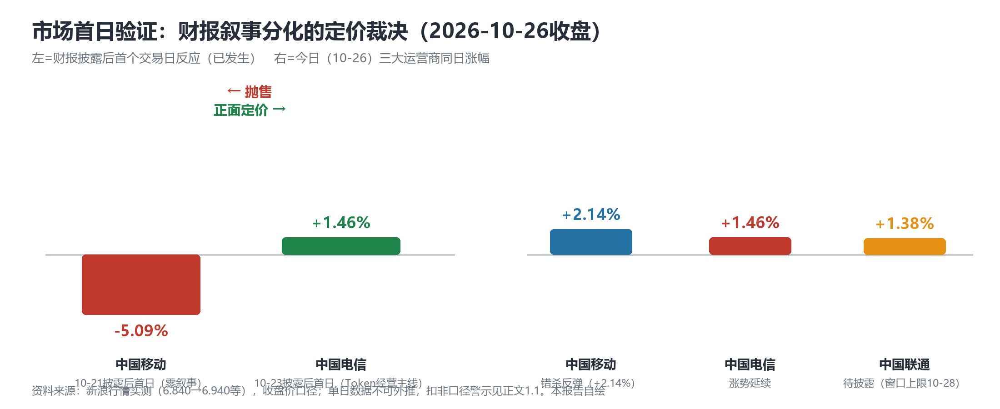
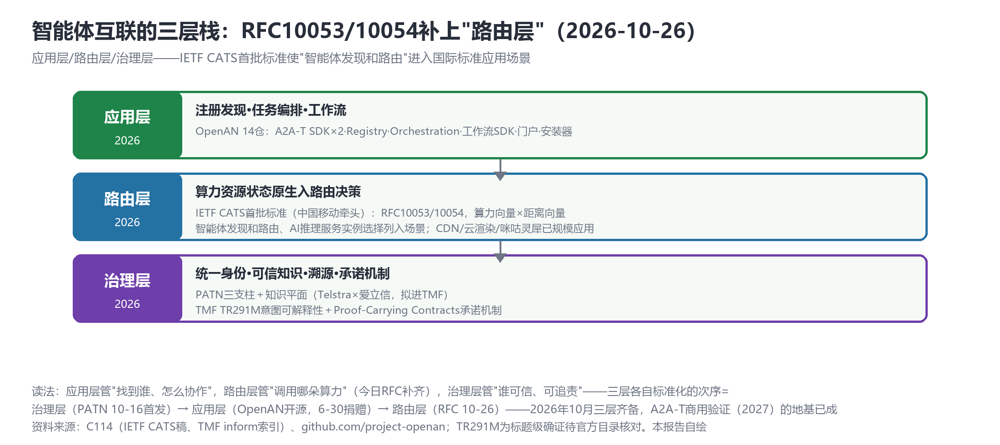

# 双重定价日：资本市场首验Token叙事，IETF为智能体互联立"路由层"

> **分析对象**：2026年10月24日18:00—10月26日18:00窗口（跨周日双日）的公开增量——A股行情实测（电信/移动/联通财报后市场反应）、中国移动牵头IETF CATS算力路由首批标准（RFC10053/10054）、王晓云院士DCI演讲、TM Forum TR291M索引、arXiv周一恢复列表、OpenAN恢复推送。三视角来源清单第五轮执行（搜索限流第二日，FastMode直抓预案生效）。
> **系列定位**：智能体技术洞察系列·ADN专题"新场景×新技术"系列的**完整报告第5篇**（前四篇见GitHub main：场景×技术版图v2.1、叙事换挡日、主战场换位、财报叙事分化）。
> **判定依据**：重大增量——①**市场首日验证**：电信财报后首个交易日+1.46% vs 移动财报后首日-5.09%，"财报叙事分化"论点获资本市场检验②**RFC10053/10054**：中国移动牵头IETF CATS首批标准，"智能体发现和路由"进国际标准应用场景③王晓云"Token经营的商业模式对成本高度敏感"进建网逻辑④TMF批准TR291M意图可解释性模型（标题级确证）。
> **口径约定**：【首发】【重申】【反向】【待核实】沿用系列口径；行情数字为新浪行情实测收盘价口径【转述】，**单日数据不可外推**；TR291M/RFC细节需官方目录二次核对；arXiv为预印本。
> **术语消歧**：ADN指自动驾驶网络/自智网络；CATS=Computing-Aware Traffic Steering（IETF算力感知流量引导工作组）；"词元"=Token官方译名。
> **立场**：设备商（ADN解决方案提供方）视角。

## 一、趋势判断

### 1.1 市场裁决日：电信+1.46% vs 移动财报后首日-5.09%——"财报叙事分化"的市场检验【首发·市场】

电信财报披露后首个交易日（10-26），A股收涨**+1.46%**（6.840→6.940）；对照移动财报后首日**-5.09%**（10-21）。同日三大运营商全线上涨：移动+2.14%（"错杀"反弹延续）、电信+1.46%（涨势确认）、联通+1.38%（待披露，窗口上限10-28）。

*图1：财报叙事分化的定价裁决——披露后首日反应与今日同日行情对照（本报告自绘，数据为新浪行情实测）*

**解读**：昨日报告1.1的判断（"Token经营主线+智能收入单列"与"零叙事+投资口径"的分化）获得首个市场检验——**市场正面定价了电信的AI经营叙事，却抛售了移动的沉默**，尽管移动扣非仅-0.2%而电信扣非-18.89%。这一反差说明：在AI叙事周期，资本市场此刻重"经营主线清晰度"轻"利润质量细节"。**两条纪律性警示**：其一，电信收涨与扣非-18.89%并存=**叙事溢价**，溢价随时可能回吐（周一反应只是口径之争裁决的第一票）；其二，移动今日+2.14%本身是"错杀"修正的力量——**两日以上窗口才能定论**，本报告坚持单日数据不外推。

### 1.2 算力路由RFC10053/10054：智能体互联的"路由层"获IETF背书【首发·标准】

中国移动牵头发布**IETF CATS工作组首批算力路由国际标准RFC10053/10054**（刘鹏任工作组主席）：算力资源状态原生引入路由决策平面（距离向量+算力向量叠加），RFC10053含5大功能模块；**"智能体发现和路由""AI推理服务实例选择"列入标准应用场景清单**；已规模应用于CDN、云渲染、咪咕灵犀阅读智能体（[C114，2026-10-26](https://www.c114.com.cn/news/16/a1319763.html)，【首发·标准】）。

*图2：智能体互联三层栈——应用层（OpenAN）、路由层（RFC10053/10054）、治理层（PATN+知识平面）各自标准化的次序与现状（本报告自绘）*

**点评**：系列技术线自此新增第七条——**算力路由层**。它与A2A-T注册发现（应用层）、PATN身份与知识平面（治理层）拼成智能体互联的完整三层栈（见图2）：应用层管"找到谁、怎么协作"，路由层管"调用哪朵算力"，治理层管"谁可信、可追责"。三层的标准化次序耐人寻味：治理层首发（PATN，10-16）→应用层开源落地（OpenAN捐赠，6-30起）→**路由层国际标准收口（RFC，10-26）**——2026年10月三层齐备，A2A-T商用验证（2027）的地基已成。另一层含义：**移动牵头IETF印证并扩展了ABI的判断**（10-23"中国运营商标准参与度提高"）——运营商的标准卡位正从3GPP扩展到IETF，且选在"算力+智能体"这个设备商与云厂商的交界地带。

### 1.3 王晓云DCI演讲："Token经营的商业模式对成本高度敏感"进建网逻辑【首发·锚点】

王晓云院士在DCI技术演进演讲中给出三层网络框架（DCN数据中心网/DCI数据中心互联/DCA数据中心接入）：互联内容新增**"AI参数面"**；Scale-Across流量占DCI约30%；万卡DCI需百T带宽；并提出**"面向Token经营的商业模式对成本高度敏感"应进入网络架构约束**（[C114，2026-10-26](https://www.c114.com.cn/news/16/a1319761.html)，【首发·锚点】）。**点评**："Token经营"至此完成三级跳——财报口径（电信10-23）、建网逻辑（王晓云10-26）、国际标准场景（RFC10-26）**同周合流**（叠加UBBF三个"R"10-23与词元经济学10-23/10-24）。当建网逻辑开始为Token成本敏感度让路，"TokenQoS衡量体系"（系列专篇）与词元计量对账就从"计费问题"升格为"架构约束问题"——设备商的网络设计文档需要新增"单位Token传输成本"这一节。

### 1.4 TR291M意图可解释性模型：知识平面生态新增标准工件【首发·标准工件，待核实】

TM Forum已批准2026年**TR291M意图可解释性模型**（FastMode评论披露，标题级确证、正文反爬待核，【待核实】）。**点评**：意图可解释性与知识平面的可信度判定、溯源要求互为表里——共同构成AN"可追责性"双支柱（为什么这么决策=意图解释；依据什么知识=知识溯源）。从10-16 PATN首发到10-26 RFC与TR291M，**八天之内智能体互联与意图治理完成了从"白皮书主张"到"标准工件"的降维打击式推进**——标准供给侧的节奏已经快于多数设备商的产品节奏。

### 1.5 学术与开源恢复日：治理与安全主题延续【重申·论文】

arXiv周一恢复：cs.MA **2610.31974**（MCP解码时溯源绑定——智能体安全，与知识平面溯源诉求同构）、**2610.31985**（有益智能体问题：涌现合作绕过工作流的治理边界）、2610.31743（异构LLM多智能体提示-模型联合优化）；cs.NI 2610.32827（数字孪生×Open RAN NTN-TN）。OpenAN周一恢复：portal/orchestration/SDK-python三仓推送（[github.com/project-openan](https://github.com/project-openan)，【重申·活跃】）。**点评**：学术线连续第五日供给，主题从"框架构建"（上周ACN类）转向"安全与治理"（溯源绑定/涌现合作边界）——与产业侧TR291M、知识平面的治理议程精确同步。

### 1.6 反向信号：叙事溢价、治理环境与联通窗口上限【首发·反向】

①**叙事溢价风险**（1.1）：电信扣非-18.89%却收涨——若后续交易日回吐，"口径竞赛"叙事将面临反身性检验；②**运营商反腐双案确证**：电信原总经理杨小伟一审被判12年、移动原集团高管方力被查（[C114，2026-10-26](https://www.c114.com.cn/news/15/a1319766.html)等，【首发·治理】）——采购决策链的治理环境信号，设备商合规边界管理的重要性上升；③**Gartner：44%的CEO难以证明AI财务回报**——与运营商"智能收入单列"对照，电信的口径化恰是对这一全球难题的正面回应，也是叙事溢价的基本面支撑；④**联通第六日未披露**（无停牌），窗口上限10-28（本周三），人工核查预案已预置（上交所600050公告页）；⑤搜索限流第二日，FastMode直抓预案生效（工具链韧性验证）。

### 1.7 汇聚点：新场景×新技术映射与"三重定价"结论

| 新场景/信号 | 靠什么技术兑现 | 关键技术 | 验证状态 |
|---|---|---|---|
| Token叙事的市场定价（电信+1.46%） | Token经营主线+智能收入单列 | 财报叙事 | 首发·市场检验（10-26） |
| 智能体路由层标准化 | CATS算力向量×距离向量 | RFC10053/10054 | 首发·国际标准（10-26） |
| Token成本敏感建网 | AI参数面+Scale-Across 30% | DCI三层框架 | 首发·建网逻辑（10-26） |
| 意图可追责 | TR291M意图可解释性 | 知识平面双支柱 | 待核实·标准工件（10-26） |
| 智能体安全治理 | MCP溯源绑定+涌现合作边界 | 学术治理主题 | 重申·论文（10-26） |

汇聚结论：**"Token经营"在一周内完成三重定价**——市场定价（电信+1.46%）、标准定价（RFC10053/10054智能体路由场景）、架构定价（Token成本敏感进建网约束）。ADN目标态的"五件套"（形态/输入/安全/互联/度量）之外，第六件正在成形：**定价体系**（词元计量+算力路由+财报口径）——它不是一项技术，而是让前五件能被买卖、被调度、被审计的那一层。设备商的产品清单里，"定价体系组件"（词元计量网关、算力路由适配、财报映射模板）至今没有竞品，先发者定义品类。

## 二、技术诉求分析

### 2.1 诉求矩阵总表（系列八项诉求·今日锚点刷新）

| # | 技术诉求 | 今日触发锚点 | 落点 | 证据状态 |
|---|---|---|---|---|
| 1 | 意图可编译 | TR291M意图可解释性（10-26，待核实） | 意图解释模型 | 标准工件化 |
| 2 | 知识可治理 | TR291M×知识平面可信度/溯源=可追责双支柱 | 分类法+解释+溯源 | 双支柱成形 |
| 3 | 数据面换代 | AI参数面+Scale-Across 30%（10-26） | DCI/DCN参数面 | 建网逻辑确认 |
| 4 | 闭环可验证 | （今日无新触发） | 孪生保真度 | 待补 |
| 5 | 智能体可互联 | **RFC10053/10054智能体路由场景（10-26）** | 算力路由层 | **国际标准落定** |
| 6 | 能力可复制 | OpenAN三仓恢复推送（10-26） | 工具链全家桶 | 活跃 |
| 7 | 价值可记账 | **市场首日+1.46%验证叙事定价（10-26）** | 财报口径→市场定价 | 溢价与回吐风险并存 |
| 8 | 监督可执行 | 运营商反腐双案（10-26） | 采购合规边界 | 治理环境信号 |

### 2.2 内在张力表

| 张力 | 表现 | 对设备商的后果 |
|---|---|---|
| 叙事溢价 vs 利润质量 | 电信扣非-18.89%却+1.46%，移动扣非-0.2%却曾-5.09% | 引用财报-行情关联时必须双口径并注+多日窗口；帮助客户"把成效做实"比"把故事讲满"更抗回吐 |
| IETF RFC vs 厂商协议 | CATS算力路由国际标准 vs A2A-T/PATN厂商/运营商协议 | 路由层已被IETF收口——A2A-T/PATN宜明确定位在应用/治理层，避免与RFC重叠再造轮子 |
| Token成本敏感 vs 网络过度建设 | "Token经营对成本高度敏感" vs 算力利用率仅30-40%（10-23刘韵洁） | 网络方案须内置单位Token成本模型——报价单从"带宽+时延"转向"带宽+时延+Token单价" |
| 联通窗口上限 vs 披露沉默 | 窗口10-28截止在即，第六日无稿 | 明日预置人工核查升级；三种口径对照篇随时待发 |

## 三、关键技术分析（当期增量优先）

### 3.1 CATS算力路由RFC：智能体互联的"网络层"落定【首发·重点】

RFC10053/10054的技术要点是**把算力资源状态（算力向量）与传统的距离向量在路由决策平面叠加**——路由器不再只问"哪条路最近"，还要问"哪条路尽头的算力最合适"。RFC10053的5大功能模块与"智能体发现和路由、AI推理服务实例选择"场景清单，把这一机制正式接入智能体调用链路；CDN/云渲染/咪咕灵犀的规模应用证明其已过工程成熟线。**点评**：这一层过去是"云网融合"的宣传语，现在是IETF标准——对设备商意味着路由器/交换机的新计费维度（算力感知路由能力）与新的集采测试项；对运营商意味着"算力并网"（10-20刘韵洁/Ion-2030）有了可部署的协议底座。设备商的卡位：CATS数据面的转发芯片/线卡支持与"算力向量"的遥测面（谁家的算力状态上报更实时更准确，谁就在RFC部署中占先）。

### 3.2 AI参数面与Token成本敏感建网【首发·锚点】

王晓云把"AI参数面"列为DCI互联新内容（与数据面/控制面/管理面并列的又一"面"主张——继华为DAP后第二个参数面提法），Scale-Across占DCI 30%、万卡百T给出容量锚点；"Token经营商业模式对成本高度敏感"进架构约束则把商业语言编译成了工程语言。**点评**：与10-16华为DAP对照——两大厂在同一个月分别从核心网与承载网提出"参数面/第三平面"，第四平面的标准化竞赛已经鸣枪；设备商应在TMF/CCSA同步推进"单位Token传输成本"的度量规范（词元计量对账的网络侧 half），与词元统计体系（10-23数据局）完成接口。

### 3.3 TR291M与可追责双支柱【首发·标准工件，待核实】

意图可解释性（为什么这么决策）+知识平面（依据什么知识、可信度几何）构成AN可追责的双支柱——分别对应"决策链"与"证据链"。**点评**：可追责性是L4放行的监管前提（欧盟AI法案2026大限[p12]的AN版）；设备商的意图引擎若不能输出TR291M式解释模型，将在合规维度出局——建议把"解释即日志"纳入意图接口设计约束。

### 3.4 学术增量：安全与治理主题的持续升温【重申·论文】

MCP解码时溯源绑定（2610.31974）把"溯源"下沉到协议解码时刻——比传输后审计更强的保障模型；"有益智能体问题"（2610.31985）揭示涌现合作可能绕过工作流约束——与Gartner"生成快过人类审核"警告（10-21）同题。**点评**：学术治理议程与产业标准议程（TR291M/知识平面）已形成两周内的双向引用密度；设备商研究部门宜设立"AN治理"专项跟踪位，而非按传统"安全"条线归档。

## 四、总结思考

### 4.1 核心命题

10月26日是"Token经营"的**三重定价日**：市场用+1.46%给电信的叙事定了价，IETF用RFC给智能体路由定了价，王晓云用"成本敏感"给建网逻辑定了价。至此，ADN目标态五件套（形态/输入/安全/互联/度量）之外，**第六件——定价体系（词元计量+算力路由+财报口径）——已经显形**：它让前五件能被买卖、被调度、被审计。而市场的首日裁决同时给了一个冷提醒：叙事会溢价也会回吐，**能穿越回吐周期的只有成效侧数据**——这仍是全系列悬而未决的那一跳。

### 4.2 关键判断

1. **路由层已被IETF收口，厂商协议竞争退守应用层与治理层**——A2A-T/PATN应明确与CATS的接口（注册发现→算力路由查询），避免在路由层重复造轮子。
2. **"单位Token传输成本"将进入网络设计文档与报价单**——设备商需在Q1内完成成本模型与CATS遥测面的原型支撑。
3. **叙事溢价需要成效数据续期**——电信后续交易日若回吐，恰好证明系列判断："价值可记账"的终点是成效科目，不是叙事科目；财报映射模板的成效版（KBI级）价值再+1。
4. **TR291M类"解释即日志"将成为意图引擎的合规门槛**——建议纳入产品设计约束并跟踪TMF官方目录核对。
5. **联通窗口上限10-28**——第三种财报口径随时可能出现，三方对照篇（移动/电信/联通口径矩阵）素材已备，披露即发。
6. **反腐双案提示采购链治理收紧**——设备商合规边界管理（招待/礼品/立项沟通）应按最严口径执行，恰逢ADN集采密集期。

### 4.3 对不同主体的启示

**运营商**：电信的+1.46%证明口径化有市场回报，但"叙事溢价"的维持需要成效数据——建议在业绩说明会给"智能收入"加统计方法附录；算力路由上，CATS已收口路由层，运营商店面宜聚焦"算力向量数据治理"（谁维护算力状态的权威源）。

**设备商**：三个立即可开工组件——CATS数据面/遥测面支持、词元计量网关（网络侧）、意图解释日志（TR291M对齐）；标准侧在应用层/治理层与IETF明确分工，把资源集中到知识平面TMF贡献（窗口仍开）。

**开发者**：算力向量遥测采集器与MCP溯源绑定中间件（2610.31974思路）是两个可开源方向；CATS场景清单中的"AI推理服务实例选择"可直接复用于咪咕类阅读智能体的调度器设计参考。

**标准组织**：IETF与TMF/CCSA的接口需要一次明确对齐（路由层RFC已定，应用层/治理层归口谁）——建议TMF在知识平面立项文件中显式引用CATS，避免两线标准在"智能体寻址"上出现语义分叉；"单位Token传输成本"度量规范宜由CCSA与数据局统计体系对接立项。
