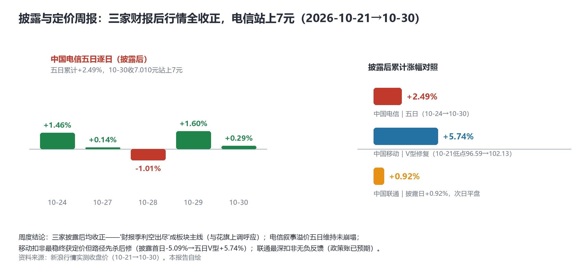
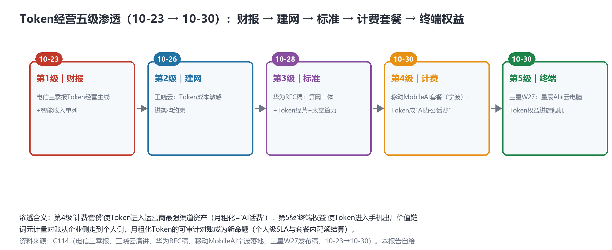

# 周度裁决日：Token成"AI办公话费"（第五级渗透），L4首进现网，三家披露后全收正

> **分析对象**：2026年10月29日18:00—10月30日18:00窗口的公开增量——三大运营商披露后行情周度收官实测、移动MobileAI计费套餐落地（宁波）、三星W27旗舰机Token权益、云南移动×中兴L4自智现网首现、华为RANSpirit规模数据（Decoding China 2026）、arXiv周五25篇命中（单日最高）、通道工程事件（系统代理失效与直连切换）。三视角来源清单第九轮执行。
> **系列定位**：智能体技术洞察系列·ADN专题"新场景×新技术"系列的**完整报告第9篇**（另有对照篇与学术版图专题）——本篇为**披露与定价周报**（10-24预告的周度结论）+Token五级渗透定版。
> **判定依据**：重大增量——①**Token计费产品化两连**：进计费套餐（"AI办公话费"）+进旗舰机权益包，Token经营第五级渗透闭合②**L4自智现网首现**（系列首次"L4"字面进现网场景）③**周度裁决**：三家披露后全收正④华为RANSpirit规模锚点补齐终局合流。
> **口径约定**：【首发】【重申】【反向】【待核实】沿用系列口径；行情数字为新浪行情实测收盘价；L4自智为标题级确证（正文404待补，【待核实】）；arXiv为预印本。
> **术语消歧**：ADN指自动驾驶网络/自智网络；"AI办公话费"为媒体对移动MobileAI套餐中Token计费的表述【转述】；RANSpirit为华为无线网络智能体方案名。
> **立场**：设备商（ADN解决方案提供方）视角。

## 一、趋势判断

### 1.1 周度裁决：三家披露后全收正，"利空出尽+叙事定价"双主线确立【首发·市场周报】

10-30电信A股**+0.29%收7.010元，站上7元整数关口**，披露后五日累计**+2.49%**（逐日：+1.46%/+0.14%/-1.01%/+1.60%/+0.29%）；移动自10-21低点96.59港元V型修复累计**+5.74%**（至102.13）；联通披露日+0.92%、次日平盘。**周度结论（兑现10-24预告）**：①**电信叙事溢价五日维持且创披露后新高，无反身性回吐**——10-26提出的"叙事溢价回吐风险"未兑现，溢价进入"确认期"；②移动"扣非最稳终获定价"但路径先杀后修（首日-5.09%→五日V型+5.74%）——市场对投资账的理解需要时间；③联通最深扣非（-36.2%）无负反馈——政策账已被预期定价；④三家披露后均收正=**"财报季利空出尽"成板块主线**，与花旗上调目标价呼应（[新浪行情实测](https://finance.sina.com.cn/realstock/company/sh601728/nc.shtml)，10-21→10-30）。

*图1：三家披露后行情对照——电信五日逐日与累计对比（本报告自绘）*

### 1.2 Token经营第五级渗透：计费套餐与终端权益——从企业计量到"AI话费"【首发·场景·重点】

本周Token计费产品化两连：①移动**MobileAI计划套餐落地宁波**——**"token成了'AI办公话费'"**，Token首次进入运营商计费套餐体系（[C114，2026-10-30](https://www.c114.com.cn/news/16/a1319901.html)，【首发·场景】）；②三星W27旗舰机发布稿确认支持**电信星辰AI助手与云电脑Token权益**——Token进入旗舰机出厂权益包（【首发·场景】）。至此Token经营**五级渗透闭合**（图2）：财报（电信10-23）→建网逻辑（王晓云10-26）→标准表态（华为10-28）→**计费套餐（移动10-30）→终端权益（三星10-30）**。

*图2：Token经营五级渗透——从财务报表到终端出厂价值链（本报告自绘）*

**点评**：第4、5级与前三级性质不同——财报/架构/标准是"机构层"渗透，计费/终端是**"消费层"渗透**："AI话费"意味着词元计量对账从企业侧（可审计账单）走到**个人侧（月租化配额结算）**，运营商把Token装进了自己最强的渠道资产（月租+套餐+终端补贴）。对设备商的直接命题：**个人级词元计量网关**（套餐内配额审计、终端侧用量上报、家庭/政企共享池）是下一个产品空白——词元网关的规格书需新增"个人/家庭粒度"章节。

### 1.3 L4自智现网首现：从财报缺席到现网出现，一周之差【首发·商用】

云南移动×中兴推动**中老铁路高铁智能运维迈入L4自智**（[C114，2026-10-30](https://www.c114.com.cn/news/16/a1319903.html)，标题级确证、正文待补，【待核实】）。**点评**：10-23三季报核对时"L4字面三家零命中"，一周后L4首次出现在现网场景报道中——**财报缺席≠实践缺席**，运营商的ADN分级实践跑在财报语言前面。战略含义：①L4现网是**成效账的最佳载体**（L4分级本身就是可验证指标——自治闭环率/人工干预率），联通成果账→成效账的路径在此打通；②高铁场景（中老铁路）=高可靠性垂直场景的L4首发，"垂直场景先行、公众网跟进"的L4推广路径值得跟踪；③云南移动×中兴组合提示：设备商L4实证与运营商省级试点绑定将是下一个集采竞争面。

### 1.4 华为RANSpirit规模锚点：终局合流的第四块实证【首发·锚点】

华为Decoding China 2026披露RANSpirit规模数据：**25张网/120万小区/2000工程师**使用，感知-决策闭环分钟级；菲律宾台风案例——1700个退服小区自动调度周边8000个小区资源，**数据连接留存率50%（传统<10%）**；并明确提出"**网络服务对象从人向智能体拓展**"、呼吁共建智能体开放生态（[C114，2026-10-30](https://www.c114.com.cn/news/22/a1319902.html)，【首发·锚点】）。**点评**：①留存率50%vs10%是**ADN成效的第五个可引用量化锚点**（此前四个：MTTR-21%、意图履约率93%、铁路故障处置4小时→11分钟、IoT平台7个月）；②"服务对象从人向智能体拓展"=华为版终局叙事的落点句，与爱立信"智能网络底座"、移动"分布式超级大脑"、Telstra"知识平面"完成**四家四实证**（前三家是框架，华为补规模数据）——10-27"四方对齐"从词汇表对齐升级到**实证对齐**；③"智能体开放生态"呼应A2A-T商用验证（2027）的生态预埋。

### 1.5 A2A-T学术栈三层成型：ATP+PCM+Concordat【首发·学术】

arXiv周五25篇命中（单日最高）：**ATP《Agent Transfer Protocol》**（与A2A-T最直接对标的传输层提案）、**PCM（可验证多智能体通信）**、Concordat（类型化会话，10-27）——**A2A-T的学术栈补齐"传输-会话-验证"三层**；暗面新增：黏性合谋（激励移除后合谋仍持续——比合谋本身更棘手的治理难题）、**记忆注入攻击**（经社交交互路径污染智能体记忆——记忆资产的攻击面首现）；记忆线第五篇（Long-Term Agent Memory）；意图丢失测量（2610.37830）；cs.NI侧LinkDreamer V2X世界模型、联邦频谱协同（arXiv，10-30，【首发·学术】）。**点评**：A2A-T商用验证（2027）之前，学术栈三层（传输/会话/验证）先行成形——OpenAN工程栈与学术栈的接口对齐窗口约6个月；记忆注入攻击把"记忆审计"从设计约束升级为安全需求（攻击模型→测试用例清单再+1）。

### 1.6 通道工程事件与来源清单修正【首发·运维】

本周五系统代理进程（127.0.0.1:7897）再次停止致HTTP全断约1小时，已定位并切换**直连优先**（国内源+arXiv全通，含此前误判不可达的export API——**通道判定修正：export API实际可用**）；新策略固化为"**直连优先+代理仅用于被墙源**"（[RUNBOOK_git_push.md](team_workspace/RUNBOOK_git_push.md)同步更新）。**点评**：8天运行中的第二次代理故障验证了直连备份的有效性；来源体检的价值在实战中兑现——export API的"复活"使arXiv批查（29篇journal-ref级）恢复自动化通道。TR291M官方核对第六日pending（DDG限流第五日）；联通业绩说明会公告未发——**下周两大观察点**。

### 1.7 汇聚点：周末五线收口与"AI话费"结论

| 新场景/信号 | 靠什么技术兑现 | 关键技术 | 验证状态 |
|---|---|---|---|
| Token成"AI办公话费" | MobileAI套餐（宁波） | 词元计费·套餐化 | 首发·计费（10-30） |
| Token进旗舰机 | 三星W27星辰AI+云电脑权益 | 终端权益包 | 首发·终端（10-30） |
| L4首进现网 | 中老铁路高铁智能运维 | L4自智分级 | 首发·现网（待核实） |
| ADN成效第五锚点 | RANSpirit台风案例留存率50% | 无线智能体 | 首发·规模（10-30） |
| A2A-T学术栈三层 | ATP+PCM+Concordat | 传输/会话/验证 | 首发·学术（10-30） |

**周末五线收口**：①财报口径✅（三方分型+媒体印证）②市场定价✅（五日检验通过，溢价确认期）③终局合流✅（四家框架+华为规模实证）④学术版图开放（累计34篇，A2A-T学术栈成形，月报11-01首期）⑤政策落地✅（六张网机制化+117亿集采）。**汇聚结论：本周ADN完成了从"叙事"到"账本"再到"货架"的完整下探**——Token经营五级渗透（财报→建网→标准→计费→终端）意味着词元经济已进入可购买状态；L4现网首现意味着分级承诺进入可验证状态。下一周的主题将是**"成效数据的第一次集中披露"**（联通业绩说明会+MobileLink 2026）。

## 二、技术诉求分析

### 2.1 诉求矩阵总表（系列八项诉求·今日锚点刷新）

| # | 技术诉求 | 今日触发锚点 | 落点 | 证据状态 |
|---|---|---|---|---|
| 1 | 意图可编译 | 意图丢失测量（2610.37830） | 意图可观测性 | 学术补位 |
| 2 | 知识可治理 | **记忆注入攻击**（暗面） | 记忆审计=安全需求 | 设计约束升级 |
| 3 | 数据面换代 | **Token五级渗透闭合（10-30）** | 个人级词元计量网关 | **消费层渗透** |
| 4 | 闭环可验证 | L4现网首现（中老铁路） | 自治闭环率/L4分级指标 | **成效账载体出现** |
| 5 | 智能体可互联 | **A2A-T学术栈三层（ATP/PCM/Concordat）** | 传输-会话-验证 | 学术先行 |
| 6 | 能力可复制 | RANSpirit 25网/120万小区 | 规模复制实证 | 锚点+1 |
| 7 | 价值可记账 | 周度裁决：溢价确认期 | 市场定价 | 五日检验通过 |
| 8 | 监督可执行 | 黏性合谋（激励移除仍持续） | 治理套件新难题 | 攻击模型+1 |

### 2.2 内在张力表

| 张力 | 表现 | 对设备商的后果 |
|---|---|---|
| 月租化弹性 vs 个人级审计 | "AI话费"套餐灵活计费 vs 词元配额的个人级可审计结算 | 词元网关新增"个人/家庭粒度"章节——配额审计与终端用量上报是规格书缺口 |
| L4承诺 vs 成效披露 | 现网L4首现 vs 财报三家L4零命中 | 引导客户把L4分级写进披露口径（自治闭环率/人工干预率）——成效账的现成载体 |
| 学术栈先行 vs 工程节奏 | ATP/PCM/Concordat已出 vs OpenAN工程栈 | 6个月接口对齐窗口——会话/验证层标准吸收宜在2027商用验证前完成 |
| 黏性合谋 vs 激励设计 | 激励移除后合谋仍持续（2610.37602类） | 治理套件需"激励重置+拓扑重排"组合拳，单靠经济手段不充分 |

## 三、关键技术分析（当期增量优先）

### 3.1 "AI话费"：词元计费的个人侧时刻【首发·重点】

MobileAI套餐把Token装进月租，本质是把词元从"企业IT采购品"重新定义为"个人通信消费品"——与语音分钟数、流量GB并列的**第三个计量单位**。工程含义有三：①计费系统需新增词元计量域（采集点：终端SDK/边缘网关/AI平台侧），与BSS计费引擎对接；②套餐设计引入配额/加速包/共享池（家庭号共享Token池可期）；③对账链条从"企业账单审计"延伸到"个人账单争议处理"——**词元计量对账网关的个人粒度规格**（10-24提出的空白点）由此获得明确的需求文档。设备商应立即与运营商计费部门对齐采集点方案（终端SDK vs 网络侧DPI vs AI平台API日志三选一或混合）。

### 3.2 L4现网与成效账的桥【首发·商用·待核实】

L4分级天然携带可验证指标集（自治闭环率、人工干预率、异常接管时长）——**中老铁路案例若配指标披露，将是"成效账"的第一个现网样本**。设备商动作：①把L4分级指标集模板化（对标TMF ANLAV分级判据）；②推动客户在业绩说明会引用（联通九大成果的指标化路径正好衔接）；③高铁场景实证（多普勒/隧道/跨境漫游的高难度环境）对ADN可信度 Lemedia价值极高——若正文核实，宜作为标杆案例进入对标材料。

### 3.3 RANSpirit规模锚点：ADN成效的第五个可引用数字【首发·锚点】

50%vs10%的台风留存率是迄今最具对比度的ADN成效数据（五倍改善、灾害场景、运营商现网）——比MTTR-21%更有叙事穿透力。**点评**：配合"服务对象从人向智能体拓展"的落点句，华为把RAN智能体的成效叙事推进到"韧性"维度（灾害韧性是监管与公众都关心的公共价值）——**成效叙事的公共价值维度（应急/韧性/普惠）可能比降本维度更快进入政策口径**，"六张网"语境下尤其如此。

### 3.4 A2A-T学术栈与暗面新题【首发·学术】

ATP（传输）+Concordat（会话）+PCM（验证）三层学术栈给A2A-T提供了"标准-学术"双轨支撑；暗面两篇把治理难度再上台阶——黏性合谋说明**激励设计不能一劳永逸**（需要持续监测+拓扑干预），记忆注入攻击说明**记忆资产需要来源隔离**（社交交互路径不可信）。**点评**：治理套件的测试用例清单增至七类（合谋/欺骗/社工/级联/市场扭曲/黏性合谋/记忆注入）——"协议+治理+审计"三件套交付物的分量持续加重。

## 四、总结思考

### 4.1 核心命题

本周的收官画面：**Token经营走完五级渗透（财报→建网→标准→计费→终端），词元经济进入"可购买"状态；L4首进现网，分级承诺进入"可验证"状态；三家披露后全收正，市场完成第一轮口径教育。** ADN的产业化在十月的最后一周同时拿下"货架"（计费/终端）、"标签"（L4分级）与"裁决"（行情周报）——十一月的主题由此清晰：**成效数据的第一次集中披露**（联通业绩说明会+MobileLink 2026+学术月报11-01首期），"右上角"（强叙事+可验证成效）的占位竞赛正式开赛。

### 4.2 关键判断

1. **"AI话费"确立词元的第三个计量单位地位**（分钟/GB/Token）——个人级词元计量网关是立即开工的规格书缺口，采集点方案（终端/网络/平台）需在MobileLink前后与运营商对齐。
2. **L4现网首现打通"成果账→成效账"**——L4分级指标集（自治闭环率等）是成效披露的现成载体，模板本周可成稿；正文核实后中老铁路进标杆案例库。
3. **留存率50%vs10%为ADN成效第五锚点**——"灾害韧性"维度可能先于"降本"维度进入政策口径（六张网语境）。
4. **A2A-T"标准-学术"双轨成立**——六个月内完成学术栈（ATP/PCM/Concordat）与OpenAN工程栈的接口对齐，否则2027商用验证将面临双轨分裂。
5. **记忆注入攻击使"记忆审计"升级为安全需求**——治理测试用例清单增至七类，三件套交付物持续加重。
6. **通道策略固化为"直连优先+代理仅用于被墙源"**——export API判定修正为可用，arXiv批查自动化恢复；下周一（11-02）执行学术月报首期（11-01恰逢周六，顺延规则见调度配置）。

### 4.3 对不同主体的启示

**运营商**："AI话费"套餐的客服与对账预案（个人账单争议）应与套餐上线同步；L4现网案例（中老铁路）宜在业绩说明会以指标集形式披露，抢占成效账先手。

**设备商**：个人级词元计量网关规格书（采集点/配额审计/共享池）+L4分级指标集模板+七类攻击模型测试用例——三份文档一周内可完成初稿；MobileLink 2026（11-5/7）聚焦"成效数据+五级渗透"叙事而非概念叙事。

**开发者**：终端Token用量上报SDK与记忆来源隔离中间件（对抗注入攻击）是两个新空白点；学术月报开源复刻（arXiv API+分类矩阵）可直接复用本系列探测脚本。

**标准组织**：TMF宜将"词元计量的个人粒度对账"纳入知识平面/计费架构议题（运营商计费部门已有真实需求）；CCSA的"智能收入统计口径"规范应同步覆盖"AI话费"类个人套餐的统计归口。
