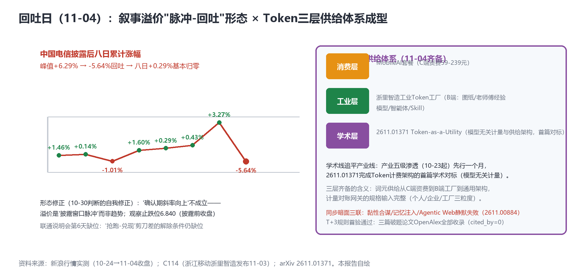

# 叙事溢价脉冲归零（电信-5.64%），Token-as-a-Utility首篇学术对标，AIDC月投资骤降40.2亿——"建设热运营冷"的第三块拼图

> **分析对象**：2026年11月3日18:00—11月4日18:00窗口的公开增量——三大运营商披露后行情首次大幅回撤（电信-5.64%）、浙江移动"工业Token工厂"发布（乌镇）、arXiv 2611批次cs.NI五篇（Token-as-a-Utility学术首篇+暗面三联补完）、C114独家运营商AIDC投资月度骤降、爱立信ISAC商用锚点、T+3规则首验。三视角来源清单第十四轮执行。
> **系列定位**：智能体技术洞察系列·ADN专题"新场景×新技术"系列的**完整报告第13篇**——本篇含**系列首次自我修正**（10-30"叙事溢价确认期"判断修正为"脉冲-回吐形态"）与**学术线追平产业线**的里程碑（Token-as-a-Utility）。
> **判定依据**：重大增量——①**叙事溢价脉冲归零**（八日+0.29%，形态修正）②**2611.01371《Token-as-a-Utility》**——Token计费架构首篇学术对标，三层供给体系成型③**AIDC投资10月骤降至40.2亿**（vs Q3百亿峰值）——"建设热运营冷"第三块拼图。
> **口径约定**：【首发】【重申】【反向】【待核实】沿用系列口径；行情为新浪实测收盘；AIDC投资为C114基于公开招中标统计的独家口径；甲骨文-腾讯70亿芯片租赁取消为传闻级。
> **术语消歧**：ADN指自动驾驶网络/自智网络；Token-as-a-Utility=将Token计量与供给建模为公用事业式服务的架构主张；ISAC=通感一体化。
> **立场**：设备商（ADN解决方案提供方）视角。

## 一、趋势判断

### 1.1 叙事溢价首次大幅回撤：脉冲-回吐形态定型（系列自我修正）【首发·市场·修正】

电信**-5.64%收6.860元**（披露后最大单日跌幅），八日累计从峰值+6.29%回吐至**+0.29%基本归零**；移动-2.42%、联通-1.76%三家齐跌（新浪实测11-04）。**系列自我修正**：10-26提出"溢价回吐风险"、10-30判定"五日维持未回吐、进入确认期"——今日数据表明后者不成立：**溢价是"披露窗口脉冲"而非"趋势斜率"**（见图1左）。修正后的定价模型：财报季集中披露的叙事差异产生脉冲式溢价，窗口关闭后向基本面回归；**联通说明会（第6天未定档）是唯一未兑现的披露窗口**——联通-1.76%叠加缺位，"抢跑-兑现"剪刀差开始负反馈。

*图1：电信八日累计涨幅脉冲形态（左）×Token三层供给体系（右）——本报告自绘*

**后续观察点**：①止跌位=披露前收盘6.840元（未破位则脉冲理论成立、破位则需引入基本面重估）；②MobileLink（11-5/7）与联通说明会（若定档）构成12月波士顿前的下一轮披露窗口——**脉冲理论的可证伪检验**。

### 1.2 Token-as-a-Utility首篇学术对标：学术线追平产业线【首发·学术·重点】

arXiv 2611批次cs.NI五篇全中：**2611.01371《Token-as-a-Utility: A Model-Agnostic Architecture for Metering and Provisioning AI Inference Services》**——Token计量与供给的**模型无关架构**首篇（与MobileAI资费表10-31、工业Token工厂11-03、词元交易平台10-23同构，【首发·学术】）；**2611.00838**认知网络数字孪生**闭环依赖保障**（Agentic AI自毁保障环风险——CLIC意图闭环的姊妹题：闭环失稳怎么办）；2611.03406 AI-RAN多时间尺度编排（信令风暴防治）；**2611.00884《When 200 OK Is Not an Answer》Agentic Web静默失败**——协议层暗面（与黏性合谋/记忆注入构成**暗面三联**）（arXiv，2026-11-02批次，【首发·学术】）。

**点评**：①**学术线追平产业线**：产业侧五级渗透（10-23起）先行一个月，今日学术侧给出计量供给架构的通用化表述——"模型无关"三字正是词元计量对账网关的核心规格（不绑定任何模型供应商的计量层）；②暗面三联的第三联"静默失败"直指**Agentic Web的监控盲区**（HTTP 200但业务失败）——与"自毁保障环"（2611.00838）同属"闭环的可信性"命题：CLIC解决意图一致性，这两篇解决**闭环运行时的失效可见性**——治理套件测试用例清单增至九类；③2611编号跃迁+cs.NI五篇全中=ADN相关论文进入稳定高产期。

### 1.3 工业Token工厂：三层供给的中层落地【首发·场景·重点】

浙江移动（乌镇11-03）发布"浙里智造"平台三大模块——**"工业图纸、老师傅经验和工业数据转化为模型、智能体和Skill"**，配套FDE驻场陪跑与四共机制，提出"领先的工业智能服务商"新定位（[C114，2026-11-03](https://www.c114.com.cn/news/16/a1320006.html)，【首发·场景】）。**点评**：Token供给体系三层齐备（图1右）：**消费层**（MobileAI套餐，C端资费）→**工业层**（浙里智造，B端"经验→Skill"资产化）→**学术层**（2611.01371，通用架构）。工业层的独特价值在**老师傅经验的知识资产化**（图纸/经验/数据三源入模）——与知识平面三领域（分类法/可信度/溯源）和数据产权登记（11-03）直接接口：**"老师傅经验"是第一类需要登记ID的知识资产**。移动"工业智能服务商"定位=Token供给侧的B端纵深（对照联通成果账/电信收入账），三家的AI经营口径分化继续加深。

### 1.4 AIDC投资10月骤降：建设热的三重冷数据齐备【首发·投资】

C114独家统计：运营商AIDC投资**10月骤降至40.2亿元**（39个项目，vs Q3单月百亿峰值）——移动35亿占86%（中卫23.41亿EPC）、联通4亿（阜新绿电智算1.46亿）、**电信仅1.05亿**（14项目全部千万级以下）（[C114，2026-11-04](https://www.c114.com.cn/news/16/a1320011.html)，【首发·投资】）。**点评**："建设热运营冷"三块拼图齐备：①GPU利用率30%（官方口径，11-01）；②"跟风扎堆"政策警示（11-03）；③**AIDC投资骤降**（招中标数据，11-04）——土建高峰结束的信号，AI基础设施从"建设期"进入"**利用率期**"：与三重冷数据对应的三类产品叙事上移——调度类（CATS/算力路由）、存储节流类（华为袁远）、**利用率经营类**（Token填充率/智算中心上座率KBI）。电信当月仅1.05亿与其当日-5.64%客观并置——**投入节奏与市场定价的共振回撤**（相关性非因果，如实并置）。设备商含义：AIDC土建类订单（EPC/机电）退坡，**利用率提升类订单**（调度/运维/计量）接力——方案重心从"建得快"转向"用得满"。

### 1.5 ISAC商用锚点与说明会缺位【首发·商用/反向】

爱立信通感一体（ISAC）发布**2027商用试点**——ISAC首个商用时间锚点（【首发·商用】）；ChatGPT周活12亿（智能体消费侧规模锚点）；英伟达市值登顶（供给侧信号）。**联通说明会第6天未定档**——缺位负反馈累积（与-1.76%并置）；MobileLink明日开幕今日预热静默（开幕日关注）；TR291M第11日pending；T+3规则首验通过（三篇破题论文OpenAlex全部收录，cited_by=0正常——学术月报指标管线就绪）。

### 1.6 汇聚点：新场景×新技术映射与"冷数据日"结论

| 新场景/信号 | 靠什么技术兑现 | 关键技术 | 验证状态 |
|---|---|---|---|
| Token三层供给齐备 | 工业Token工厂+学术首篇 | 计量供给架构 | 首发·场景/学术（11-03/04） |
| 溢价脉冲归零 | 披露窗口效应 | 市场定价·脉冲模型 | 首发·市场（修正）（11-04） |
| AIDC建设转利用率 | 招中标月度骤降 | 调度/计量/KBI | 首发·投资（11-04） |
| 闭环失效可见性 | 自毁保障环+静默失败 | 暗面三联 | 首发·学术（11-02批次） |
| ISAC商用锚点 | 2027商用试点 | 通感一体 | 首发·商用（11-04） |

汇聚结论：**11-04是"冷数据日"**——行情（溢价归零）、投资（AIDC骤降）、学术（静默失败/自毁风险）三组数据同日指向同一命题：**狂热期的第一组修正数据到齐**。但同日也有冷数据对应的暖供给：Token三层供给体系成型（消费/工业/学术）、利用率经营类产品的叙事窗口打开、暗面三联补全治理清单。**"建设热"退潮后的竞争，从"谁建得多"转向"谁转得动"——利用率、计量、成效KBI是下半场的关键词**。

## 二、技术诉求分析

### 2.1 诉求矩阵总表（系列八项诉求·今日锚点刷新）

| # | 技术诉求 | 今日触发锚点 | 落点 | 证据状态 |
|---|---|---|---|---|
| 1 | 意图可编译 | 2611.00838闭环依赖保障（CLIC后续） | 意图闭环失稳防护 | 姊妹题出现 |
| 2 | 知识可治理 | **老师傅经验→Skill资产化（11-03）** | 经验知识登记 | 第一类登记对象 |
| 3 | 数据面换代 | **2611.01371 Token-as-a-Utility** | 模型无关计量层 | **学术首篇对标** |
| 4 | 闭环可验证 | Agentic Web静默失败（2611.00884） | 200 OK≠业务成功 | 监控盲区 |
| 5 | 智能体可互联 | （无新触发） | A2A-T栈 | T+3观察中 |
| 6 | 能力可复制 | 浙里智造三大模块+FDE | 工业智能服务商模式 | B端复制样本 |
| 7 | 价值可记账 | 脉冲-回吐修正+AIDC骤降 | 定价与投资回归 | 冷数据齐备 |
| 8 | 监督可执行 | 暗面三联补完 | 测试用例九类 | 治理清单+2 |

### 2.2 内在张力表

| 张力 | 表现 | 对设备商的后果 |
|---|---|---|
| 脉冲定价 vs 成效兑现 | 溢价归零 vs 成效数据仍缺位 | 披露窗口（MobileLink/说明会/波士顿）是溢价重新积累的唯一途径——成效KBI披露的战略价值再升 |
| 建设退坡 vs 利用率接棒 | AIDC土建订单退坡 vs 调度/计量需求上升 | 产品线重心迁移：EPC类依赖度下调，"转得动"类方案（调度/运维/计量）加速 |
| 模型无关 vs 股东绑定 | 2611.01371模型无关架构 vs 运营商入股DeepSeek | 计量层模型无关+供给层多模型适配——架构中立性成为设备商差异化卖点 |
| 经验资产化 vs 经验流失 | 老师傅经验入模 vs 隐私/产权/离职带走的治理 | 经验资产登记（数据产权ID）+知识平面可信度判定=工业Token工厂的合规底座 |

## 三、关键技术分析（当期增量优先）

### 3.1 Token-as-a-Utility：计量对账网关的学术镜像【首发·学术·重点】

2611.01371的"模型无关计量与供给架构"与系列10-24提出的"词元计量对账网关"在问题域上重合——**精读重点**：①计量点抽象（是否覆盖终端SDK/边缘网关/平台API三采集点）；②"Utility"的供给语义（配额/优先级/峰谷定价——对标MobileAI六档资费与工业层SLA）；③跨模型计量的一致性定义（不同模型Token不可通约——工业层的"经验Skill计量"可能需要新单位）。**点评**：学术首篇给出通用化语言后，设备商的网关规格书有了可引用的架构参照——**规格书与论文的双向引用**（规格书引2611.01371为依据、反馈用例给作者）是低成本建立学术-产业互信的动作。

### 3.2 工业Token工厂与"老师傅经验"的知识工程【首发·场景·重点】

"图纸/经验/数据→模型/智能体/Skill"的三源入模是**经验知识资产化的第一个运营商级流水线**。工程要点：①三源的**可信度分级**（老师傅口述经验的验证路径——知识平面"可信度判定"的工业版）；②Skill的**计量与复用**（一次沉淀、多厂复用——Skill调用计量是工业Token计量的新粒度）；③FDE驻场陪跑的**交付物清单化**（陪跑期结束的验收=Skill可用率/产线指标改善——KBI式交付）。**点评**：工业层把ADN的"能力可复制"诉求从网络运维扩展到工业现场——设备商的工业智能体产品线（若有）应以"Skill资产包+计量网关+登记兼容"三件套对标浙里智造。

### 3.3 脉冲-回吐模型与披露日历【首发·方法论·修正】

八日行情给出三个定价参数：脉冲幅度（峰值+6.29%）、回吐速度（单日-5.64%）、回归锚（披露前6.840）。**点评**：市场定价的载体是"披露窗口"而非"叙事本身"——**披露日历**（MobileLink 11-5/7、联通说明会、12月波士顿、月报11-01已发）成为行情预测的输入变量；设备商IR/市场团队的披露节奏管理（发布会/白皮书/案例的排期）应参考同一日历——**叙事投放撞上窗口期能放大脉冲，错过窗口则衰减**。

### 3.4 AIDC骤降的结构解读与利用率经营【首发·投资】

40.2亿（-60%+环比）的结构：移动86%集中（中卫EPC）、电信全线下千万级——**土建高峰结束+分化加剧**。**点评**：①"利用率期"的产品清单：调度（CATS/算力路由）、存储节流（袁远）、**计量经营**（Token填充率KBI）——与三层供给体系的工业层天然衔接（工厂的智算利用率是可签约指标）；②电信的1.05亿与其财报"适度超前"表述的张力——**投资节奏与叙事口径的一致性**将成为下一轮财报核对项（对照在建工程口径）；③联通4亿（绿电智算）与其成果账/资本约束一致——三家的AI投入分化三轴齐备（叙事-利润/资本-模型/投资-节奏）。

## 四、总结思考

### 4.1 核心命题

11-04的三组冷数据（溢价归零、AIDC骤降、静默失败）与两组暖供给（三层供给体系、利用率产品窗口）共同画出了产业阶段切换的S曲线：**"建设热"的顶点已过（投资-60%、溢价归零），"运营冷"的解法开始成形（计量供给架构、工业Skill、利用率KBI）**。系列13篇的追踪显示，ADN产业化的真正瓶颈从来不是"建"，而是"转"——转得动的证据（利用率、计量、成效KBI）恰是当前最稀缺的披露物。联通说明会第6天缺位在今日行情中首次显示负反馈——**成效披露的缺位本身开始被定价**。

### 4.2 关键判断

1. **溢价=披露窗口脉冲（非趋势）**——修正10-30判断；披露日历（MobileLink/说明会/波士顿）成为行情与叙事投放的共用输入；止跌位6.840为可证伪检验点。
2. **学术线追平产业线（2611.01371）**——计量对账网关规格书与论文双向引用；"模型无关"是设备商对抗股东绑定的架构卖点。
3. **三层供给体系（消费/工业/学术）齐备**——工业层的"老师傅经验→Skill"是知识资产化第一流水线；登记ID+可信度分级+FDE交付KBI三件套为合规与验收底座。
4. **"建设热→利用率期"切换确认**（三重冷数据齐备）——产品重心从EPC类转向调度/计量/经营类；"谁转得动"取代"谁建得多"。
5. **暗面三联补完（合谋/记忆注入/静默失败）+闭环失稳（2611.00838）**——治理测试用例九类；"200 OK≠成功"的监控盲区应进入AN Copilot与工业智能体的验收标准。
6. **联通说明会缺位开始被定价**——第7天（明日）若仍无，观察项升级为"披露治理"信号。

### 4.3 对不同主体的启示

**运营商**：披露日历管理（说明会定档宜快——负反馈累积中）；工业Token工厂的经验资产登记与可信度分级应与数据局产权登记系统对接；AIDC"利用率期"的KBI口径（上座率/Token填充率）宜在年报前定型。

**设备商**：①网关规格书×2611.01371双向引用+架构中立声明；②工业智能体"Skill资产包+计量网关+登记兼容"三件套对标浙里智造；③产品线重心向"转得动"类迁移（调度/计量/利用率经营）；④验收标准纳入"静默失败监控"（200 OK≠业务成功）。

**开发者**：Agentic Web静默失败探测器（HTTP 200但业务失败的语义层监测）与Skill计量SDK（工业层粒度）是两个新空白点。

**标准组织**：TMF宜将"模型无关计量"纳入知识平面/计费架构议程（引用2611.01371）；CCSA"智能收入统计口径"规范增加"工业Skill计量"与"智算利用率KBI"两个新条目；ISAC 2027商用试点的网络侧需求（感知-通信联合KBI）宜提前进3GPP波士顿立场文件。
