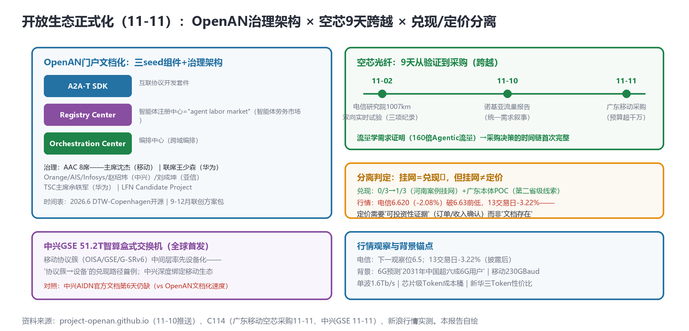

# OpenAN门户文档化（AAC八席+Registry"智能体劳务市场"），空芯光纤9天跨越验证到采购，GSE 51.2T首发——"挂网=兑现"与"挂网=定价"的分离判定

> **分析对象**：2026年11月10日18:00—11月11日18:00窗口的公开增量——OpenAN门户站Best Practices/Architecture/Governance页上线（河南案例挂网兑现破局+治理架构），广东移动空芯光纤采购（千万级），中兴全球首发GSE 51.2T智算盒式交换机，行情兑现/定价分离检验。三视角来源清单第二十轮执行。
> **系列定位**：智能体技术洞察系列·ADN专题"新场景×新技术"系列的**完整报告第18篇**——本篇完成**兑现跟踪的首个破局记录**（0/3→1/3）与**"挂网=兑现"≠"挂网=定价"的分离判定**（交付物定价模型的精度升级）。
> **判定依据**：重大增量——①**OpenAN门户文档化**（河南案例挂网+LFN Candidate+AAC八席治理+三seed组件+"agent labor market"概念）②**空芯光纤9天从验证到采购**（电信试验11-02→广东移动采购11-11）③**中兴GSE 51.2T全球首发**（移动协议簇中间层设备化）。
> **口径约定**：【首发】【重申】【反向】【待核实】沿用系列口径；门户站内容为页面直抓（11-10推送）；行情为新浪实测；背景条目多为标题级。
> **术语消歧**：ADN指自动驾驶网络/自智网络；AAC=OpenAN顾问委员会；TSC=技术指导委员会；"agent labor market"=Registry Center的官方隐喻（智能体劳务市场——智能体的注册/发现/雇佣机制）。
> **立场**：设备商（ADN解决方案提供方）视角。

## 一、趋势判断

### 1.1 OpenAN门户文档化：兑现破局与开放生态正式化【首发·开源·重点】

OpenAN门户站（11-10推送）三页齐发，**兑现跟踪0/3→1/3破局**：①**Best Practices页**——河南联创案例正式挂网："China Mobile Henan: From Operations Automation to E2E Collaborative Autonomy"（跨域投诉+意图驱动节能，built on OpenAN and A2A-T，**validated with live-network production practice**）+家宽投诉多智能体示例；②**Virtual Lab**——**广东本体POC**（自然语言→本体检索→编排执行事件流）+赛事直播保障Demo（A2A-T编排）——**第二省级案例线索**；③**Architecture+Governance页**——LFN Candidate Project身份+**三seed组件**（A2A-T SDK/Registry Center/Orchestration Center）+**AAC八席治理**（主席沈杰·移动/联席王少森·华为/Orange/AIS/Infosys/赵绍炜·中兴/刘成坤·亚信）+TSC主席余轶军（华为）+时间表（2026.6 DTW-Copenhagen开源、9-12月联创方案包）（[project-openan.github.io](https://project-openan.github.io)，11-10，【首发·开源】）。

*图1：OpenAN三seed组件与治理架构（左）×空芯9天跨越（右上）×兑现/定价分离（右下）——本报告自绘*

**点评**：①OpenAN从"GitHub监控对象"升格为**"文档化开源项目"**——案例/架构/治理/时间表四要素齐备，开源项目的成熟度门槛正式跨过；②**Registry Center的"agent labor market"（智能体劳务市场）隐喻**是本轮最具概念价值的表述：智能体的注册/发现/雇佣机制被官方定义为"劳务市场"——**智能体经济的市场结构有了开源侧的制度表述**（对照42号文身份码=身份层、Two-Ledger=账本层、Registry=市场层——**智能体经济的制度三件套成形**）；③AAC八席的成员结构（移动主席+华为联席+中兴/亚信+国际三席）=**中国运营商主导、国际厂商参与**的治理格局——与3GPP波士顿裁决（12月）形成"开源先行、标准后至"的双轨节奏。

### 1.2 空芯光纤9天跨越：从验证到采购【首发·硬件·重点】

**广东移动采购空芯光纤（预算超千万）**（[C114，2026-11-11](https://www.c114.com.cn/news/16/a1320180.html)，【首发·硬件】）——距电信研究院1007km双向实时试验（11-02）仅**9天**。**点评**：①"验证→采购"的跨越速度创系列纪录（此前光通信新技术从试验到集采通常以年计）——**流量学框架（诺基亚11-10：Agentic 160倍）→技术验证（11-02）→采购决策（11-11）**的需求-验证-采购时间链首次完整；②采购方是**移动**（非试验方电信）——跨运营商的技术扩散（电信验证、移动采购）说明空芯的价值判断已超越单一运营商——**"算电协同+确定性DCI"的公共基础设施属性获市场确认**；③千万级预算=试点规模（非骨干铺开）——下一步观察**骨干级集采**（对照400G OTN骨干，11-07）。设备商含义：空芯配套（熔接/放大/监测）的产品窗口已开，与中兴GSE（1.3）同属"协议簇→设备"的兑现路径。

### 1.3 GSE 51.2T首发设备化：协议簇→设备的兑现路径首例【首发·硬件】

中兴**全球首发GSE 51.2T智算盒式交换机**——移动协议簇（OISA/GSE/G-SRv6）中间层**率先设备化**（[C114，2026-11-11](https://www.c114.com.cn/news/16/a1320181.html)，【首发·硬件】）。**点评**：①移动智能网（11-06）的协议簇（OISA卡间互联/GSE全调度以太/G-SRv6）在发布后5天即有设备落地——**"协议主张→设备兑现"的速度**是生态绑定深度的直接度量（对照OISA伙伴数0披露的兑现缺位，GSE设备化是**首个实质兑现事件**——兑现跟踪应增列"协议簇设备化"指标）；②中兴策略清晰化：**深度绑定移动生态**（AIDN方案+GSE设备+AAC席位赵绍炜）——在华为OpenAN生态与移动智能网生态之间，中兴选择双押（AIDN独立方案+GSE移动绑定），**"生态间骑墙"的平衡术**是设备商多生态时代的新课题；③51.2T盒式形态=智算集群的**柜顶/盒式互联**场景（对照超节点整机）——GSE设备化的第一战场是中小智算园区（对照吉瓦级园区的超节点路线）。

### 1.4 兑现与定价的分离判定：交付物定价模型的精度升级【首发·市场·方法论】

**分离判定成立**：兑现破局（河南案例挂网0/3→1/3）但行情未反应——电信**6.620（-2.08%）跌破6.63前低**，"6.76-6.79企稳"判定被打破，13交易日累计**-3.22%**，下一观察位6.5（新浪实测）。**点评**：交付物定价模型（11-06首验）需要**精度升级**：①"挂网=兑现"已判真（文档/案例存在即兑现）；②但"挂网=定价"未成立——**市场定价需要"可投资性证据"**（订单金额/收入确认/利润率影响）而非"文档存在"——文档化与采购化之间隔着投资决策（空芯采购11-11是采购级，但其市场反应尚待观察）；③修正后的定价阶梯：**叙事（已折价）→文档（兑现✓/定价✗）→采购（待检验）→收入（未至）**——每上一级，市场定价的确定性升一档；④6.5若破位，则进入"基本面重估"深水区（对照联通18pp缺口逻辑——市场可能开始质疑三家AI投入的收入转化率）。**方法论沉淀**：兑现跟踪的判定标准从"存在性"升级为"可投资性"——**订单披露日才是行情拐点的候选日**。

### 1.5 背景与负结果【重申/反向】

背景（标题级）：6G预测报告"**2031年中国超六成6G用户**"（6G商用时间表锚点）；移动**230GBaud单波1.6Tb/s长距试验**（光传输纪录+1）；"**词元的账要算细**"芯片级Token成本稿（媒体侧Token会计学跟进——与Two-Ledger/芯片级计量呼应）；新华三"Token极致性价比"（设备商Token叙事第二例——继中兴AIDN后）；北京**5万PFlops具身智能算力集群**（机器人第六域的算力底座）。负结果：联通补位周度第1周无；中兴AIDN官方文档第6天仍缺（与OpenAN文档化速度形成刺眼对照——**同一生态中兴双线：OpenAN贡献快、AIDN背书慢**）；TR291M第18日pending。

### 1.6 汇聚点：新场景×新技术映射与"制度三件套"结论

| 新场景/信号 | 靠什么技术兑现 | 关键技术 | 验证状态 |
|---|---|---|---|
| 智能体劳务市场 | Registry Center注册/发现/雇佣 | OpenAN三seed组件 | 首发·开源（11-10） |
| 空芯采购跨越 | 广东移动千万级采购 | 空芯光纤 | 首发·硬件（11-11） |
| 协议簇设备化 | 中兴GSE 51.2T首发 | GSE全调度以太 | 首发·硬件（11-11） |
| 第二省级案例 | 广东本体POC | 本体检索+编排 | 线索级（11-10） |

汇聚结论：**11-11是"开放生态正式化日"**——OpenAN补齐案例/架构/治理/时间表四要素并给出"智能体劳务市场"制度隐喻，空芯完成需求→验证→采购时间链，GSE完成协议簇→设备首例。**智能体经济的制度三件套（身份码42号文/账本Two-Ledger/市场Registry）与兑现阶梯（文档→采购→收入）同日显影**——产业化的"制度基建"接近完工，剩下的分水岭是"可投资性证据"（订单与收入）。

## 二、技术诉求分析

### 2.1 诉求矩阵总表（系列八项诉求·今日锚点刷新）

| # | 技术诉求 | 今日触发锚点 | 落点 | 证据状态 |
|---|---|---|---|---|
| 1 | 意图可编译 | 广东本体POC（自然语言→本体→编排） | 本体检索层 | 第二省级线索 |
| 2 | 知识可治理 | 本体+Registry（知识/智能体登记） | 注册发现机制 | **市场层成形** |
| 3 | 数据面换代 | **空芯采购+GSE 51.2T** | 算力互联设备化 | **兑现路径首例** |
| 4 | 闭环可验证 | （延续） | 孪生两分支 | 周度观察 |
| 5 | 智能体可互联 | **A2A-T SDK seed+案例挂网** | 互联开发套件 | **开发者就绪** |
| 6 | 能力可复制 | 联创方案包（9-12月） | 复制工具包 | 时间表明示 |
| 7 | 价值可记账 | **兑现/定价分离判定** | 可投资性证据 | 方法论升级 |
| 8 | 监督可执行 | Governance页（治理架构） | AAC/TSC | 制度成形 |

### 2.2 内在张力表

| 张力 | 表现 | 对设备商的后果 |
|---|---|---|
| 文档兑现 vs 投资定价 | 案例挂网 vs 行情续跌 | 兑现披露升级到"订单级"才能拐点——IR策略对准采购/收入确认节点 |
| 生态双押 vs 站队风险 | 中兴OpenAN贡献+AIDN独立+GSE绑移动 | 多生态骑墙的平衡术——治理席位/设备绑定/独立方案三线的资源分配 |
| 开源先行 vs 标准后至 | OpenAN DTW开源 vs 3GPP波士顿 | 开源事实标准vs标准组织主线的赛跑——6个月内双轨合流点 |
| 轻资产背书缺 vs 对手文档化 | 中兴AIDN第6天 vs OpenAN四要素齐 | 背书缺位的竞争成本显性化——中兴专题观察点（3个月限）继续计时 |

## 三、关键技术分析（当期增量优先）

### 3.1 "智能体劳务市场"：Registry Center的制度含义【首发·开源·重点】

Registry Center被官方定义为"agent labor market"——智能体的注册、发现、雇佣机制即劳动力市场结构。**点评**：①**雇佣关系的技术化**：智能体被"雇佣"意味着任务-智能体匹配有价格机制（对照任务路由，11-06——任务路由的路由表就是Registry的雇佣价目表）；②与42号文身份码（监管层）、Two-Ledger（账本层）拼成**制度三件套**：身份（谁在市场里）→市场（怎么匹配）→账本（怎么结算）——**智能体经济的制度基建接近完工**；③对设备商：Registry的接口规范（注册格式/发现协议/雇佣合约模板）是A2A-T SDK之上的下一层产品位——**"劳务市场中间件"**（信誉评分/雇佣撮合/纠纷仲裁）是治理三件套之后的新空白点；④AAC八席治理=市场的"董事会"——中兴/亚信入席说明**设备商/软件商在制度层的席位竞争已经开始**，未入席者（爱立信/诺基亚/新华三）的窗口在DTW开源前。

### 3.2 空芯采购跨越：需求-验证-采购时间链的完整性【首发·硬件·重点】

9天跨越的分解：需求证明（诺基亚流量学，Agentic 160倍）→技术验证（电信1007km三项纪录）→采购决策（广东移动千万级）。**点评**：①**时间链完整性**的意义：三条环节由三个不同主体完成（设备商报告/电信试验/移动采购）——**跨主体的接力验证**比单一主体闭环更有说服力（技术公地化的标志）；②千万级=试点量级，真正的拐点是**骨干级集采**（对照400G OTN骨干与1-5-20ms时延圈，空芯在"20ms圈"的城市间段有替换刚需）——观察2026H1的骨干级空芯集采；③设备商动作：空芯配套产品线（专用熔接机/相干适配/监测探针）的技术白皮书宜在骨干集采前发布（对照中兴AIDN背书缺位的教训——**文档先行**）。

### 3.3 GSE设备化与"协议簇→设备"兑现路径【首发·硬件】

中兴GSE 51.2T盒式交换机=移动协议簇的首个设备兑现。**点评**：①兑现跟踪新增指标"**协议簇设备化数**"（OISA/GSE/G-SRv6各有多少厂商设备落地）——协议主张的生态生命力以此度量（OISA伙伴数0披露的缺位由此对冲：GSE设备化证明协议簇不是纸面）；②中兴的GSE绑定与AIDN独立的**双线平衡**：GSE设备卖给移动生态（跟移动走），AIDN方案卖给全网运营商（独立走）——设备线绑定、方案线中立的组合拳；③51.2T盒式的战场定位：**中小智算园区的柜顶互联**（对照吉瓦级园区的超节点路线）——"协议簇设备化"首先在长尾场景兑现，符合技术扩散规律。

### 3.4 兑现-定价分离的判据体系【首发·方法论】

交付物定价模型的四级阶梯与判据：**L1叙事**（概念/话语——已折价）→**L2文档**（案例/白皮书/门户——兑现✓定价✗）→**L3采购**（订单/中标——定价候选：空芯采购/GSE首发待行情检验）→**L4收入**（财报收入行——终极确认）。**点评**：①四级判据给行情预测提供了**事件分级框架**：L2级事件（挂网）不再触发行情（本轮已证），L3级事件（采购/中标公告）是下一批候选拐点——**设备商与运营商的IR日历应标注L3级事件**；②对照联通缺位：连L2都没有的缺位者在L3/L4上的缺席将被放大——**披露治理的四级欠账**（L2-L4全缺）是联通案例的精确刻画；③方法论沉淀：兑现跟踪的周度查证按L1-L4分级记录，月报新增"兑现阶梯"专栏。

## 四、总结思考

### 4.1 核心命题

11-11的一天里，智能体经济完成了两件事：**制度基建的收尾**（OpenAN治理架构+"智能体劳务市场"Registry+身份码+账本——制度三件套成形）与**兑现阶梯的标定**（L2文档兑现✓但定价未动、L3采购事件出现——空芯采购与GSE设备化是L3级的首批样本）。产业化的重心从"建制度"移向"**出证据**"：市场已经学会区分"文档"与"订单"——L2级事件不再触发行情，L3级（采购/中标）才是候选拐点。OpenAN的"agent labor market"隐喻与AAC八席治理，则把竞争从技术层提升到制度层——**2026.6 DTW开源是制度层的"波士顿时刻"**（对照3GPP 12月波士顿），两个12月窗口（12月波士顿/明年6月DTW）构成未来7个月的标准化双峰。

### 4.2 关键判断

1. **兑现跟踪判定标准升级为四级阶梯**（叙事/文档/采购/收入）——L2级事件不再触发行情；L3级（空芯采购/GSE首发）是下批候选拐点；兑现查证按L1-L4分级记录。
2. **制度三件套成形**（身份码/Two-Ledger/Registry劳务市场）——"劳务市场中间件"（信誉/撮合/仲裁）是治理三件套之后的新产品空白；AAC席位竞争窗口在DTW开源前。
3. **空芯时间链完整（需求→验证→采购9天）**——骨干级集采是2026H1观察点；空芯配套产品白皮书宜先行（文档先行教训）。
4. **GSE设备化开启"协议簇→设备"兑现路径**——兑现跟踪增列"协议簇设备化数"；中兴双线平衡（设备绑移动/方案中立）是多生态时代的新课题。
5. **中兴AIDN背书缺位与OpenAN文档化形成同主体对照**——3个月限的降级判定继续计时；文档先行的竞争成本已量化（对照竞品四要素齐备）。
6. **双12月窗口构成标准化双峰**——3GPP波士顿（12月，6G架构）+DTW-Copenhagen（2026.6，OpenAN开源）——立场文件与开源贡献的排期对齐。
7. **电信6.5为最后观察位**——破位则进入基本面重估深水区；L3级事件（订单披露）是唯一候选拐点。

### 4.3 对不同主体的启示

**运营商**：采购/中标公告的披露规格宜含金额与规模（L3级判据的可投资性来源）；OpenAN治理席位宜吸纳更多国际运营商（对照Orange/AIS）；联通补位仍以"成效披露+缺口拆解"打包为最优解。

**设备商**：①Registry接口规范跟踪+劳务市场中间件预研（信誉/撮合/仲裁）；②空芯配套产品白皮书先行发布；③GSE类协议簇设备化的跟进行动（华为/新华三对OISA/GSE的设备化响应是观察点）；④IR日历标注L3级事件（订单披露日=行情拐点候选日）。

**开发者**：Registry API封装（注册/发现/雇佣模板）与L1-L4兑现阶梯监控仪表盘（对准运营商公告）是两个新空白点。

**标准组织**：LFN宜在DTW开源前公布Registry接口规范草案（劳务市场的先规则后开源）；TMF宜对齐Registry与Two-Ledger（市场与账本的接口）；CCSA宜开"智能体劳务市场"研究项（Registry的中国标准通道）。
