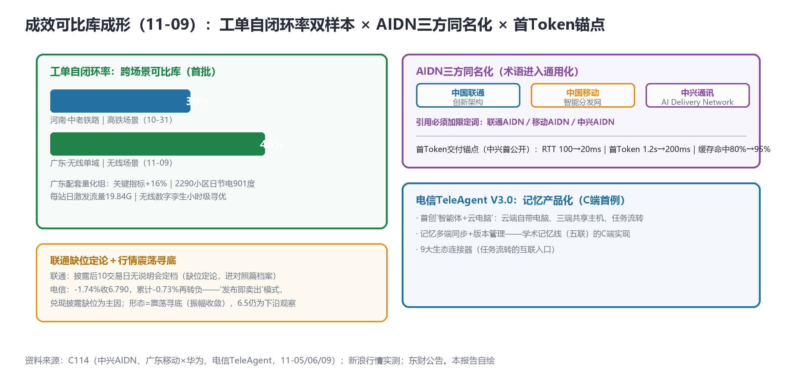

# 成效可比库成形（自闭环率46%vs30%双样本），首Token时延200ms锚点，TeleAgent记忆产品化——AIDN三方同名化与联通缺位定论

> **分析对象**：2026年11月8日18:00—11月9日18:00窗口的公开增量——广东移动×华为国内首个无线单域网络自治实践（A2A-T生产案例第2个）、中兴AIDN解决方案（AI Delivery Network，三方同名化）、电信TeleAgent V3.0（记忆产品化）、arXiv暗面九/十类与治理对称生长、联通缺位10交易日定论、行情6.910检验未守。三视角来源清单第十八轮执行。
> **系列定位**：智能体技术洞察系列·ADN专题"新场景×新技术"系列的**完整报告第17篇**——本篇建成系列**成效可比库**（首批跨场景可比数据对），并记录**AIDN术语三方同名化**（行业通用名化的标志性事件）。
> **判定依据**：重大增量——①**工单自闭环率46%vs30%双样本**（跨场景可比库首批）②**中兴AIDN首Token时延1.2s→200ms**（分发性能锚点首公开）③**TeleAgent V3.0记忆多端同步+版本管理**（记忆产品化C端首例）④**联通缺位10交易日定论**⑤暗面治理对称生长。
> **口径约定**：【首发】【重申】【反向】【待核实】沿用系列口径；46%vs30%两样本的**场景不可直接横比**（高铁vs无线、域范围不同），可比性在于指标定义与采集方式一致——横比仅供参考，纵向趋势才是主读法；行情为新浪实测。
> **术语消歧**：ADN指自动驾驶网络/自智网络；**AIDN自本篇起为三方同名异指词**：联通AIDN=创新架构（10-29）、移动AIDN=智能分发网（11-05）、中兴AIDN=AI Delivery Network智能分发网络（11-09）——**引用必须加限定词**。
> **立场**：设备商（ADN解决方案提供方）视角。

## 一、趋势判断

### 1.1 成效可比库成形：自闭环率46%vs30%双样本【首发·成效·重点】

广东移动×华为**国内首个无线单域网络自治实践**：**A2A-T极简对接+自然语言意图驱动**；量化组——**工单自闭环率46%**（vs河南中老铁路高铁场景30%，10-31）、关键指标**+16%**、**2290小区日节电901度**、**每站日激发流量19.84G**、无线数字孪生**小时级寻优**（[C114，2026-11-06](https://www.c114.com.cn/news/16/a1320112.html)，【首发·成效】）。这是**A2A-T生产案例第2个**（继河南×华为OpenAN联创11-05后）。

*图1：工单自闭环率双样本（左）×AIDN三方同名化与首Token锚点（右上）×TeleAgent记忆产品化（右下）——本报告自绘*

**点评**：①**成效可比库首批建成**：46%（无线）vs30%（高铁）——两样本场景不同（横比仅供参考），但**指标定义与采集方式一致**（工单自闭环率的可比口径），构成了"成效账"的第一批可比数据对——**跨场景可比库是成效账从"个案披露"到"基准体系"的前提**（对标L4五项KPI，11-05提出"四列映射表"的现网数据侧）；②46%>30%的**主读法是纵向趋势**：无线场景的单域自治闭环率高于高铁跨境场景，符合"场景越复杂闭环率越低"的预期——**场景难度与闭环率的负相关曲线**一旦有三个以上样本即可成基准线；③"自然语言意图驱动"=意图栈三层（接口/闭环/任务路由）在现网的**第二次落地**（继CLIC学术侧后）；④2290小区日节电901度（≈0.39度/小区/日）——**节能KBI的现网密度**（与OpenAN动态节能智能体的"跨厂商对接1天"同属节能线，11-06）。设备商含义：跨场景可比库是投标的关键证据结构——**每新增一个生产案例即新增一行**，案例建设的优先级高于单案例的绝对值。

### 1.2 首Token时延200ms：分发性能锚点首公开【首发·性能】

中兴AIDN解决方案（MobileLink期间发布）：**AIDN=AI Delivery Network（智能分发网络）**——CDN+SRv6+边缘推理+智能缓存；量化锚点——网络RTT **100ms→20ms**、**首Token时延1.2s→200ms**（边缘语义缓存）、缓存命中率**80%→95%**（[C114，2026-11-06](https://www.c114.com.cn/news/16/a1320114.html)，【首发·性能】）。**点评**：①**首Token时延**是词元分发体验的关键指标（对话式AI的首响等待）——200ms锚点与Token万亿/日运营锚点（11-07）构成**量与质两个锚点**（量=调用量，质=时延/命中率）；②边缘语义缓存命中率95%意味着**近九成请求不必回源**——分发层缓存是Token TCO的下一个杠杆（语义缓存的计量归属成为新问题：命中缓存的Token算谁的？——**Two-Ledger会计模型的缓存分账条款**需求+1）；③AIDN**三方同名化**正式显性化（联通=创新架构/移动=智能分发网/中兴=AI Delivery Network）——**同名异指词进入通用化阶段**：三家用同一个词指三个东西，行业术语的"公地"正在形成，谁先建立**消歧标准**（限定词规范+对应关系表）谁就占据术语枢纽——术语对齐表从"紧急事项"（11-06）升级为**标准动作**（本周内成稿+TMF/CCSA提案附送）。

### 1.3 TeleAgent V3.0记忆产品化：学术记忆线的C端实现【首发·产品】

电信TeleAgent V3.0：**首创"智能体+云电脑"**（云端"自带电脑"、三端共享主机、任务流转）；**记忆多端同步+版本管理**；9大生态连接器（[C114，2026-11-09](https://www.c114.com.cn/news/16/a1320120.html)，【首发·产品】）。**点评**：记忆产品化的C端首例——学术记忆线（五联：精炼/情景/失败/长期/审计）的**消费者级实现**：①多端同步=记忆的可用性（手机/PC/云三端一致——记忆成为跨端资产）；②**版本管理=记忆的可回滚**（记忆错误的恢复机制——与记忆失败模式2611.040?2611.07982线的审计需求对应）；③"智能体+云电脑"=**智能体的算力外置**（记忆与算力都在云侧，终端只是会话窗口——与移动"AI话费"的终端权益、中兴AIDN边缘缓存构成三种终端侧形态）。设备商动作：记忆同步协议与云电脑智能体接入规范是TeleAgent生态的两个接口位；"记忆版本管理"宜进入知识平面提案的C端章节。

### 1.4 联通缺位定论与行情震荡寻底【反向·定论】

联通披露后**10个交易日无业绩说明会定档**（东财公告零新增，跨2个周末；口径备注：自然交易日7个亦已覆盖）——**缺位定论成立**，进对照篇档案：18pp扣非缺口公开拆解窗口持续关闭，后续定档以"补位"事件记录。行情：电信**-1.74%收6.790**，披露后累计**-0.73%再度转负**——**6.910未守住**，交付物定价反弹（+4.22%）未持续；形态=**脉冲-破位-修复-再回落的震荡寻底**（振幅收敛）；"发布即卖出"模式延续（兑现披露缺位为主因：白皮书挂网三查0/3+0/1）。**点评**：①缺位定论的意义在于**把"未发生"变成"记录在案"**——联通的叙事修复成本随每个交易日上升，说明会+成效数据是唯一止损路径；②震荡寻底形态下，交付物定价模型的**持续性检验未通过**（反弹需要兑现披露支撑）——11-06"兑现则稳固、跳票则重演"的双向预判中，跳票分支正在展开；③6.5一带仍为下沿观察位。

### 1.5 arXiv暗面九、十类与治理对称生长【首发·学术】

arXiv周一批次：**2611.09445**活体Agent竞技场**激励病理**（集中度/规则偏差/网络稀释三型）+**2611.08971幻影共识**（暗面第九、十类）；治理**工程化对称生长**——2611.09054可逆MAS（状态可回滚）+2611.08516 Aegis OS（授权疲劳消除）；2611.09318递归自改进频谱Agent（AN资源线）；KP实例化3天无直接跟进（正常，T+3+收录节奏）（arXiv，11-08批次，【首发·学术】）。**点评**：暗面十类与治理工程化**对称生长**的格局确立——攻击面扩展（十类）与防御工程化（可逆/授权疲劳治理）同步推进：①激励病理三型（集中度/规则偏差/网络稀释）是Token激励设计的**三维风险图**（对应IoA生态的份额集中/规则设计/拓扑稀释）；②幻影共识=多数表决机制的失效模式（与黏性合谋互补——合谋是主动勾结，幻影是被动失真）；③**可逆MAS与TeleAgent记忆版本管理同构**——"可回滚"从学术概念到学术工程到C端产品的一周贯通。

### 1.6 汇聚点：新场景×新技术映射与"可比库"结论

| 新场景/信号 | 靠什么技术兑现 | 关键技术 | 验证状态 |
|---|---|---|---|
| 成效可比库 | 双样本自闭环率+量化组 | A2A-T+意图驱动 | 首发·成效（11-09） |
| 分发性能锚点 | 中兴AIDN边缘语义缓存 | 首Token 200ms | 首发·性能（11-06） |
| 记忆产品化 | TeleAgent V3.0 | 多端同步+版本管理 | 首发·产品（11-09） |
| 治理对称生长 | 可逆MAS+Aegis OS | 可回滚/授权疲劳 | 首发·学术（11-08批次） |
| 缺位定论 | 10交易日锚点 | 披露治理 | 定论（11-09） |

汇聚结论：**11-09是"可比库成形日"**——成效（双样本）、性能（首Token）、治理（对称生长）三条线同时获得**可比的、可复用的**工程基准：成效可比库（自闭环率双样本）、性能锚点组（200ms/95%）、治理用例库（十二类+三型病理）。**可比性是基准化的第一步**——ADN产业化从"有个案"进入"有基准"的阶段；而联通缺位定论与行情寻底提醒：基准的价值要靠披露来变现，缺位者将被基准体系边缘化。

## 二、技术诉求分析

### 2.1 诉求矩阵总表（系列八项诉求·今日锚点刷新）

| # | 技术诉求 | 今日触发锚点 | 落点 | 证据状态 |
|---|---|---|---|---|
| 1 | 意图可编译 | 自然语言意图驱动（广东现网） | 意图栈现网第二例 | 落地确认 |
| 2 | 知识可治理 | 记忆版本管理（TeleAgent） | 记忆可回滚 | **产品化首例** |
| 3 | 数据面换代 | **首Token 200ms/命中95%** | 分发性能锚点 | **锚点首公开** |
| 4 | 闭环可验证 | 无线数字孪生小时级寻优 | 孪生寻优周期 | 现网锚点 |
| 5 | 智能体可互联 | A2A-T生产案例第2个 | 跨厂商互联 | 案例库+1 |
| 6 | 能力可复制 | **跨场景可比库（46%vs30%）** | 成效基准线雏形 | **基准化启动** |
| 7 | 价值可记账 | 语义缓存命中的分账问题 | 缓存Token归属 | 规格缺口+1 |
| 8 | 监督可执行 | 激励病理三型+幻影共识 | 暗面十类 | 体系化 |

### 2.2 内在张力表

| 张力 | 表现 | 对设备商的后果 |
|---|---|---|
| 可比口径 vs 场景差异 | 指标定义一致 vs 高铁/无线场景难度不同 | 可比库注明场景元数据（域范围/复杂度分级）——防误读的披露规范 |
| 同名通用化 vs 枢纽缺位 | AIDN三方同名 vs 消歧标准无人认领 | 消歧标准是低成本高杠杆的标准动作——一周内成稿+提案附送 |
| 缓存命中 vs 计量归属 | 95%命中 vs 命中Token归谁 | 语义缓存分账条款进网关规格（Two-Ledger缓存扩展） |
| 缺位定论 vs 基准边缘化 | 联通10交易日 vs 可比库建设加速 | 缺位者无法进基准库——成效披露的时间价值显性化 |

## 三、关键技术分析（当期增量优先）

### 3.1 跨场景可比库：成效账的基准化路径【首发·成效·重点】

双样本可比的正确读法与扩展路径：①**主读法=纵向趋势**（同一场景的历史对比：河南后续季度自闭环率是否从30%上升）；②**辅读法=横向参考**（不同场景在元数据约束下的排序：高铁>城域公众>园区？待三样本验证）；③**可比库元数据规范**（场景类型/域范围/工单定义/采集窗口四要素——披露时必须附带，否则数字不可比）。**点评**：可比库是"成效账"的技术底座——TMF ANLAV分级判据×现网KPI×可比库三者的对齐表（11-07提出的四列映射表）的**第三列现网数据**开始填充。设备商动作：每承接一个自治项目即按可比库规范留档（场景元数据+KPI组），**12个月内形成10样本库**即可对外发布行业基准报告——基准制定权是下一阶段的战略高地。

### 3.2 首Token锚点与语义缓存分账【首发·性能·重点】

200ms首Token+95%命中率的组合把分发层的工程目标显性化。**点评**：①**语义缓存的计量问题**：命中缓存的请求消耗的"分发资源"与"模型算力"完全不同——Token计量需区分**回源Token（计模型费）vs缓存Token（计分发费）**——Two-Ledger双账本模型（11-07）恰好提供记账框架：账本A记模型算力、账本B记分发缓存；②首Token时延与1-5-20ms三级时延圈（11-07）的对应：200ms落在省干级（5-20ms圈×多跳×排队）——**分发层的时延预算分解表**（端-边缘-省干-骨干四级）可据此起草；③中兴以第三方身份发布AIDN（AI Delivery Network）=**设备商在分发层的定位声明**——与运营商的分发层（移动AIDN）是"方案vs网络"的互补关系，竞合边界用限定词划清。

### 3.3 记忆产品化与可逆性三贯通【首发·产品】

TeleAgent多端同步+版本管理、可逆MAS（学术）、记忆审计（标准）三者的贯通。**点评**："记忆可回滚"成为记忆经济的**安全底线功能**：C端（TeleAgent版本管理）→工程（可逆MAS状态回滚）→标准（记忆审计十类攻击）——三层一致地指向"**记忆操作必须可逆**"这一设计公理；与KP实例化（11-07）组合，知识平面方案的"记忆章节"规格可定型：**同步（多端一致）×版本（可回滚）×审计（可追责）×计量（Two-Ledger）**四要素——这是设备商知识平面产品的记忆模块验收清单。

### 3.4 治理对称生长的产业化含义【首发·学术】

暗面十类×防御工程化的对称曲线。**点评**：①攻击面与防御力同步扩张意味着**安全能力成为互联规模化的前置投资**——IoA生态的每个新成员都应携带治理能力证明（与42号文进网检测衔接）；②激励病理三型给Token激励设计（运营商TokenHub/区域平台）提供**三维风险自查表**：份额集中度检查/规则偏差审查/网络稀释监测——TokenHub运营方的季度自查清单可直接引用；③幻影共识提醒多智能体表决机制（群决策/联邦调度）的**共识质量监控**——与2611.00838闭环失稳（11-04）同属"决策可信"线。

## 四、总结思考

### 4.1 核心命题

11-09的三组可比基准（成效双样本/性能锚点/治理对称生长）宣告ADN产业化进入"**基准阶段**"：个案时代的证据是"我做了"，基准时代的证据是"我比基准高多少"。成效可比库（46%vs30%）、性能锚点（200ms/95%）、治理用例库（十二类）三个库在同一周内成形，而联通以10交易日缺位定论缺席了基准化的开幕式——**基准阶段的第一条规律已经显现：不进基准库者被基准体系定价为"无成效"**。系列17篇的脉络至此清晰：叙事（10-21断点）→口径（10-29三方）→成效刻度（10-31 L4 KPI）→定价模型（11-04~06交付物定价）→**基准可比（11-09）**——证据体系的五级演进在一个月内完成，下一段是基准的争夺（谁的口径成为行业标准）。

### 4.2 关键判断

1. **成效可比库是成效账的基准化起点**——可比库元数据规范（四要素）本周成稿；12个月内10样本即发布行业基准报告——基准制定权争夺开始。
2. **AIDN三方同名化使消歧升级为标准动作**——消歧标准（限定词规范+对应关系表）一周内成稿并随TMF/CCSA提案分发；术语枢纽位价值最高。
3. **语义缓存分账是词元会计的新条款**——回源Token/缓存Token双轨计量进网关规格（Two-Ledger缓存扩展）；首Token时延预算分解表四级起草。
4. **"记忆操作必须可逆"成为设计公理**——同步/版本/审计/计量四要素定型知识平面记忆模块验收清单；TeleAgent是C端标杆。
5. **治理对称生长确立"安全即前置投资"**——激励病理三型自查表进TokenHub运营方季度审查；互联新成员须携治理能力证明。
6. **联通缺位定论的边缘化效应**——基准体系对缺位者的隐性定价（无成效数据=无法进库）；补位事件（说明会+成效披露）将按"补位溢价"重估。
7. **交付物定价进入震荡寻底**——持续性检验未通过；下一个重新积累窗口=白皮书挂网（三查0/3待破）+武汉大会（11-18/20）+12月波士顿。

### 4.3 对不同主体的启示

**运营商**：生产案例披露一律附可比库元数据（场景/域/定义/窗口）；语义缓存的计费口径宜在"AI话费"全国化前定型；联通说明会宜以"成效披露+缺口拆解"打包补位。

**设备商**：①可比库留档流程纳入项目交付标准（每项目一行）；②消歧标准成稿+分发；③语义缓存分账条款+首Token时延预算表进AIDN/AI Delivery Network类方案；④记忆模块四要素验收清单；⑤OpenAN社区提交安全测试用例（治理对称生长的参与位）。

**开发者**：可比库元数据校验工具（自动检查披露数据四要素齐全）与语义缓存分账SDK（Two-Ledger缓存扩展实现）是两个新空白点。

**标准组织**：TMF宜将"跨场景可比库规范"纳入ANLAV修订（成效披露的元数据标准）；CCSA"智能收入统计口径"增加"自闭环率"可比口径条目；3GPP波士顿立场吸收"意图驱动现网案例"（AI原生RAN的证据包）。
