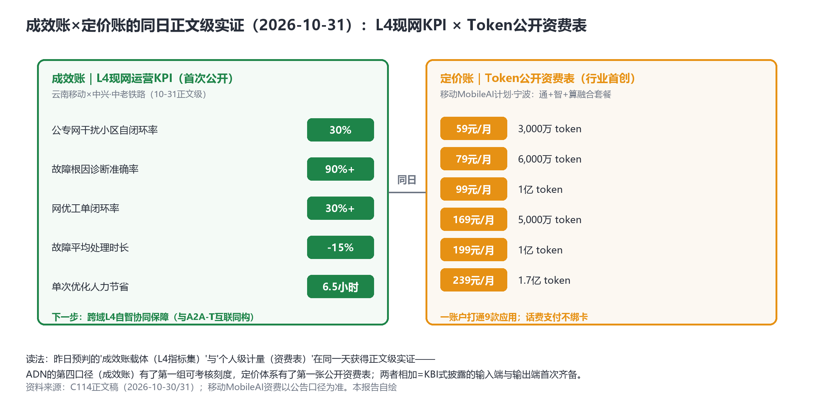

# 成效账有了第一组刻度，定价账有了第一张资费表——L4现网KPI与Token资费的同日正文级实证

> **分析对象**：2026年10月30日18:00—10月31日18:00窗口的公开增量（周六）——10-30四篇404稿的正文级补抓（L4自智中老铁路稿、MobileAI套餐资费表、三星W27、三方业绩综述）、中科曙光"Token时代存储"大会稿、江苏电信1.8亿万卡智算池中标结果、arXiv周末休刊负结果。三视角来源清单第十轮执行（直连优先策略运行良好）。
> **系列定位**：智能体技术洞察系列·ADN专题"新场景×新技术"系列的**完整报告第10篇**——本篇是10-30报告两项预判的**同日正文级验证**：成效账载体（L4指标集）与个人级计量（资费表）。
> **判定依据**：重大（"标题级→正文级"升级日）——①**L4现网运营KPI首次公开**（五项可考核刻度）②**Token公开资费表**（六档，零售定价发现链闭合）③Token/记忆经济下探存储硬件层④智算池竞合路线分化。
> **口径约定**：【首发】【重申】【反向】【待核实】沿用系列口径；L4 KPI与资费表均为C114正文级转述（以运营商正式公告为准）；arXiv为预印本。
> **术语消歧**：ADN指自动驾驶网络/自智网络；L4为TMF AN自治等级第四级（知乎自治）；"成效账"为系列提出的第四口径（KBI式量化成效），区别于移动投资账/电信收入账/联通成果账。
> **立场**：设备商（ADN解决方案提供方）视角。

## 一、趋势判断

### 1.1 L4现网KPI首次公开：成效账的第一组可考核刻度【首发·正文级】

10-30标题级稿升级为正文级：中国移动集团网络部2026年明确高铁网络**"网络口碑领先"与"L4自智试点"两大方向**（集团级战略）；云南移动×中兴·中老铁路高铁智能运维的**L4现网运营KPI首次公开**——公专网干扰小区**自闭环率30%**、故障**根因诊断准确率90%+**、**网优工单闭环率30%+**、故障平均处理时长**-15%**、单次优化**节省6.5小时/人**；技术栈为基站内嵌智能融合板+**测-析-治-溯四步闭环**+单用户回溯（2小时体验报告/12小时提质报告）；全线5G 160MHz、100%覆盖、下行645Mbps；**下一步"跨域L4自智协同保障"**（[C114，2026-10-30](https://www.c114.com.cn/news/127/)，正文级）。

*图1：L4现网KPI×Token公开资费——成效账与定价账的同日正文级实证（本报告自绘）*

**点评**：10-30报告预判"L4分级指标集是成效账的现成载体，若配指标披露将是成效账第一个现网样本"——**次日即兑现**。五项KPI的意义不在数值高低而在**形态**：这是"自智"第一次以**可考核刻度**（而非能力描述）出现在现网报道中——成效账从概念有了第一组真实输入。特别值得注意"测-析-治-溯"四步闭环与单用户回溯（2h/12h报告）：**"溯"环节使自智行为可审计**——与TR291M意图可解释性、记忆审计（10-30）构成同一"可追责"命题的现网版。跨域L4下一步则与OpenAN跨域编排、A2A-T互联同构——**单域L4→跨域L4的路径已明示**，这正是2027商用验证的主战场。

### 1.2 Token公开资费表：定价发现链的最终闭合【首发·正文级】

MobileAI计划（宁波）完整资费：**59/79/99元（3,000万/6,000万/1亿token）与169/199/239元（5,000万/1亿/1.7亿token/月）**，行业首创"通+智+算"融合套餐；**一个Token账户打通美图秀秀/千问/夸克等9款应用**；话费支付不绑卡（[C114，2026-10-30](https://www.c114.com.cn/news/111/)，正文级）。**点评**：Token零售定价发现链就此闭合——词元交易平台（10-23）→双11商品（10-24）→**公开资费表（10-31）**。三个定价刻度的意义：①59元/3000万token≈**2元/百万token的零售锚价**（首次有运营商级公开比价基准）；②"通+智+算"融合=话费/流量/Token三计量单位的套餐化合并；③"话费支付不绑卡"=复用运营商计费信任资产，绕开支付绑卡摩擦——**运营商在个人AI计费市场的渠道优势被制度化**。词元计量对账的规格书自此有了资费级输入：配额审计、跨应用通算、超额计费规则均有真实参照。

### 1.3 存储层入局：Token/记忆经济下探硬件【首发·硬件】

中科曙光（10-29大会）："**Agent时代，存储的核心价值是向Agent提供可检索、可更新、可治理的记忆与上下文**"，并提出私有化Token生成（[C114，2026-10-29](https://www.c114.com.cn/news/16/a1319889.html)，【首发·硬件】）。**点评**：10-30确立"记忆=第五类网络资产"，今日存储厂商即给出**硬件层价值主张**——记忆资产有了专属载体叙事（可检索=向量库、可更新=版本化、可治理=审计）。这与知识平面（组织知识）、记忆四联（智能体经历）、RANSpirit（网络侧）拼成**记忆经济的四层栈**：硬件存储-智能体记忆-组织知识-审计治理。设备商的存储合作位（智能融合板已含本地记忆池）与服务器厂商的Agent存储主张将在"网元内生智能"层相遇。

### 1.4 智算池竞合路线分化：国产化集采vs云商独家中标【首发·竞合】

江苏电信**1.8亿万卡智算池由阿里云独家中标**——与移动117亿AI超节点**国产化**集采形成路线分化（[C114，2026-10-29/30](https://www.c114.com.cn/news/16/a1319893.html)，【首发·竞合】）。**点评**：两家运营商在"万卡级AI基础设施"上走出两条路线（国产整机vs云商服务）——对设备商意味着**同一客户的AI基础设施预算存在双轨可能**，投标策略需按"资源池形态"（自建vs云服务）分别准备；ADN目标态的算力底座竞争从"单一带宽叙事"进入"路线叙事"。

### 1.5 负结果与运维【重申】

arXiv周末休刊（周五25篇已全录，10-20以来累计34篇+周五25篇批次）；联通业绩说明会公告未发（**下周一11-02观察点**，18pp缺口拆解）；TR291M官方核对第7日pending（DDG被墙+代理死亡，建议inform站内人工核）；OpenAN openan-installation部署工具今日首推（开源栈走向"一键部署"）；C114 roll锚点列前缀系统性偏差已用栏目枚举法根治（URL真实性治理）。

### 1.6 汇聚点：新场景×新技术映射与"可验证+可购买"结论

| 新场景/信号 | 靠什么技术兑现 | 关键技术 | 验证状态 |
|---|---|---|---|
| L4现网KPI公开 | 测-析-治-溯闭环+单用户回溯 | L4分级·成效指标 | 首发·正文级（10-31） |
| Token公开资费表 | 通+智+算融合套餐 | 词元计费·资费化 | 首发·资费（10-31） |
| 记忆入存储硬件 | 可检索/可更新/可治理记忆 | Agent存储 | 首发·硬件（10-29） |
| 智算池两路线 | 国产化vs云商独家 | AI基础设施竞合 | 首发·竞合（10-30） |
| 跨域L4预告 | 跨域协同保障 | A2A-T/OpenAN | 路径明示（下一步） |

汇聚结论：**10-31是"实证日"**——昨日（10-30）报告的两个预判在同一天拿到正文级证据：成效账有了第一组可考核刻度（L4五项KPI），定价账有了第一张公开资费表（Token六档）。两者相加，**KBI式披露的输入端（成效刻度）与输出端（计费资费）首次齐备**——"右上角"（强叙事+可验证成效）的占位竞赛从理论阶段进入素材阶段。

## 二、技术诉求分析

### 2.1 诉求矩阵总表（系列八项诉求·今日锚点刷新）

| # | 技术诉求 | 今日触发锚点 | 落点 | 证据状态 |
|---|---|---|---|---|
| 1 | 意图可编译 | （无新触发） | 意图解释模型 | 待TR291M核对 |
| 2 | 知识可治理 | 曙光"可治理记忆"（10-29） | 记忆四层栈 | 硬件层入局 |
| 3 | 数据面换代 | **Token六档资费表（10-31）** | 个人级计量网关 | **资费级锚点** |
| 4 | 闭环可验证 | **L4五项KPI（10-31）** | 自治闭环率等指标 | **成效刻度首组** |
| 5 | 智能体可互联 | 跨域L4协同预告 | A2A-T互联 | 路径明示 |
| 6 | 能力可复制 | 集团级"L4试点"方向（2026） | 省份复制 | 复制周期开启 |
| 7 | 价值可记账 | 资费表×KPI双实证 | 定价+成效双输入 | 素材齐备 |
| 8 | 监督可执行 | "溯"环节+单用户回溯 | 自智行为可审计 | 现网版可追责 |

### 2.2 内在张力表

| 张力 | 表现 | 对设备商的后果 |
|---|---|---|
| KPI刻度 vs ANLAV判据 | 中老铁路五项KPI vs TMF ANLAV L4判据口径 | 指标对齐表（现网KPI↔ANLAV↔财报成效行）是成效账模板的中间层 |
| 零售资费 vs 企业对账 | 59-239元个人套餐 vs 企业级SLA计费 | 词元网关双模（个人配额制/企业审计制）——采集点与结算规则分轨设计 |
| 国产化 vs 云商服务 | 移动117亿整机集采 vs 江苏电信云商独家 | 双轨投标能力：资源池自建方案+云服务适配方案并行 |
| 记忆硬件 vs 知识平面 | 曙光Agent存储 vs Telstra知识平面 | "记忆（个体经历）×知识（组织共识）"的边界定义——TMF立项文件的术语工作+1 |

## 三、关键技术分析（当期增量优先）

### 3.1 L4五项KPI：成效账模板的第一组指标【首发·重点】

把五项KPI放进成效账框架：**自闭环率30%**（自动化程度的直接刻度——对应KBI"自治闭环率"）、**根因诊断准确率90%+**（决策质量刻度——对应TR291M可解释性的量化面）、**工单闭环率30%+**（人机协同刻度）、**处理时长-15%**（效率刻度——对应MTTR族）、**6.5小时/次人力节省**（价值刻度——可直接货币化进财报）。**点评**：这五项恰好覆盖"自动化-质量-协同-效率-价值"五个维度——**成效账模板（财报映射成效版）的第一组指标直接可用**，无需再发明；设备商的动作是把这五项与TMF ANLAV判据、联通九大成果、电信智能收入口径做成一张四列映射表（现网KPI×标准判据×成果清单×财报行）——这张表就是"右上角"占位的钥匙。

### 3.2 Token六档资费：词元网关的资费级输入【首发·重点】

六档资费给出三个工程锚点：①**定价颗粒**（2元/百万token零售锚价——与API批发价、双11折扣价形成三级价格结构）；②**账户模型**（一账户九应用=Token中心账户制，计量需跨应用归集）；③**结算规则**（话费支付+不绑卡=后付费/配额扣减混合）。**点评**：词元计量网关的规格书可从"抽象需求"升级为"对标规格"——个人粒度采集点（终端SDK上报+平台侧核减）、配额生命周期（月度重置/结转）、超额策略（降速/按量/停服）均可按资费表反推；**"AI话费"的客服争议处理流程**（账单争议=Token流水审计）是下一个BSS级需求。

### 3.3 记忆经济的四层栈：从曙光存储到审计治理【首发·硬件】

曙光把存储价值重定义为"向Agent提供可检索/可更新/可治理的记忆与上下文"——记忆经济四层栈（硬件存储→智能体记忆→组织知识→审计治理）自此每层都有厂商站位：曙光（硬件）、记忆四联学术（个体）、知识平面Telstra（组织）、TR291M+审计层（治理）。**点评**：四层栈中设备商的传统强区在底层（网元内嵌存储/智能融合板）与顶层（审计）——**中间两层（个体记忆/组织知识）是软件与标准的主场**；设备商宜以"融合板记忆池+审计接口"的组合卡位，避免与服务器厂商在通用存储正面竞争。

### 3.4 智算池双路线：设备商的双轨投标能力【首发·竞合】

江苏电信云商独家中标vs移动国产化集采——同一运营商体系内出现两种AI基础设施获取路线。**点评**：对设备商的含义分层：①整机路线（移动模式）=传统强项延续；②云服务路线（江苏电信模式）=设备商需提供"可被云商集成"的部件（网络/互联/运维），从主设备商降维为基础设施组件商——**两条路线的利润结构不同，产能与研发配置需要明确分化**；ADN视角的关键是无论哪条路线，**词元计费层（五级渗透第4级）都需要网络侧计量配合**——这是设备商在两条路线中都不缺席的位置。

## 四、总结思考

### 4.1 核心命题

系列第10篇是一个"验证日"：10-30的两个预判（L4指标集=成效账载体、AI话费=个人级计量）在24小时内获得正文级实证——**成效账有了第一组可考核刻度（L4五项KPI），定价账有了第一张公开资费表（Token六档）**。自10-21"零叙事"断点起，系列追踪的"价值可记账"命题至此完成素材闭环：投入账/收入账/成果账（三方口径）→政策账/转型账（归因框架）→**成效刻度（L4 KPI）+资费锚点（Token资费）**——"右上角"占位竞赛的输入输出两端首次齐备，剩下的是把素材组装成模板与披露实践。11月的三个披露节点（联通业绩说明会11-02观察、MobileLink 2026 11-5/7、学术月报11-01首期）将检验组装速度。

### 4.2 关键判断

1. **五项L4 KPI就是成效账模板的第一组指标**——"现网KPI×ANLAV判据×成果清单×财报行"四列映射表一周内可成稿，是设备商成效咨询的开门件。
2. **2元/百万token是首个运营商级零售锚价**——词元网关规格书从抽象需求升级为对标规格；个人/企业双模设计（配额制/审计制）确立。
3. **记忆经济四层栈成形**（曙光硬件/学术个体/Telstra组织/TR291M治理）——设备商卡位"融合板记忆池+审计接口"，避开通用存储正面战。
4. **智算池双路线要求双轨投标能力**——词元计量层是设备商在"整机路线"与"云服务路线"中都不缺席的公共位置。
5. **联通业绩说明会（11-02观察）是成效披露的第一个官方检验点**——若九大成果配量化指标，三方口径将向四方口径（+成效账）演进。
6. **"溯"环节与单用户回溯使自智行为可审计**——ANLAV分级、TR291M解释、记忆审计在现网收敛为同一命题：**每一次自治决策都可回溯**——这是L4可信度的工程底线，也是设备商与运营商共同的下一张考卷。

### 4.3 对不同主体的启示

**运营商**：L4 KPI披露（云南样本）应尽快标准化为集团口径（指标定义/采集方式/报告周期），避免各省口径漂移；"AI话费"的客服与对账预案与套餐全国化同步。

**设备商**：三份交付物本周可完成——①四列映射表（KPI×ANLAV×成果×财报行）；②词元网关双模规格书（对标六档资费）；③记忆池+审计接口组合方案（对齐曙光叙事与融合板存量）。跨域L4（下一步明示）是2027商用验证的预研重点，与OpenAN编排对齐。

**开发者**：Token流水审计SDK（个人账单争议场景）与L4 KPI采集探针（对接测析治溯闭环）是两个立即可做的开源件。

**标准组织**：TMF宜将"现网L4 KPI口径"纳入ANLAV修订议程（现网已有真实指标集，吸收成本低）；CCSA"智能收入统计口径"规范应覆盖Token套餐资费的统计归口（六档资费已有真实样本）。
