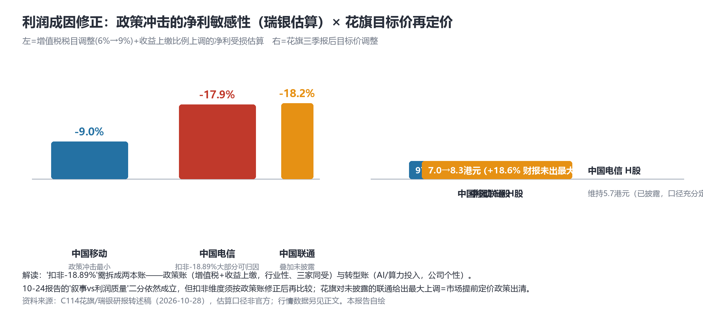
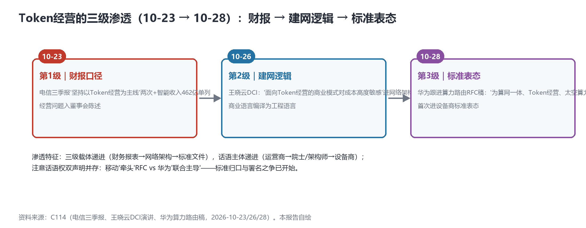

# 政策修正与人事穿透：电信扣非-18.89%须拆两本账，联通总裁直通国家数据集团，Token经营完成三级渗透

> **分析对象**：2026年10月27日18:00—10月28日18:00窗口的公开增量——花旗/瑞银研报（三运营商目标价与利润政策成因）、联通总裁简勤辞任公告（2026-043，调任国家数据集团董事长）、联通披露窗口届满状态、"六张网"入"十五五"重大工程、华为算力路由RFC跟进稿、MobileLink 2026大会更名、arXiv周三17篇命中、行情第三日实测。三视角来源清单第七轮执行（DDG限流第四日，东财公告API为新增可用通道）。
> **系列定位**：智能体技术洞察系列·ADN专题"新场景×新技术"系列的**完整报告第7篇**（前六篇见GitHub main；另有学术版图专题第1期）。本篇包含对10-24财报叙事分化论点的**自我修正**。
> **判定依据**：重大增量——①**利润成因修正**：增值税税目调整+国有资本收益上缴上调构成行业性政策冲击，电信扣非-18.89%须拆"政策账+转型账"两本账重估②**联通治理观察升级**：总裁调任国家数据集团+三季报窗口届满仍未披露且无延期公告③**Token经营三级渗透闭合**：财报→建网逻辑→标准表态（华为首次把Token经营写进标准表态）④"六张网"入"十五五"重大工程。
> **口径约定**：【首发】【重申】【反向】【待核实】沿用系列口径；政策冲击影响为瑞银估算口径【转述·非官方】；行情数字为新浪行情实测；"治理交接期"为推测待证；arXiv为预印本。
> **术语消歧**：ADN指自动驾驶网络/自智网络；"六张网"指"十五五"重大工程中的算力网、新一代通信网等六类国家网络基础设施；"政策账/转型账"为本报告提出的归因分析框架。
> **立场**：设备商（ADN解决方案提供方）视角。

## 一、趋势判断

### 1.1 头号修正：电信扣非-18.89%须拆"两本账"——政策账与转型账【首发·修正】

花旗上调三大运营商目标价（移动H股97→102港元、联通H股7→8.3港元即+18.6%为财报未出者中最大上调、电信维持5.7），同时研报系统化确认利润下滑的政策成因：**增值税税目调整**（流量/短信/宽带等从6%调至9%，瑞银估算对移动/电信/联通净利影响约-9%/-17.9%/-18.2%）与**国有资本收益上缴比例上调**（20%→35%，三家集团合计多缴约270亿元/年）（[C114，2026-10-28](https://www.c114.com.cn/news/16/a1319837.html)，【转述·非官方】）。

*图1：政策账的净利敏感性×花旗再定价——扣非-18.89%的大部分可与政策冲击对账（本报告自绘，估算口径）*

**对10-24"财报叙事分化"论点的自我修正**：①"叙事vs零叙事"的分化判断**不变且已被市场验证**（两日+1.61%）；②但"利润质量"维度的对比须修正——电信扣非-18.89%与移动扣非-0.2%的分化中，相当部分是**全行业政策冲击的行业项而非公司项**（电信17.9%的政策敏感度接近其扣非降幅本身），把扣非差全部读作"AI转型成本"或"经营恶化"都不成立；③移动"可比口径良好增长"的表述在政策账修正后获得部分平反；④真正的公司项信号仍是**收入结构**（智能收入462亿单列、Token经营主线）——"口径竞赛"的胜负手从利润基数转向**收入结构的可披露性**。设备商启示：财报映射模板需内置"政策账调整行"，帮客户把"转型成效"从政策噪音中剥离——**这恰是KBI式成效披露的技术前提**。

### 1.2 联通治理观察升级：总裁直通国家数据集团，窗口届满仍不披露【首发·治理】

联通公告（2026-043）：总裁**简勤辞任（10-26生效）调任国家数据集团董事长**——与10-20国家数据集团挂牌班子完全对上；同期**三季报窗口届满（10-28）仍未披露且无延期公告**（东财600050公告API实测，最新仅辞任公告），A股法定截止10-31剩3天（[C114/东财，2026-10-28](https://www.c114.com.cn/news/16/a1319841.html)，【首发·治理】）。

**点评**：三层含义。①**人事穿透**：词元治理三层结构（10-27报告1.6）从股权层（运营商各15%）延伸到**人事层**——国家数据集团董事长来自运营商总裁，运营商与数据要素国家基础设施的人事直通坐实；②**披露异常**：窗口届满+无延期公告在A股属程序异常（往年在10/22-10/28内），"治理交接期"是合理推测但**待证**——若10-31届期仍无披露则升级为重大异常；③**对照篇改期**：三方口径对照篇从"披露即发"改为"披露后发+超窗标注"——缺口从节奏问题升级为治理观察项。

### 1.3 Token经营三级渗透闭合：财报→建网逻辑→标准表态【首发·标准】

华为跟进算力路由RFC稿（10-28）明言其创新方向"为算网一体、**Token经营**、太空算力探索"——**Token经营首次进入设备商标准表态**（[C114，2026-10-28](https://www.c114.com.cn/news/22/a1319839.html)，【首发·标准】）。至此三级渗透闭合（见图2）：财报口径（电信10-23）→建网逻辑（王晓云10-26）→标准表态（华为10-28）。

*图2：Token经营三级渗透——载体从财务报表到网络架构再到标准文件，话语主体从运营商到设备商（本报告自绘）*

**点评**：一个概念八天走完"财报→架构→标准"三级，是2026年以来产业共识成形速度的极值——词元计量对账的空白点（10-24）因此获得最强的标准化推力。**同时注意话语权信号**：移动稿称"牵头"、华为稿称"联合主导"RFC10053/10054——**双声明并存=标准署名之争已开始**，CATS后续 drafts 的编辑席位与后续标准（算力度量/路由扩展）的主导权将决定"算力路由层"的品牌归属；设备商宜在"度量与遥测"子领域建立不可替代的工程存在感，而非在"牵头"字眼上竞争。

### 1.4 ADN升格国家工程叙事："六张网"入"十五五"重大工程【首发·政策】

2026年4月政治局确定的"十五五"重大工程包含**"六张网"**——算力网、新一代通信网与水电网等传统网络并列（[C114，2026-10-28](https://www.c114.com.cn/news/16/a1319835.html)，【首发·政策】）；移动15届合作伙伴大会更名"**移动网络大会MobileLink 2026**"（11-5/7广州），"Mobile"内涵延展至移动计算与移动智能。**点评**：ADN从"运营商降本工具"→"厂商产品线"→"经营主线"（Token）→**"国家工程组件"**——四级升格全部完成；"新一代通信网"写入国家工程意味着6G/ADN的投入确定性与集采节奏上移，设备商的"十五五"对齐文档（六张网×五件套×定价体系）值得一周内成稿。

### 1.5 arXiv记忆管理主题爆发：智能体的"第五资产"浮出【首发·学术】

arXiv周三cs.MA爆发17篇命中：**2610.37461《Concordat: Typed Sessions for LLM Agents》**（类型化会话——A2A-T会话层的学术对标）、2610.36221（EREBOTS 4.0：A2A智能体+MCP工具）、2610.36264（Inbox as Coordination Primitive：收件箱作为协调原语）；**记忆管理主题四连发**——2610.36652（记忆精炼）、2610.35966（EMMA情景记忆）、2610.35930（意见改变追踪）、2610.35950（审计层机械复验）（arXiv，2026-10-28，【首发·学术】）。**点评**：记忆管理四篇与知识平面（可信知识）、TR291M（可解释）、AN决策记忆（FastMode）五线同频——**"记忆"正在成为继频谱/算力/数据/技能之后的第五类网络资产**；Concordat则说明A2A-T的会话语义已有学术标准化候选，OpenAN的应用层栈获得理论纵深。

### 1.6 行情第三日：温和回吐，溢价未崩【重申·市场】

电信A股第三日**-1.01%**（6.950→6.880），三日累计+0.58%；同日移动-1.31%、联通状态见1.2。**点评**：板块普跌中电信相对抗跌（-1.01%vs-1.31%），叙事溢价**温和回吐而非崩塌**——与政策账修正的节奏吻合（市场在等待10-31前的联通披露与机构重估落地）；观察期至10-30/31，届时出周度结论并完成"叙事溢价"专项检验的闭环。

### 1.7 汇聚点：新场景×新技术映射与"修正周"结论

| 新场景/信号 | 靠什么技术兑现 | 关键技术 | 验证状态 |
|---|---|---|---|
| 政策账重估（利润归因） | 增值税+收益上缴敏感性模型 | 财报口径·政策调整行 | 首发·研报（10-28） |
| 人事直通数据集团 | 运营商总裁→数据集团董事长 | 词元治理·人事层 | 首发·治理（10-26生效） |
| Token经营标准表态 | 算力路由RFC创新方向 | CATS+词元经济 | 首发·标准（10-28） |
| ADN国家工程化 | "六张网"重大工程 | 算力网+新一代通信网 | 首发·政策（10-28） |
| 智能体记忆资产 | 记忆精炼/情景记忆/审计复验 | 记忆管理四连发 | 首发·学术（10-28） |

汇聚结论：**10-28是"修正周"的收官日**——本周系列报告的主线（叙事分化→定价裁决→终局合流→学术版图）在今日获得三重修正与加固：利润归因修正（政策账）、治理穿透修正（联通人事）、话语权修正（双主导）。修正不是否定，而是把论点从"叙事竞赛"深化到"归因竞赛"——**下一个竞争点是"谁能把政策账与转型账分开披露"**，这仍是KBI式成效披露的变体。

## 二、技术诉求分析

### 2.1 诉求矩阵总表（系列八项诉求·今日锚点刷新）

| # | 技术诉求 | 今日触发锚点 | 落点 | 证据状态 |
|---|---|---|---|---|
| 1 | 意图可编译 | （无新触发） | 意图解释模型 | 待TR291M官方核对 |
| 2 | 知识可治理 | 记忆管理四连发（10-28）——知识平面的学术镜像扩容 | 记忆+知识双资产 | 五线同频 |
| 3 | 数据面换代 | 华为RFC稿"算网一体+Token经营"（10-28） | 算力路由+词元计量 | 标准表态确认 |
| 4 | 闭环可验证 | （无新触发） | 孪生保真度 | 待补 |
| 5 | 智能体可互联 | Concordat类型化会话+EREBOTS 4.0（10-28） | A2A-T会话语义 | 学术对标出现 |
| 6 | 能力可复制 | MobileLink更名"移动计算与移动智能"（10-28） | 底座外延扩大 | 叙事确认 |
| 7 | 价值可记账 | **政策账/转型账两本账框架（10-28）** | 财报归因 | **归因竞赛开启** |
| 8 | 监督可执行 | 联通窗口届满不披露+人事穿透（10-28） | 披露纪律与治理 | 观察项升级 |

### 2.2 内在张力表

| 张力 | 表现 | 对设备商的后果 |
|---|---|---|
| 政策账 vs 转型账 | 同一扣非降幅的行业项vs公司项归因 | 财报映射模板内置政策调整行——"转型成效"从政策噪音中剥离的能力成为咨询卖点 |
| 牵头 vs 联合主导 | 移动与华为对RFC10053/10054的双重署名声明 | 避开"牵头"字眼之争，在度量/遥测子领域建立工程不可替代性 |
| 国家工程确定性 vs 披露纪律 | "六张网"升格 vs 联通窗口届满不披露 | 集采确定性上升的同时，客户治理尽调（KYC）深度须加强——预算假设挂钩披露表现 |
| 会话语义学术化 vs 工程节奏 | Concordat等对标A2A-T vs OpenAN工程栈 | 应用层栈吸收学术会话类型（会话SLA/一致性约束）宜在2027商用验证前完成 |

## 三、关键技术分析（当期增量优先）

### 3.1 "两本账"框架：从利润归因到成效披露的桥【首发·方法论】

把扣非拆为政策账（行业性：增值税6%→9%+收益上缴20%→35%）与转型账（公司性：AI/算力投入与智能收入），是财报分析的常规操作，但其ADN含义特殊：**运营商讲"AI转型"故事的最大软肋就是归因模糊**——利润降了说不清是政策还是转型，收入涨了说不清是智能还是价格。设备商若能提供"政策账调整+转型成效归因"的报表级模板（对接智能收入单列口径），就把10-24以来的"财报映射模板"从话术工具升级为**审计工具**——这是KBI公式进财报的真正通道。

### 3.2 华为RFC表态与"双主导"信号【首发·标准】

华为把RFC10053/10054纳入"算网一体、Token经营、太空算力"创新叙事，同时"联合主导"与移动"牵头"并存。**点评**：太空算力（LEO在轨智能体，呼应ORCA 2610.28404）首次与Token经营并列为RFC价值叙事——算力路由的边界从地面延展到天基；话语权竞争的实质是**后续标准（算力度量、SLA路由、跨域结算）的编辑权**——词元计量对账若进CATS后续draft，其起草方将同时锁定数据面与定价体系两个枢纽。

### 3.3 记忆管理学术线：第五类网络资产的轮廓【首发·学术】

记忆精炼（什么该忘）、情景记忆（经历怎么存）、意见改变追踪（立场演化）、审计层机械复验（记忆可审计）四篇同日出现，覆盖记忆生命周期的存-炼-追-审四环节。**对位**：知识平面管"组织的知识"，记忆管理管"智能体的经历"——两者在"可信度+溯源+审计"上同构；设备商的AN Copilot产品记忆若不能机械复验（审计层），在TR291M时代将不可部署。**启示**：把"记忆审计"纳入AN Copilot的设计约束，与"解释即日志"（10-26）并列。

### 3.4 Concordat与A2A-T：会话语义的标准候选【首发·论文】

类型化会话（Typed Sessions）给智能体间交互加类型约束（会话协议、状态机、一致性）——与A2A-T的任务会话、OpenAN工作流SDK直接对标。**对位**：应用层栈（OpenAN）+路由层（RFC）+治理层（PATN/TR291M）之外，**会话语义层**可能成为第四个标准化点；学术先行（2610.37461），产业跟进窗口存在。

### 3.5 东财公告API：披露监测的新通道【首发·工具】

np-anotice-stock.eastmoney.com公告API实测可用，补充了联通IR的SPA盲区——披露监测从"C114 roll+IR页"升级为"公告API直查"。**点评**：三家运营商的公告监测从此可以分钟级自动化，联通10-31法定截止日的核查将有实时通道；这也是本周搜索限流期间最重要的通道补强。

## 四、总结思考

### 4.1 核心命题

本周五篇报告构成完整的"修正弧线"：10-24叙事分化（提出）→10-26市场裁决（验证）→10-27终局合流（升维）→学术版图（补维）→**10-28政策修正与治理穿透（校准）**。校准后的结论更结实：**"口径竞赛"的真实战场在归因层——谁能把政策账与转型账、叙事与成效分开披露，谁就赢得KBI式披露的定义权**。Token经营三级渗透（财报→架构→标准）与人事穿透（运营商→数据集团）说明这场竞赛的参与方已经从两家运营商扩展到设备商、院士层与国家基础设施——词元经济的基础设施化进程，比一周前的任何判断都快。

### 4.2 关键判断

1. **扣非对比必须在政策账修正后进行**——10-24的扣非分化对比（电信-18.89%vs移动-0.2%）保留叙事结论、修正利润结论；设备商财报模板立即内置政策调整行。
2. **联通10-31是最后的程序节点**——届期仍无披露则"披露纪律"成为独立风险项，三方对照篇以"双方+治理观察"形态发布。
3. **"双主导"标志标准署名之争开始**——设备商在CATS后续draft的战略应聚焦算力度量与遥测（工程壁垒最深、与词元计量对账接口最近）。
4. **记忆=第五类网络资产**——存-炼-追-审四环节的学术齐备意味着"记忆审计"将成AN Copilot的部署门槛；与"解释即日志"并列为设计约束。
5. **ADN已升格国家工程组件**——"六张网"对齐文档、MobileLink 2026（11-5/7）的展台叙事需在一周内准备就绪。
6. **电信周度结论10-30/31出炉**——叙事溢价检验与联通披露将在同一窗口收口，两个观察合并为一个"披露与定价周报"。

### 4.3 对不同主体的启示

**运营商**：主动拆账优于被动解释——在业绩说明会给出"政策影响量化+转型投入单列"的双账披露，把归因模糊的软肋变成披露透明的卖点；联通披露程序的说明义务（无论10-31前是否披露）需最高优先级处理。

**设备商**：报表级"两本账"模板+CATS度量/遥测子领域深耕+"记忆审计"设计约束三件套本周可开工；MobileLink 2026（11-5/7）是"六张网+Token经营+智能底座"叙事的首次同台——展台材料按国家工程口径重写。

**开发者**：公告API监测脚本（东财np-anotice-stock接口）与记忆审计中间件（机械复验层，2610.35950思路）是两个立即可做的开源件。

**标准组织**：CATS后续draft宜为"词元计量对账"预留数据字段（与国家统计体系接口）；CCSA"智能收入统计口径"规范（10-24建议）因政策账争议而紧迫度上升——归因竞赛需要行业级口径仲裁者。
