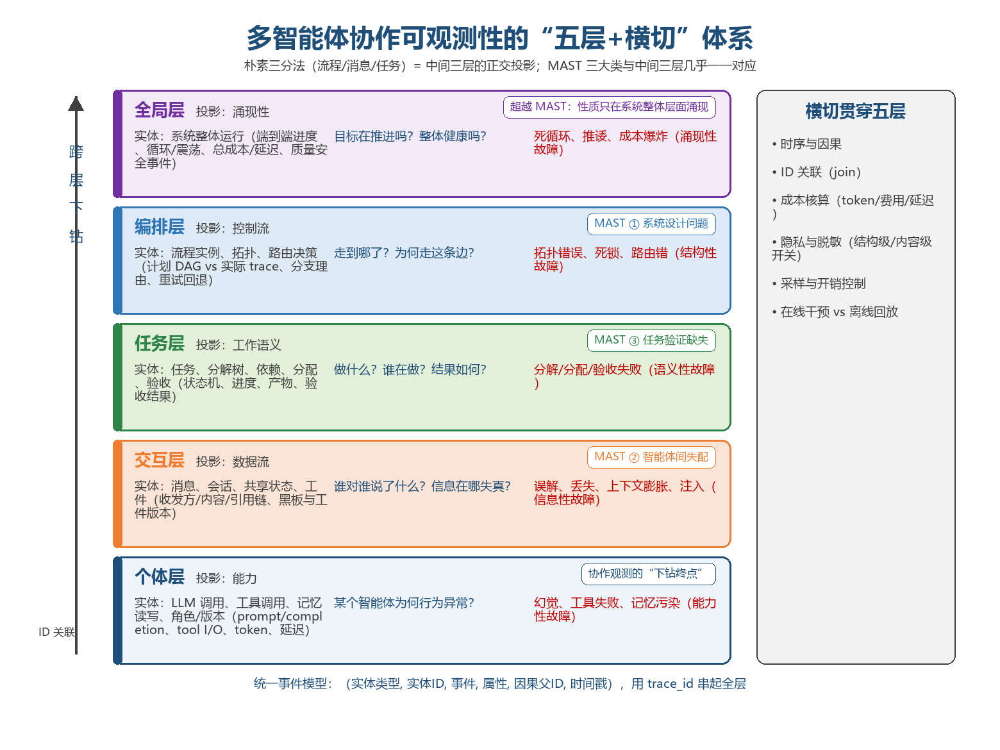
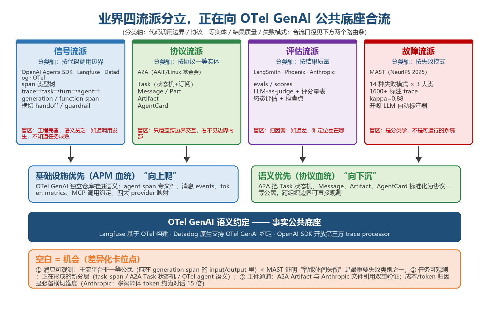

# 从看见调用到看懂协作：多智能体可观测性的五层体系、四流派合流与语义层卡位

> **分析对象**：《多智能体协作可观测性分类——洞察文档》（OpenAN 内部研究笔记，2026-10-10）及其交叉验证的业界公开资料——OpenAI Agents SDK 追踪文档、Langfuse 可观测数据模型、Datadog Agent Observability、OpenTelemetry GenAI 语义约定、A2A 规范、MAST 失败分类学（arXiv:2503.13657，NeurIPS 2025）、Anthropic 多智能体研究系统工程实践；补充《GitHub 多智能体协作论文项目调研》（2026-10-31，GitHub API 核实）与 OpenAN 观测产品线设计文档（an-agentobserver、an-a2atobserver、an-observation-center，2026-05）。
> **系列定位**：智能体技术洞察系列·智能体观测专题。与系列五《对智能体/多智能体的技术诉求分析》交叉引用（其诉求 9"调用链透明化"、诉求 14"全链路行为审计"在本篇展开为可观测的完整技术体系），与《本体在多智能体协同与A2A-T上的应用》互为表里——那篇回答"协作怎么说得通、对得上"，本篇回答"协作跑起来之后，看不见的部分怎么管"。
> **口径约定**：可观测性=从系统外部输出推断内部状态的能力，工程上落地为 trace/log/metric(/eval) 四信号；"五层"指个体层/交互层/编排层/任务层/全局层；星标与项目状态为 2026-10-31 GitHub API 实测；Anthropic 成本数据出自其多智能体研究系统公开工程博客。
> **立场**：设备商（ADN 解决方案提供方）视角。

## 一、趋势判断

### 1.1 故障主体换挡：多智能体系统的病根在"协作"，不在"单点"

多智能体系统（MAS）的故障大多是协作级故障：两个智能体互相推诿形成死循环、任务分解不合理导致重复劳动、关键信息在多轮传递中失真、总 Token 成本爆炸。单智能体时代的观测手段——LLM 调用日志、prompt/completion 记录——对这类故障结构性失明：每一步都"看起来正常"，问题只在协作链上涌现。两个硬锚点：MAST（Multi-Agent System Failure Taxonomy，arXiv:2503.13657）基于 7 个主流框架、1600+ 条标注 trace（标注者间一致性 kappa=0.88），把失败归纳为三大类——系统设计问题、智能体间失配、任务验证缺失——后两类直接发生在协作面而非个体内；Anthropic 多智能体研究系统的运行数据显示，多智能体 token 消耗约为普通对话的 15 倍、token 用量解释了 80% 的性能方差——成本与故障都长在协作链上。

**点评**：观测重心必须跟着故障走。平台界已经用产品命名投票：Datadog 把产品从 LLM Observability 更名升级为 Agent Observability——产品名本身就是一次市场判断："LLM 观测"是过渡形态，"智能体观测"才是赛道。

### 1.2 分类即地图：观测点、数据模型、产品定位都由分类决定

分类体系不是学究式整理，它直接决定三件事：**观测点埋在哪**（分类就是观测点的地图）、**数据模型怎么建**（哪些实体、哪些生命周期状态、靠什么 ID 关联）、**产品怎么定位**（业界哪层成熟、哪层空白）。评价一个分类只有两个标准：**MECE**（以实体为分类对象时互斥、覆盖完备——以事件为对象则必然重叠）与**故障驱动**（每一类都对应一类"不观测就定位不了"的故障——合理分类由要诊断的故障模式反推）。

朴素三分法（协作流程/协作消息/协作任务）方向正确——对应一次协作执行的三个正交投影：**控制流**（拓扑、调度、路由）、**数据流**（智能体间流动的信息）、**工作语义**（被协作完成的工作单元）。但互斥性检验暴露它的成立条件：同一条"orchestrator 给智能体 B 发消息派活"，在流程视角是一条边（A→B 被调度）、消息视角是一条 message 记录、任务视角是一次 task 状态迁移（pending→assigned）——**以事件为对象，三分法不互斥；以实体为对象（流程实例、消息、任务，各有生命周期状态机），基本互斥**。由此带来两个设计要求：分类对象必须是实体而非事件；三个投影必须用 ID（trace_id/message_id/task_id）互相 join。"任务 T3 卡了 20 分钟 → 定位到它所在的流程步骤 → 找到该步骤等待的未回复消息 → 下钻到 B 的工具调用失败"——这类跨层下钻只在 ID 关联存在时才可能，**三视图的价值只在能互相 join 时才兑现**。

### 1.3 完备性检验暴露四个缺口：三分法升级为"五层+横切"

对三分法做覆盖完备性检验，暴露四个缺口：**向下缺个体层**（"B 收到任务为何不动手"的答案在 B 的 LLM 调用、工具失败、记忆污染里，协作三视图全看不到——协作故障的根因大部分发生在个体内部，个体可观测是协作可观测的下钻终点）；**"消息"只覆盖半个交互面**（黑板模式、共享记忆、共享文档这类协作不走消息，只观测消息对它们完全失明，需扩为含共享状态与工件的"交互层"）；**向上缺全局层**（互相推诿 20 轮、成本爆炸，单看任何一条消息/任务/流程步骤都"正常"，性质只在系统整体涌现）；**横切维度不属于任何一层但每层都要带**（时序因果、成本核算、隐私脱敏、采样开销、在线干预 vs 离线回放）。修正后的目标体系为五层+横切（见图1）：

*图1：五层+横切体系——朴素三分法是中间三层的正交投影，MAST 三大类与之几乎一一对应（本报告自绘，分类口径承接 2026-10-10 内部研究笔记）*

最强的外部验证来自 MAST：其三大失败类别与三分法几乎一一对应——系统设计问题↔编排可观测、智能体间失配↔交互可观测、任务验证缺失↔任务可观测。朴素三分法"恰好暗合"故障结构，不是巧合，而是"分类由故障反推"这条生成规律在起作用：合理的观测分类从来都是从要诊断的故障模式倒推出来的。

### 1.4 业界四流派分立，两条路线正在合流

业界没有统一的官方分类。把标准组织、可观测平台、互操作协议与研究工作摆在一起，可辨识四个流派，分类轴各不相同、互为镜像：**信号流派**按代码调用边界分类（OpenAI Agents SDK 的 span 类型树、Langfuse 的 session→trace→observation 三层数据模型、Datadog 的三种 trace 粒度、OTel GenAI 约定）——自动埋点只能挂在框架代码边界上，所以分类天然是调用栈分层，工程完备、语义贫乏；**协议流派**按协议一等实体分类（A2A 的 Task/Message/Artifact/AgentCard）——当协作跨越组织边界、双方没有共享代码栈时，唯一可观测的就是协议层实体，这迫使语义实体成为一等公民；**评估流派**按结果质量分类（LangSmith、Phoenix、Anthropic 的 evals/scores、LLM-as-judge）——可观测不止"记录发生了什么"，还要"判断好不好"；**故障流派**按失败模式分类（MAST 的 14 模式×3 大类）——分类学的用途是反推观测点（见图2）。

*图2：四流派分立与向 OTel GenAI 公共底座的合流，下方橙色条为差异化卡位点（本报告自绘）*

两条路线正在合流，公共底座是 OTel GenAI 语义约定：基础设施优先阵营（APM 血统）向上爬——OTel GenAI 已从主仓库独立为专门仓库，推进 agent span（专文件）、消息 events、token metrics、MCP 调用约定与四大 provider 映射；语义优先阵营（协议血统）向下沉——A2A 把 Task 状态机、Message、Artifact 标准化为协议一等公民。三个合流注脚：Langfuse 明确基于 OpenTelemetry 构建、Datadog 原生支持 OTel GenAI 约定、OpenAI SDK 开放第三方 trace processor。**OTel GenAI 正在成为智能体遥测的事实公共底座**——这与电信设备产业熟悉的"接口标准化后价值上移"规律完全同构。

### 1.5 空白即机会：消息可观测没人做，任务可观测正在分层

把五层框架与业界现状对齐，三个结构性结论浮出：

| 三分法 | 业界最强对应物 | 业界成熟度 | 差距/机会 |
|---|---|---|---|
| 流程可观测 | OpenAI task/turn span、OTel agent span、Datadog workflow trace | 成熟 | 可直接复用 OTel 底座 |
| 消息可观测 | A2A Message + generation span 的 prompt/completion | **空白/前沿** | 语义级消息观测（意图、失真、引用链）基本无人做 |
| 任务可观测 | A2A Task 状态机、OpenAI task_span | 标准化中 | 分解树、依赖、验收语义尚无统一模型 |

其一，**消息可观测是主流平台的空白地带**：OpenAI SDK 的 handoff 只是 span，消息内容藏在 generation span 的 input/output 里，agent 间通信不是独立观测实体；只有 A2A 把 Message 协议对象化。而 MAST 证明"智能体间失配"是最重要的失败类别之一——空白×高重要性的交集，正是差异化机会。其二，**任务可观测是正在形成的新分层**：OpenAI SDK 引入 turn 之上的 task_span、A2A 定义完整 Task 状态机、OTel 在补 agent/workflow 语义——语义层观测是当前的收敛方向。其三，**工件通道被双重验证**：A2A 把 Artifact 与 Message 并列（配 TaskArtifactUpdateEvent）；Anthropic 让子智能体把结果写文件系统、只回传引用，以避免多级转述的"传话游戏"——消息不是唯一交互通道，工件是并列的信息通道。五层其余部分与业界的对应：个体层（OTel generation/tool span，成熟）、全局层（Anthropic 交互结构监控、Datadog Patterns/Insights，新兴）、评估（Langfuse/LangSmith scores，成熟）。

### 1.6 观测档位解耦：结构级与内容级是两个可分离的开关

存在一个独立的"结构级观测层"，且可与内容级观测解耦：在标准追踪之外，监控智能体的**决策模式与交互结构**（谁、何时、对谁、什么拓扑）而不看对话内容，以此定位根因、发现意外行为——后者成本高、隐私敏感，必须做成可关断的开关（OpenAI SDK 的 sensitive-data 开关、导出前 redaction 是同一逻辑）。元数据级与内容级是两个观测档位：结构级全天候常开（便宜、可全局聚合、隐私友好），内容级按需开（贵、敏感、事后最难补采）。成本维度同理是一等公民：Datadog 直接按 LLM span 数计价——观测数据模型直接影响客户成本账单；任何分类体系里，成本/Token 归因必须是横切维度而非事后报表。

### 1.7 趋势的汇聚点：可观测"语义化"，观测中心升级为"智能体网管"

四条趋势线——故障主体换挡、分类由实体与故障双标准收敛、四流派向 OTel GenAI 底座合流、语义层（消息/任务/工件）成为空白与新分层——汇聚成一个判断：**智能体可观测正在"语义化"**。观测重心的迁移路径清晰可辨：记录调用（过去，LLM 观测）→理解协作（现在，智能体观测）→评估与治理（未来，第四信号与在线干预）。目标架构是统一事件模型：每个观测点产出（实体类型，实体 ID，事件，属性，因果父 ID，时间戳），用 trace_id 串起全层；最小可行集先做**交互层+任务层**——语义最浓、事后最难补采（消息不录就永远没了），个体层用 OTel instrumentation 蹭现成生态，全局层在前四层数据上做聚合。对设备商，这一汇聚点的产品化形态就是"智能体网管"：观测中心之于多智能体系统，等于网管系统之于电信网络——没有它，L4 自智的"自治"无法被验收，Token 经营的"账"无法被结算，治理体系的"责"无法被认定。

## 二、技术诉求分析

### 2.1 从五层体系推导的七条技术诉求

**诉求1：ID 全层关联——跨层下钻的前提。** trace_id/message_id/task_id 互相引用，个体层 span 通过因果父链挂接任务与流程实例。没有 ID 关联，五层只是五个数据孤岛；有了 ID 关联，才可能从"任务卡了 20 分钟"一路下钻到"某个工具调用失败"。这是数据模型的第一约束，必须在埋点设计之初写入，事后补建成本极高。

**诉求2：语义实体一等公民——Task/Message/Artifact 对齐 A2A。** 任务带完整状态机（配查询/订阅接口与流式状态事件）、消息是结构化协议对象（收发方/时间/协议类型/内容/引用链）、工件与消息并列（产物通道、版本、引用）。对齐 A2A 的副产品是跨组织互操作能力——协议实体标准化之日，就是跨域观测互通之时。

**诉求3：故障驱动选点——MAST 14 模式反推观测点清单。** 14 种失败模式，每种至少对应一个必须存在的观测点。这是观测点选择的"验收标准"：拿 MAST 清单逐项对照自家平台，缺哪个观测点，就是哪个故障模式不可诊断。

**诉求4：评估作为第四信号——LLM-as-judge + 终态评估。** 多智能体系统同一起点可走多条都有效的路径，逐步对照式评估失效——转向 LLM-as-judge + 评分量表（事实准确性、引用准确性、完整性、来源质量、工具效率）；对改变状态的智能体做终态评估+检查点，而非逐步评估。evals/scores 必须与 trace 并列成为数据模型的一等信号，而非外挂报表。

**诉求5：结构级/内容级分级开关——隐私与成本的观测档位。** 结构级（谁、何时、对谁、什么拓扑）常开；内容级（说了什么）默认关断、按需开启、导出前脱敏。这既是隐私合规要求（智能体间通信常携带用户数据），也是成本控制手段（内容存储是结构数据的几十倍开销）。

**诉求6：成本归因全层穿透——Token 是观测数据的一等字段。** 每个事件携带 token_usage（prompt/completion/total）与延迟，归因链路：单次调用→任务→会话→智能体→租户。多智能体 15 倍 token 消耗的量级下，无成本归因的观测系统等于只记账不核账。这条诉求与系列五的 Token 经济主线直接接轨：观测事件模型就是智能体"话单"的数据底座。

**诉求7：在线干预与离线回放并存。** 时序与因果字段支撑两类消费：在线——看板、告警、熔断与人工介入（Observability 面向 Ops）；离线——会话回放、故障复盘、评估回归（可回放性面向工程改进）。缺回放的观测只是日志堆，缺在线干预的观测只是显微镜。

### 2.2 诉求矩阵总表

| # | 技术诉求 | 五层落点 | 业界最强对应物 | 对设备商的含义 |
|---|---|---|---|---|
| 1 | ID 全层关联 | 横切 | OTel trace context、A2A task/message ID | 数据模型设计约束，埋点之初写入 |
| 2 | 语义实体一等公民 | 任务/交互/工件 | A2A Task/Message/Artifact、AgentCard | 协议对齐=免费获得跨域互操作 |
| 3 | 故障驱动选点 | 全部 | MAST 14 模式×3 大类 | 观测点的验收清单 |
| 4 | 评估第四信号 | 全局+任务 | Langfuse/LangSmith evals、LLM-as-judge | 从"看见"到"判好"的台阶 |
| 5 | 结构/内容分级开关 | 横切 | OpenAI SDK sensitive-data、导出 redaction | 隐私合规+成本档位 |
| 6 | 成本归因穿透 | 横切 | token metrics、Datadog 按 span 计价 | 智能体话单的数据底座 |
| 7 | 干预+回放并存 | 编排+全局 | 回放播放器、实时 WebSocket | Ops 与工程改进双消费面 |

### 2.3 内在张力表

| 张力对 | 矛盾表现 | 化解方向 |
|---|---|---|
| 内容可见 ↔ 隐私脱敏 | 看得越细越能定位，但内容级最敏感最贵 | 结构级常开+内容级开关；导出前脱敏 |
| 采样开销 ↔ 覆盖完备 | 全量采集存储成本高，采样丢的是"事后才知道重要"的样本 | 分层采样：结构级全采+内容级按需采+错误会话全采 |
| 语义丰富 ↔ 标准化程度 | 消息语义越丰富越难跨平台互通 | 沿 OTel GenAI 约定扩展自定义属性，不另起炉灶 |
| 跨组织可观测 ↔ 边界内埋点权 | 看不到对方内部，对方也没义务埋点 | 协议层实体观测（A2A）+ 结构级元数据交换 |
| 实时干预 ↔ 离线回放 | 在线流要低延迟、离线分析要完整数据 | 同一事件模型双消费：流式通道+持久存储分离 |

## 三、关键技术分析

### 3.1 OpenAI Agents SDK 追踪体系：调用栈分层的"信号流派"标本

span 类型树为 trace → task_span → turn_span → agent_span → generation_span / function_span，横切 handoff_span（交接）与 guardrail_span（护栏）。turn 之上引入 task_span，是"任务层"进入调用栈分层的信号；handoff/guardrail 作为横切 span，把"协作动作"与"安全动作"从普通调用中区分出来。

**点评**：这套分层的语义仍停在执行结构：知道"调用发生了"，不知道"任务成没成"；消息内容主要藏在 generation span 的 input/output 里，agent 间通信不是独立观测实体。它代表信号流派的天花板——工程完备、语义贫乏。值得注意的是其 sensitive-data 开关与第三方 trace processor 开放接口：前者是内容级观测档位的先例，后者是与 OTel 底座合流的工程接口。

### 3.2 OTel GenAI 语义约定：事实公共底座

已从 OTel 主仓库独立为专门仓库（semantic-conventions-genai），当前推进：agent span（专文件）、消息 events、token metrics、MCP 调用约定，以及 OpenAI/Anthropic/Bedrock/Azure 的 provider 映射。基础设施界"向上爬"到语义层的支点全在这里。

**点评**：设备商选型的第一约束由此确定——**底座锁 OTel 兼容**。OTel 兼容意味着免费获得整个生态（Langfuse/Datadog/自建后端通用），且在约定演进中不绑死任何单一厂商。自定义语义实体（任务分解树、电信扩展字段）应作为属性扩展挂在 OTel 约定之上，而非另造协议。

### 3.3 Langfuse：三层数据模型与第四信号

session → trace → observation（span/generation/event 三种观察类型），明确基于 OpenTelemetry 构建；evals/scores 做成与 trace 并列的信号，LLM-as-judge 评估结果直接挂接 trace。

**点评**：开源+OTel 的组合使 Langfuse 成为自建观测中心的最短路径：私有化部署满足数据主权与合规，OTel 底座保证不被锁定，evals 并列保证"看见"与"判好"同库。其代价是语义层（任务分解/验收、消息引用链）需要自行补齐——这正是差异化空间所在。

### 3.4 Datadog Agent Observability：更名信号与按 span 计价

trace 三种粒度（单次 LLM 推理/预定义工作流/智能体动态执行的工作流）；产品从 LLM Observability 更名升级为 Agent Observability；商业模式直接按 LLM span 数计价。

**点评**：更名完成两件事——把赛道从"模型观测"改判为"智能体观测"，把目标客户从 AI 团队扩展到平台团队。按 span 计价的深层含义：**观测数据模型即计费单位**——span 粒度怎么切，直接决定客户的成本曲线；这反过来压迫所有平台把 span 语义做精（粗了没价值，细了计费贵）。成本作为一等公民，在商业模型层获得确认。

### 3.5 A2A 协议一等实体：跨组织边界的观测面

Task（带完整状态机的生命周期实体，配 GetTask/ListTasks/SubscribeToTask 查询订阅接口与 TaskStatusUpdateEvent 流式事件）、Message/Part（结构化通信对象）、Artifact（与 Message 并列的产物通道，配 TaskArtifactUpdateEvent）、AgentCard（身份与能力描述的静态注册面）。

**点评**：当协作跨越组织边界——双方没有共享代码栈、不能到对方埋点——唯一可观测的就是协议层实体。这是"语义优先"分类在工业界最完整的实现，也是设备商 A2A-T 观测产品的立足点：协议实体标准化之后，跨组织可观测不再需要"对方配合埋点"，观测面从"代码边界"移到"协议边界"——与电信网管的"接口北向化"是同一次历史重演。

### 3.6 MAST：观测点的"反推法"操作手册

1600+ 条标注 trace（MAST-Data）、7 个主流框架、分类学由 150 条 trace 精标（kappa=0.88），14 种失败模式聚为三大类，配套开源 LLM-as-a-Judge 自动标注器（GitHub 429★，2026-10-31 实测）。

**点评**：MAST 的价值不在结论而在方法论——**分类由故障反推，观测点由分类生成**。把 14 种失败模式当作观测点验收清单逐项对照，即可审计任何观测平台的盲区。三大类与三分法的一一对应（系统设计↔编排、智能体间失配↔交互、任务验证↔任务）为五层框架提供了最强外部验证。研究侧的呼应同样清晰：2023 年"能不能协作"（AutoGen 61,643★、MetaGPT 71,098★、ChatDev 34,627★、CAMEL 17,998★，均为 2026-10-31 实测）→2024 年"如何组织协作"→2025+ "协作为何失败、代价几何"（MAST、LatentMAS 潜空间通信压缩，ICML 2026 Spotlight）——研究焦点已从机制设计转向失灵与成本，可观测恰是失灵与成本共同的先决学科。

### 3.7 Anthropic 多智能体研究系统：评估流派与结构级观测的产业示范

四个可复用的工程决策：多智能体同一起点可走多条有效路径→LLM-as-judge+评分量表（事实准确性、引用准确性、完整性、来源质量、工具效率）替代逐步对照；对改变状态的智能体→终态评估+检查点；隐私保护→监控决策模式与交互结构而不看对话内容（结构级与内容级解耦的原点实践）；防传话失真→子智能体把结果写文件系统、只回传引用（工件通道的第二重验证）。

**点评**：这四条决策分别对应诉求4、诉求4、诉求5、交互层工件语义——评估流派在实践中独自走完了五层框架的大半检查点。其成本数据（15 倍 token、80% 方差）是"成本归因横切"最硬的论据：token 用量既是成本变量又是性能变量，观测系统不穿透计量，性能优化与成本治理都无从下手。

## 四、总结思考

### 4.1 核心命题

可观测的下一程不是"看得更多"，而是"看得更懂"：从调用栈遥测（看见调用）走到协作语义（看懂协作）。五层+横切是目标体系，统一事件模型是目标数据模型，OTel GenAI 是公共底座，语义层（消息/任务/工件）是产业空白。对设备商，这条判断的产品化出口只有一个词：**智能体网管**——多智能体系统跑进生产环境的那一刻，"看不见的部分怎么管"就从技术议题升格为产品赛道，其产业位置等同于二十年前网管系统之于电信网络。L4 自治的验收、Token 经营的结算、智能体治理的定责，三个当前最热的议题共用同一个数据底座——协作可观测。

### 4.2 关键判断

1. **观测对象换挡已由产业动作确认**：MAST 把失败主体定在协作面，Datadog 用更名投票——"LLM 观测"是过渡形态，"智能体观测"是赛道。
2. **分类按实体切、按故障反推**：三分法是中间三层的正交投影；个体层是下钻终点、全局层是涌现面、横切维度（成本/隐私/采样/时序）每层必带。
3. **OTel GenAI 锁定底座，A2A 锁定语义**：底座兼容决定生态，协议实体对齐决定跨组织能力；两者都选开放标准，自定义语义作为属性扩展挂接。
4. **消息可观测是空白×高重要性的交集**：MAST 证明智能体间失配最重要，主流平台却把消息藏在 generation span 里——语义级消息观测（意图、失真、引用链）是差异化机会。
5. **评估是第四信号、成本是一等字段**：无 evals 的观测是日志堆，无 token 归因的观测在 15 倍量级下等于失明。
6. **结构级/内容级解耦是隐私与成本的统一解**：结构级常开、内容级开关、导出前脱敏——观测系统的合规与成本设计由此同框解决。

### 4.3 对不同主体的启示

**运营商**：多智能体运维体系（自智网络的 L3→L4 爬坡）上线之前，先验收观测能力——自治的幅度不能超过可观测的幅度；Token 经营与智能体结算依赖成本归因穿透，观测事件模型就是智能体"话单"的数据底座（与话单内嵌质量标记的定责思路同构）。

**设备商**：观测中心是 ADN 解决方案从"管网络"延伸到"管智能体"的天然新增品类，详见第五章。

**开发者/平台团队**：底座选 OTel 兼容（免费获得生态），语义层补 Task/Message/Artifact 三实体（对齐 A2A），观测点用 MAST 14 模式反推（验收清单），评估挂 LLM-as-judge+终态评估（第四信号），内容级做开关（隐私与成本）。

**标准组织**：OTel GenAI（遥测语义）、A2A（协议实体）、MAST（观测点反推法）三者构成可观测标准三角；电信域的机会在于把 A2A-T 扩展字段（切片、QoS 需求、会话标识）纳入观测语义约定——协作观测×网络域语义的交叉地带尚无标准认领。

## 五、设备商视角：OpenAN 观测栈的五层定位与产品机会

### 5.1 五层框架 × 自有观测栈对照

OpenAN 的三条观测产品线（an-agentobserver、an-a2atobserver、an-observation-center，2026-05 设计）已覆盖五层框架的大部分，且选型与业界收敛方向一致：

| 层/维度 | 业界最强对应物 | OpenAN 现状 | 差距/动作 |
|---|---|---|---|
| 个体层 | OTel generation/tool span | an-agentobserver：多语言 SDK+Trace Proxy（Go）+OTel Collector+Jaeger，gen_ai.* 属性映射，六类事件（agent_run/llm_call/tool_call/reasoning/context_update/error），含任务回放设计 | **已对齐**；保持 OTel GenAI 约定同步 |
| 交互层 | A2A Message（业界空白区） | an-a2atobserver：message.sent/received 事件、A2A/A2A-T 双拦截器、ext_payload 电信扩展（会话ID/QoS需求/切片ID） | **领先主流平台**；补消息引用链与失真分析 |
| 任务层 | A2A Task 状态机 | an-a2atobserver：task.created/updated/delegated、状态机跟踪、TimescaleDB 超表+Redis Streams 摄入 | **已对齐 A2A**；补分解树/依赖/验收语义 |
| 编排层 | OpenAI task/turn span | trace/span 树+因果父链；拓扑回放（D3 动态拓扑+回放播放器） | 补计划 DAG vs 实际 trace 对照、分支理由记录 |
| 全局层 | Anthropic 结构监控、Datadog Patterns | Dashboard 指标（会话数/消息数/时延/成功率/token 趋势） | **待建**：循环/推诿检测、成本爆炸告警 |
| 评估 | Langfuse evals | an-observation-center：门户插件+自部署 Langfuse v2 | **待接**：evals 第四信号、LLM-as-judge |
| 成本横切 | token metrics | 每事件 token_usage 字段（prompt/completion/total） | **待建**：全层归因链路（调用→任务→会话→智能体） |

三条产品线的设计目标（20+ 智能体、单会话数百消息、日数千会话、默认 30 天保留）与统一事件模型（trace_id/span_id/parent_span_id/时间戳贯穿全部事件）已经在工程上实现了诉求1；A2A-T 拦截器把电信扩展字段带入观测流，实现了"协作观测×网络域语义"的交叉——正是 4.3 节判断的标准认领空白。

### 5.2 三个产品机会（按确定性排序）

1. **语义层观测平台（消息+任务+工件）**：业界没做好的位置。消息可观测（意图、失真、引用链）×MAST 证明的最重要失败类别=空白机会；an-a2atobserver 已占住 Task/Message/Artifact 三个语义实体，下一步是把"看得见"升级为"看得懂"——消息失真检测（引用链断裂、语义漂移）、任务验收语义（分解树+依赖满足度+产物核对）。
2. **"智能体网管"（观测中心）**：观测中心之于多智能体系统=网管之于电信网络。已有门户入口（指标观测菜单）、Langfuse 底座、会话回放；产品化方向是运维闭环——告警（循环检测/成本爆炸/成功率劣化）、干预（熔断/重派/人工接管）、复盘（回放+评估回归）。对 ADN 叙事的价值：L4 自治的验收需要"自治幅度≤可观测幅度"的证据链，观测中心就是证据链的载体。
3. **观测×治理×计费合流产品**：审计数据服务三个主人（安全/财务/法务，系列五诉求14）在多智能体时代扩展为四位——运维（自治闭环）同样消费同一份数据。事件模型中的 token_usage 字段就是智能体"话单"的雏形：按任务/会话/智能体聚合的成本归因，直接对接 Token 计费与 SLA 定责（话单内嵌质量标记思路的观测面实现）。一次埋点，四个消费面——这是观测数据模型设计的最高杠杆。

### 5.3 行动清单（按优先级）

1. 底座锁 OTel GenAI：agentobserver 保持 semconv 同步，跟进 agent span/消息 events/token metrics 约定演进（成本最低、确定性最高）。
2. 语义实体对齐 A2A：a2atobserver 补消息引用链与失真分析、任务分解树/验收语义（语义层是空白区，先到先得）。
3. MAST 14 模式反推观测点：对照清单审计三条产品线，输出盲区矩阵（这是观测产品的"体检表"）。
4. 评估第四信号接入：Langfuse evals + LLM-as-judge + 终态评估进入 observation-center（从"看见"到"判好"）。
5. 全局层建成：循环/推诿检测、成本爆炸告警、端到端进度视图（涌现性故障的观测面）。
6. 结构级/内容级开关：内容级观测默认关断+按需开启+导出脱敏，覆盖到协议观测路径（合规与成本同解）。
7. 成本归因全层穿透：token_usage 全层归因链路进话单级精度，对接 Token 计费与定责体系（与 TokenQoS 专利布局协同）。

### 5.4 小结

五层框架给出的最终定位判断：**观测的重心正在从基础设施（OTel 已定）移向语义层（尚无人占）**。OpenAN 观测栈的占位恰好跨在合流的交汇点上——个体层蹭 OTel 生态、语义层对齐 A2A 协议、门户层借 Langfuse 底座；剩下的差距（评估、全局、归因）全部是"前四层数据已经在手，缺的只是消费面"的差距。智能体互联网的建网期，就是智能体网管的定价权形成期——语义层卡位的时间窗口，与 A2A-T 商用验证（2027）同节奏。

---

## 参考资料

1. MAST：Cemri et al., "Why Do Multi-Agent LLM Systems Fail?"，arXiv:2503.13657，NeurIPS 2025（1600+ trace、14 模式、kappa=0.88）：<https://arxiv.org/abs/2503.13657>
2. MAST 开源仓库（LLM 自动标注器，429★@2026-10-31）：<https://github.com/multi-agent-systems-failure-taxonomy/MAST>
3. OpenAI Agents SDK — Tracing（span 类型树、sensitive-data 开关）：<https://openai.github.io/openai-agents-python/tracing/>
4. Langfuse — Observability Data Model（三层模型、OTel 底座）：<https://langfuse.com/docs/observability/data-model>
5. OpenTelemetry GenAI Semantic Conventions（独立仓库、agent span、token metrics、MCP 约定）：<https://github.com/open-telemetry/semantic-conventions-genai>
6. Datadog — Agent Observability（更名升级、按 LLM span 计价）：<https://docs.datadoghq.com/llm_observability.md>
7. A2A Protocol Specification（Task/Message/Artifact/AgentCard 一等实体）：<https://a2a-protocol.org/latest/specification/>
8. Anthropic — How we built our multi-agent research system（15 倍 token、80% 方差、LLM-as-judge、终态评估、结构级监控、工件引用）：<https://www.anthropic.com/engineering/multi-agent-research-system>
9. LatentMAS — Latent Collaboration in Multi-Agent Systems，ICML 2026 Spotlight，arXiv:2511.20639（潜空间通信压缩）：<https://arxiv.org/abs/2511.20639>
10. 《多智能体协作可观测性分类——洞察文档》（OpenAN 内部研究笔记，2026-10-10，本报告分析基础）
11. 《GitHub 多智能体协作论文项目调研》（2026-10-31，GitHub API 核实：AutoGen 61,643★、MetaGPT 71,098★、ChatDev 34,627★、CAMEL 17,998★）
12. OpenAN 观测产品线设计文档：an-agentobserver（2026-05-27）、an-a2atobserver（2026-05-28）、an-observation-center（门户插件+Langfuse v2）

---

*系列交叉引用：系列五《对智能体/多智能体的技术诉求分析》（诉求9 调用链透明化、诉求14 全链路行为审计）；《本体在多智能体协同与A2A-T上的应用》（A2A-T 三层栈：协议/注册/语义）；《洞察报告_TokenQoS衡量体系_服务分档账本分解与话单质量》（话单内嵌质量标记）。图1、图2为本报告自绘（提取口径承接上述分析对象），版权归属本报告。*
