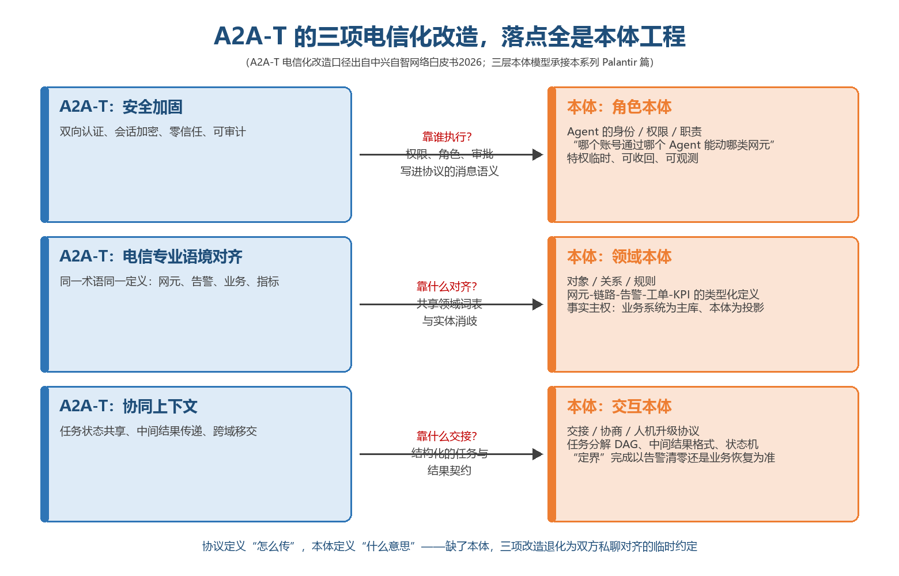
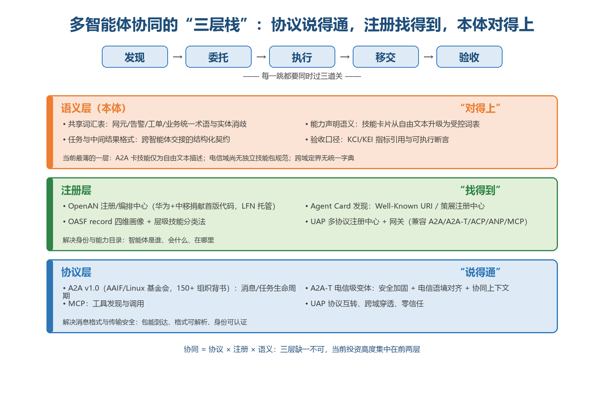
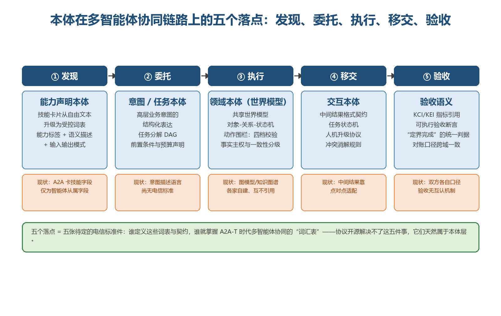

# 「说得通」之后是「对得上」——本体在多智能体协同与A2A-T上的应用

> **分析对象**：公开一手资料（采集日期2026-10-21）：A2A协议规范全文（a2a-protocol.org：v1.0、Agent Card与AgentSkill字段、发现三策略、扩展机制、AAIF治理）、A2A-T与OpenAN一手材料（华为MWC26官网新闻稿、openan.dev架构文档、project-openan各仓库README与API参考、C114系列报道、TMF IG1453/IG1453A与催化剂动态）、CCSA/信通院"加速AN L4规模部署联合倡议"（2026-04-24）、新华网OpenAN发布报道（2026-06-26）、IEEE P3931 ADDR成立信息（2026-04-09）、中兴《自智网络白皮书2026》A2A-T三项电信化改造与UAP口径、《中国联通自智网络白皮书2026》官方解读（网络运营本体、企业级数智本体）、亚信AN-Ontology、中国移动NetMCP（2025-06-19）、信通院"本体智能"测评（2026）、经典谱系文献（FIPA规范题录、OWL-S W3C提交、Uschold & Gruninger 1996）、LLM时代研究（Agora arXiv 2410.11905、μACP AAMAS 2026、arXiv计量）、W3C社区组章程（AI Agent Protocol/Typed Context Protocol/Agent Identity）、AGNTCY/OASF/ARD/AI Catalog文档、Palantir官方文档；交叉引用本系列前作——Ontology专题一至四篇、SkillHub篇、注册中心篇、L4篇、目标态全景篇、多智能体诉求篇。
> **系列定位**：智能体技术洞察系列·Ontology专题第五篇。第一篇回答"单体智能体的受控执行底座"，二至四篇回答"跨界样本与中国产品化"；本篇把镜头从单体拉到群体——多智能体协同与A2A-T时代，本体放在哪一层、怎么用、谁来定。与SkillHub篇互为表里：SkillHub回答"能力资产怎么流通"，本篇回答"流通资产的词汇与语义由谁铸造"。
> **立场说明**：设备商视角贯穿全文，第四章按运营商/设备商/开发者/标准组织分述启示。文中三张插图为本报告自绘。

---

## 一、趋势判断：协议竞速之后，语义层是多智能体协同的最后一公里

### 1.1 协同要过三道关——说得通、找得到、对得上，产业投资高度集中在前两关

多智能体协同的工程前提可以拆成三道关：消息能传、格式可解、身份可信（说得通）；智能体是谁、会什么、在哪里（找得到）；双方对术语、任务、结果的含义理解一致（对得上）。2025年末至2026年，前两道关获得了产业级重兵投入——协议层，A2A于2026-03-12发布v1.0稳定规范（新增签名AgentCard、多协议绑定、多租户）、08月进入Linux基金会旗下Agentic AI Foundation（AAIF）Growth Stage并获得150余个组织背书（IBM ACP并入、华为把A2A用作鸿蒙Celia与应用内智能体间的协议）；电信侧A2A-T先于2025-12-04在TMF曼谷Innovate Asia由华为联合中国移动、Orange、Telefónica、Vodafone首次发布，2026-03-02 MWC26华为首发AN L4二阶段方案并联合中国移动启动A2A-T软件开源计划（三组件：A2A-T协议SDK、注册中心——认证/寻址/技能管理、编排中心——低代码可视化工作流，宣称集成周期从月级缩短至天级，华为官网），2026年6月OpenAN在Linux Foundation Networking正式发布（中国移动任主席单位，完全重写谷歌未开源的注册中心模块，[新华网，2026-06-26](https://www.news.cn/info/20260626/4a99523b493c415a800955f0db271e56/c.html)），CCSA与信通院联合三大运营商、华为、中兴的"加速AN L4规模部署联合倡议"（2026-04-24）把"多智能体协同目标架构、A2A-T电信智能体互联协议"写入AN L4第二阶段关键标准研制路线（[网易，2026-04-24](https://www.163.com/dy/article/KR9NMR7G05568W0A.html)）；注册层，OpenAN注册/编排中心、AWS AgentCore Registry、OASF/AGNTCY目录把"发现、身份、信任、治理、路由"收敛为注册中心的五件事，联通PATN完成全球首例智能体间First Call（注册发现、发起连接、对方审批、语义交互、数据通道全流程跑通，[C114，2026-10-16](https://www.c114.com.cn/news/119/a1319320.html)），紫金山AXP以异构协议统一转换、百万级注册、百毫秒级语义寻址切入，GSMA"自智网络智能体开放生态项目"于09-23给A2A-T装上组织载体（三大运营商、信通院、CCSA、华为、中兴、亚信、浪潮共同参与，[C114，2026-09-23](https://www.c114.com.cn/news/126/a1318554.html)）。第三道关的投入是孤岛级的：A2A卡的AgentSkill被规范自述为"大体是描述性概念"（largely a descriptive concept），技能输入输出只到media type粒度、没有参数级Schema；电信侧尚无独立的技能包规范；亚信AN-Ontology的物联网投诉工单本体1048行TTL、约30个类，与TMF SID/GSM词表零对齐、三库互不引用；"跨专业故障定界准确率91%"背后，"定界"一词至今没有跨厂商统一定义。**协议层在打集团军战争，语义层在打游击——三道关的投入错配，是多智能体协同当前最大的结构性风险。**

### 1.2 A2A-T的三项电信化改造，本质是三张本体需求清单

A2A-T在通用A2A之上的电信化改造有两套公开口径，工程实质同构。中兴白皮书的能力侧表述是三件事：安全加固、通信领域专业语境对齐、协同上下文（《中兴通讯自智网络白皮书2026》[p39-p40]，联创+实验室同步在研A2A-T协议规范[p38]）；OpenAN架构文档的工程侧拆解是四个扩展：Task-T结构化任务模式（"为每个任务定义确定性提示词，消除智能体间自由格式请求的歧义"，openan.dev）、Notification-T事件订阅、Negotiation-T行动前结构化协商、Authorization-T改网操作显式授权；C114报道的字段级口径则是高价值场景字段、可靠性协商、安全黑名单三项（[C114，2026-07-14](https://www.c114.com.cn/news/126/a1313870.html)）。把两套口径与本体工程对表，对应关系严丝合缝：**安全加固/Authorization-T**要回答"哪个账号通过哪个智能体、以什么身份、能调用什么、留什么痕"——这是**角色本体**（Agent的身份/权限/职责）的领地，Palantir AIP"一切特权都是临时的、可收回的、可观测的"总原则的电信版；**语境对齐/高价值场景字段**要回答"同一个'网元''告警''业务''指标'在双方是否同义"——这是**领域本体**（对象/关系/规则）的领地，联通"企业级数智本体解决跨系统数据、实体、术语口径不统一"正是同一问题的运营商表述；**协同上下文/Task-T与Negotiation-T**要回答"任务状态如何共享、中间结果按什么格式交接、'定界完成'以告警清零还是业务恢复为准"——这是**交互本体**（任务、移交、协商协议）的领地。协议规定"怎么传"，本体规定"什么意思"——**电信化做得越深，协议改造的每一项都会下探到本体层。A2A-T SDK已经把这个事实做进了代码：客户端做场景识别+槽位抽取+模板渲染，服务端按Schema校验场景/模板/槽位约束并做语义校验，内置prompts/scenarios/slots/templates/negotiation-vocabulary五类资源包——这五类资源就是本体资产的工程形态，当前被硬编码在SDK内、不可自定义、不支持从注册中心远程加载。语义层已经随协议出场，但以"内置资源包"的私有形态存在——跨厂商协作时槽位类型与场景词表的一致性没有任何治理机制，这正是"集成周期月级"里最顽固的那一段，A2A-T的"天级"口径覆盖不到它。**

*图1：A2A-T三项电信化改造（中兴白皮书口径）与三层本体的映射——OpenAN的Task-T/Negotiation-T/Authorization-T工程拆解与之同构（本报告自绘）*

### 1.3 Agent Card正在长成"事实上的本体"，但自由文本是它的天花板

能力声明是本体最浅的落点，也是正在自发形成的一处。A2A智能体卡以身份（name/description/provider）、服务端点、能力开关、认证方案、技能列表构成自述名片，但AgentSkill的七个字段（id、name、description、tags、examples、inputModes/outputModes、securityRequirements）被规范自述为"大体是描述性概念"——**没有参数级输入输出Schema，I/O声明只到media type粒度，语义全靠自然语言供对端LLM阅读**。OASF record以属性/技能/域/模块四维承载能力画像，其discovery extension允许A2A卡与AI Catalog条目携带同一套技能/域标注，实现一次建模多格式分发；AGNTCY的层级技能分类法（OASF v1.1.0，十八个一级类别、已含Multi-Agent Coordination [70901]等编排类目，建模哲学继承自安全领域的OCSF）支撑跨记录的能力匹配与语义链接；OpenAN注册中心更进一步，提供自然语言任务描述→智能体匹配的语义检索API——**生态事实上已经在用"本体"的方式工作（分类法、能力画像、语义匹配），只是没有人把词表本身建成受控资产。**天花板同样明显：技能描述是自由文本，两个智能体都声明"故障定界"、输入输出模式一致，不代表验收口径一致——一个以告警清零为准、一个以业务恢复为准；OpenAN的语义检索依赖外部LLM（模型故障即返回503）、注册元数据layer是≤64字符自由字符串而非受控分类法；向量与LLM能匹配"故障定界"与"根因定位"的相似度，匹配不了"验收口径"的分歧。**向量近似是语义层的劣质代用品：它让"找得到"显得聪明，却让"对得上"继续失守——技能名片从自由文本升级为受控词表引用，是A2A生态语义化的第一道坎。**

### 1.4 本体从"单体智能体的世界模型"升格为"多智能体的共享合约"

Ontology专题首篇的结论是单体视角的：本体是企业AI从"会回答"到"能办事"的运行层，LLM只能申请、平台才能执行，四档校验（PASS/WARN/CLARIFY/REJECT）与单向写路径构成动作围栏。多智能体协同把这个问题升了一维：单体时代的对手是幻觉（让一个智能体认清世界），群体时代的对手是歧义（让一群智能体对世界的认识一致）——前者是认知问题，后者是合约问题。多智能体协同的核心难题是一致性：多个智能体对同一任务的理解偏差沿协作链放大，需要共享任务上下文、明确角色边界（谁决策、谁执行、谁验收）与标准化的中间结果格式；本系列Palantir篇归纳的三层本体（角色/领域/交互）面向多Agent协作展开，使命正是"消除点对点集成"——Palantir官方可核实的架构（业务领域本体+Agent运行时+Role×Classification×Purpose三维权限治理）与之同构。**本体在单体里是软件组件，在群体里是组织间合约——版本如何演进、分歧如何裁决、对齐如何验证，治理属性超过技术属性。买一个本体平台容易，签一份语义合约难；电信多智能体协同的下一程，难的全在后半句。**

### 1.5 电信域的语义资产是"半成品富矿"——每家都有半张字典，没有一家有整本

把电信域现有语义资产摊开盘点：设备商与标准组织握着**网元字典**（YANG模型、网管信息模型——机器可读、工程纪律严明，但止步于配置结构，无推理语义、无动作语义、无业务对象层）；TMF握着**业务字典**（SID/GBS二十余年沉淀的共享信息模型，但以人读的规范文档形态存在，未形式化）；中兴握着**知识字典**（图模型平台动态知识图谱，联创场景无线故障根因定位准确率>90%，但平台私有、跨厂商互不可见）；中国移动握着**工具字典**（NetMCP协议框架2025-06-19发布，"中移必行"平台汇聚近50大类200余原子能力、支持30余复杂工作流，原子级权限管控并与MCP兼容——能力目录的现成雏形，[通信世界网，2025-06-30](http://www.cww.net.cn/article?id=601773)）；联通握着**流程字典**（300余项L4级细分流程、28类数字员工岗位、网络运营本体与"企业级数智本体"的架构定位——为智能体设立事实、逻辑与合规基准，运营商侧定位最准，工程细节未公开）；亚信握着**开源字典的雏形**（AN-Ontology以OWL+版本化IRI+CC BY 4.0发布，5GC本体136条OWL限制最扎实、资源本体最粗糙，自述定位"充当机器的世界模型，为智能体提供精确推理依据，将高层业务意图转化为可执行的网络策略"）；ZTE握着**验收字典的骨架**（KBI-KEI-KCI三层指标体系）；信通院握着**认证抓手**（"本体智能"平台能力测评2026年已运转，中创、创新奇智等已过测，"业务语义本体+Agent运行时"已进入其行业报告话语，[IT之家，2026-10-12](https://www.ithome.com/1/012/063.htm)）。**没有一家能独立凑齐"智能体可推理的完整字典"，但每家都握着别人凑不齐的那半张——从半张字典到整本的距离，就是"对得上"的距离。**

### 1.6 词汇表的起草权比协议的发明权更持久

语义公共品的卡位已经多线并进：亚信以AN-Ontology+IEEE P3931（正式名称《Agent Description, Discovery, and Registry (ADDR) Interoperability》——智能体描述、发现与注册互操作标准，2026-04成立，中国移动、信通院、上交大、北邮参与，[新浪财经，2026-04-09](https://finance.sina.com.cn/wm/2026-04-09/doc-inhtwaif8996519.shtml)）+TMF推广三轨并走；CCSA与信通院的AN L4联合倡议（2026-04-24）已把A2A-T列入行标研制路线，电信运营域本体行标仍空白；GB/T 48000.3—2026《标准数字化 第3部分：本体建模要求》于2026-01-28发布、08-01实施，但它规范的是标准文献数字化的本体建模——**域错位**：方法学可复用，电信运营域本体无国标；TMF侧，A2A-T催化剂《加速ANL4迈向多智能体协作时代》获2026 DTW杰出催化剂大奖（神州泰岳+中国移动及伙伴，[新浪财经，2026-10-20](https://finance.sina.com.cn/roll/2026-10-20/doc-inivvsvt5834073.shtml)），IG1453 beta与"增强提示词元模型"IG1453A已发布beta（2026-02-06）——接纳形态是催化剂与提示词元模型，尚无本体/语义层正式立项；国际侧，W3C的agent社区组集群同步升温——AI Agent Protocol CG（278人，"Agentic Web"）把"结构化描述智能体能力、接口、目标与状态以支持自动推理与编排"写进章程，Typed Context Protocol CG专攻全局知识表示与局部解释上下文的对齐，Agent Identity Registry CG（2026-04）以DID+可验证凭证立agent身份（[W3C社区组章程，2026-10-21检索](https://www.w3.org/community/agentprotocol/)）——语义层的国际标准动作已在路上，但均处社区组阶段、无电信域剖面。多条线的共同特征：**都在抢"行业默认引用的词表"这一位置，但没有任何一个标准主体在牵头"电信域共享概念体系"——A2A-T的场景字段、NetMCP的原子能力目录、P3931的Agent描述各自携带私有词汇。**协议会被标准化收口——A2A进AAIF、150余组织背书的先例说明开放协议的终局是公共品；但词表一旦成为行业默认引用，就是三十年资产——TMF SID二十余年的行业地位是前例。**A2A-T的"TCP时刻"已经发生，下一个定价点是"字典时刻"；按CCSA二期标准2027年前后成型的节奏，语义/本体层的立项窗口大约就在未来12个月——晚了就只能适配别人定义的字段。**

### 1.7 汇聚点：智能体互联网的三层栈——"TCP时刻"之后是"字典时刻"

把三条线索收拢成一个架构判断：多智能体协同的地基是三层栈——**协议层**（说得通：A2A-T/A2A/MCP/UAP，消息格式、任务生命周期、传输安全）、**注册层**（找得到：OpenAN注册/编排中心、Agent Card发现、OASF记录，身份、能力目录、发现）、**语义层**（对得上：本体，共享词汇、能力声明语义、任务与中间结果契约、验收口径、角色权限模型）。多智能体诉求篇已把智能体通信协议栈分为语法层、语义层、经济层并断言"语义层的本体/标签标准决定发现机制的有效性"——本篇把这个判断具体化：**语义层不是协议层的附属配置，而是能与协议层并列、拥有自己开源社区与标准轨道的独立层。**A2A-T给协议层装上了组织载体（GSMA项目、OpenAN开源），语义层目前只有孤岛（AN-Ontology早期、GB/T通用化、TMF业务侧、厂商私有图模型）——三层栈的地基不均匀，而承重正在向语义层转移：协议统一与注册统一完成之后，集成瓶颈必然下移到内容层，跨域协同的双方除了"说得通""注册得上"，还要"对得上"彼此的技能与验收口径。**智能体互联网补齐第三层的过程，就是从"连得快"到"合得拢"的过程——这一层的电信化，是A2A-T之后下一个十年期的工程。**

*图2：多智能体协同的三层栈——协议层、注册层、语义层分别解决"说得通""找得到""对得上"，当前投资高度集中在前两层（本报告自绘）*

---

## 二、技术诉求分析：语义层的七项诉求

### 2.1 诉求逐条展开

**诉求1：共享词汇表——把"电信普通话"做成可计算资产**
- **诉求内容**：跨厂商、跨专业、跨系统的统一术语与实体消歧——"告警"在无线、核心网、传输下的语义差异，"业务"在BSS与OSS的口径差异，同一对象在各系统的唯一识别（"华南体验中心"与"广州天河旗舰店"指向同一实体）；词汇表须版本化、可引用、可校验。
- **结论**：语义统一是多智能体协同的第一交付物；做不到实体消歧，后面所有协作都在放大"张冠李戴"式幻觉——单体场景是检索失准，跨智能体场景是接力传错。

**诉求2：能力声明可计算——技能卡片从自由文本到受控词表**
- **诉求内容**：技能名片的最小字段集：标识与命名空间、能力描述（受控词表引用而非自由文本）、输入输出模式（带语义的类型：实体、单位、口径）、前置工具依赖（映射到MCP原子能力）、验收断言（可执行断言而非形容词）、适用模型范围、风险等级、来源与签名。
- **结论**：A2A卡技能字段、agentSkillsDefinition v0.1.0、OASF技能标注已提供挂载点，缺的是电信受控词表与验收断言两个必补字段——补齐即从"能力发现"升到"任务验收"粒度。

**诉求3：意图与任务的结构化——从自然语言委托到任务本体**
- **诉求内容**：高层业务意图的机器可读表达（意图本体，与TMF意图框架衔接）；任务分解DAG的语义（子任务类型、前置条件、依赖关系）；跨智能体调用携带预算与跳数元数据的语义字段（经济层与语义层的接口）。
- **结论**：委托靠提示词私聊是当前常态；联通把"跨域意图理解、能力注册、任务编排"列为全域智能协同体系的三大支柱，前两支柱的工程载体一半在协议、一半在任务本体——A2A-T的Task-T结构化任务模式（场景+槽位+模板）已是任务本体的工程雏形，但资源内置私有、无跨厂商治理；意图描述语言没有电信标准，协同深度就封顶在"人能看懂、机器猜着办"。

**诉求4：共享世界模型——领域本体、事实主权与一致性分级**
- **诉求内容**：对象/关系/状态机/规则的领域本体作为各智能体的公共世界模型；事实主权清晰（业务系统是System of Record、本体是投影）；属性级一致性分级（工单状态STRONG_ON_READ、统计指标EVENTUAL）；动作围栏（四档校验、单向写路径）。
- **结论**：跨域协同的前提有二——通信协议统一与知识统一，"以知识图谱对各单域知识统一建设和管理，保证跨域和单域分析的一致性和完备性"是厂商白皮书已写明的主张，但各家图模型互不可见，知识统一在厂商边界处断线；共享世界模型是断线处的接续方案，接续的方式只能是对齐而非重建。

**诉求5：角色与权限本体——"哪个账号通过哪个Agent能动哪类网元"**
- **诉求内容**：主体-代理双层身份的语义模型（谁授权、谁执行）；角色本体（身份/权限/职责）与数字员工岗位体系绑定；特权临时、可收回、可观测；PATN"统一身份标识、基于身份的路由寻址、第三方监管溯源"三支柱的语义层支撑。
- **结论**：身份体系（PATN、Entra Agent ID）解决"认证"，角色本体解决"授权语义"——没有后者，权限规则散落在各平台配置文件里，审计无法自动对账，监管人制度（业务+技术双重监管人）只能靠人肉执行。

**诉求6：验收语义——KCI/KEI指标引用与可执行断言**
- **诉求内容**：每项技能/子任务声明验收断言引用的KCI/KEI指标；跨域协作双方按同一指标字典对账；"定界完成""优化达标"的统一判据；验收结果可互认（一方孪生考场的验收结果全网有效）。
- **结论**：验收语义是电信对A2A生态最有价值的提案方向——通用生态停在能力发现粒度，电信需要任务验收粒度；KBI-KEI-KCI三层指标是现成骨架，缺的是把指标体系变成技能包可引用的机器可读字典。

**诉求7：本体的治理与演化——对齐而非统一、本体进Git**
- **诉求内容**：跨组织对齐机制（等价类声明、映射文件、对齐公理，显式记录分歧）；版本化IRI与命名空间纪律；本体走Git/Review/测试/CI/CD的软件工程全流程；动态演进不破坏既有引用（软硬编码分离的容器式本体）。
- **结论**：统一本体是理想态、对齐本体是工程态——五套TTL互不imports、零SHACL的现状证明"一统"无人有能力也有意愿完成；对齐机制的标准化（映射文件格式、对齐公理表达）比大而全参考模型更可行也更紧迫。

### 2.2 诉求矩阵总表

| 诉求 | 核心内容 | 关键锚点 | 缺失后果 |
|---|---|---|---|
| 共享词汇表 | 统一术语+实体消歧+版本化引用 | 联通企业级数智本体；亚信对象层"业务词典" | 张冠李戴沿协作链放大，跨域结论不可复现 |
| 能力声明可计算 | 受控词表+语义化输入输出模式+验收断言 | A2A卡技能字段；OASF技能标注；agentSkillsDefinition | 发现退化为向量近似，装配错配 |
| 意图与任务结构化 | 意图本体+任务DAG语义+预算跳数字段 | 联通"跨域意图理解"；TMF意图框架；A2A-T Task-T | 委托靠提示词私聊，群体治理无语义载体 |
| 共享世界模型 | 领域本体+事实主权+一致性分级+动作围栏 | Ontology首篇四层结构；ZTE知识图谱统一建设主张[p10] | 各智能体世界模型不一致，跨域分析不可信 |
| 角色与权限本体 | 主体-代理双层身份+岗位绑定+特权生命周期 | PATN三支柱；Authorization-T显式授权；联通双重监管人；AIP特权三原则 | 权限散落配置文件，审计无法自动对账 |
| 验收语义 | KCI/KEI指标引用+可执行断言+验收互认 | KBI-KEI-KCI；VERA成对重跑门禁；SkillHub验收断言提案 | 验收无互认，跨域协同成效账算不清 |
| 治理与演化 | 对齐而非统一+版本化IRI+本体进Git | Ontology4AI入库五项标准；GB/T 48000.3；Palantir动态内核 | 词表碎片化，每次对接都是一次性翻译成本 |

### 2.3 内在张力表

| 张力对 | 矛盾表现 | 现实的折中 |
|---|---|---|
| 语义统一 vs 语义主权 | 协同要求同一种话，厂商/专业域不愿被别人定义 | 骨架公共品化（受控词表、指标字典），行业语义资产化，对齐而非统一 |
| 语义丰富 vs 上下文经济 | 名片/词表越全装配越准，但撑爆网元小模型上下文 | 三级渐进披露+按消费者身份选择性披露（A2A选择性披露方向） |
| 公共品 vs 商业差异化 | 词表开源换引用，语义资产是壁垒 | 骨架与词表开源，语义描述与验收断言资产化——"词免费、义收费" |
| 标准冻结 vs 认知演进 | 标准要稳定，领域认知在流动 | 版本化IRI+软硬编码分离，schema版本发布后不可变、词表内容可演进 |
| 集中词表 vs 域内自治 | 集团要统一字典，省域/专业有自造词惯性 | 分层词表：核心对象层集中、专业扩展层联邦、对齐映射文件显式化 |

---

## 三、关键技术分析

### 3.1 A2A协议的语义机制盘点：格式标准化了，意义留白了

A2A协议把"格式"做成公共品的动作干净利落：v1.0（2026-03-12）以Protobuf定义核心数据模型并要求所有协议绑定（JSON-RPC/gRPC/HTTP+JSON）功能等价，新增签名AgentCard（JWS+JCS）、多协议绑定与多租户支持；发现三策略（Well-Known URI自描述遵循RFC 8615、策展注册中心、直接配置）且规范层面不规定注册中心API——Future Considerations原文写明"社区正在探索注册中心交互的标准化"，目录明确留给生态；Task九态生命周期与Message的TextPart/FilePart/DataPart三段式载荷中，DataPart（任意结构化JSON）是唯一的结构化语义通道；扩展机制四类（Data-only、Profile——可对DataPart强制JSON Schema、新增方法、状态机扩展），以A2A-Extensions请求头协商激活，且**不得修改核心数据结构定义**——语义只能旁挂在metadata与DataPart上；官方示例扩展AGP已出现"按声明的能力路由Intent载荷"的意图路由雏形。与MCP的分工有官方原文背书：MCP纵向连接工具与数据，A2A横向连接对等智能体——"A2A is about agents partnering on tasks; MCP is more about agents using capabilities"。但盘点其语义机制，离本体差三步：**第一步，技能是描述性概念**——AgentSkill无参数Schema、I/O只到media type粒度，能力匹配全靠对端LLM阅读自然语言；**第二步，结构化语义只有DataPart一条窄门**——Profile扩展可挂JSON Schema，但类型有结构无语义，参数叫alarm_id不等于两个智能体的alarm是同一实体、同一分级口径；**第三步，规范零本体机制**——v1.0全文检索ontology/vocabulary/taxonomy零命中，"common semantic model"实指Protobuf数据模型，授权语义（AUTH_REQUIRED的scope、有效期、撤销）与身份语义均显式不在A2A语义范围内。**点评**：这是聪明的协议设计——先解决采用速度（150余组织背书、IBM ACP并入、华为把A2A用作鸿蒙Celia与应用内智能体间的协议），把语义问题显式留给生态；但留白就是集成成本的后置。A2A-T用Task-T补了第一步（结构化任务提示词+Schema校验），第二、三步——语义类型系统与跨卡对齐机制——仍然空着，这正是本体的入场口。

### 3.2 A2A-T与OpenAN：语境对齐的工程落点与语义留白

A2A-T的公开轨迹在十二个月内完成了"发布—标准化—开源—组织化"四连：2025-12-04 TMF曼谷Innovate Asia首次发布（华为联合中国移动、Orange、Telefónica、Vodafone）；2026-02-06 TMF Accelerate Week发布IG1453 beta与增强提示词元模型IG1453A；2026-03-02 MWC26华为首发AN L4二阶段方案、宣布三组件开源计划（A2A-T协议SDK、注册中心、编排中心，华为官网）；2026年6月OpenAN在LFN正式发布（中国移动任主席单位，开源定位"面向端到端自治网络、锚定SPG/A2A-T/意图API等行业标准"，[新华网，2026-06-26](https://www.news.cn/info/20260626/4a99523b493c415a800955f0db271e56/c.html)）；2026-09-23 GSMA"自智网络智能体开放生态项目"启动（[C114，2026-09-23](https://www.c114.com.cn/news/126/a1318554.html)）。工程细节揭示了语义层的真实形态：A2A-T SDK自述增强"信息模型、任务协商、协作安全"，客户端做场景识别+槽位抽取+模板渲染，服务端做场景/模板/槽位约束校验与语义校验，协商分information/feasibility/target三类；注册中心提供AgentCard CRUD、LLM语义检索（自然语言任务→智能体匹配）、提示注入检测与高风险技能黑名单、人工审核流与JWS验签，并**预置了一个默认禁用的通用知识图谱API——整个A2A-T/OpenAN家族唯一直接的知识图谱落点**；编排中心支持自然语言意图生成工作流（拉取AgentCards喂给LLM生成流程）。现网证据已有量化锚点：福建移动无线故障监控场景工单压降30%、修复时间3小时→2.03小时、集成周期月级→天级（[C114，2026-06](https://www.c114.com.cn/news/126/a1314266.html)）。对照注册中心篇的判断——电信级智能体互联的收敛物大概率是"一个身份与注册标准+若干协议适配器"——OpenAN补的正是身份与适配器两件，中兴UAP以多协议注册中心+网关兼容A2A/A2A-T/ACP/ANP/MCP（中兴白皮书2026口径，公开渠道暂未见独立报道），协议互转解决的是信封格式，信件里的"定界""割接""业务恢复"仍需字典；联通PATN的三支柱（统一身份、身份路由、监管溯源）全部落在身份与治理平面，First Call把"语义交互"列为五环节验证项之一，语义机制未公开；AXP把"百毫秒级语义寻址"当卖点，依托CENI实现4000公里跨域寻址。语义留白同样清晰，三处：**其一，语义资产以"内置资源包"形态私有化**——场景/槽位/模板/协商词表五类资源硬编码在SDK内、不可自定义、不支持从注册中心远程加载，跨厂商协作时槽位类型与场景词表的一致性没有任何治理机制；**其二，注册中心的分类是非受控的**——layer是≤64字符自由字符串，语义检索依赖外部LLM（模型故障即503），默认单实例、注册上限100个智能体（与AXP百万级愿景差四个数量级，工程早期形态）；**其三，标准形态是提示词元模型**——TMF的接纳载体IG1453A名为"增强提示词元模型"（全文在会员墙内），语义层被定义在提示词工程层面而非词表/本体层面。**点评**：三条电信互联路线（A2A-T/PATN/AXP）都在语义上表态，但表态与机制之间隔着本体：A2A-T的技术选型是"自然语言+LLM+模板词表+JSON Schema校验"而非符号化本体，在单厂商闭环内够用，跨厂商就是槽位对不齐、场景词表各说各话。OpenAN补了"信令网"，还缺"字典"——注册中心旁那个默认禁用的知识图谱API，是整个生态给自己预留的语义层座位，现在缺的是把座位坐满的人：电信域受控词表与技能验收断言的参考规范，是OpenAN生态里最值得现在立项的工程。

### 3.3 本体在多智能体协同中的五重角色：从FIPA到LLM时代的谱系

本体与多智能体的绑定不是新事物。经典MAS时代（FIPA，1996年成立、2005年并入IEEE计算机学会）把三件套写进规范：ACL消息层（FIPA00061，基于言语行为理论的施为语）的消息信封含sender/receiver/performative/content/language/**ontology**字段——发消息的智能体声明"我这段话用某本体的词汇说"，收方按同一本体解义；内容语言层（FIPA-SL，FIPA00008，承接KIF/KQML与ARPA知识共享工程谱系）承载内容语法；本体服务层（FIPA00086）维护本体名→词条/关系/公理的映射，支撑ontology字段的解析与语义验证。能力声明的经典形态是OWL-S（W3C成员提交，2004-11-22，自述"服务的本体"）：Service Profile供发现、Process Model供执行、Grounding供互操作，以IOPE（输入/输出/前置条件/效果）做逻辑匹配——智能体能力发现等于基于本体的逻辑演绎，而非关键词检索。FIPA体系的教训在2026年有了学术定评：μACP论文（AAMAS 2026）的原话是"FIPA-ACL保证了语义丰富性，但对受限环境不可行；轻量IoT协议以牺牲表达力换取效率"——形式语义完备但工程过重，多智能体平台败于互联网的轻量路线，本体随之沉寂二十年。LLM时代倒转了顺序：连接层（MCP/A2A）先行爆发、语义层后置补课——大模型用概率能力临时垫付了"理解"，把本体从"协同的前置条件"变成"协同的后置债务"；牛津Agora协议研究（arXiv 2410.11905）把智能体通信命名为三难困境（Agent Communication Trilemma：通用性/效率/可移植性不可兼得），其元协议设计——"高频通信用标准化例程、低频通信用自然语言、中间地带由LLM现写例程"——正是无本体状态下的折中生存术。债总要还：多智能体协同的一致性难题（理解偏差沿协作链放大）、能力标签造假、验收口径分歧，全是这笔债的利息单。本体在协同链路上的角色由此收敛为五重，每一重都有经典与LLM时代的对照：**通信共享词汇**（经典=FIPA的ontology字段+SL；现在=Agent Card与AI Catalog条目的结构化元数据——语义从"公理化本体+形式语义"退到"JSON Schema+受控词表"，牺牲可判定性换LLM易用性）；**能力与知识声明**（经典=OWL-S的IOPE逻辑匹配；现在=OASF十八类技能分类法——已含Multi-Agent Coordination [70901]等编排类目——加内容寻址路由与密码学可验证声明，从逻辑演绎退到分类法标注）；**共享世界模型**（经典=TOVE式领域本体；现在=Palantir式可操作本体——对象/链接/动作绑定实时数据，企业内最成功的本体形态，跨组织共享缺位）；**交互约束**（任务、中间结果、移交协议的结构化契约——A2A-T的Task-T正在做的事）；**治理锚点**（经典=施为语的前置/效果条件；现在=Action围栏——Palantir的量化示例：100个ActionType、某角色可见30个、权限过滤后可执行20个，"Agent的能力边界=被授权的Action"）。**点评**：FIPA把本体做进协议是"重语义轻连接"，LLM时代是"重连接轻语义"——两个极端各摔过一跤，收敛物已经开始显形：AGNTCY的发现栈重新长出AI Catalog（索引）/ARD（消费API）/Agent Directory（目录服务）三层，与经典"消息-内容语言-本体"三层解耦显式押韵，其官方结论"互操作不是靠选出一种获胜格式达成"正是"对齐而非统一"的工程版；W3C的AI Agent Protocol社区组（278人，"Agentic Web"）把"结构化描述智能体能力、接口、目标与状态以支持自动推理与编排"写进章程，Typed Context Protocol组专攻"全局知识表示与局部解释上下文"的错位。经典时代的ontology字段设计（消息显式声明所用本体）值得A2A-T直接继承——这是协议与本体之间最便宜的接口。

### 3.4 电信域语义资产盘点：半张字典们的完整清单

| 语义资产 | 持有方 | 形态 | 离"智能体可用的本体"的距离 |
|---|---|---|---|
| YANG模型/网管信息模型 | 设备商、IETF/ONF | 机器可读模式（XML/JSON Schema） | 有结构无推理：缺业务对象层、动作语义、公理约束；改造量=加语义层而非重建 |
| TMF SID/GBS | TMF | 规范文档+模型 | 面向人的词汇：覆盖业务对象最全，未形式化（无OWL/机器推理），正在被意图框架部分激活 |
| 图模型平台/知识图谱 | 中兴等厂商 | 平台私有图谱 | 单域可用（根因定位>90%【自报】），跨厂商互不可见——知识统一停在厂商边界 |
| NetMCP/"中移必行"能力目录 | 中国移动 | MCP兼容协议+能力平台（50大类200余原子能力、30+工作流） | 工具语义层雏形：原子能力与权限管控已成目录，缺场景/验收词汇与形式化 |
| 网络运营本体/企业级数智本体 | 中国联通 | 架构蓝图+统一数字底座组件 | 运营商侧定位最准（事实/逻辑/合规基准），工程细节未公开，落地形态待观察 |
| AN-Ontology三库 | 亚信（Ontology4AI开源） | OWL/TTL+版本化IRI+CC BY 4.0 | 形式化早期：5GC本体136条限制最扎实，资源本体零限制；零TMF词表对齐、三库互不imports |
| KBI-KEI-KCI指标体系 | 中兴提案 | 指标框架 | 验收语义的现成骨架：三层指标可直接作为技能验收断言的引用字典，尚无机器可读形态 |
| L4细分流程/数字员工岗位 | 中国联通 | 流程梳理（300余项流程、28类岗位） | 流程本体的原料：岗位=角色本体实例、流程=交互本体素材，未本体化 |
| GB/T 48000.3 | 国家标准 | 标准文档 | 通用建模方法学（实体/属性/公理三件套）但域错位：规范对象是标准文献数字化，电信运营域本体国标空白，方法学可复用 |

**点评**：这张表的读法是"谁缺谁的半张"——设备商缺业务与流程词汇，BSS/OSS厂商缺网元与遥测词汇，运营商缺形式化工程，标准组织缺领域参考模型。四个缺口中只有一个是排他性的：**网元与设备侧语义（含实时遥测）只有设备商能给**——这是设备商在语义层博弈中不可替代的筹码，也是"延迟进入=替对手垫高词表先发优势"判断的实体依据。文献计量把空白的程度量化得更刺眼：arXiv全库"agentic+telecom"方向论文已达46篇，而"ontology+network+fault+agents"的命中仅1篇——还是2003年Jefferson Lab用FIPA智能体做控制系统的那篇——网络运维用本体做智能体语义对齐的公开研究空白了二十余年，工作封闭在会员制标准体系与厂商白皮书中。另一个值得记录的空白是：YANG/信息模型的OWL/RDF本体化，学术与工业界均检索不到系统性公开工程——二十年积累的"事实语义层"尚未被激活进智能体时代，谁做映射工程，谁获得事实入口。

### 3.5 映射模板：协同链路五阶段 × 本体五落点

把本体五重角色装到多智能体协同链路的五个阶段上，得到一张可直接用于架构设计的映射模板：**发现阶段**用能力声明本体（技能卡片受控词表+语义描述+输入输出模式，注册中心的混合检索有了受控地基）；**委托阶段**用意图/任务本体（高层意图结构化、任务DAG语义、预算与跳数字段）；**执行阶段**用领域本体（共享世界模型+事实主权+动作围栏，四档校验在此执行）；**移交阶段**用交互本体（中间结果格式契约、任务状态机、人机升级协议）；**验收阶段**用验收语义（KCI/KEI指标引用、可执行断言、跨域对账口径）。

*图3：本体在多智能体协同链路上的五个落点——发现、委托、执行、移交、验收，每个落点对应一张待定的电信标准件（本报告自绘）*

**点评**：五个落点就是五张待定的电信标准件，建设次序不必齐头并进：**验收语义先行**（KBI-KEI-KCI已有骨架，把指标变成机器可读字典的成本最低、对账价值最直接）→**能力声明跟上**（A2A卡/OASF挂载点现成，补受控词表引用与验收断言字段即可）→**领域本体按域生长**（从故障定界一个闭环做起，灭火图式"对象-状态-下钻"是最小模板）→**意图与交互本体最后收口**（依赖前两者的词汇沉淀）。这个次序的原理与Ontology首篇"从最小闭环长起"一脉相承：先让一对智能体在一个场景"对得上"，再扩展词汇的覆盖面。

### 3.6 语义层的治理与演化：对齐而非统一的工程化

语义层要成为公共品，治理设计比模型设计更决定成败。四条工程原则：**其一，对齐而非统一**——等价类声明、映射文件、对齐公理让各家保留自己的词表而互认互通，"统一本体"的立项在多厂商环境下没有活口（五套TTL零imports的现状是意愿的诚实表达）；**其二，入库质量门槛**——版本化IRI、命名空间与声明一致、标准工具（Protégé/Jena）可加载、LICENSE实体文件、与既有词表的对齐声明，五项作为入库最低标准，否则"开源本体"退化为占位发布；**其三，本体进Git**——Object/Link/Function/Action/权限五类测试、Review、CI/CD、可回滚，本体是运行时契约而非配置文档；**其四，动态内核**——只硬编码对象/属性/关系的基础结构，语义与数据软编码解耦，模型与认知同步演进，避免"版本迭代式"词表永远落后于网络与业务的变化节奏。**点评**：治理的最后一个接口在经济层——验收语义决定对账口径，对账口径决定谁买单：技能按调用量计费的内部市场、Token运营体系的计量结算，都以"验收断言机器可读"为前提。语义层因此不只是协同的地基，也是智能体经济结算体系的会计科目表——这是它值得独立立项、而不能寄生于协议项目的最终理由。

---

## 四、总结思考

### 4.1 核心命题

协议的开源解决不了语义的共识。A2A-T把多智能体协同的"接线时间"从月级压到天级，但"对齐时间"仍停在月级——协同的成本结构正在从协议集成转移到语义对齐。语义层的公共品（受控词表、验收断言字典、对齐机制）由谁供给，谁就持有协同网络的"汇率"：每一次跨厂商协作的翻译成本、每一次技能交易的验收口径、每一次责任认定的审计语义，都要过这道闸门。**多智能体协同的终局是"协议标准化+注册中心化+本体公共品化"三层同时成立，第三层现在是空的，空位本身就是机会。**

### 4.2 关键判断

1. **三道关的投入错配是当前最大结构性风险**。协议层百亿级叙事（A2A-T/UAP/PATN三线竞合+GSMA组织化+OpenAN开源），语义层孤岛级投入（AN-Ontology 1048行TTL、厂商私有图模型、零对齐的行业标准）——协议统一与注册统一完成之日，就是语义瓶颈显形之时。
2. **A2A-T的三项电信化改造（安全加固/语境对齐/协同上下文）本质是三张本体需求清单**，分别落在角色本体、领域本体、交互本体的领地；缺了本体，改造退化为私聊对齐，"天级集成"覆盖不到语义对齐这段最顽固的成本。
3. **Agent Card是事实本体的雏形，"描述性概念"是它的天花板**。A2A规范自述技能为"大体是描述性概念"、无参数Schema，A2A-T以Task-T结构化任务提示词补位——协议家族自己承认了自由格式请求的歧义问题；但Task-T的场景/槽位/词表以内置资源包形态私有化（不可自定义、不可远程加载），跨厂商一致性无治理机制。受控词表引用与验收断言是两张必补的标准件；向量近似能垫付"找得到"，垫付不了"对得上"。
4. **本体从软件组件升格为组织间合约**——单体时代对抗幻觉，群体时代对抗歧义；治理属性（版本、对齐、裁决）超过技术属性，"对齐而非统一"是唯一现实路径。
5. **电信域"半张字典"的分布决定博弈格局**：协议三兄弟已各就各位——A2A-T管对话（OpenAN承载）、NetMCP管调工具、P3931 ADDR管描述发现注册——但三者共同依赖的电信域共享概念体系无任何标准主体牵头，各自携带私有词汇；设备商握着唯一排他的半张（网元语义+实时遥测），BSS/OSS厂商在抢整本字典的起草权（AN-Ontology+IEEE P3931+TMF三轨），设备商的应对只能是"以共治方身份进入+贡献排他语义"，而非自建封闭词表。
6. **"字典时刻"的窗口比"TCP时刻"更长也更值钱**。协议被标准收口后成为公共品，词表成为行业默认引用后是三十年资产（TMF SID为前例）；语义共识的建设周期以年计，现在不动手，两年后只能在别人的命名空间里安家。
7. **语义层的技术选型之争已经开场：提示词元模型 vs 受控词表+本体**。A2A-T家族的选型是"自然语言+LLM+模板词表+Schema校验"，TMF的接纳载体（IG1453A增强提示词元模型）同样停在提示词层——单体闭环够用，跨厂商失灵（槽位对不齐、场景词表各说各话）。把SDK内置资源包升级为受控词表+对齐机制+验收断言，是OpenAN生态最值得立项的下一步；按CCSA二期标准2027年前后成型的节奏，语义/本体层立项窗口约12个月。

### 4.3 对不同主体的启示

| 主体 | 启示 |
|---|---|
| 运营商 | 把语义层纳入智能体互联网规划的一级组件（与协议、注册并列），不再寄生于平台项目；集团层面统一技能字典与验收语义（KCI/KEI指标字典机器可读化是第一动作），把各省创新从"经验交流"升级为"资产入库"；GSMA生态项目/CCSA/TMF三轨同步推进语义提案，采购时把"本体资产可迁移、词表可对齐"写进厂商准入；联通"企业级数智本体"的定位（事实/逻辑/合规基准）是运营商侧最完整的语义层蓝图，工程化落地值得全行业跟踪 |
| 设备商 | 四个动作按成本排序：一是盘点自有网元语义资产（YANG/信息模型/告警语义/遥测指标），以映射而非重建转为网络域本体并对齐TMF SID词表，顺势发起或共建"网络模型→可推理本体"的开源映射工程——业界尚无系统性公开工程，谁做谁获事实入口——这是唯一排他的半张字典；二是以共治方身份进入AN-Ontology与OpenAN语义层（PR贡献TMF对齐+网元词汇），把设备侧语义写进标准词表而非被定义，A2A-T SDK的场景/槽位/协商词表资源包正是应推动开放治理的标的；三是产品化两个差异化点——语义资产库（版本化IRI+语义描述+多域复用）与动作围栏本体（四档校验/特权生命周期/审计语义，Ontology首篇的工程标准产品化）；四是把30+ L4场景方法论连同验收断言做成"官方技能包"上架（承接SkillHub篇第四条产品线），技能包即语义资产的商业形态——从卖设备到卖字典再到卖方法 |
| 开发者 | 技能名片带受控词表引用与验收断言再发布，自由文本描述只用于人读；以OASF record为主档一次建模、经discovery extension派生A2A卡与MCP server.json；跨智能体中间结果用结构化契约（引用共同本体）而非自然语言交接；本体资产进Git、走Review与测试，当代码不当配置 |
| 标准组织 | 五个空白点按紧迫度：①电信域本体参考模型——与TMF SID/意图框架衔接而非另起一套话语，避免本体标准与意图标准两套词汇；②A2A-T语义扩展规范——技能受控词表、验收断言、任务本体作为协议扩展字段的统一表达；③本体对齐机制——映射文件格式、对齐公理、分歧记录的标准化工件；④验收语义字典——KCI/KEI指标的机器可读引用规范与跨域互认框架；⑤本体入库质量门槛——版本化IRI、命名空间一致、标准工具可加载、LICENSE、词表对齐声明五项最低标准。落地路径现成：在CCSA AN L4第二阶段标准包挂载"网络运营域本体建模要求"行标（复用GB/T 48000.3方法学+电信域概念体系），以IEEE P3931 ADDR的电信领域profile承载能力/场景描述本体，把TMF催化剂（A2A-T获奖项目）推进为正式IG/GB交付物，并资助"YANG/SID→可推理本体"的开源映射工程。A2A与MCP"把不规定的部分清晰留白交给生态"的经验，同样适用于语义规范：规定骨架与对齐机制，把领域语义留给共建 |
