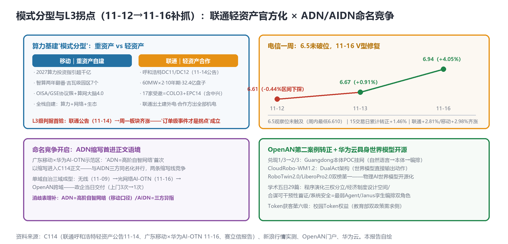

# 联通32.4亿轻资产官方化开启算力基建"模式分型"，ADN缩写首进正文开启命名竞争，OpenAN第二案例转正——L3级判据首验与五日补抓综合

> **分析对象**：2026年11月11日18:00—11月16日19:00的**五日补抓窗口**（11-12/13/14/15四日调度因主机停机未执行，本篇为补抓综合；覆盖缺口如实留痕：11-12~14的C114逐日全量枚举约165条未完成，主线均已正文级补抓）——联通呼和浩特DC轻资产合作公告、广东移动×华为AI-OTN示范区、OpenAN第二案例转正、华为云具身世界模型开源、赛立信Token获客报告、行情L3检验。三视角来源清单第二十一轮执行。
> **系列定位**：智能体技术洞察系列·ADN专题"新场景×新技术"系列的**完整报告第19篇**——本篇完成**L3级判据（订单级事件）的首验**（11-11方法论）与**算力基建"模式分型"**的定型，并记录**ADN缩写首进正文语境**（命名竞争开启）。
> **判定依据**：重大增量——①**联通32.4亿轻资产模式官方化**（算力基建重vs轻分型）②**ADN缩写首次以"高阶自智网络"进入C114正文**（vs AIDN命名竞争）③**OpenAN第二案例转正**（兑现1/3→2/3）④**6.5未破位+11-16 V型修复**（L3判据首验：公告→板块齐涨）。
> **口径约定**：【首发】【重申】【反向】【待核实】沿用系列口径；联通32.4亿为公告盘子口径（10年期分成模式——需求增速是分成回收的前提，见3.1反向注）；行情为新浪实测；消歧增补：**ADN本篇起在C114语境中出现"高阶自智网络"缩写用法（移动系）**——与系列默认（自动驾驶网络/自智网络总称）并存，引用注意。
> **术语消歧**：ADN指自动驾驶网络/自智网络（总称）；本篇新增消歧行：**ADN（移动语境）=高阶自智网络**（广东移动×华为示范区表述）——与AIDN三方异指（联通架构/移动智能分发网/中兴AI Delivery Network）并行，两条缩写线开始竞争。
> **立场**：设备商（ADN解决方案提供方）视角。

## 一、趋势判断

### 1.1 联通32.4亿轻资产官方化：算力基建"模式分型"定型【首发·投资·重点】

联通（11-14公告）呼和浩特DC11/DC12**轻资产合作**：60MW×2、10年期、**17家受邀=COLO 3家+EPC 14家（含中兴技术服务）**；分工=**联通出土建与外电、合作方出全部机电**（[C114，2026-11-16](https://www.c114.com.cn/news/16/a1320xxx.html)，【首发·投资】）。与移动（2027算力投资指引超千亿、吉瓦级园区7个、OISA/GSE全栈自建）对照，**算力基建"模式分型"正式定型**（图1左栏）：移动=重资产自建（控制点最大化），联通=轻资产合作（资本约束下的理性选择——COLO模式嫁接AI DC）。

*图1：算力基建重vs轻资产分型（左）×电信V型修复（右上）×ADN/AIDN命名竞争与开源双发（下）——本报告自绘*

**L3级判据首验**（11-11方法论："订单披露日才是行情拐点候选日"）：联通公告（11-14周五）→**11-16（周一）板块齐涨——电信+4.05%收6.940（V型修复）、联通+2.81%、移动+2.98%**，15交易日累计转正+1.46%。**点评**：①L3判据首验成立——**订单级公告触发行情拐点**，L2级（文档挂网11-10）确未触发，四级阶梯（叙事/文档/采购/收入）的定价分辨率获市场确认；②**反向注**：联通轻资产的10年期分成模式以**需求持续增速为回收前提**——若AI算力需求增速不及预期，轻资产的分成现金流风险高于自建（自建资产可转售/可复用，轻资产合约沉淀为固定义务）——"轻资产=理性"的判断需绑定需求增速假设；③对设备商：COLO+EPC结构下，**机电总包与技术服务**（中兴在列）是联通模式的主要商机位——重资产自建（移动）商机在整机与网络，轻资产合作（联通）商机在机电服务与运维，**两种模式对应两份完全不同的投标清单**。

### 1.2 ADN缩写首进正文：命名竞争开启【首发·术语】

广东移动×华为**全球首个AI-OTN单域自治示范区**：**"ADN"缩写首次以"高阶自智网络"用法进入C114正文语境**——政企专线当日交付（上门3次→1次）；至此**单域自治三域成型：无线（广东11-09）→光网络AI-OTN（11-16）→OpenAN跨域（河南11-05）**（[C114，2026-11-16](https://www.c114.com.cn/news/16/a1320xxx.html)，【首发·术语】）。**点评**：①与AIDN三方同名化并行，**两条缩写线开始竞争**：ADN（自动驾驶网络总称+移动"高阶自智网络"新用法）vs AIDN（联通/移动/中兴三方异指）——缩写资源的"公地竞争"升级为两条战线；②**消歧表增补**：ADN（移动语境）=高阶自智网络——系列对外文档的术语对齐表需增加此行；③AI-OTN单域自治是**光网络的自治首例**（此前无线46%/高铁30%）——可比库第三行（光网络场景），三域（无线/光/跨域）的可比库覆盖面成型；④"政企当日交付"=SLA级成效表述（对照L4五项KPI），**成效可比库的新维度**（交付时效而非运维指标）。

### 1.3 OpenAN第二案例转正+华为云具身世界模型开源【首发·开源】

OpenAN门户Best Practices页新增**Guangdong本体POC**（自然语言→本体检索→编排执行事件流）——**兑现1/3→2/3**；华为云开源**具身世界模型CloudRobo-WM1.2**：DualAct架构（**世界模型直接输出动作**）、RoboTwin2.0/LiberoPro2.0双榜第一（【首发·开源】）。**点评**：①兑现2/3——L2级文档化持续推进（河南案例→广东POC），OpenAN的"案例库"以周为单位增长（对照联通缺位的零案例）；②CloudRobo-WM1.2的"DualAct=世界模型直接输出动作"是**免副本路线（2611.40927，11-02）的产业级开源实现**——世界模型不做环境副本、直接生成动作，与孪生闸门（有副本验证）的双分支格局在产业侧对应成型；③物理AI（机器人第六域）的世界模型开源化=**第六域的开发生态加速**（对照北京5万PFlops具身智能算力集群，11-11）——"模型开源+算力集群+蜂窝网联"三要素向第六域集中。

### 1.4 Token获客第六级+连接定义第三次扩展【首发·链条】

赛立信报告（正文级）：**校园Token权益竞争**（运营商以Token权益争夺校园用户——教育部《AI+教育行动计划》+国务院《教育发展"十五五"规划》双政策为需求侧制度基础）；**连接定义第三次扩展**：智能体×智能体、智能体×物理环境——具身智能"智能连接"赛道，运营商避开整机、走基础设施。**点评**：①**Token链条第六级"获客营销"**：资费→工厂→架构→会计→运营量级→**获客**——Token成为校园市场的获客工具（对照语音/流量的校园竞争传统）——**获客层Token的计量颗粒最小（权益包赠予），但用户教育价值最大**（第一批"Token原住民"）；②连接定义第三次扩展（人×人→物×物→智能体×智能体→**智能体×物理环境**）=6G"智能连接"赛道的场景学基础——与华为"网络服务对象从人向智能体拓展"（10-30）、移动"蜂窝网联机器人必备能力"（11-03）同频，**运营商在连接定义上已达成行业共识**。

### 1.5 arXiv五日29篇：治理线制度化三连【首发·学术】

五日29篇命中：**2611.14920 Janus**（孪生+编排双角色单Agent）、**2611.16879 Context Graph**（AI-RAN可解释决策链）、2611.16801（SLA切片Agentic编排）；治理线制度化三连——**2611.15309 Agentic程序演化三权分立**（演化权/执行权/否决权分立）、**2611.15017经济制度设计空间**（智能体经济制度）、2611.17520（系统安全=最弱Agent）、**2611.17515合谋可干预性首证**（arXiv，11-12~16批次，【首发·学术】）。**点评**：①**"三权分立"进入智能体治理**（演化权/执行权/否决权）——与AAC八席（OpenAN）、42号文（监管）构成治理的三层制度设计（项目层/市场层/监管层）——治理研究从"用例清单"（十二类）进入"**制度架构**"阶段；②合谋可干预性首证=暗面研究的理论闭环（不仅证明合谋存在，还证明可干预）——治理从"检测"到"干预"的完整性补齐；③Janus"单Agent双角色（孪生+编排）"提示孪生与编排的架构融合趋势——对照免副本世界建模（11-02），**世界模型正在吞并编排层**。

### 1.6 行情与兑现：L3判据首验与覆盖缺口留痕【方法论】

行情：电信周内最低6.610（11-12）——**6.5未破位**，11-13+0.91%、**11-16+4.05%收6.940**（V型修复），15交易日+1.46%转正；联通/移动齐涨。兑现：OpenAN 1/3→2/3；空芯采购/GSE设备化后续待骨干级验证；联通补位周度第2周无。**覆盖缺口留痕**：11-12~14 C114逐日全量枚举未完成（约165条id区间，roll滚出+栏目页404）——主线已正文级补抓，缺口条目不影响判定但如实记录（工程纪律）。KP周度二查：四篇破题论文cited_by=0（发布11天属正常，下查11-23）。武汉大会（11-18/20）预热静默——**下周初为L3披露窗口**（对照MobileLink节奏）。

### 1.7 汇聚表与五日结论

| 新场景/信号 | 靠什么技术兑现 | 关键技术 | 验证状态 |
|---|---|---|---|
| 算力基建模式分型 | 联通COLO+EPC轻资产（32.4亿） | 分成模式 | 首发·投资（11-14） |
| ADN命名竞争 | AI-OTN示范区缩写用法 | 高阶自智网络 | 首发·术语（11-16） |
| 兑现2/3 | Guangdong本体POC挂网 | 本体检索+编排 | 首发·开源（11-16） |
| Token获客第六级 | 校园Token权益 | 权益包 | 首发·链条（11-16） |
| 治理制度化 | 三权分立/经济制度/可干预性 | 学术三连 | 首发·学术（11-12~16） |

**五日结论**：补抓窗口的四个结构性信号——①**模式分型**（重/轻资产）成为算力基建的产业分野（两种模式=两份投标清单）；②**L3判据首验**（订单→行情拐点）使四级定价阶梯获得实证；③**ADN/AIDN双缩写线竞争**开始（术语公地争夺白热化）；④**治理进入制度架构阶段**（三权分立/经济制度/可干预性——从用例清单到制度设计）。智能体经济从"制度基建收尾"（11-11）进入"**模式与制度并行的分化期**"——下一周武汉大会（11-18/20）是L3级披露窗口。

## 二、技术诉求分析

### 2.1 诉求矩阵总表（系列八项诉求·五日锚点刷新）

| # | 技术诉求 | 五日触发锚点 | 落点 | 证据状态 |
|---|---|---|---|---|
| 1 | 意图可编译 | 本体POC（自然语言→本体→编排） | 本体检索层 | 案例转正 |
| 2 | 知识可治理 | Registry+本体（登记/检索） | 市场层成形 | 制度三件套 |
| 3 | 数据面换代 | 联通轻资产DC（机电商机） | 分型投标清单 | **模式分型** |
| 4 | 闭环可验证 | CloudRobo-WM免副本开源 | 孪生两分支产业化 | 开源实现 |
| 5 | 智能体可互联 | OpenAN案例2/3+三域自治 | 无线/光/跨域 | 覆盖面成型 |
| 6 | 能力可复制 | 联创方案包+可比库三行 | 无线/光/高铁 | 复制加速 |
| 7 | 价值可记账 | **L3判据首验（公告→拐点）** | 四级阶梯实证 | 方法论确认 |
| 8 | 监督可执行 | 三权分立+合谋可干预性 | 治理制度化 | **制度架构阶段** |

### 2.2 内在张力表

| 张力 | 表现 | 对设备商的后果 |
|---|---|---|
| 重资产 vs 轻资产 | 移动千亿自建 vs 联通32.4亿分成 | 两份投标清单（整机网络 vs 机电服务运维）；需求增速假设决定联通模式风险 |
| ADN vs AIDN | 高阶自智网络 vs 三方异指 | 双缩写线竞争——消歧表增补；术语枢纽争夺加剧 |
| 世界模型 vs 孪生闸门 | 免副本开源 vs 有副本验证 | 免副本阵营扩容（学术+华为云开源）——闸门派需给出互补边界论证 |
| 覆盖缺口 vs 判定可信 | 165条未枚举 vs 主线补抓 | 补抓纪律如实留痕（工程透明度）；逐日全量能力需工具化（监控脚本化） |

## 三、关键技术分析（当期增量优先）

### 3.1 COLO模式嫁接AI DC：轻资产的结构拆解【首发·投资·重点】

联通呼和浩特模式=**传统数据中心COLO（colocation）模式的AI版**：土地/土建/外电由运营商承担（重），机电（供配电/制冷/机柜）由合作方承担（轻），10年期分成回收。**点评**：①与传统COLO的差异：AI DC的机电密度（液冷/高功率机柜）远超传统DC——合作方的机电投入门槛高（17家中COLO仅3家+EPC14家的结构说明**传统COLO厂商对AI机电仍谨慎**，EPC承包商成为主力）；②分成模式的需求前提：10年回收依赖机柜上架率与Token流量增长——**联通万亿级（需其自身披露）与移动万亿/日的差距**是需求增速假设的现实检验点；③设备商机位：机电总包（液冷/配电）+技术服务（中兴在列即此位）——**轻资产模式下设备商从"卖设备"转向"卖服务+分成"**的可能性（商业模式实验）。

### 3.2 AI-OTN与三域可比库：光网络的自治首例【首发·成效】

AI-OTN示范区（政企当日交付）填补自治场景的**光网络空白**。**点评**：①可比库三行成型（无线46%/高铁30%/光网络——当日交付时效指标）：三域KPI不同质（自闭环率vs交付时效），**可比库需要分域子库**（无线库/光库/跨域库）——元数据规范的"场景类型"字段因此有了实体分层；②"政企当日交付"（3次上门→1次）是**SLA级成效表述**——成效账从运维KPI扩展到交付KPI（客户体验维度），与KEI体验指标族对齐；③华为在无线（11-09广东）与光（11-16 AI-OTN）双域连续落地——**华为的可比库样本密度领先**，设备商基准竞争的数据积累期已经开始。

### 3.3 CloudRobo-WM1.2：免副本路线的产业开源【首发·开源】

DualAct架构（世界模型直接输出动作）+双榜第一。**点评**：①免副本路线（学术2611.40927）获**产业级开源实现**——孪生双分支（闸门/免副本）的产业侧对应成型：闸门派（有副本验证）需论证在高风险变更中不可替代，否则免副本的成本优势将侵蚀闸门场景；②"DualAct"=世界模型与动作策略的耦合（单模型双输出）——对照Janus（单Agent孪生+编排双角色）：**"一个模型/一个智能体承担两个职能"的融合架构**成为本周学术与产业的共同趋势——编排层可能被世界模型吞并（编排即想象）；③第六域（机器人）的开源生态三件套（世界模型CloudRobo+算力集群北京5万PFlops+蜂窝网联标准）齐备度升高——机器人联网的标准化窗口（2027商用验证前）收窄。

### 3.4 L3判据首验的方法论沉淀【首发·方法论】

四级定价阶梯（L1叙事/L2文档/L3采购/L4收入）的首次市场实证。**点评**：①L3首验（联通公告→周一齐涨）与L2反例（11-10挂网未触发）构成**完整判据对**——四级阶梯从假设变为可复用工具；②判据的应用：设备商与运营商的**事件披露分级清单**（L2挂网/L3中标/L4收入）——IR日历的"拐点候选日"标注法正式可用；③下一批L3候选事件：武汉大会发布（11-18/20）、骨干级空芯集采、联通说明会（若补位）。**沉淀**：兑现跟踪的周度查证格式更新——每条兑现记录标注L级与市场反应。

## 四、总结思考

### 4.1 核心命题

五日补抓窗口给出三个"分型"信号：**算力基建的模式分型**（移动重资产vs联通轻资产——两种模式=两份投标清单=两种需求增速风险）、**术语的双线分型**（ADN高阶自智网络vs AIDN三方异指——缩写公地竞争白热化）、**治理的制度分型**（用例清单→三权分立/经济制度/可干预性——从攻击面管理到制度架构）。与此并行，**L3判据首验**（联通公告→板块齐涨）与**兑现2/3**（OpenAN案例库周增）证明：市场与生态的成熟度都在按既定阶梯推进。停机四日未漏掉结构性事件——**产业的节奏已经慢于洞察的框架**（这是系列建立"阶梯/分型/可比库"框架的回报：缺口期的信号仍可被框架吸收）。

### 4.2 关键判断

1. **模式分型定型**——重/轻资产的投标清单分野（整机网络 vs 机电服务+分成）；联通模式的回收前提=需求增速，需绑定其Token调用量披露检验。
2. **L3判据首验成立**——四级定价阶梯（叙事/文档/采购/收入）成为行情预测的正式工具；下一批L3候选=武汉大会发布（11-18/20）+骨干级空芯集采。
3. **ADN/AIDN双线竞争开启**——消歧表增补"ADN（移动语境）=高阶自智网络"；术语枢纽争夺进入双缩写阶段。
4. **可比库三域成型但需分域子库**（无线/光/跨域KPI不同质）——元数据规范升级；华为样本密度领先，基准竞争的数据积累期已开始。
5. **免副本路线产业开源化**（CloudRobo-WM）——孪生双分支的产业对应成型；世界模型吞并编排层（Janus+DualAct同构）是新架构趋势。
6. **治理进入制度架构阶段**——三权分立/经济制度设计空间/合谋可干预性首证；治理研究的"制度期"开始（对照AAC/42号文的产业制度）。
7. **覆盖缺口留痕**——四日停机的165条缺口如实记录；监控工具化（逐日全量脚本化）列入改进项。

### 4.3 对不同主体的启示

**运营商**：联通轻资产模式的需求增速前提需以Token调用量定期披露自证；ADN/AIDN术语的行业消歧宜由 neutrality第三方（TMF/CCSA）牵头（运营商各自背书自己的缩写无法收敛）。

**设备商**：①两份投标清单并行准备（重资产整机网络/轻资产机电服务+分成模式）；②可比库留档分域子库化；③免副本世界模型的跟踪与闸门互补论证；④武汉大会（11-18/20）L3披露窗口的发布排期。

**开发者**：分域可比库元数据校验器与轻资产分成现金流模型（10年期敏感性）是两个新空白点。

**标准组织**：TMF宜牵头ADN/AIDN消歧（中立第三方）；CCSA宜开"AI数据中心机电合作规范"（联通模式的标准化——分成/SLA/验收）；治理"三权分立"（2611.15309）宜进OpenAN Governance页引用（学术-开源互证）。
