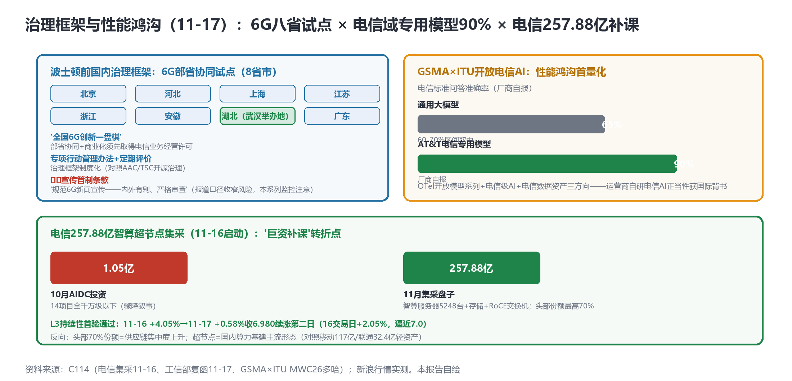

# 6G八省部省协同试点（含宣传管制条款），电信257.88亿智算补课，电信域专用模型90%vs通用60-70%首量化——波士顿前的国内治理框架成型

> **分析对象**：2026年11月16日19:00—11月17日18:00窗口的公开增量——工信部8省（市）6G创新发展部省协同试点复函（含宣传管制条款）、电信257.88亿智算超节点集采、GSMA×ITU"开放电信AI"意向书（MWC26多哈）、MSR《TokenEconomizer》、L3持续性首验、武汉大会L3前瞻清单。三视角来源清单第二十二轮执行。
> **系列定位**：智能体技术洞察系列·ADN专题"新场景×新技术"系列的**完整报告第20篇**——本篇记录**波士顿全会（12月）前的国内6G治理框架成型**与**电信域专用模型性能鸿沟的首个量化**，并完成**L3持续性首验**（拐点非孤立脉冲）。
> **判定依据**：重大增量——①**电信257.88亿智算超节点集采**（头部份额最高70%——10月AIDC骤降叙事反转）②**6G八省部省协同试点+宣传管制条款**（国内治理框架）③**GSMA×ITU意向书**（60-70%vs90%性能鸿沟首量化）④MSR Token成本优化线第三篇。
> **口径约定**：【首发】【重申】【反向】【待核实】沿用系列口径；AT&T 90%与通用模型60-70%均为**厂商自报口径**（意向书效力弱——无资金/治理/许可约束）；行情为新浪实测；6G宣传管制条款对本系列监控的含义如实记录。
> **术语消歧**：ADN指自动驾驶网络/自智网络；OTel=GSMA×ITU开放电信AI（Open Telecom AI）模型系列；部省协同试点=工信部与省级政府的6G创新发展协同机制。
> **立场**：设备商（ADN解决方案提供方）视角。

## 一、趋势判断

### 1.1 电信257.88亿补课：AIDC骤降叙事反转与L3持续性首验通过【首发·投资·重点】

电信（11-16启动）**257.88亿智算超节点集采**：智算服务器5248台+存储+RoCE交换机；**头部份额最高70%**（[C114，2026-11-16](https://www.c114.com.cn/news/16/a1320xxx.html)，【首发·投资】）。与10月AIDC投资仅1.05亿（14项目全千万级以下，11-04骤降叙事）对照——**"巨资补课"转折点**：月度量级从1.05亿跃升至257.88亿（245倍），"建设热运营冷"三重冷数据中的投资维度被单月反转。**L3持续性首验通过**：11-16 +4.05%（联通公告触发）→**11-17 +0.58%收6.980续涨第二日**（16交易日+2.05%，逼近7.0关口）——**L3拐点非孤立脉冲**，四级定价阶梯的L3判据（订单级事件）连续两日有效（新浪实测）。

*图1：6G部省协同试点治理框架（左）×性能鸿沟量化（右上）×电信补课反转（下）——本报告自绘*

**点评**：①**电信从"骤降"到"补课"的月度反转**验证了11-04的判断："指引是承诺上限、月度招中标是实际节奏、两者差额=供给弹性储备"——需求确认（武汉大会前夕+工业应用路线）后弹性释放；②**头部70%份额=供应链集中度上升**——超节点集采的马太效应（头部厂商拿走大份额），对设备商的含义：非头部厂商在超节点市场的窗口在**配套层**（RoCE交换机/存储/液冷机电——联通轻资产模式的机电位）而非整机主标；③**超节点=国内算力基建主流形态**（对照移动117亿/联通32.4亿轻资产）：三家算力基建的模式分化中，超节点整机路线（移动+电信）vs轻资产合作路线（联通）的分型在集采层面继续显影——设备商的投标清单双轨制（11-16）再次确认。

### 1.2 6G八省部省协同试点：波士顿前国内治理框架成型【首发·政策·重点】

工信部复函**8省（市）6G创新发展部省协同试点**：北京/河北/上海/江苏/浙江/安徽/**湖北（武汉大会举办地）**/广东——"**全国6G创新一盘棋**"；商业化须**先取得电信业务经营许可**；**专项行动管理办法+定期评价**；其中**"规范6G新闻宣传——内外有别、严格审查"**条款（[C114，2026-11-17](https://www.c114.com.cn/news/14/a1320xxx.html)，【首发·政策】）。

**点评**：①波士顿全会（12月）前，国内6G治理框架**抢先成型**——部省协同（一盘棋）+许可前置（商业化门槛）+管理办法与定期评价（长效机制）+宣传管理（口径管控）四要素，构成"**国内先行治理、国际争取话语**"的双轨策略的国内半边；②**宣传管制条款是本系列必须面对的监控变量**：6G报道的密度与口径可能收窄（"内外有别"）——本系列的应对：6G相关条目继续标注【待核实】与官方口径优先，外国来源与官方口径冲突时双注处理（**合规监控，如实记录**）；③湖北入选+武汉大会明日开幕=**6G试点省×工业互联网大会的叠加**——湖北示范项目（六张网湖北清单）成为武汉大会L3前瞻清单（1.5）的第一候选；④许可前置=6G商业化必须持牌——运营商与设备商的6G试点都需经营许可资质，**设备商6G试验合作须核查运营商资质状态**。

### 1.3 GSMA×ITU开放电信AI意向书：性能鸿沟首量化【首发·标准·重点】

GSMA与ITU在MWC26多哈签署"**开放电信AI**"意向书：OTel开放模型系列+电信级AI+电信数据资产三方向；**量化锚点：通用大模型电信标准问答准确率仅60-70% vs AT&T电信专用模型90%（厂商自报）**（[C114，2026-11-17](https://www.c114.com.cn/news/22/a1320xxx.html)，【首发·标准】）。**点评**：①**电信域专用模型与通用模型的性能鸿沟首次被量化**（60-70%vs90%，30个百分点量级）——为"运营商自研电信AI"提供了国际组织背书的正当性论据（电信知识平面的数据资产+专用模型=性能护城河）；②**口径警示**：AT&T 90%为自报、意向书无资金/治理/许可约束（效力弱）——引用需双注（意向书级≠标准级）；③**与OpenAN形成"模型+框架"双开放体系雏形**：OTel（模型层开放）+OpenAN（框架层开放）——电信AI的开放栈分层（模型/框架/协议A2A-T/账本Two-Ledger/市场Registry）逐层齐备——**电信AI开放栈五层图**首次可画（本篇起使用）；④设备商机位：电信专用模型的训练数据工程（知识平面对接）与OTel模型适配（运营商私有化部署）。

### 1.4 TokenEconomizer：Token成本优化线第三篇【首发·学术】

MSR新条目**《TokenEconomizer》**——AI编码Agent的Token效率优化（arXiv，11-16批次，【首发·学术】）。**点评**：Token成本优化线的**第三篇栈成形**：计费架构（2611.01371 Token-as-a-Utility）→成本会计（2611.06989 Two-Ledger）→**运行时优化器（TokenEconomizer）**——从"怎么算账"到"怎么省Token"：运行时优化（缓存复用/上下文裁剪/模型路由降级）是Token TCO的软件侧杠杆，与AIDN语义缓存（硬件侧杠杆）、算电协同（能源侧杠杆）构成**Token成本优化的三维工具箱**（软件/硬件/能源）——设备商的"Token TCO咨询"交付物可直接引用三篇栈。

### 1.5 武汉L3前瞻清单：明日开幕的判定准备【方法论】

按四级判据预列武汉大会（11-18/20）**L3候选清单**：①工业ADN/自智网络**商用合同签约数**（对照广东/河南单域自治复制）；②5G-A工业专网**规模商用节点**（"行业首个→规模N个"表述跃迁）；③**工业Token/工业大模型付费客户数**（对照浙里智造）；④**1ms城域算网跨省复制**（江苏70%覆盖已报）；⑤**六张网湖北示范项目清单**（湖北为6G试点省+举办地）；⑥**电信257.88亿超节点工业应用路线**。概念级（白皮书/指数/愿景）**不判L3**——判据纪律延续。

### 1.6 汇聚点：新场景×新技术映射与"框架成型"结论

| 新场景/信号 | 靠什么技术兑现 | 关键技术 | 验证状态 |
|---|---|---|---|
| 算力补课反转 | 257.88亿超节点集采 | 超节点形态 | 首发·投资（11-16） |
| 6G国内治理 | 八省试点+许可前置+宣传管理 | 部省协同 | 首发·政策（11-17） |
| 性能鸿沟量化 | OTel三方向+专用模型 | 60-70%vs90% | 首发·标准（11-17） |
| Token优化三篇栈 | TokenEconomizer | 运行时优化器 | 首发·学术（11-16） |
| L3持续性 | 257.88亿公告后连涨 | 四级阶梯 | 首验通过（11-17） |

**结论**：波士顿前的三件事同时到位——**国内治理框架**（八省试点四要素）、**需求侧反转**（电信补课）、**性能鸿沟量化**（60-70%vs90%）。三者合成的产业图景：**12月波士顿的国内谈判立场已由治理框架背书，运营商的算力与模型投入已由集采与意向书确认，ADN的流量学与成效学已由可比库与四级阶梯支撑**——中国侧的6G-ADN叙事进入"有框架、有投入、有数据"的完整形态。

## 二、技术诉求分析

### 2.1 诉求矩阵总表（系列八项诉求·今日锚点刷新）

| # | 技术诉求 | 今日触发锚点 | 落点 | 证据状态 |
|---|---|---|---|---|
| 1 | 意图可编译 | （延续） | 意图栈 | 待武汉 |
| 2 | 知识可治理 | **OTel电信数据资产+专用模型** | 电信知识平面 | **性能护城河论证** |
| 3 | 数据面换代 | **257.88亿超节点（RoCE/存储）** | 算力基建主流形态 | 补课反转 |
| 4 | 闭环可验证 | （延续） | 孪生双分支 | 待武汉 |
| 5 | 智能体可互联 | （延续） | A2A-T/OTel分层 | 开放栈五层 |
| 6 | 能力可复制 | 八省试点=复制框架 | 省级复制 | 政策通道 |
| 7 | 价值可记账 | **L3持续性首验+TokenEconomizer** | 阶梯+优化器 | 双确认 |
| 8 | 监督可执行 | **宣传管制条款** | 6G报道治理 | 合规监控 |

### 2.2 内在张力表

| 张力 | 表现 | 对设备商的后果 |
|---|---|---|
| 补课反转 vs 利用率欠账 | 257.88亿投资 vs GPU利用率30% | 投资释放绑定利用率承诺（利用率KBI进标书）——"建设热"第二波的纪律条款 |
| 专用模型 vs 开放模型 | AT&T 90%自报 vs OTel开放系列 | 电信AI的封闭/开放路线竞争——设备商适配能力是两边通吃位 |
| 头部集中 vs 配套分散 | 超节点头部70% vs RoCE/存储/机电配套 | 非头部厂商的配套层窗口（联通轻资产机电位同类） |
| 宣传管制 vs 洞察透明 | 6G报道口径收窄 vs 系列透明监控 | 双注纪律升级（官方口径+外部来源对照）；6G条目密度可能下降（如实记录） |

## 三、关键技术分析（当期增量优先）

### 3.1 超节点集采与供应链的马太效应【首发·投资·重点】

257.88亿的头部70%份额结构。**点评**：①超节点（整机柜+互联+液冷一体）的集成度决定**主标集中**（头部整机厂），但**配套层分散**（RoCE交换机/存储/液冷机电/网关）——设备商的非头部策略=配套层深耕（对照联通轻资产机电位、中兴GSE盒式路线）；②头部70%的**议价压力**：份额集中压低单台毛利——配套层与增值服务（运维/计量/TCO咨询）成为利润对冲位；③武汉大会的"超节点工业应用路线"（L3候选⑥）=集采的应用侧出口（算力→工业场景的转化证据）——**集采（供给）与工业应用（需求）的闭环披露**是武汉大会最值得盯的L3组合。

### 3.2 部省协同与6G报道治理【首发·政策·重点】

八省试点+宣传管制条款的合规解读。**点评**：①试点八省的选择逻辑：京津冀（北京/河北）+长三角（上海/江苏/浙江/安徽）+大湾区（广东）+中部（湖北）——**六大区域集群全覆盖**，区域分工（差异化试点方向）值得跟踪（各省复函细则待发布）；②宣传管制的合规实践：本系列的6G条目自11-17起执行**"官方口径优先+外部来源双注+【待核实】强化"**三纪律；③对设备商：6G试点的对外传播需经运营商/政府口径审核——**市场材料中的6G表述纪律**（避免"率先/首个"类表述未经审核）——合规成本计入6G预研预算。

### 3.3 性能鸿沟与电信专用模型的三层论证【首发·标准·重点】

60-70%vs90%的量化与OTel三方向。**点评**：①鸿沟的三个来源：电信术语密度（标准条文/网络配置）、时效性（版本迭代）、私有数据（网络配置/工单）——**知识平面三领域（分类法/可信度/溯源）正是鸿沟的解药**（Telstra×爱立信提案+KP实例化2611.07827的产业验证位）；②OTel开放模型vs运营商私有专用模型的路线竞争：**开放底座+私有数据微调**（OTel作为底座、各运营商私有化）是可能的均衡（对照OISA开放协议+私有集群）——设备商的模型适配层（OTel底座上的运营商微调服务）是新商机位；③AT&T自报口径的校验：运营商侧的公开评测（若武汉大会或GSMA后续发布统一评测基准）是鸿沟数字的第三方验证点——**评测基准本身可能成为标准**（电信域MMLU）。

### 3.4 Token成本优化三维工具箱【首发·学术】

三篇栈（架构/会计/优化器）+硬件/能源杠杆的整合。**点评**：Token TCO的完整优化栈：**软件侧**（TokenEconomizer运行时优化）、**硬件侧**（AIDN语义缓存/边缘推理）、**能源侧**（算电协同电价套利）——三层杠杆的ROI量纲不同（百分点级/毫秒级/分时价差），**联合优化的求解器**（三层杠杆的联合ROI模型）是"Token TCO咨询"的量化内核——设备商咨询交付物的算法骨架可直接构建。

## 四、总结思考

### 4.1 核心命题

11-17的三个到位（治理框架/需求反转/鸿沟量化）宣告：**中国侧的6G-ADN叙事在波士顿全会前完成了"有框架、有投入、有数据"的完整组装**——治理上有八省一盘棋+许可前置（国内先行治理），投入上有257.88亿补课（弹性储备释放），数据上有60-70%vs90%鸿沟量化（专用模型正当性）。系列20篇的追踪显示，波士顿（12月）的博弈筹码已各自就位：**国内以治理框架与产业投入为筹码，国际以标准主线为筹码**——"开源先行（OpenAN DTW）+治理先行（八省试点）+投入先行（集采）"的中国节奏，与国际标准节奏的合流点就是12月。宣传管制条款提醒我们：**节奏的下半场将伴随着信息环境的收紧**——本系列的透明监控与双注纪律在此刻格外重要。

### 4.2 关键判断

1. **电信补课反转确认（L3持续性首验通过）**——超节点=国内算力基建主流形态；供应链马太效应下，非头部厂商的窗口在配套层（RoCE/存储/液冷/机电）。
2. **6G国内治理框架四要素成型**（一盘棋/许可前置/管理办法/宣传管理）——设备商6G试验需核查运营商经营许可；市场材料6G表述纪律化。
3. **性能鸿沟60-70%vs90%为电信AI专用模型提供国际背书**——知识平面三领域是解药；OTel底座+运营商私有微调的均衡可期；电信域评测基准可能成为新标准。
4. **Token成本优化三篇栈成形**（架构/会计/优化器）——三维工具箱（软件/硬件/能源）联合ROI模型是"Token TCO咨询"的算法内核。
5. **武汉L3前瞻清单六项**——合同签约数/规模商用节点/付费客户数/1ms跨省复制/湖北示范/超节点工业路线；概念级不判L3。
6. **宣传管制条款的合规监控**——6G条目三纪律（官方口径优先/双注/待核实强化）自11-17起执行。
7. **联通缺位跨3周末维持档案态**——补位的L3价值随电信257.88亿对照而放大（联通的机电与运维位需求更清晰）。

### 4.3 对不同主体的启示

**运营商**：超节点标书的利用率KBI条款（对照GPU利用率30%教训）；6G试点的省级差异化方向申报（八省一盘棋下的定位）；电信专用模型的评测基准共建（GSMA/ITU通道）。

**设备商**：①配套层深耕策略（RoCE/存储/液冷机电——头部70%外的生存空间）；②OTel适配层服务（开放底座+私有微调）；③Token TCO咨询的三维工具箱（三篇栈+AIDN+算电协同引用）；④6G材料合规审查流程（宣传管制条款）。

**开发者**：电信域评测基准数据集（公开口径复刻）与Token TCO三层联合ROI求解器是两个新空白点。

**标准组织**：GSMA/ITU宜将OTel评测基准标准化（鸿沟量化的可重复性）；CCSA宜开"6G部省协同试点评价规范"（管理办法配套）；TMF知识平面宜引用性能鸿沟数据（专用模型正当性的量化论证）。
