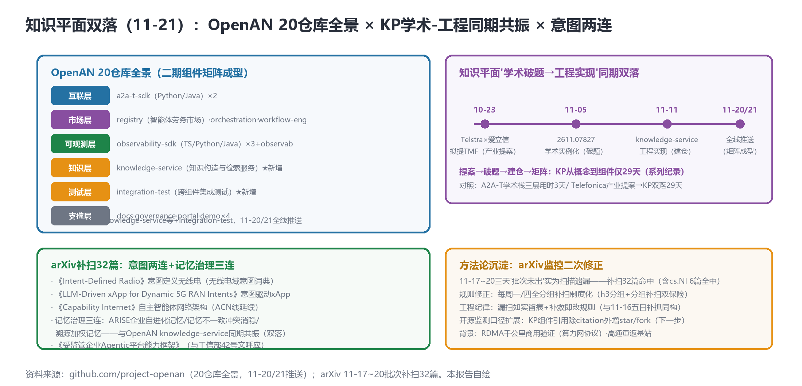

# OpenAN 20仓库全景（knowledge-service=KP开源实现），意图定义无线电两连，记忆治理三连——知识平面"学术破题→工程实现"同期双落与arXiv监控二次修正

> **分析对象**：2026年11月20日18:00—11月21日18:00窗口的公开增量——OpenAN仓库全景曝光（20仓库，二期组件矩阵：knowledge-service/可观测四件套/integration-test等11-11批量创建）、arXiv四批次补扫32篇命中（意图两连+记忆治理三连+Capability Internet）、国家算力互联网RDMA千公里商用验证（标题级）、7.0巩固3/3定论。三视角来源清单第二十六轮执行。
> **系列定位**：智能体技术洞察系列·ADN专题"新场景×新技术"系列的**完整报告第24篇**——本篇记录**知识平面（KP）的"学术破题→工程实现"同期双落**（系列最快概念落地纪录：29天）与**arXiv监控规则的二次修正**（漏扫32篇的补救与制度化）。
> **判定依据**：重大增量——①**OpenAN 20仓库全景**（knowledge-service=KP开源实现）②**KP学术-工程双落**（2611.07827×knowledge-service同期共振）③**意图接口两连+记忆治理三连**（arXiv补扫32篇）④7.0巩固3/3定论。
> **口径约定**：【首发】【重申】【反向】【待核实】沿用系列口径；OpenAN仓库清单为GitHub页面直抓（11-20/21推送）；"132页新规"第4天正文仍未生成（撤稿概率累积——不确定性悬挂维持）；行情周末休市（7.0巩固3/3以11-18/19/20三日定论）。
> **术语消歧**：ADN指自动驾驶网络/自智网络（移动语境"高阶自智网络"，11-16）；knowledge-service=OpenAN的"知识构造与检索服务组件"（KP的开源实现载体）。
> **立场**：设备商（ADN解决方案提供方）视角。

## 一、趋势判断

### 1.1 OpenAN 20仓库全景：二期组件矩阵成型【首发·开源·重点】

OpenAN仓库全景曝光：**20个仓库**构成二期组件矩阵（图1左栏）——互联层（a2a-t-sdk Python/Java×2）、市场层（registry"智能体劳务市场"/orchestration/workflow-engine×2）、可观测层（observability-sdk TS/Python/Java×3+observability-center）、**知识层（knowledge-service"知识构造与检索服务组件"★11-11新增）**、测试层（integration-test★新增）、支撑层（docs/governance/portal/demo×4）；11-11批量创建+11-20/21全线推送（[github.com/project-openan](https://github.com/project-openan)，【首发·开源】）。

*图1：OpenAN 20仓库矩阵（左）×KP双落时间线（右上）×意图两连与记忆三连（右下）——本报告自绘*

**点评**：①从11-11"三seed组件"（A2A-T SDK/Registry/Orchestration）到20仓库矩阵，**8天完成组件矩阵成型**——开源工程的扩张速度与DTW 2026.6时间表匹配（开源前的功能完备期）；②可观测层四件套（SDK三语言+center）=**智能体运维的观测标准件**（对照暗面"静默失败"2611.00884——可观测性是对抗静默失败的工程前提）；③integration-test的独立建仓=**跨组件集成测试的工程化**（对照治理十类测试用例——测试从清单到仓库）。

### 1.2 KP学术-工程双落：三段完成与29天纪录【首发·学术×工程·重点】

**knowledge-service=KP（知识平面）的开源实现**——与学术《Instantiating the Knowledge Plane》（2611.07827，11-05）**同期双落**。时间线（图1右上）：Telstra×爱立信拟提TMF（10-23，产业提案）→学术实例化（11-05，破题）→**knowledge-service建仓（11-11，工程实现）**→全线推送（11-20/21，矩阵成型）——**KP从概念到组件仅29天**（系列纪录；对照A2A-T学术栈三层用时3天——不同阶段的加速比）。**点评**：①**"学术破题→工程实现"同期双落**是产业-学术协同的最快样本：提案（产业）→论文（学术）→仓库（工程）三段在一个月内完成——知识平面的"提案-论文-代码"三轨制成立；②knowledge-service的定位（知识构造与检索服务）=KP三领域（分类法/可信度/溯源交互）的**工程抽象起点**——组件接口（构造/检索API）是TMF提案的落地参照；③**双落对设备商的含义**：KP的工程实现已可复用（开源组件），设备商的知识平面产品**不必自研底层**——"开源组件+行业微调"路径成立（对照OTel底座+私有微调，11-17）。

### 1.3 意图接口两连+Capability Internet：意图词典的无线电域填充【首发·学术】

arXiv补扫32篇（11-17~20批次）：cs.NI 6篇全中——**《Intent-Defined Radio》（意图定义无线电）**+**《LLM-Driven xApp for Dynamic 5G RAN Intents》**（意图接口两连）+**《Capability Internet：自主智能体网络架构》**（ACN线延续，对照2610.28244，10-21）；cs.MA——**《Agent-Native Applications》新应用范式**（[arXiv，11-17~20批次，【首发·学术】）。**点评**：①意图词典空白区（10-20标注）的**无线电域填充**：Intent-Defined Radio（意图定义无线电）+LLM-Driven xApp（RAN意图的LLM执行）——**意图接口在RAN侧的两连**（此前CLIC在Open RAN安全侧、2611.040744，11-02）——意图线从"安全闭环"扩展"定义范式"；②Capability Internet=ACN（智能体成为网络实体）的架构深化——"能力互联网"可能是ACN的下一阶段表述（能力=可发现/可组合/可交易的智能体功能单元——与Registry"劳务市场"呼应，11-11）。

### 1.4 记忆治理三连：记忆线从资产化进入治理化【首发·学术】

arXiv cs.MA记忆治理三连：**ARISE企业自进化记忆**（自进化与记忆治理的结合）、**记忆不一致冲突消隐**（多源记忆冲突的消解）、**溯源加权记忆**（记忆可信度的溯源加权）；另**《受监管企业Agentic平台能力框架》**（与工信部42号文呼应，11-06）；去中心化逐跳委托攻防（暗面延续）。**点评**：①记忆线三级跳完成：资产化（11-03曙光/11-09 TeleAgent）→**治理化**（三连：自进化/冲突消解/溯源加权）——记忆治理从"审计清单"（十二类）进入"治理算法"（消隐/加权/进化约束）；②**与knowledge-service同期共振**（学术记忆治理×工程知识服务）——**"记忆×知识"的学术-工程双落**（对照KP双落）——智能体的记忆与知识底座在同一周完成学术与工程的双向确认；③受监管企业Agentic框架=42号文（11-06）的学术镜像——**监管-学术的双落**（政策框架→学术框架）。

### 1.5 arXiv监控二次修正与7.0定论【方法论/市场】

**监控二次修正**：11-17~20三天"批次未出"实为扫描遗漏——补扫32篇命中（含cs.NI 6篇全中）；**规则修正：每周一/四全分组补扫制度化**（h3分组+分组补扫双保险）——漏扫如实留痕+补救即改规则（与11-16五日补抓同构的工程纪律）。开源监测口径扩展：KP组件引用除citation外增**star/fork监测**（下一步）。7.0巩固**3/3定论成立**：三日（7.08/7.15/7.34）全部收于7.0上方且逐日递增——**"7.0平台确认"**，18交易日+7.31%，下一压力位7.5（周六休市无新数据）。**点评**：①监控二次修正与11-16五日补抓构成**"漏扫-补扫-改规则"的完整工程纪律样本**（两次修正的制度化=监控体系的自我进化）；②star/fork口径扩展=**开源指标进入学术监测体系**（论文引用之外的第二种影响力度量——KP双落的工程侧追踪）。

### 1.6 汇聚点：新场景×新技术映射与"双落"结论

| 新场景/信号 | 靠什么技术兑现 | 关键技术 | 验证状态 |
|---|---|---|---|
| KP开源实现 | knowledge-service建仓 | 知识构造与检索 | 首发·工程（11-11/20） |
| 意图定义无线电 | Intent-Defined Radio+xApp | RAN意图 | 首发·学术（11-17批次） |
| 记忆治理化 | ARISE/冲突消隐/溯源加权 | 记忆治理算法 | 首发·学术（11-17批次） |
| 算力网协议商用 | RDMA千公里验证 | RDMA长距 | 首发·商用（标题级） |
| 7.0平台确认 | 3日巩固3/3 | 四级阶梯 | 定论（11-21） |

**结论**：11-21的"双落"（KP学术×工程）与"双修"（arXiv监控二次修正+开源监测口径扩展）共同标志：**知识平面的产业-学术-工程三轨全部贯通，且监测体系完成自我进化**。智能体基础设施的"知识层"自此有了论文、代码与提案的三重存在——对照身份码（监管）、账本（Two-Ledger）、市场（Registry）三件套，**知识层是第一个三轨齐备的层**——底座建设的"完成度排序"由此可测：知识层>账本层≈市场层>身份层（待落地验证）。

## 二、技术诉求分析

### 2.1 诉求矩阵总表（系列八项诉求·今日锚点刷新）

| # | 技术诉求 | 今日触发锚点 | 落点 | 证据状态 |
|---|---|---|---|---|
| 1 | 意图可编译 | **Intent-Defined Radio+xApp两连** | RAN意图词典 | **无线电域填充** |
| 2 | 知识可治理 | **knowledge-service（KP开源）** | 知识构造/检索 | **工程实现落地** |
| 3 | 数据面换代 | RDMA千公里商用（标题级） | 算力网协议 | 商用验证 |
| 4 | 闭环可验证 | observability四件套 | 可观测标准件 | 工程就绪 |
| 5 | 智能体可互联 | Capability Internet架构 | ACN深化 | 学术延续 |
| 6 | 能力可复制 | 20仓库组件复用 | 开源组件+微调 | 路径成立 |
| 7 | 价值可记账 | star/fork监测扩展 | 开源指标 | 口径升级 |
| 8 | 监督可执行 | 记忆治理三连 | 治理算法化 | **治理化阶段** |

### 2.2 内在张力表

| 张力 | 表现 | 对设备商的后果 |
|---|---|---|
| 开源组件 vs 自研底线 | knowledge-service开源 vs 知识资产的差异化 | "开源组件+行业微调"——自研重心上移（行业知识模型而非底层服务） |
| 意图扩展 vs 词典统一 | RAN意图两连 vs 跨域意图词典 | 分域意图词典×统一词表——Registry/KEI式的统一层需求 |
| 漏扫风险 vs 监控制度化 | 32篇漏扫 vs 周一/四补扫制度化 | 监控规则自我进化——"制度化的纠错"成为体系可信度的一部分 |
| 双落加速 vs 引用滞后 | KP双落29天 vs cited_by=0 | 学术-工程影响力量表（引用+star/fork）——新度量框架需求 |

## 三、关键技术分析（当期增量优先）

### 3.1 knowledge-service与KP工程栈【首发·开源·重点】

KP开源实现（知识构造与检索服务）的组件定位。**点评**：①knowledge-service在20仓库矩阵中的**枢纽位**：上承Registry（智能体注册的知识画像）、下接observability（知识调用的可观测）——知识层是组件矩阵的"数据底座"；②"构造与检索"双API=KP三领域（分类法/可信度/溯源）的工程入口——**构造侧对应分类法+可信度、检索侧对应溯源交互**——组件API即标准提案的落地形式（对照Two-Ledger记账框架）；③设备商动作：knowledge-service的行业微调（电信知识模型/工业知识图谱——对照联通140TB数据集，11-19）是"开源组件+行业微调"路径的第一战。

### 3.2 意图定义无线电：RAN意图词典的学术突破口【首发·学术·重点】

Intent-Defined Radio+xApp两连的意义。**点评**：①意图词典空白区（10-20标注）的**分域填充策略**成型：Open RAN安全（CLIC，11-02）→无线电定义（本篇两连）——**每个网络域都有自己的意图词典分支**（无线/光/核心/跨域），分域词典×统一词表的双层结构成为可预期架构（对照可比库分域子库，11-16）；②Intent-Defined Radio的"意图定义"语义（意图作为无线电的配置原语）=意图从"指令"升格"定义"——**RAN配置的意图原语化**是AI-RAN的架构级主张（对照2611.16879 Context Graph可解释决策链，11-16批次）；③设备商动作：RAN意图词典的行业词表（与OpenAN knowledge-service联动）是意图线的工程化入口。

### 3.3 记忆治理三连与治理算法化【首发·学术】

ARISE/冲突消隐/溯源加权的治理算法意义。**点评**：①记忆治理从"审计清单"（12类攻击）到"治理算法"（自进化约束/冲突消解/溯源加权）——**治理的算法化**使记忆治理可交付（算法即产品）；②溯源加权记忆=**记忆可信度的计算化**（知识平面"可信度判定"的记忆版——KP与记忆治理在算法层合流）；③与knowledge-service同期共振的工程含义：**知识服务内置记忆治理算法**（构造时消隐冲突/检索时溯源加权）——knowledge-service的v2规格候选。

### 3.4 监控口径扩展与制度化纠错【首发·方法论】

arXiv二次修正+star/fork扩展的体系含义。**点评**：①**"漏扫-补扫-改规则"制度化**（第二次）——监控体系的自我进化成为系列方法论的一部分（与四级阶梯/可比库/三纪律并列的第四项制度资产）；②周一/四补扫的制度化节奏：周一（周一批量）/周四（周中查漏）/周末（负结果确认）——**周频监控的三点采样**；③star/fork口径：开源组件的影响力=star/fork（工程侧）+citation（学术侧）+集采引用（产业侧）——**三维影响力度量**（KP的追踪从论文延伸到仓库到采购）。

## 四、总结思考

### 4.1 核心命题

11-21的"双落"（KP学术×工程29天）与"双修"（监控二次修正+口径扩展）指向同一命题：**智能体基础设施的建设速度已经超过观测它的速度**——KP从提案到组件29天，而其学术引用仍是0（预印本周期）、其工程影响尚无star/fork口径。**观测体系的进化速度（二次修正/口径扩展/三级采样）必须追平建设速度**——这正是本系列存在的意义：为一个月走完别人一个季度的产业配备同步的观测框架。知识层的三轨齐备（提案/论文/代码）是底座建设的里程碑：底座完成度排序（知识>账本≈市场>身份）给出了下一阶段的缺口地图——**身份层的工程实现（42号文身份码的开源化）是最后的底座缺口**。

### 4.2 关键判断

1. **KP双落29天创纪录**——"提案→论文→代码"三轨制成立；设备商知识平面走"开源组件+行业微调"路径（不自研底层）。
2. **意图词典分域填充策略成型**（RAN两连+CLIC）——分域词典×统一词表双层架构可预期；RAN意图原语化是AI-RAN架构级主张。
3. **记忆治理算法化**（三连）——记忆治理可交付（算法即产品）；knowledge-service v2候选=内置记忆治理算法。
4. **20仓库矩阵8天成型**——开源扩张速度与DTW时间表匹配；可观测四件套是对抗静默失败的工程前提。
5. **监控体系完成二次进化**（周一/四补扫制度化+star/fork口径）——"制度化的纠错"成为体系可信度的组成部分。
6. **7.0平台3/3定论**——行情进入7.0新平台（下一压力位7.5）；四级阶梯的巩固判据完整走通。
7. **底座完成度排序可测**（知识>账本≈市场>身份）——身份层开源化（42号文身份码工程实现）是最后的底座缺口。

### 4.3 对不同主体的启示

**运营商**：knowledge-service的行业微调合作（电信知识模型/联通工业图谱——开源组件+私有数据路径）；意图分域词典的行业词表供给。

**设备商**：①OpenAN组件复用评估（knowledge-service/observability四件套的集成测试）；②RAN意图词典的行业词表共建（OpenAN贡献）；③记忆治理算法的工程化跟踪（ARISE/溯源加权）；④star/fork三维影响力度量进竞品监测。

**开发者**：knowledge-service的行业微调模板与observability SDK的静默失败探测插件是两个新空白点。

**标准组织**：TMF宜将knowledge-service组件接口写入知识平面提案（代码即提案的落地形式）；CCSA宜开"意图分域词典"研究项（RAN/光/核心分域）；LFN宜在DTW前公布star/fork与citation的三维影响力框架（KP双落的度量标准化）。
