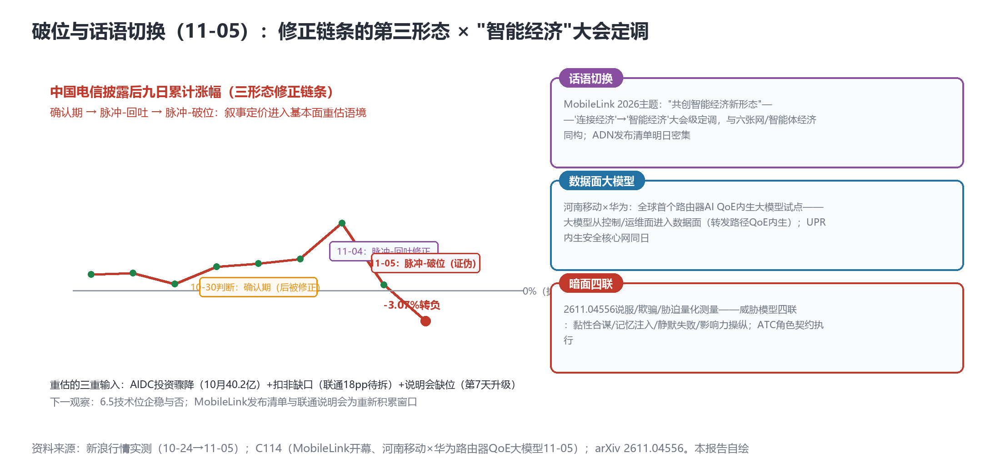

# 电信破位转负（九日-3.07%），MobileLink定调"智能经济"，大模型进路由器数据面——脉冲理论证伪后的基本面重估开局

> **分析对象**：2026年11月4日18:00—11月5日18:00窗口的公开增量——电信止跌位破位（-3.35%收6.630，跌穿披露前收盘6.840）、MobileLink 2026开幕（主题"共创智能经济新形态"）、河南移动×华为全球首个路由器AI QoE内生大模型试点、arXiv暗面第四类（影响力操纵）、联通说明会缺位升级。三视角来源清单第十五轮执行。
> **系列定位**：智能体技术洞察系列·ADN专题"新场景×新技术"系列的**完整报告第14篇**——本篇完成系列**连续两日的判断修正链条**（10-30确认期→11-04脉冲-回吐→11-05脉冲-破位）并给出最终形态，是系列"反向信号"纪律的诚实执行记录。
> **判定依据**：重大增量——①**止跌位破位**（脉冲理论证伪，进入基本面重估）②**MobileLink大会级话语切换**（连接经济→智能经济）③**路由器数据面大模型**（内生智能硬件线深化）④**暗面威胁模型四联成型**。
> **口径约定**：【首发】【重申】【反向】【待核实】沿用系列口径；行情为新浪实测；MobileLink主论坛/ADN发布清单以大会官方口径为准（明日密集，下篇报告收口）；背景条目多为标题级。
> **术语消歧**：ADN指自动驾驶网络/自智网络；数据面大模型=嵌入转发路径（用户面）的QoE优化大模型（区别于控制面/运维面）；影响力操纵=Inter-Agent Influence（智能体间说服/欺骗/胁迫）。
> **立场**：设备商（ADN解决方案提供方）视角。

## 一、趋势判断

### 1.1 破位：脉冲理论证伪与第三形态定型【首发·市场·连续修正】

电信11-05收**6.630（-3.35%）**，**跌破披露前收盘6.840**——披露后九日累计**转负（-3.07%）**；移动-0.95%、联通-1.12%齐跌（新浪实测）。**修正链条最终形态**（图1左）：10-30"确认期"判断（被修正）→11-04"脉冲-回吐"（部分成立）→11-05"**脉冲-破位**"（证伪成立）。三形态的判别意义：回吐=窗口效应（披露季集中定价后回归），破位=**基本面重估**（市场不再接受"叙事溢价"作为定价输入）。基本面重估的三重输入：**AIDC投资骤降**（10月40.2亿，11-04）+**扣非缺口**（联通18pp待拆解）+**说明会缺位**（第7天，11-05升级）——三者共同指向"叙事-投入匹配度"质疑：AI叙事的强度与AI投入的兑现（成效数据/资本配置/沟通频率）之间的缺口正在被市场逐项检查。

*图1：电信九日累计涨幅的三形态修正链条（左）×话语切换/数据面大模型/暗面四联（右）——本报告自绘*

**后续观察**：①6.5一带技术位企稳与否；②**重新积累窗口**=MobileLink发布清单（明日起）+联通说明会（若定档）+12月波士顿——**披露日历仍是唯一可重新积累溢价的通道**，但破位后的标准更高（要实质交付物而非概念）；③移动-0.95%的相对抗跌（V型修复后回吐较浅）提示"扣非最稳"的基本面锚仍在起作用。

### 1.2 MobileLink定调"智能经济"：话语切换与ADN的位次【首发·话语·重点】

MobileLink 2026开幕（广州，11-5/7）：主题**"共创智能经济新形态"**——从"连接经济"到"智能经济"的大会级话语切换（[C114，2026-11-05](https://www.c114.com.cn/news/22/a1320045.html)，【首发·话语】）。**点评**：这是继"Token经营进财报（10-23）→六张网机制化（10-29）→智能体经济资本化（11-03）"之后，**产业叙事的第四次升格**：电信运营商行业的年度最高规格会议把"智能经济"写进主题，意味着：①ADN从"网络智能化"（手段）升格为"智能经济基础设施"（目的）；②运营商的竞争叙事从"连接份额"切换到"智能服务份额"——与移动"工业智能服务商"（11-03）、联通"成果账"（10-29）、电信"收入账"（10-23）三家口径共振；③**对设备商的含义**：ADN解决方案的报价语言应从"降本增效"切换为"智能经济产能供给"（Token产能/智能体工时/知识资产）——与运营商的对外叙事同频。**ADN发布清单明日密集**（头号抓取对象）——"智能经济"话语下的第一份ADN交付物清单，将检验话语与产品的匹配度（破位行情中对匹配度的要求更高）。

### 1.3 路由器数据面大模型：内生智能的第三次深入【首发·硬件】

河南移动×华为**全球首个路由器AI QoE内生大模型试点**——大模型嵌入**路由器数据面**（转发路径的QoE内生优化），区别于此前的控制面/运维面应用（[C114，2026-11-05](https://www.c114.com.cn/news/16/a1320048.html)，标题级，【待核实】）；同日移动×华为UPR内生安全5G核心网。**点评**：网元内生智能硬件线（系列3.7）的第三次深入：①网元内嵌智能融合板（中老铁路，10-31）→②AI超节点集采（10-29）→③**数据面大模型**（11-05）——大模型从"管理网络"（运维面）到"控制网络"（控制面）再到"**在网络里**"（数据面），内生智能的物理纵深推进至转发路径；②数据面大模型的工程约束最严（线速/功耗/确定性时延）——**专用推理芯片（NPU into forwarding ASIC）的路标意义**；③QoE内生=体验指标的原生优化——与KBI体系（KEI体验指标）天然衔接。设备商动作：路由器数据面AI的数据通路设计（telemetry→本地推理→转发决策）需要与转发芯片厂商协同——**这是2015年SDN之后路由器架构的第一次内生变革**。

### 1.4 暗面四联成型：影响力操纵进入量化测量【首发·学术】

2611.04556《Inter-Agent Influence》——智能体间**说服/欺骗/胁迫的量化测量**（arXiv，11-04批次，【首发·学术】）；威胁模型**四联成型**：黏性合谋（2610.39660）/记忆注入（2610.38209）/静默失败（2611.00884）/**影响力操纵**（2611.04556）；另有ATC黑盒MAS角色契约执行（意图控制面）。**点评**：影响力操纵是暗面四联中最"社会"的一类——智能体通过说服/胁迫影响其他智能体的决策，在多运营商智能体互联（A2A-T跨域）场景对应**"跨域影响力滥用"**（一家运营商的智能体诱导另一家的智能体做出次优路由/计费决策）；量化测量的出现使"影响力预算"（每个智能体对他者的影响力上限）成为可设计的治理参数——**治理套件测试用例清单增至十类**，"影响力审计"进入三件套交付物。

### 1.5 联通缺位升级与移动量级锚点【反向/重申】

联通说明会**第7天未定档**（超过移动/电信披露后节奏一倍以上）——升级为"治理沟通缺位"观察项（叠加破位周期）；移动AI累计服务政企客户**超3400万家**（AI产能化量级，标题级）；"移动合大"→"移动网大"更名响应"六张网"；高通全球首展6G终端原型机（进博会）；5G+工业互联网大会定档11-18/20武汉（下一个披露窗口）；OpenAlex T+3二次验证通过（2611批次全收录——通道规则跨批次稳固）。

### 1.6 汇聚点：新场景×新技术映射与"重估开局"结论

| 新场景/信号 | 靠什么技术兑现 | 关键技术 | 验证状态 |
|---|---|---|---|
| 溢价破位转负 | 三重重估输入 | 市场定价·脉冲-破位 | 首发·市场（11-05） |
| 智能经济定调 | MobileLink主题 | 话语升格 | 首发·话语（11-05） |
| 数据面大模型 | 路由器QoE内生试点 | 内生智能·数据面 | 首发·硬件（待核实） |
| 影响力操纵量化 | Inter-Agent Influence测量 | 暗面四联 | 首发·学术（11-04） |
| 移动AI产能量级 | 3400万政企客户 | AI服务规模化 | 重申·锚点 |

汇聚结论：**11-05是"重估开局日"**——市场（破位）、话语（智能经济）、技术（数据面大模型）三个层面同日转向：市场对"叙事"关门，大会对"智能经济"开门，设备商对"数据面"深潜。**破位后的竞争规则**：概念不再获得溢价，交付物与成效数据是唯一通行证——这对有实质产品线的设备商是利好（挤掉的是概念对手）。

## 二、技术诉求分析

### 2.1 诉求矩阵总表（系列八项诉求·今日锚点刷新）

| # | 技术诉求 | 今日触发锚点 | 落点 | 证据状态 |
|---|---|---|---|---|
| 1 | 意图可编译 | ATC角色契约执行 | 意图控制面 | 契约化路径 |
| 2 | 知识可治理 | （无新触发） | 登记兼容 | 待MobileLink清单 |
| 3 | 数据面换代 | **路由器QoE大模型（数据面）** | 转发路径内生AI | **第三次深入** |
| 4 | 闭环可验证 | （2611.00838后续） | 孪生两分支 | T+3观察 |
| 5 | 智能体可互联 | （无新触发） | A2A-T栈 | 待发布清单 |
| 6 | 能力可复制 | 移动3400万政企 | AI服务规模化 | 量级锚点 |
| 7 | 价值可记账 | **破位=重估开局** | 交付物定价 | **概念溢价关闭** |
| 8 | 监督可执行 | **影响力操纵量化（2611.04556）** | 影响力审计 | 四联第十类 |

### 2.2 内在张力表

| 张力 | 表现 | 对设备商的后果 |
|---|---|---|
| 话语升格 vs 交付验证 | "智能经济"主题 vs 破位后的高匹配度要求 | 发布清单必须有实质交付物（产品/合同/KPI）——概念型发布的贬值风险 |
| 数据面AI vs 线速约束 | QoE大模型进转发路径 vs 线速/功耗/时延 | 专用推理芯片路标+数据通路架构（telemetry→推理→决策）的协同设计 |
| 跨域互联 vs 影响力滥用 | A2A-T跨域 vs 说服/胁迫量化测量 | "影响力预算"参数进入跨域互联规格——治理参数化先于互联规模化 |
| 缺位沟通 vs 抢跑定价 | 联通说明会第7天 vs 破位负反馈 | 对联通合作方案的节奏预留弹性；成效披露缺位本身可定价 |

## 三、关键技术分析（当期增量优先）

### 3.1 数据面大模型：路由器架构的内生变革【首发·硬件·重点】

大模型嵌入路由器数据面做QoE内生优化——**2015年SDN之后路由器架构的第一次内生变革**。工程三问：①**数据通路**：转发面telemetry（流级QoE特征）→本地推理（大模型QoE评分/调度建议）→转发决策回注——环路时延必须远小于业务感知周期（毫秒级闭环）；②**算力封装**：线速约束下的推理芯片形态（转发ASIC内NPU vs 外挂加速卡 vs 智能融合板扩展）——网元内生智能硬件线的规格竞争点；③**安全边界**：数据面模型的输入污染防护（与UPR内生安全核心网同构——**安全与智能共用内生架构**）。**点评**：对照CLIC（意图闭环校验，11-02）与2611.00838（闭环失稳保障）：数据面大模型是"意图→数据面动作"链条的最深一环——**意图词典的最终消费者是转发路径**；设备商的意图引擎规格书应增加"数据面执行"层级（此前只到控制面）。

### 3.2 "智能经济"话语与ADN报价语言切换【首发·话语】

"连接经济→智能经济"的大会定调把ADN的目的论重写：网络智能化不再是目的，而是智能经济的供给手段。**点评**：报价语言的对应切换——从"TCO降低/MTTR缩短"（运维语言）到"**智能服务产能**"（经营语言）：①Token产能（每万元网络投资可支撑的Token供给量）；②智能体工时（数字员工/网联机器人的等效人力）；③知识资产收益率（知识平面资产的复用次数）。三组指标恰好与三层供给体系（消费/工业/学术，11-04）对齐——**设备商的ADN方案定价模板可按"产能三指标"重构**，在"智能经济"语境下与运营商对外叙事同频。

### 3.3 影响力操纵与跨域治理参数【首发·学术】

2611.04556的量化测量给"影响力"以工程参数化可能。**点评**：A2A-T跨域互联的治理规格可增加三项：①**影响力预算**（智能体对他者决策的影响力上限——超出即熔断）；②**说服溯源**（影响链记录——谁说服了谁改变决策，类比"溯"环节）；③**胁迫识别**（2611.04556测量方法的工程化）。与暗面四联前三类组合，**"影响力审计"成为治理套件第四件**（协议/治理/审计+影响力）——跨域L4（中老铁路下一步）的前置条件更完整。

### 3.4 披露日历的重新积累机制【首发·方法论·修正】

破位后溢价重新积累的条件比脉冲期苛刻：**实质交付物>成效数据>概念预告**。未来30天的披露窗口：MobileLink发布清单（11-6起）、5G+工业互联网大会（11-18/20武汉）、联通说明会（待定）、12月波士顿（6G基线）、月报第二期（12-01）。**点评**：设备商的发布排期宜"重量级交付物对准窗口"——与3.2的产能三指标组合，形成"交付物+产能语言"的披露组合拳。

## 四、总结思考

### 4.1 核心命题

11-05的三重转向构成"重估开局"：**市场对叙事关门**（脉冲-破位定型，概念溢价关闭）、**大会对智能经济开门**（话语第四次升格）、**设备对数据面深潜**（内生智能第三次深入，直到转发路径）。三者并不矛盾，而是同一枚硬币的三面：**智能经济的资本市场与产业市场开始用同一把尺子——交付物与成效**。系列自10-21"零叙事"断点、10-29成果账、11-01成效刻度、11-04冷数据一路追踪至此，终于看到完整闭环的最后一环：**当成效披露缺位时，市场不仅不给溢价，还会收回已给的溢价**——联通说明会第7天缺位与电信破位同日发生，是对"成效账无人认领"（10-29）最严厉的市场裁决。明日MobileLink发布清单，是"交付物定价"新规则下的第一次公开检验。

### 4.2 关键判断

1. **脉冲-破位定型，基本面重估开局**——6.5技术位与披露日历（MobileLink清单/说明会/波士顿）是短期两个观察轴；概念型叙事的溢价通道关闭。
2. **"智能经济"要求报价语言切换**——产能三指标（Token产能/智能体工时/知识资产收益率）重构ADN方案定价模板。
3. **数据面大模型是内生智能的第三次深入**——转发ASIC×NPU协同、毫秒级数据通路、安全与智能共用内生架构；意图引擎规格书补"数据面执行"层。
4. **暗面四联+影响力审计**——影响力预算/说服溯源/胁迫识别三项参数进入跨域互联规格；治理套件四件套（协议/治理/审计/影响力）。
5. **联通缺位升级为披露治理信号**——第8天起跟踪口径升级；说明会定档与18pp拆解是联通叙事修复的唯一路径。
6. **T+3规则跨批次稳固**——学术月报第二期（12-01）的指标管线完全就绪（含2611批次的引用追踪起点）。

### 4.3 对不同主体的启示

**运营商**：MobileLink发布清单宜"交付物优先"（产品/合同/KPI，少概念多实证）；联通说明会宜立即定档——破位周期中缺位的成本每日递增；数据面大模型试点宜配QoE改善KPI披露（把技术试点转化为成效证据）。

**设备商**：①数据面AI数据通路架构（telemetry→推理→决策）与转发芯片协同设计启动——意图引擎规格书补"数据面执行"层；②ADN定价模板按产能三指标重构；③治理套件第四件（影响力审计）进入跨域互联规格；④发布排期对准披露日历（11-18武汉大会/12月波士顿）。

**开发者**：数据面推理的数据通路中间件（telemetry采集→本地推理→决策回注的毫秒级框架）与影响力预算熔断器（智能体间影响力超限熔断）是两个新空白点。

**标准组织**：3GPP波士顿立场文件吸收"数据面AI"议题（AI原生RAN的转发面延伸）；CCSA宜开"网元数据面智能"研究项（路由器QoE大模型已具试点事实）；TMF知识平面议程增加"影响力审计"参数（与A2A-T跨域治理衔接）。
