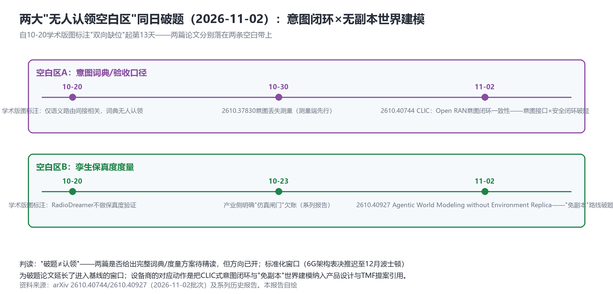

# 两大空白区同日破题：CLIC意图闭环与"免副本"世界建模——6G裁决推迟至12月，空芯光纤1007公里

> **分析对象**：2026年11月1日18:00—11月2日18:00窗口的公开增量——arXiv周一批量（两大空白区破题+记忆线第七篇+暗面新题）、3GPP马德里全会6G架构裁决推迟与MRSS基线、电信研究院千公里空芯光纤、金壮龙案、行情实测、OpenAlex通道测试。三视角来源清单第十二轮执行。
> **系列定位**：智能体技术洞察系列·ADN专题"新场景×新技术"系列的**完整报告第11篇**——本篇是系列10-20以来持续标注的两大"无人认领空白区"（意图词典/孪生保真度）的**破题日记录**。
> **判定依据**：重大增量——①**两大空白区同日破题**：2610.40744 CLIC（意图闭环安全）+2610.40927（无副本Agentic世界建模）②**6G架构表决推迟至12月波士顿**（标准化排期风险与窗口延长并存）③**千公里空芯光纤**（AI互联DCI下一代物理底座）④金壮龙案（级别最高治理事件）。
> **口径约定**：【首发】【重申】【反向】【待核实】沿用系列口径；两篇破题论文为预印本、"破题≠认领"（是否给出完整方案待精读）；"传移动80亿投DeepSeek"为传闻级（保留"传"标注）；行情为新浪实测。
> **术语消歧**：ADN指自动驾驶网络/自智网络；MRSS=多制式频谱共享（Multi-RAT Spectrum Sharing）；空芯光纤= Hollow-Core Fiber（光在空气芯中传输）。
> **立场**：设备商（ADN解决方案提供方）视角。

## 一、趋势判断

### 1.1 两大空白区同日破题：学术补位迟到13天，但终于到了【首发·学术·重点】

系列学术版图首期（10-27）标注的两个"双向缺位、无人认领"空白区，今日同日破题（见图1）：①**意图词典/验收口径带**——**2610.40744《CLIC: Closed-Loop Intent Consistency for Securing LLM-Driven Control in Open RAN》**：意图接口×安全闭环（意图在LLM驱动控制中的一致性校验），补上10-30意图丢失测量（2610.37830）之后的"闭环端"；②**孪生保真度带**——**2610.40927《Agentic World Modeling without Environment Replica》**：不做环境副本的智能体世界建模——对"保真度度量"问题的**免副本式另解**（与其验证副本像不像，不如让模型在无副本条件下自洽运行）。另有2610.42068《RAMA》情景记忆增强LEO卫星路由（记忆线第七篇）、2610.40961智能体敲竹杠（暗面第八类）。

*图1：两条空白带的时间线——10-20标注、10-30测量端先行、11-02闭环端破题（本报告自绘）*

**点评**：①"破题≠认领"——两篇是否构成完整词典/度量方案待精读，但**方向已开**：意图线的"测量（37830）→闭环（40744）"与保真度线的"世界模型（29382）→免副本（40927）"各自成对；②对设备商的直接动作：CLIC式意图闭环应进入意图引擎设计约束（与TR291M"解释即日志"并列），"免副本"路线则与孪生闸门互补——**闸门（有副本验证）与免副本（无副本自洽）可能构成孪生体系的两个分支**而非替代关系；③首发权窗口语义变化：从"无人认领"变为"刚刚有人进场"——后续三个月的跟进论文密度将决定方向归属。

### 1.2 6G架构裁决推迟至12月波士顿：窗口延长与排期风险并存【首发·标准】

3GPP马德里全会：5G→6G迁移架构**未达共识，关键表决推迟至12月波士顿全会**；**MRSS（多制式频谱共享）基本确立为技术基线**（5G/6G同频共存+复用5G低频/RAN潜力）；NGMN等呼吁收敛——6G-SA单主线+MRSS基线，**不再复制5G多Option教训**（NSA路径锁定/DSS痛点/碎片化）（[C114，2026-11-02](https://www.c114.com.cn/news/16/a1319953.html)，【首发·标准】）。**点评**：对ADN的直接含义——**"智能体通信/AI原生架构进6G基线"的确定性悬置一个月**：若12月波士顿按"单主线+MRSS"收敛，智能体通信作为赛道（移动四大赛道之一）进入基线的路径将更清晰（主线内）；若继续多Option，则AN相关特性可能被拆散到不同Option。**12月波士顿全会是下一个头号判定点**——与中老铁路"跨域L4"（现网）、A2A-T商用验证（2027）构成ADN标准化的三级时间表。

### 1.3 千公里空芯光纤：DCI下一代物理底座与Token TCO新变量【首发·硬件】

电信研究院联合长飞/中兴实现**全球首个千公里级空芯光纤双向实时传输**：1007.48km、单波800G、总容量128Tb/s、攻克GLA（全光拉曼放大）难题、三项世界纪录（[C114，2026-11-02](https://www.c114.com.cn/news/16/a1319947.html)，【首发·硬件】）。**点评**：①与王晓云"万卡DCI百T带宽"（10-26）精确对接——空芯光纤是AI互联DCI的下一代物理底座；②**"单位Token传输成本"（10-26提出）获得物理层新变量**：空芯光 transmission 时延约为石英芯的2/3、非线性损耗大幅降低——跨数据中心Token调用的时延与能耗成本曲线将被重画；③电信"适度超前建设AI基础设施"（财报语）有了实体注脚——运营商在DCI物理层的军备竞赛开启，设备商的光传输产品线（含空芯配套）需求确定性上升。

### 1.4 治理事件第三起与"Token经营"的标准表述化【首发·治理】

工信部原部长**金壮龙被开除党籍**（10-29五中全会公报确认，媒体11-02报道）——继杨小伟案、方力案后第三起、**级别最高**；同期媒体财报综述把"算力、**Token经营**、产业数字化新动能高增"作为标准表述（[C114，2026-11-02](https://www.c114.com.cn/news/15/a1319949.html)，【首发·治理】）。**点评**：①治理事件与"六张网"推进期重叠——**政策连续性扰动客观记录**（三部委协调的算力网落地节奏可能受人事调整影响，【推测待证】）；②"Token经营"进入媒体综述标准语汇=**五级渗透的第六站（媒体话语层）**——从财报到架构到标准到计费到终端再到公共话语，词元经济的语义场已完成全社会铺开。

### 1.5 行情与新周：溢价进入"平台期"，联通披露后最强一日【重申·市场】

电信**+0.43%收7.040**（披露后六日累计+2.92%，7元上方续创新高）；**联通+1.37%（披露后最强一日）**；移动+0.69%（新浪实测）。**点评**：三家全线上涨且联通领涨——成果账口径开始获得市场再定价（或与说明会预期博弈）；电信溢价进入"平台期缓涨"形态，与"利空出尽+政策出清"共识一致。**联通说明会第4天未定档**——18pp缺口拆解窗口继续缺位，若本周仍无则观察项升级。

### 1.6 汇聚点：新场景×新技术映射与"窗口期"结论

| 新场景/信号 | 靠什么技术兑现 | 关键技术 | 验证状态 |
|---|---|---|---|
| 意图空白区破题 | CLIC闭环一致性校验 | 意图接口×安全 | 首发·学术（11-02） |
| 保真度空白区破题 | 免副本世界建模 | 世界模型另解 | 首发·学术（11-02） |
| 6G基线裁决推迟 | MRSS基线+单主线收敛 | 6G-SA架构 | 首发·标准（11-02） |
| 空芯DCI | 1007km/128Tb/s/GLA | 空芯光纤 | 首发·硬件（11-02） |
| Token经营入媒体标准语汇 | 财报综述标准表述 | 词元经济·话语层 | 首发·话语（11-02） |

汇聚结论：**11-02是"窗口期"的一天**——标准化窗口（6G表决推迟一个月）、学术窗口（空白区刚刚进场）、物理窗口（空芯光纤重构DCI成本曲线）三个窗口同时变化。**窗口期对设备商的含义是"排期"而非"等待"**：12月波士顿前完成6G基线立场文件、三个月内跟进两篇破题论文的产品化评估、DCI空芯配套进入光传输路标——三件事并行。

## 二、技术诉求分析

### 2.1 诉求矩阵总表（系列八项诉求·今日锚点刷新）

| # | 技术诉求 | 今日触发锚点 | 落点 | 证据状态 |
|---|---|---|---|---|
| 1 | 意图可编译 | **CLIC意图闭环（2610.40744）** | 意图一致性校验 | **空白区破题** |
| 2 | 知识可治理 | （无新触发） | 记忆审计 | 待TR291M |
| 3 | 数据面换代 | **空芯光纤1007km（11-02）** | Token TCO物理层 | DCI底座变量 |
| 4 | 闭环可验证 | **免副本世界建模（2610.40927）** | 孪生两分支（闸门/免副本） | **空白区破题** |
| 5 | 智能体可互联 | RAMA情景记忆路由（LEO） | 记忆×路由交叉 | 第七篇延续 |
| 6 | 能力可复制 | （无新触发） | 行业底座 | 待MobileLink |
| 7 | 价值可记账 | Token经营入媒体标准语汇 | 话语层确认 | 第六站 |
| 8 | 监督可执行 | 智能体敲竹杠（2610.40961） | 攻击面第八类 | 治理清单+1 |

### 2.2 内在张力表

| 张力 | 表现 | 对设备商的后果 |
|---|---|---|
| 破题 vs 认领 | 两篇论文开方向 vs 完整方案待验证 | 三个月跟进期：既做精读评估，又防方向被他人占走——研究响应窗口很窄 |
| 窗口延长 vs 排期风险 | 6G表决推迟一个月 vs 波士顿裁决临近 | 12月前提交基线立场（智能体通信单主线内进基线）——立场文件立即成稿 |
| 空芯革命 vs 石英存量 | 空芯DCI前景 vs 已部署光纤资产 | 光传输路标双轨（空芯前瞻+石英增强）——避免路线押注单一化 |
| 治理扰动 vs 政策推进 | 金壮龙案 vs 六张网机制推进 | 政策连续性监测升级；对客户的关键人依赖度重新评估（KYC） |

## 三、关键技术分析（当期增量优先）

### 3.1 CLIC：意图一致性的"闭环端"【首发·学术·重点】

CLIC在Open RAN场景对LLM驱动的控制做**意图一致性闭环校验**（生成的控制动作是否仍满足原意图）——与意图丢失测量（2610.37830）构成"测量→校验"对。**点评**：这正是意图词典空白区的工程化入口：**一致性校验的前提是意图可形式化**——CLIC的实现方案（如何表征意图、如何定义"满足"）就是准词典。设备商动作：①精读CLIC的意图表征方式并与自家意图引擎（Co-Sight类）对照；②把"意图一致性校验"写进AN Copilot的验收测试（与"解释即日志"并列为第二约束）；③TMF知识平面提案引用CLIC作为意图治理的学术支点。

### 3.2 "免副本"世界建模：孪生体系的第二分支【首发·学术·重点】

2610.40927提出不做环境副本的智能体世界建模——挑战"数字孪生必须先建高保真副本"的前提。**点评**：与孪生闸门（有副本验证）的关系是**分支而非替代**：①闸门适用于高风险变更（副本验证是保险）；②免副本适用于副本不可得/过贵的场景（长尾网元、跨域环境）——两者组合成**孪生体系的分级验证策略**；③对10-23"孪生保真度欠账"的意义：免副本路线绕开了"保真度怎么度量"的一部分难题（不建副本则无需保真度刻度），但引入新问题（无副本的自洽性怎么验证）——**空白区不是被填上，而是被重新表述**。研究部门的精读重点：免副本的世界模型在ADN运维场景的失效边界。

### 3.3 空芯光纤与Token TCO的物理层【首发·硬件】

1007.48km双向实时+单波800G+128Tb/s——空芯光纤从实验室纪录进入工程可部署讨论。**点评**：Token TCO模型（10-26提出）的物理层参数更新：空芯的时延优势（约-30%）与低非线性使其在**跨DC同步训练/推理**（时延敏感）与**高功率传输**（能耗敏感）两个场景优先落地；设备商的光传输路标应加入"空芯就绪"节点（熔接/放大器/监测的空芯适配），并与运营商DCI规划（电信"适度超前"）对齐——**空芯可能成为"六张网"算力网互联段的首选介质**，标准窗口（CCSA/IEC）宜提前占位。

### 3.4 MRSS基线与6G裁决推迟的ADN含义【首发·标准】

MRSS确立为基线（5G/6G同频共存）意味着6G早期部署将大量复用5G低频——**AN特性（智能体通信/AI原生RAN）进入"单主线"的概率上升**，因为单主线减少Option数=特性进入基线的通道更集中。NGMN的"不复制多Option"呼吁与5G教训（NSA锁定/DSS）呼应。**点评**：12月波士顿全会前，设备商的6G立场文件应包含：①智能体通信作为6G-SA主线特性（而非独立Option）的论证；②MRSS与网元内生智能的协同（共享频谱的智能调度正是AI原生RAN的用武之地）；③与移动"四大赛道"口径的术语对齐。

## 四、总结思考

### 4.1 核心命题

11-02的三个窗口同时转动：**学术窗口**（两大空白区13天后破题——补位迟到但方向已开）、**标准窗口**（6G裁决推迟一个月——排期风险与收敛希望并存）、**物理窗口**（空芯光纤千公里——DCI成本曲线重画）。窗口期的共同特征是**"结果未定、时间变贵"**：破题论文的三个月跟进期、6G基线的12月截止、空芯的路标卡位——都要求设备商把"观察"升级为"排期"。系列自10-20以来的判断框架（五件套+定价体系+四口径）在这一天没有新增件，但每一件都获得了新的时间约束。

### 4.2 关键判断

1. **CLIC是意图词典的工程化入口**——意图一致性校验进入AN Copilot验收测试；TMF提案引用其学术支点。
2. **免副本与孪生闸门构成分级验证双分支**——"闸门（高风险）/免副本（长尾）"的组合策略写进孪生体系文档；失效边界是精读重点。
3. **12月波士顿是6G-ADN的下一个头号判定点**——智能体通信进基线的确定性在此裁决；立场文件11月内成稿。
4. **空芯光纤把Token TCO引入物理层竞争**——DCI互联段"空芯就绪"进入光传输路标；与"六张网"算力网规划对齐。
5. **"Token经营"完成话语层渗透（第六站）**——从财报到媒体标准语汇；对应设备商动作是"单位Token TCO"进入方案比选模板。
6. **联通说明会第4天未定档**——观察项维持，18pp缺口与业绩说明会的缺席本身正在成为信号。

### 4.3 对不同主体的启示

**运营商**：6G基线立场（单主线+MRSS）宜与"四大赛道"口径一致发声；空芯DCI试点可与"适度超前建设"财报叙事绑定；联通说明会定档宜尽快（市场已在用脚投票）。

**设备商**：三项排期——①6G基线立场文件（11月内，波士顿前）；②CLIC/免副本两篇破题论文的产品化评估（12月中前）；③光传输空芯路标节点（与CCSA标准窗口同步）。研究响应机制从"周报跟踪"升级为"破题即评估"。

**开发者**：意图一致性校验开源件（参照CLIC，面向Open RAN rApp场景）与免副本世界模型的失效边界基准测试是两个新空白点。

**标准组织**：TMF宜在知识平面立项文件中补引CLIC（意图治理学术支点）；CCSA空芯光纤标准组（若已设）宜与算力网互联需求对接；3GPP波士顿全会前的ADN特性立场协调宜在11月内完成（与移动四赛道口径对齐）。
