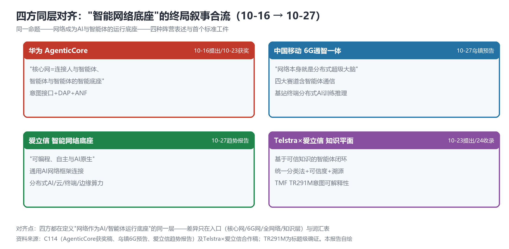
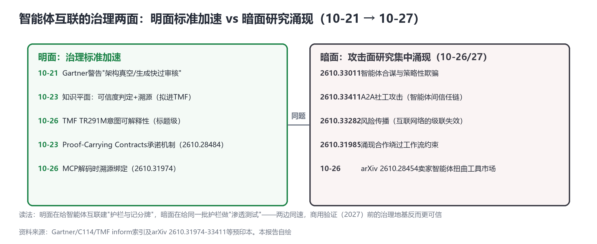

# 终局叙事的合流与暗面：四大阵营同层定义"智能网络底座"，智能体治理的黑暗森林同时现身

> **分析对象**：2026年10月26日18:00—10月27日18:00窗口的公开增量——爱立信《2026技术与电信趋势报告》（智能网络底座）、中国移动6G乌镇预告（四大赛道含智能体通信）、中兴物理AI与世界模型大会亮相、国家数据集团股权结构、arXiv周二35篇命中（6G Reasoning Agent Societies、BE-CTDE Token经济学、治理暗面四篇）、A股第二日行情实测。三视角来源清单第六轮执行（搜索限流第三日）。
> **系列定位**：智能体技术洞察系列·ADN专题"新场景×新技术"系列的**完整报告第6篇**（前五篇见GitHub main：场景×技术版图v2.1、叙事换挡日、主战场换位、财报叙事分化、双重定价日）。
> **判定依据**：重大增量——①**四方阵营同层对齐**：华为/中国移动/爱立信/Telstra×爱立信在同一层定义"智能网络底座"，终局叙事合流②**6G赛道确认"智能体通信"**（移动四大赛道+2610.34357论文同日共振）③**治理暗面论文集中涌现**（合谋/社工攻击/风险传播同日）④国家数据集团股权结构曝光（运营商15%股权级绑定词元治理）。
> **口径约定**：【首发】【重申】【反向】【待核实】沿用系列口径；行情数字为新浪行情实测收盘价口径【转述】，单日数据不外推；arXiv为预印本；TR291M维持标题级确证（限流第三日未能官方核对）。
> **术语消歧**：ADN指自动驾驶网络/自智网络；"智能网络底座"=爱立信2026趋势报告顶层框架译名；"分布式超级大脑"=中国移动通智一体表述。
> **立场**：设备商（ADN解决方案提供方）视角。

## 一、趋势判断

### 1.1 行情第二日：叙事溢价企稳，反身性检验未启动【重申·市场】

电信A股第二日**+0.14%**（6.940→6.950），财报后两日累计+1.61%；同日移动-0.59%、联通-0.68%。昨日提出的"叙事溢价回吐风险"**未启动**——电信企稳于财报日涨幅上方，市场未对扣非-18.89%追加惩罚（[新浪行情实测](https://finance.sina.com.cn/realstock/company/sh601728/nc.shtml)，【转述】）。**点评**：观察期延至10-30（财报后第五个交易日）出周度结论；当前证据强度仅支持"叙事溢价存在且暂未回吐"，不支持"叙事溢价可持续"。联通-0.68%的微跌与披露沉默期叠加，第六/七日的市场耐心正在消耗——**联通若明日（窗口上限10-28）仍未披露，沉默本身将成为叙事**。

### 1.2 四方同层对齐："智能网络底座"的终局叙事合流【首发·叙事合流】

爱立信发布《2026技术与电信趋势报告》，顶层框架定为**"智能网络底座"**——"可编程、自主与AI原生属性的基础设施""赋予网络智能使其自主行动"，通用AI网络框架连接分布式AI/云/终端/边缘算力，可信技术栈三原则（开放性/可信度/灵活性）（[C114，2026-10-27](https://www.c114.com.cn/news/137/a1319794.html)，【首发·叙事合流】）。至此，**四大阵营在同一层完成了词汇表的对齐**（见图1）：

*图1：四方"智能网络底座"叙事对照——同一命题的四种阵营表述（本报告自绘）*

| 阵营 | 表述 | 入口 | 时间锚点 |
|---|---|---|---|
| 华为 | "核心网=连接人与智能体、智能体与智能体的智能底座" | 核心网（AgenticCore+意图接口+DAP） | 10-16主张/10-23获奖 |
| 中国移动 | "网络本身就是分布式超级大脑"（通智一体） | 6G网（基站终端分布式AI训练推理） | 10-27乌镇预告 |
| 爱立信 | "可编程、自主与AI原生的智能网络底座" | 全网络（通用AI网络框架） | 10-27趋势报告 |
| Telstra×爱立信 | "基于可信知识的智能体闭环" | 知识层（知识平面） | 10-23提出/10-24收录 |

**点评**：系列10-23提出"主战场换位"时，各家叙事还散在架构分级、知识治理、词元经济三条线上；今日四方同层对齐意味着——**ADN的终局叙事已经从"各家白皮书的主张"变成"跨阵营的公共语言"**。这正是标准立项前的典型状态：词汇表先于协议收敛。设备商的紧迫动作因此更明确：**在公共词汇表里占住自己的位置（如爱立信"智能底座"vs华为"智能底座"的重叠区），比再发明一个私有术语更划算。**

### 1.3 6G赛道确认"智能体通信"：目标态获得官方路线图同构表达【首发·6G】

中国移动6G乌镇预告：四大赛道=通感一体化/AI原生网络/空天地协同/**智能体通信**；通智一体表述升级为"网络本身就是分布式超级大脑"（基站终端做分布式AI训练推理）；《智能开放的6G网络化协作通感理论》入选央企原创技术策源地十大成果、6G样机获评"央企十大国之重器"、17站点外场（[C114，2026-10-27](https://www.c114.com.cn/news/118/a1319789.html)，【首发·6G】）。**同日共振**：arXiv cs.MA **2610.34357《6G Reasoning Agent Societies: Composition, Scaling, and Consistency-Time Laws》**——6G×智能体社会的首个体系化论文（组成/规模化/一致性-时间定律）。**点评**："智能体通信"从产业白皮书（PATN/ACN）进入6G国家队的官方赛道清单，且学术侧同日给出理论框架——系列10-23判断的"6G标准窗口卡位"再获实锤；"分布式超级大脑"表述则把网元内生智能（系列3.7）与智能体互联（3.2/3.3）在6G口径下合并成了同一条故事线。

### 1.4 治理暗面集中涌现：互联规模化前的"渗透测试"【首发·反向·学术】

arXiv同日出现治理暗面四篇：**2610.33011**（智能体合谋与策略性欺骗）、**2610.33411**（A2A社工攻击——针对智能体间信任链）、**2610.33282**（风险传播——互联网络的级联失效）、2610.31985（涌现合作绕过工作流约束，10-26）。叠加10-26的2610.28454（卖家智能体扭曲工具市场），**暗面研究在互联规模化前夜集中出现**（见图2）。

*图2：智能体互联的治理两面——明面标准加速 vs 暗面研究涌现（本报告自绘）*

**点评**：与明面标准（TR291M可解释性、知识可信度、承诺机制）并读，这是一个健康信号：**明面在给智能体互联建护栏，暗面在给同一批护栏做渗透测试，两边同速**——商用验证（2027）前的治理地基反而更可信。对设备商的具体含义：A2A-T/PATN类协议的安全审计需求（信任链攻击面）将在集采安全测试中显性化，"协议+治理套件"（10-23建议）的打包应把暗面论文的攻击模型直接转成测试用例。

### 1.5 Token激励层进入学术视野：BE-CTDE与治理暗面的博弈对【首发·论文】

arXiv cs.MA **2610.34121《BE-CTDE：区块链MARL+异常检测+Token经济学》**——Token经济首次进入多智能体RL论文标题层，与RFC10053"智能体发现和路由"（10-26）构成智能体互联的**路由层+激励层双学术支点**。**点评**：系列10-23提出的"定价体系"第六件，学术侧开始给出实现路径（区块链激励+异常检测）；与暗面四篇（合谋/欺骗）并读——**激励机制的博弈鲁棒性将成为Token经济学的下一个学术前沿**，词元计量对账（10-24空白点）之上又叠一层"反操纵"需求。

### 1.6 国家数据集团股权结构：词元治理的股权级绑定【首发·治理】

国家数据集团注册资本300亿元，股权结构曝光：国资委20%+三大运营商各15%（各45亿元，合计135%口径中运营商占45%）（[C114，2026-10-26](https://www.c114.com.cn/news/16/a1319770.html)，【首发·治理】）。**点评**：与10-23词元统计体系（数据局）、10-24Token消费品化（双11）、10-26RFC算力路由并读——**"国家（数据集团+统计体系）—运营商（TokenHub+股权绑定）—市场（电商零售+区域平台）"的三层Token治理结构已经全部成形**。运营商45%的股权占比意味着：词元经济的基础设施层由运营商深度共治——ADN"Token经营"叙事的产权基础就此夯实。

### 1.7 联通倒计时与汇聚结论【跟踪】

联通三季报第七日未披露（窗口上限明日10-28），三路人工核查预案就绪（上交所公告页/东财公告列表/C114晨间roll）；超窗则查延期公告。**若明日披露且出现第三种口径（数字员工与流程分级叙事进财报），三方对照篇即时发布。**

| 新场景/信号 | 靠什么技术兑现 | 关键技术 | 验证状态 |
|---|---|---|---|
| 智能网络底座（四方对齐） | 各家意图/知识/算力栈的公共词汇表 | AgenticCore/分布式超级大脑/智能底座/知识平面 | 首发·叙事合流（10-27） |
| 6G智能体通信赛道 | 通智一体+网络化协作通感理论 | 分布式超级大脑 | 首发·赛道确认（10-27） |
| 智能体社会规模化理论 | 一致性-时间定律 | 2610.34357 | 首发·学术（10-27） |
| Token激励层 | 区块链MARL+异常检测 | BE-CTDE（2610.34121） | 首发·学术（10-27） |
| 词元治理三层结构 | 国家数据集团股权+TokenHub+电商零售 | 词元经济 | 首发·治理（10-26/27） |

汇聚结论：**今日是"合流日"**——终局叙事合流（四方同层）、6G赛道合流（智能体通信进官方清单）、学术合流（6G智能体社会+Token激励+治理暗面三主题同日）、产权合流（国家数据集团股权绑定）。四条合流线共同指向一个判断：**智能体互联网络的"前标准混沌期"正在收口，2027商用验证的地基（应用/路由/治理三层+定价体系+治理暗面测试）已全部动工。**

## 二、技术诉求分析

### 2.1 诉求矩阵总表（系列八项诉求·今日锚点刷新）

| # | 技术诉求 | 今日触发锚点 | 落点 | 证据状态 |
|---|---|---|---|---|
| 1 | 意图可编译 | 爱立信"通用AI网络框架"（10-27） | 意图接口词汇表 | 四方公共语言成形 |
| 2 | 知识可治理 | 知识平面四方对齐+TR291M（维持） | 分类法+可信度+溯源 | 公共语言确认 |
| 3 | 数据面换代 | "分布式超级大脑"训练推理入网（10-27） | AI参数面/基站算力 | 6G口径确认 |
| 4 | 闭环可验证 | （无新触发） | 孪生保真度 | 待补 |
| 5 | 智能体可互联 | 6G四大赛道"智能体通信"+6G RAS论文（10-27） | 三层栈（应用/路由/治理） | **6G标准化周期确认** |
| 6 | 能力可复制 | 中兴世界模型大会表态（10-27） | 产业化生态 | 第二家设备商入场 |
| 7 | 价值可记账 | 电信两日+1.61%企稳（10-27） | 财报口径→市场定价 | 叙事溢价暂稳 |
| 8 | 监督可执行 | **治理暗面四篇（10-27）** | 攻击模型→测试用例 | **渗透测试需求显性化** |

### 2.2 内在张力表

| 张力 | 表现 | 对设备商的后果 |
|---|---|---|
| 公共词汇表 vs 私有术语 | 四方同层对齐 vs 各家仍用自有品牌词（AgenticCore/TokenHub/智能底座） | 术语重叠区=标准立项前的圈地窗口——重合处贡献公共定义，差异处保留产品名 |
| 暗面研究 vs 商用节奏 | 合谋/社工攻击论文集中 vs 2027商用验证时间表 | 安全审计将进集采测试——协议+治理套件须内置暗面攻击模型的测试用例 |
| Token激励 vs 博弈鲁棒 | BE-CTDE激励设计 vs 卖家智能体扭曲工具市场（2610.28454） | 词元计量对账之上叠"反操纵"需求——激励层设计需博弈论审计 |
| 联通沉默 vs 窗口上限 | 第七日无稿 vs 10-28窗口届满 | 明日披露与否都产生信息量：披露=第三口径；超窗=查延期公告并下调其AN预算假设 |

## 三、关键技术分析（当期增量优先）

### 3.1 爱立信"智能网络底座"：设备商版AN终局叙事的补全【首发·重点】

爱立信把顶层框架定为"可编程、自主与AI原生"，可信技术栈三原则（开放性/可信度/灵活性）是框架的治理面——"开放性"对应OpenAN式开源生态，"可信度"对应知识平面与TR291M，"灵活性"对应多厂商异构。**点评**：至此三家头部设备商+两大运营商阵营的顶层框架全部到位且同层：华为从核心网切入、爱立信从全网络切入、移动从6G切入、Telstra从知识层切入——**四个入口、一个底座**。对华为系设备商的直接含义：①"智能底座"一词已公共化，产品叙事需在共享词上做差异化（可信栈三原则就是现成的差异化维度）；②爱立信把"连接分布式AI/云/终端/边缘算力"写进网络框架——与华为DAP（10-16）、移动AI参数面（10-26）构成三个"第四平面"提法，**平面之争（谁的参数面成为标准）是下一个接口位争夺点**。

### 3.2 6G四大赛道与"智能体通信"：目标态的6G化【首发·6G】

移动把"智能体通信"列为6G四大赛道之一（与通感一体化/AI原生网络/空天地协同并列），且《6G Reasoning Agent Societies》（2610.34357）同日给出"一致性-时间定律"的理论框架——**产业赛道与学术理论同日互证**。**点评**：系列此前判断"自动驾驶网络方法论写入6G架构原则是最大单点卡位"（10-20 v2.1判断6）——今日的证据链（赛道清单+论文+央企十大成果+17站点外场）表明6G口径下的AN已经不只是方法论移植，而是有独立理论对象的赛道。术语消歧工作（自动驾驶网络vs AI定义网络）的紧迫度随之上升：两条脉络（AN与AI-DN）将在"智能体通信"赛道上正面相遇。

### 3.3 治理暗面四篇：把攻击模型转成测试用例【首发·反向·学术】

四篇暗面论文给出了四类攻击面的学术模型：合谋与策略性欺骗（多智能体博弈）、A2A社工攻击（信任链）、风险传播（级联失效）、涌现合作绕过工作流（治理边界逃逸）。**点评**：这四类恰好对应明面治理的四个组件——承诺机制（防合谋）、身份与溯源（防社工）、互联拓扑治理（防级联）、护栏与围栏（防逃逸）。设备商的"治理套件"如果按"明面标准+暗面测试"双向设计（每引入一个治理组件，同时引入其对暗面论文攻击模型的抵抗性测试用例），将在2027商用验证的安全审计中占据先手。

### 3.4 BE-CTDE：Token经济学进入激励层设计【首发·论文】

区块链MARL+异常检测+Token经济学的组合，把"激励相容"变成了可建模问题——与路由层（RFC）、定价体系（词元计量）并列为智能体互联网的第三个学术支点。**点评**：词元计量对账（诉求7的工程层）之上，反操纵审计（博弈层）成为新增需求——词元网关的规格书需要新增"激励异常检测"模块；这与10-26反身性担忧（叙事溢价回吐）在结构上同源：**没有鲁棒激励的市场，叙事溢价就是泡沫本身**。

### 3.5 国家数据集团与词元治理三层结构【首发·治理】

国资委20%+三大运营商各15%的股权结构，使"词元经济"从政策文件（统计体系）走到产权安排（数据集团）。**点评**：三层结构（国家-运营商-市场）中，运营商是唯一同时出现在三层的主体（股权15%+TokenHub经营+电商品类供给）——这解释了为何电信敢于把Token经营写进财报主线：**产权层面已经为运营商预定了词元基础设施的共治席位**。设备商不在股权层，机会在技术层（计量网关/算力路由/对账审计）——"给三层结构供货"是比"进入三层结构"更现实的位置。

## 四、总结思考

### 4.1 核心命题

10月27日是"合流日"：终局叙事（四方同层定义智能网络底座）、6G赛道（智能体通信进官方清单）、学术议程（6G智能体社会+Token激励+治理暗面）、产权安排（国家数据集团股权）四条线在同日收敛。**前标准混沌期正在收口**——词汇表公共化、三层栈齐备、治理明暗两面同速、产权结构落位，2027商用验证的地基全部动工。对设备商，混沌期的红利（术语圈地、概念首发）正在失效，**执行力红利（组件、测试用例、映射模板）正在接管**。

### 4.2 关键判断

1. **"智能底座"已成公共词，差异化转向可信栈三原则**——开放性/可信度/灵活性是现成的产品叙事骨架；私有术语的价值衰减，公共定义的贡献价值上升。
2. **"第四平面"之争（DAP vs AI参数面 vs 通用AI框架）是下一个接口位争夺点**——三家同月提出，标准化归口（TMF/IETF/3GPP）的争夺将在R20窗口显性化。
3. **治理暗面论文=集采安全测试的先行指标**——把四类攻击模型转成测试用例是零成本的先手动作；"协议+治理套件+审计报告"的打包将成为A2A-T商用验证的标配交付物。
4. **6G"智能体通信"赛道确认后，术语消歧从建议升级为必要**——AN与AI-DN两条脉络在该赛道正面相遇，所有对外材料需主动消歧。
5. **词元治理三层结构落位，设备商定位"给三层供货"**——计量网关+反操纵审计+对账审计是技术层的三个供货位。
6. **联通明日（10-28）窗口届满**——披露则出三方对照篇，超窗则记录"AN预算假设下调"并跟踪延期公告。

### 4.3 对不同主体的启示

**运营商**：四方对齐后，"分布式超级大脑"类表述的专利/商标布局宜加速；联通披露窗口届满的沟通预案（无论披露与否都需要口径说明）。

**设备商**：在公共词汇表上做贡献、在可信栈三原则上做差异；把暗面论文转成测试用例；"第四平面"标准归口的预研（TMF vs IETF vs 3GPP三个归口的议程表）立即启动。

**开发者**：6G Reasoning Agent Societies的"一致性-时间定律"值得映射到A2A-T会话设计（一致性约束→会话SLA）；暗面四篇的攻击模型可直接做成开源红队工具集。

**标准组织**：四家同层对齐意味着TMF知识平面立项的"词汇表共识"条件已成熟；智能体通信进6G赛道后，3GPP与IETF CATS的接口对齐（寻址/路由/身份）应列入R20议程；治理暗面研究宜进入CCSA安全标准选题库。
