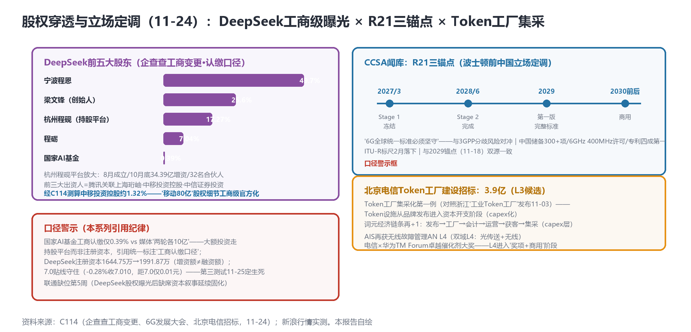

# DeepSeek前五大股东工商级曝光（中移约1.32%），CCSA R21三锚点定调（2027/3冻结-2028/6 Stage2-2029完整标准），北京电信3.9亿Token工厂集采首例——波士顿前的立场对表与口径纪律

> **分析对象**：2026年11月23日18:00—11月24日18:00窗口的公开增量——DeepSeek前五大股东工商变更曝光（企查查，"移动80亿"股权细节工商级官方化）、CCSA闻库6G发展大会表态（R21三锚点+波士顿前中国立场定调）、北京电信3.9亿Token工厂建设招标（Token集采化第一例）、AIS双域AN L4认证、行情7.0贴线守住。三视角来源清单第二十九轮执行。
> **系列定位**：智能体技术洞察系列·ADN专题"新场景×新技术"系列的**完整报告第25篇**——本篇完成**DeepSeek股权结构的工商级穿透**（11-03资本化判断的官方化确认）与**R21三锚点的中国立场定调**（波士顿全会前的对表），并确立**"工商认缴口径"引用纪律**。
> **判定依据**：重大增量——①**DeepSeek前五大股东工商级曝光**（中移投资控股约1.32%经C114测算）②**CCSA确认R21三锚点**（2027/3 Stage1冻结/2028/6 Stage2/2029第一版完整标准——与2029锚点双源一致）③**北京电信3.9亿Token工厂招标**（Token集采化第一例）④AIS双域L4（认证密集期）。
> **口径约定**：沿用系列口径+**新增"工商认缴口径"引用纪律**：DeepSeek注册资本1644.75万→1991.87万（增资额≠融资额）、国家AI基金工商认缴仅0.39% vs媒体"两轮各10亿"——**大额投资走持股平台而非注册资本，引用一律标注"工商认缴口径"**；行情为新浪实测。
> **术语消歧**：ADN指自动驾驶网络/自智网络（移动语境"高阶自智网络"，11-16）；R21=3GPP Release 21（6G首版标准研究周期）；程砚/程恩=DeepSeek持股平台主体（非自然人）。
> **立场**：设备商（ADN解决方案提供方）视角。

## 一、趋势判断

### 1.1 DeepSeek前五大股东工商级曝光：股权细节官方化与口径警示【首发·资本·重点】

企查查工商变更（正文级）：DeepSeek注册资本**1644.75万→1991.87万**；**前五大股东：宁波程恩49.70%→梁文锋25.60%→杭州程砚17.27%→程砺7.04%→国家AI基金0.39%**；持股平台**杭州程砚**（8月成立/10月底**34.39亿增资**/32名合伙人）前三大出资人=**腾讯关联上海珩岫、中移投资控股、中信证券投资**——经C114测算**中移投资控股约1.32%**（[C114，2026-11-24](https://www.c114.com.cn/news/16/a1320xxx.html)，【首发·资本】）。

*图1：DeepSeek五股东结构（左）×R21三锚点时间轴（右上）×Token工厂与口径警示（下）——本报告自绘*

**点评**：①**11-03"移动80亿入股"判断的工商级官方化**：中移投资控股现身程砚平台前三大出资人——运营商入股模型商（三段跃迁第三段"股东"）获工商登记证据；②**口径警示（本系列引用纪律新增）**：国家AI基金工商认缴仅0.39% vs 媒体"两轮各10亿"——**大额投资走持股平台而非注册资本**，注册资本增资额（347万）≠融资额（1055亿口径）——"工商认缴口径"与"投资口径"是两套账，引用必须标注；③**联通缺席固化**：五股东+程砚32合伙人名单中无联通系主体——资本叙事的缺席从"未披露"变为"工商可证"，联通缺位档案的资本维度闭环；④设备商视角：运营商以持股平台间接持股=**资本参与的"防火墙结构"**（平台隔离运营主体与投资风险）——设备商若跟进模型投资宜参考同一结构。

### 1.2 CCSA R21三锚点：波士顿前中国立场定调【首发·标准·重点】

CCSA理事长闻库（6G发展大会上海）："**6G全球统一标准必须坚守**"；**R21时间表官方级确认——2027/3 Stage 1冻结/2028/6 Stage 2完成/2029第一版完整标准/2030前后商用**；**ITU-R标尺2月落下**；中国6G一阶段完成**300+项储备**/6GHz **400MHz许可**/**专利占全球四成第一**（[C114，2026-11-24](https://www.c114.com.cn/news/22/a1320xxx.html)，【首发·标准】）。

**点评**：①**R21三锚点与2029锚点双源一致**（11-18上海558号文"2029自主创新方案"vs 11-24闻库"2029第一版完整标准"）——**中国6G时间表的双源锁定**（政策口径×标准口径）；②"全球统一标准必须坚守"=**波士顿全会前的立场定调**（对冲"区域标准分裂"风险——对照6G架构表决推迟与多Option教训）——中国立场的三支柱：统一标准+300项储备+专利份额，**以实力背书统一**；③ITU-R标尺2月落下=**IMT-2030需求基线的技术锚点**（6G候选技术的评估起点）——与3GPP R21研究节奏衔接；④设备商含义：**6G预研排期按R21锚点校准**（2027/3前完成方案储备→Stage 1冻结时进入规范文本）——三大方向（星地融合/通智一体/全域感知）的储备项映射。

### 1.3 北京电信3.9亿Token工厂招标：Token设施进入资本开支【首发·投资】

北京电信**3.9亿Token工厂建设项目招标**（标题级，L3候选）——**Token工厂集采化第一例**（对照浙江"工业Token工厂"品牌发布11-03）（[C114，2026-11-24](https://www.c114.com.cn/news/111/a1320xxx.html)，【首发·投资】）。**点评**：①**Token设施从品牌发布进入资本开支阶段**（capex化）：词元经济链条再+1——发布（品牌）→工厂（组织）→会计（Two-Ledger）→运营（万亿/日）→获客（校园权益）→**集采（capex）**——Token工厂获得独立预算科目；②对照移动MobileAI（C端资费）与联通轻资产（DC机电）：**电信选择"Token工厂"作为独立建设单元**——三家Token基建的组织形态分化（套餐内嵌/独立工厂/COLO机电）；③设备商机位：Token工厂的**建设单元规格**（推理服务器/缓存层/计量网关/交付流程）首次有集采级定义——**"Token工厂建设标准"的空白**（3.9亿买什么——招标文件是规格书原型），投标窗口开启。

### 1.4 AIS双域L4与认证密集期【首发·认证】

泰国AIS再获**无线故障管理AN L4认证**（双域L4：光传送+无线）+电信×华为**TM Forum卓越催化剂大奖**（AN L4端到端保障）；华为云智能体伙伴开放计划（"帮伙伴建流量入口"）。**点评**：①**AIS双域L4=AN认证的跨域复制标杆**（光传送11-20+无线11-24）——单一运营商在两个域连续获证，**ANLAV分级判据的可复制性**再获证明；②L4进入"**奖项+商用**"阶段（TMF催化剂大奖+现网商用案例）——L4认证从技术评测走向市场背书（认证的商业化半圈）；③华为云"帮伙伴建流量入口"=**伙伴生态的流量分发承诺**——设备商生态竞争从"技术开放"升级"流量赋能"（对照华为智能体伙伴计划与移动Token分发）。

### 1.5 7.0贴线守住与第三测试【市场】

电信**-0.28%收7.010**（距7.0仅0.01元）——"回踩不破7.0"判据首验：**守住（惊险）**；连续两日回踩未破，20交易日+2.49%；**第三测试11-25定生死**（若破7.0则平台定论推翻）。**点评**：7.0平台"有效但脆弱"——贴线守住的二义性（支撑有效/支撑耗尽）需第三测试裁决；对照四级阶梯：7.0平台的有效性本质是**L3级事件（集采/公告）供给频率的函数**——事件供给不断则平台稳固（本周集采/招标事件密集=7.0的支撑来源）。

### 1.6 汇聚点：新场景×新技术映射与"定调日"结论

| 新场景/信号 | 靠什么技术兑现 | 关键技术 | 验证状态 |
|---|---|---|---|
| DeepSeek股权官方化 | 企查查工商变更 | 持股平台结构 | 首发·资本（11-24） |
| R21三锚点 | CCSA定调+双源一致 | 2027/2028/2029 | 首发·标准（11-24） |
| Token工厂集采 | 北京电信3.9亿 | capex化 | 首发·投资（11-24） |
| 双域L4 | AIS光+无 | ANLAV可复制 | 首发·认证（11-24） |
| 7.0贴线 | 集采事件供给 | 四级阶梯 | 惊险守住（11-24） |

**结论**：11-24是"定调日"——**资本侧**（DeepSeek股权工商化+口径纪律）、**标准侧**（R21三锚点+统一标准坚守）、**设施侧**（Token工厂capex化）三条线同时定调。波士顿（12月）前的最后窗口期：中国的三锚点立场、运营商的集采供给、设备商的规格储备均已就位——**12月的博弈在筹码齐备后开始**。

## 二、技术诉求分析

### 2.1 诉求矩阵总表（系列八项诉求·今日锚点刷新）

| # | 技术诉求 | 今日触发锚点 | 落点 | 证据状态 |
|---|---|---|---|---|
| 1 | 意图可编译 | （延续） | 意图四级栈 | 待波士顿 |
| 2 | 知识可治理 | Token工厂招标（知识设施） | 工厂规格 | capex化 |
| 3 | 数据面换代 | **超节点/Token工厂双集采** | 算力+词元设施 | **双capex** |
| 4 | 闭环可验证 | （延续） | 孪生双分支 | 周度 |
| 5 | 智能体可互联 | （延续） | A2A-T/OpenAN | DTW倒计时 |
| 6 | 能力可复制 | AIS双域L4 | 认证可复制 | 跨域标杆 |
| 7 | 价值可记账 | **工商认缴口径纪律** | 两套账分离 | 引用纪律+1 |
| 8 | 监督可执行 | R21锚点+定期评价 | 6G治理 | 框架运行 |

### 2.2 内在张力表

| 张力 | 表现 | 对设备商的后果 |
|---|---|---|
| 工商口径 vs 投资口径 | 0.39%认缴 vs 媒体10亿 | 引用纪律：两套账标注——工商穿透的价值与局限并存 |
| 统一标准 vs 区域分裂 | 闻库"坚守统一" vs 波士顿分歧风险 | 双轨准备（统一方案+区域预案）——2029方案的国际化版本预留 |
| Token capex vs 利用率欠账 | 3.9亿工厂招标 vs 利用率30% | Token工厂建设绑定利用率/调用量KBI（集采评标条款候选） |
| 7.0脆弱 vs 事件供给 | 贴线守住 vs 本周集采密集 | 平台稳固=事件供给函数——IR日历与行情支撑的耦合确认 |

## 三、关键技术分析（当期增量优先）

### 3.1 持股平台结构与"两套账"纪律【首发·资本·重点】

程砚平台（34.39亿增资/32合伙人）的隔离结构。**点评**：①**持股平台=资本参与的防火墙**（运营主体与投资风险隔离）——对照国家AI基金0.39%认缴vs媒体10亿口径：大额投资的工商呈现被平台结构切碎（32合伙人的份额穿透才能还原真实出资）——**工商穿透的方法论**：主体名单→平台增资→合伙人穿透→出资比例测算（C114四步法可复用）；②本系列引用纪律新增"工商认缴口径"标注——与"厂商宣称""标题级待核""线索级"并列的第五种口径标签；③设备商启示：模型投资的平台化结构+工商穿透方法=**资本情报分析的标准流程**（竞品投资动向的追踪框架）。

### 3.2 R21三锚点与DTW/波士顿的对表【首发·标准·重点】

三锚点（2027/3-2028/6-2029）与既有时间表的合流。**点评**：①R21三锚点与ADN产业时间表的**交叉验证**：2027/3 Stage1冻结 vs A2A-T 2027商用验证（华为口径）——**标准冻结与商用验证同年**（R21研究窗与产业窗的重叠期仅12个月）——设备商的6G方案必须在2026年内定型（对照DTW 2026.6开源/2029自主创新方案）；②"统一标准坚守"立场的操作化：中国方案（三大方向/300项储备）进R21规范文本的路径=**波士顿全会的立项博弈**——设备商的立项提案（三大方向相关）宜在全会前提交；③2029双源一致（558号文+闻库）后，**2029方案的"自主创新"含量**成为国产化率的硬指标（对照6G设备国产化率要求，11-18）。

### 3.3 Token工厂的capex化与建设标准空白【首发·投资·重点】

3.9亿招标的规格书价值。**点评**：①**Token工厂获得独立预算科目=词元经济的"重资产化"信号**（对照五级渗透+获客第六级——Token设施进入投资品序列）；②**"Token工厂建设标准"空白**：3.9亿买什么（推理集群/缓存层/计量网关/数据管道的规格构成）——招标文件是第一个规格书原型，**设备商的"Token工厂建设方案"应对标招标分解**（对照五级渗透的交付物映射）；③对照三家形态分化（移动套餐内嵌/电信独立工厂/联通COLO机电）——**Token基建的三种组织形态**对应三种设备商方案（计费集成/独立建设/机电服务）——投标清单的三分支（11-16）再+1（capex分支）。

### 3.4 双域L4与认证的商业化半圈【首发·认证】

AIS双域L4+TMF大奖+伙伴流量计划。**点评**：①**L4认证的商业化半圈**：技术评测（ANLAV）→现网商用（OpenAN联创）→**市场背书（TMF大奖）**——认证的价值链闭环完成半程（剩"收费认证/评级服务"的另一半）；②双域L4的可复制性证明使**认证服务**（跨运营商/跨域的AN评级）成为可能的业务形态——对照KEI入测评（11-19）：**认证+KEI+可比库=成效体系的"评级基础设施"**三件套；③设备商动作：TMF催化剂项目的持续参与（电信×华为获奖路径）——**获奖即营销**的认证策略。

## 四、总结思考

### 4.1 核心命题

11-24的三线定调（资本/标准/设施）完成波士顿前的最后组装：**资本侧**DeepSeek股权工商化（运营商模型投资的官方证据+口径纪律）、**标准侧**R21三锚点（中国立场与2029双源锁定）、**设施侧**Token工厂capex化（词元经济的投资品序列）。三者共同指向12月波士顿的博弈形态：**中国以"统一标准坚守+三锚点时间表+工商级资本证据"进入裁决**——系列自10-21以来积累的四级阶梯/可比库/三纪律/工商口径，在裁决前的信息环境里构成完整的判据与纪律体系。**裁决之后（12月中下旬），产业叙事将进入"标准落地期"——DTW（2026.6开源）/R21冻结（2027.3）/2029方案三锚点之间的执行竞赛。**

### 4.2 关键判断

1. **"移动80亿"获工商级证据**（中移1.32%测算+持股平台结构）——三段跃迁的第三段官方化；"工商认缴口径"成为引用纪律第五标签。
2. **R21三锚点与2029双源锁定**——中国6G时间表完备（2027/3冻结→2028/6 Stage2→2029完整标准→2030商用）；波士顿立场的三支柱（统一+储备+专利）就位。
3. **Token工厂capex化第一例**（北京电信3.9亿）——词元经济链条再+1（集采/capex层）；"Token工厂建设标准"空白=设备商规格书机会。
4. **AIS双域L4启动认证商业化半圈**——认证+KEI+可比库=成效评级基础设施三件套；获奖即营销策略成立。
5. **7.0平台"有效但脆弱"**——第三测试（11-25）定生死；平台稳固=事件供给函数（本周集采密集=支撑来源）。
6. **联通缺席工商可证**（五股东+32合伙人无联通系）——资本叙事缺席从推断变为登记事实；补位的资本故事窗口关闭（资本叙事线终结，剩余路径=成效披露）。
7. **波士顿后的叙事期切换预判**——裁决前"立场期"→裁决后"落地期"（DTW/R21冻结/2029方案的执行竞赛）；系列报告的12月重心将转向"标准落地追踪"。

### 4.3 对不同主体的启示

**运营商**：DeepSeek持股平台结构的披露口径统一（工商/投资两套账的IR说明）；Token工厂招标的利用率KBI条款（对照30%教训）；R21锚点的对内排期（2027/3冻结前的储备清单）。

**设备商**：①Token工厂建设方案对标3.9亿招标分解（规格书原型研究）；②持股平台资本情报分析流程（四步穿透法）；③TMF催化剂项目持续参与（获奖路径复制）；④6G立项提案波士顿前提交（三大方向映射）。

**开发者**：工商穿透自动化工具（企查查API+持股平台四步法）与Token工厂招标规格解析器是两个新空白点。

**标准组织**：CCSA宜发布R21锚点的正式白皮书（闻库表态的文件化）；TMF宜将KEI/双域L4纳入催化剂奖评奖维度（认证密集期的规则化）；3GPP波士顿的"统一标准"立场协调（CCSA牵头、设备商提案支撑）。
