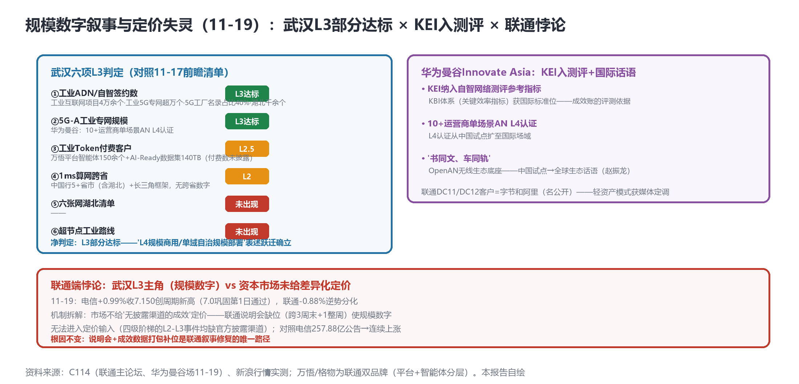

# 武汉L3部分达标（联通4万工业项目/万级专网规模数字），KEI入测评与"书同文车同轨"，DC客户名公开——联通端"叙事-定价传导失灵"悖论显影

> **分析对象**：2026年11月18日18:00—11月19日18:00窗口的公开增量——武汉5G+工业互联网大会L3判定（联通苗守野主论坛规模数字+华为曼谷场域）、KEI纳入自智网络测评参考指标、联通AIDC轻资产"生意经"正文级（DC客户名公开）、1ms城市算网中国行、行情7.0巩固第1日。三视角来源清单第二十四轮执行。
> **系列定位**：智能体技术洞察系列·ADN专题"新场景×新技术"系列的**完整报告第22篇**——本篇完成**武汉L3六项判定**（部分达标）并显影**联通端"叙事-定价传导失灵"悖论**（武汉L3主角却遭逆势分化）。
> **判定依据**：重大增量——①**武汉L3部分达标**（联通工业互联网项目4万余个/工业5G专网超万个/5G工厂名录占比40%——规模数字叙事）②**KEI正式纳入自智网络测评参考指标**（KBI体系的国际标准位）③**联通DC11/DC12客户名公开（字节和阿里）**④7.0巩固第1日通过（电信7.150创新高）。
> **口径约定**：【首发】【重申】【反向】【待核实】沿用系列口径；联通规模数字为主论坛发言口径（4万余个/超万个/40%/千余个——L3候选级，正式合同额未拆分）；行情为新浪实测；"132页新规"正文仍404（待核第2天，撤稿可能——不确定性悬挂）。
> **术语消歧**：ADN指自动驾驶网络/自智网络（注意移动语境"高阶自智网络"用法，11-16）；KEI=关键效率指标（Key Efficiency Indicators——KBI体系的国际测评表述）；格物/万悟=联通工业互联网双品牌（平台+智能体分层）。
> **立场**：设备商（ADN解决方案提供方）视角。

## 一、趋势判断

### 1.1 武汉L3部分达标：工业互联网进入规模数字叙事【首发·成效·重点】

武汉大会L3判定（对照11-17六项前瞻清单，图1左栏）：①**工业ADN/自智网络签约数——L3达标**：联通苗守野主论坛披露**工业互联网项目4万余个、工业5G专网超万个、2025年5G工厂名录占比40%、湖北落地千余个**（正文级，[C114，2026-11-19](https://www.c114.com.cn/news/16/a1320xxx.html)）；②**5G-A工业专网规模——L3达标**：华为曼谷场域**10+运营商单场景AN L4认证**；③工业Token付费客户——**L2.5**（联通万悟工业智能体平台上线智能体150余个+AI-Ready数据集140TB，**付费客户数未披露**）；④1ms算网跨省——**L2**（中国行5+省市+长三角协同框架，无跨省数字）；⑤六张网湖北清单/⑥超节点工业路线——**未出现**。净判定：**L3部分达标**（联通一家贡献规模数字，华为补充国际场域，移动/电信为L2表述）——**"L4规模商用/单域自治规模部署"的表述跃迁确立**。

*图1：武汉六项L3判定仪表（左）×KEI入测评与国际话语（右上）×联通悖论（下）——本报告自绘*

**点评**：①**工业互联网从"案例叙事"进入"规模数字叙事"**（4万项目/万级专网/40%占比——与"行业首个"时代的表述跃迁：第一个→规模N个）；②联通格物/万悟双品牌（平台+智能体分层）的架构表述首次完整——对照移动智能网三层（11-06）、中兴AIDN方案（11-09），工业互联网的平台化分层成为三家共同语言；③**跨家可比性受限**：联通贡献规模数字、华为贡献认证数、移动/电信为L2表述——**可比库的"披露不对称"问题**显影（同一大会、三家口径不一——可比库元数据规范（11-09）的现实必要性再+1）；④万悟"智能体150余个+数据集140TB"是**工业Token叙事的L2.5**：平台规模有了，付费数缺位——工业Token付费客户数是下一个L3判定点。

### 1.2 KEI入测评与"书同文、车同轨"：KBI体系的国际标准位【首发·标准·重点】

华为赵振龙（曼谷Innovate Asia）：**KEI（关键效率指标）正式纳入自智网络测评参考指标**；**10+运营商单场景AN L4认证**；**"共建无线OpenAN生态底座，实现智能体间'书同文、车同轨'"**（[C114，2026-11-19](https://www.c114.com.cn/news/22/a1320xxx.html)，【首发·标准】）。**点评**：①**KEI入测评=KBI体系的国际标准位确立**：系列自10-31（L4五项KPI）以来追踪的"成效账指标"，今日获得**国际测评体系的正式接纳**——成效披露从"自愿行为"变为"测评依据"，**指标披露的激励结构反转**（不披露=无法认证）；②"书同文、车同轨"（赵振龙引秦朝典故）=OpenAN国际化的文明级修辞——中国试点（河南/广东案例）→全球生态话语的路径显影（对照DTW 2026.6开源时间表）；③10+运营商L4认证=**AN认证的规模化信号**（对照中老铁路L4现网首例10-31）——L4认证从个案进入批次，ANLAV分级判据的商业价值兑现启动。

### 1.3 联通轻资产"生意经"与客户名公开【首发·投资】

联通AIDC轻资产模式正文级报道：**DC11/DC12服务客户=字节和阿里（客户名公开）**+轻资产逻辑完整版（资本开支压力/折旧风险/技术迭代风险三维论证）——媒体为联通模式定调（[C114，2026-11-19](https://www.c114.com.cn/news/16/a1320xxx.html)，【首发·投资】）。**点评**：①**客户名公开是L3披露的延伸**（11-14公告→11-19客户身份）——轻资产模式的信用结构显影：**头部互联网客户（字节/阿里）的长期合约=分成现金流的信用基础**——11-16"需求增速前提"判断获具体客户证据支撑；②媒体"生意经"定调=轻资产模式从公告进入商业叙事（对照11-03"股东"叙事、11-06产能语言）——联通叙事的第三个市场化文本；③风险面仍存：字节/阿里自建DC的竞争（客户自建vs租赁的边界）与132页新规（若证实）——**轻资产模式的监管与客户双重依赖**。

### 1.4 联通端定价失灵悖论：传导失灵的机制拆解【反向·悖论】

**悖论显影**：武汉L3主角是联通（规模数字），资本市场却未给联通差异化定价——11-19电信+0.99%收**7.150创周期新高**（7.0巩固第1日通过，17交易日+4.53%），**联通-0.88%逆势分化**。**点评**：①**传导失灵的机制**：四级阶梯（叙事/文档/采购/收入）的定价输入需要**官方披露渠道**——联通的规模数字发自主论坛发言（非公告/非说明会），**市场无法将"发言级数字"纳入定价模型**（可靠性折价）；对照电信257.88亿（集采公告→连续上涨）：**同是L3级数字，披露渠道决定定价资格**；②联通缺位（跨3周末+1整周）使L2-L4事件全部缺位——规模数字的"无渠道悬空"；③**根因不变**：说明会+成效数据打包补位是联通叙事修复的唯一路径——武汉主论坛数字若进入说明会正式披露，即从"发言级"升格"披露级"；④悖论的行业含义：**成效数字的价值=数字质量×披露渠道系数**——渠道系数为零时成效不可定价（联通案例的定价学教训）。

### 1.5 1ms中国行与算电年会【重申】

1ms城市算网中国行（南京/无锡/苏州）：王保平"**1ms算网=算力基建泛在智能确定性普惠化核心标志**""从标杆示范转向全域普及"；江苏"算力进车间进产线"；王晓云G-SRv6"AI时代互联网基础协议"（标题级）；华为AI-OTN"灵伴算网"；IDCC2026算电协同年会12-11北京（算电协同线的会议锚点）。**点评**：1ms算网从"江苏示范"进入"全域普及"叙事（对照11-19 L2判定——中国行5+省市）——**确定性网络的普惠化阶段**启动（对照20ms圈→1ms圈的时延阶梯，11-07）；算电协同年会（12-11）为该线定期的制度化节点。

### 1.6 汇聚点：新场景×新技术映射与"失灵悖论"结论

| 新场景/信号 | 靠什么技术兑现 | 关键技术 | 验证状态 |
|---|---|---|---|
| 工业互联网规模数字 | 联通4万项目/万级专网 | 格物/万悟双品牌 | L3达标（11-19） |
| AN L4国际认证 | 10+运营商单场景认证 | KEI/ANLAV | 首发·标准（11-19） |
| OpenAN国际话语 | "书同文车同轨" | 无线生态底座 | 首发·话语（11-19） |
| 轻资产客户公开 | 字节/阿里 | COLO+机电分成 | 首发·投资（11-19） |
| 联通定价失灵 | L3主角vs逆势分化 | 披露渠道系数 | 悖论显影（11-19） |

**结论**：11-19显影两个互补的事实：**工业互联网的规模数字叙事成立**（4万项目/万级专网/KEI入测评——成效体系的评测依据与产业数字同时到位），而**联通端的定价传导失灵**（渠道系数为零）。合成判断：**成效体系的"评测标准"（KEI）与"产业数字"（规模叙事）均已就绪，缺的只是"披露渠道"——联通案例证明渠道比数字更稀缺**。成效账竞赛的决胜变量由此清晰：不是谁数字好，而是**谁的数字能进入官方披露渠道**。

## 二、技术诉求分析

### 2.1 诉求矩阵总表（系列八项诉求·今日锚点刷新）

| # | 技术诉求 | 今日触发锚点 | 落点 | 证据状态 |
|---|---|---|---|---|
| 1 | 意图可编译 | （延续） | 意图栈 | 待波士顿 |
| 2 | 知识可治理 | 万悟AI-Ready数据集140TB | 工业知识资产 | 规模锚点 |
| 3 | 数据面换代 | 联通DC客户（字节/阿里） | 轻资产信用结构 | 客户公开 |
| 4 | 闭环可验证 | （延续） | 孪生双分支 | 周度 |
| 5 | 智能体可互联 | OpenAN"书同文车同轨" | 无线生态底座 | **国际话语** |
| 6 | 能力可复制 | 10+运营商L4认证 | 认证批次化 | 规模信号 |
| 7 | 价值可记账 | **披露渠道系数**（联通悖论） | 渠道>数字 | **悖论显影** |
| 8 | 监督可执行 | KEI入测评参考指标 | 成效评测依据 | **标准位确立** |

### 2.2 内在张力表

| 张力 | 表现 | 对设备商的后果 |
|---|---|---|
| 规模数字 vs 披露不对称 | 联通L3数字 vs 移动/电信L2表述 | 可比库"披露不对称"问题显影——跨家比较需渠道元数据 |
| KEI标准位 vs 披露激励 | 测评依据 vs 不披露无法认证 | 指标披露激励反转——客户选型将要求KEI披露 |
| 客户公开 vs 自建竞争 | 字节/阿里租赁 vs 头部自建DC | 轻资产模式的客户边界（租赁vs自建）决定天花板 |
| 数字悬空 vs 渠道缺位 | 联通规模数字 vs 说明会缺位 | "渠道系数为零时成效不可定价"——联通教训的行业化 |

## 三、关键技术分析（当期增量优先）

### 3.1 KEI入测评：成效账的国际标准位【首发·标准·重点】

KEI纳入自智网络测评参考指标的行业含义。**点评**：①KBI（系列10-21首提的成效指标族）→KEI（国际测评表述）→**测评参考指标**（正式接纳）——成效指标的"标准位"三级跳完成；②测评依据化改变披露激励：**运营商要拿L4认证就必须披露KEI**——联通/电信的说明会缺位与认证诉求将正面冲突（认证需要披露，缺位拒绝披露）——**认证压力可能反向撬开联通的披露缺位**（KEI认证 vs 缺位的两难）；③设备商动作：KEI测评的**工具链**（指标采集/口径校验/认证申报）是认证批次化后的服务空白——对照可比库元数据规范，KEI工具链与其共享元数据标准。

### 3.2 联通悖论的定价学拆解【首发·方法论】

"数字质量×披露渠道系数"公式。**点评**：①公式化：**可定价价值=f(数字质量, 渠道系数)**——联通数字质量高（4万项目）但渠道系数≈0（发言级，非公告/说明会）→可定价价值≈0；电信渠道系数=1（集采公告）→257.88亿全额定价；②渠道系数的分级（对照四级阶梯）：发言级0.2/通稿级0.4/公告级0.8/财报级1.0（经验参数，待校准）；③**行业化教训**：成效披露的"渠道规划"与数字本身同等重要——运营商IR部门需要"渠道阶梯"（发言→通稿→公告→财报）的披露排期表；④联通修复路径更新：武汉数字（4万项目）若进入11月末公告或12月说明会，渠道系数跳升——**存量数字的渠道化比新数字的产出更快**（数字已生产，只差渠道）。

### 3.3 "书同文、车同轨"：OpenAN国际化的文明修辞【首发·话语】

OpenAN无线生态底座的国际表述。**点评**：①文明典故的修辞选择（秦统一度量衡）暗示**协议统一的历史必然性叙事**——A2A-T/IoA的"统一文字（协议）与车轨（接口）"定位；②对照AIDN三方同名化的术语公地竞争（11-09/11-16）："书同文"正是术语竞争的解法叙事——**OpenAN/KEI/A2A-T是"书同文"的载体**（谁的标准被广泛引用，谁完成"同文"）；③设备商的国际话语参与位：OpenAN贡献（华为）与AAC席位（中兴/亚信）之外，**KEI测评工具链与可比库规范是下一批"同文"候选**——标准的"可测评性"（KEI先例）比"可描述性"更具传播力。

### 3.4 万悟平台与工业Token的L2.5缺口【首发·场景】

智能体150余个+数据集140TB，付费客户数未披露。**点评**：①L2.5的精确刻画：平台规模（供给端）达标、商业化（需求端）缺位——**工业Token的商业化验证是"平台→生意"的最后一公里**；②140TB AI-Ready数据集=**工业知识资产的量化锚点**（对照老师傅经验资产化，11-03；数据产权登记，11-03）——工业知识库的规模可测；③下一步判定点：万悟付费客户数/Token调用量（若披露即L3）——**工业Token的MobileAI时刻**（C端资费表对应物=工业Token价目表）是观察点。

## 四、总结思考

### 4.1 核心命题

11-19的武汉L3判定与联通悖论共同揭示：**成效体系的三大件（评测标准KEI/产业数字规模叙事/可比库规范）已全部就绪，唯一稀缺的是"披露渠道"**——联通以L3主角身份遭遇逆势分化，证明"数字质量×渠道系数"的定价公式；KEI入测评则把披露激励反转（不披露无法认证）——**渠道与认证的双重压力正在合拢，联通的缺位策略在两股力量的夹缝中难以持续**。武汉"一家独大"的披露不对称也提醒：跨家可比库需要渠道元数据——成效账竞赛的下一段是"渠道基建"（披露排期表+渠道阶梯）而非更多数字。

### 4.2 关键判断

1. **武汉L3部分达标确立**（联通规模数字+华为国际认证）——"L4规模商用"表述跃迁完成；工业Token付费客户数是下一个L3判定点。
2. **KEI入测评=成效账的国际标准位**——披露激励反转（认证需披露）；KEI工具链是认证批次化的服务空白。
3. **"渠道系数"公式确立**（数字质量×渠道系数=可定价价值）——联通悖论的行业化教训；发言级0.2/通稿0.4/公告0.8/财报1.0的分级参数待校准。
4. **联通存量数字的渠道化快于新数字产出**——武汉4万项目数字若入公告/说明会即升格；补位路径的时效性凸显。
5. **"书同文车同轨"叙事确立OpenAN国际化话语**——"可测评性"（KEI先例）是标准传播力的新维度。
6. **轻资产客户公开（字节/阿里）**——信用结构显影但客户自建竞争与监管（132页新规）双重依赖。
7. **"132页新规"撤稿可能使不确定性悬挂**——信息价值反升的异常状态，维持日检。

### 4.3 对不同主体的启示

**运营商**：联通案例的渠道教训行业化——规模数字应配"渠道阶梯"披露排期（发言→通稿→公告→财报）；KEI认证申报与披露缺位的两难宜尽早解（认证红利>披露成本）；万悟付费客户数宜择机披露（L3判定点）。

**设备商**：①KEI测评工具链（采集/校验/申报）立项；②可比库渠道元数据字段增补；③"书同文"叙事下的标准参与（KEI工具链/可比库规范=下一批同文候选）；④轻资产项目（联通类）的监管条款预留（132页新规核验后）。

**开发者**：KEI测评采集SDK与"渠道系数"追踪仪表盘（运营商披露排期监测）是两个新空白点。

**标准组织**：TMF宜将KEI正式纳入ANLAV认证判据（华为曼谷提议的标准化落位）；CCSA宜开"自智网络KEI测评规范"项目（中国KEI口径）；GSMA宜建立"披露渠道分级"指引（联通教训的行业化——IR与认证的衔接规范）。
