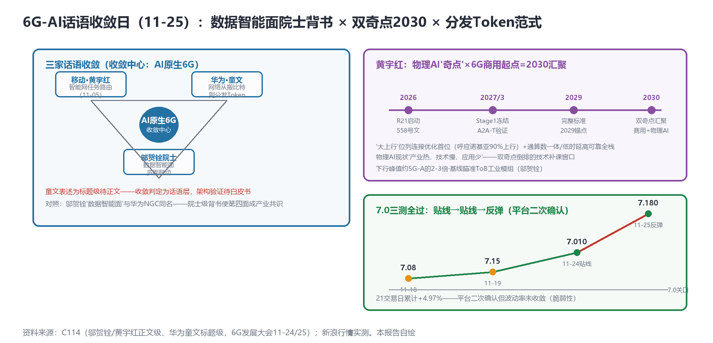

# 邬贺铨"数据智能面"院士背书，黄宇红"双奇点2030"（物理AI×6G），童文"分发Token"范式——6G-AI三家话语收敛日与7.0三测全过

> **分析对象**：2026年11月24日18:00—11月25日18:00窗口的公开增量——邬贺铨院士《6G对多场景的适应》（正文级）、移动黄宇红《6G筑基物理AI》（正文级）、华为童文"分发Token"表述（标题级）、6G发展大会院士群像、3GPP节奏确认、7.0第三测试。三视角来源清单第三十轮执行。
> **系列定位**：智能体技术洞察系列·ADN专题"新场景×新技术"系列的**完整报告第26篇**——本篇记录**6G-AI三家话语收敛**（移动任务路由/华为数据智能面/邬贺铨面联动/童文分发Token——收敛中心"AI原生6G"）与**双奇点2030**（物理AI×6G商用汇聚）的路线图确立。
> **判定依据**：重大增量——①**邬贺铨"数据智能面"院士级背书**（与华为NGC同名——第四面产业共识形成；"ToB是6G价值着力点"）②**黄宇红"双奇点2030"**（物理AI奇点×6G商用起点汇聚；"大上行"位列连接优化首位）③**童文"搬比特→分发Token"范式定义级表述**（标题级待正文）④**7.0三测全过**（贴线/贴线/反弹——平台二次确认）。
> **口径约定**：【首发】【重申】【反向】【待核实】沿用系列口径；**童文"分发Token"为标题级待正文**（对比AgenticCore有白皮书——验证风险如实标注）；行情为新浪实测。
> **术语消歧**：ADN指自动驾驶网络/自智网络（移动语境"高阶自智网络"，11-16）；"数据智能面"=核心网与用户面/控制面/管理面并列的第四面（华为NGC首提11-20、邬贺铨背书11-25）；"双奇点2030"=物理AI产业奇点与6G商用起点在2030年汇聚（黄宇红）。
> **立场**：设备商（ADN解决方案提供方）视角。

## 一、趋势判断

### 1.1 邬贺铨"数据智能面"：院士级背书与第四面产业共识【首发·政策·重点】

邬贺铨院士《6G对多场景的适应》（正文级）：**"ToB是6G价值着力点"**——六大场景仅沉浸式宽带面向ToC、其余五类主要ToB；**"管理面、控制面、用户面和数据智能面的多面联动"**——**"数据智能面"获院士级背书**（与华为NGC同名，11-20）；6G初期（2030-2033）ToC为5G迁移提质、**增长有限**；**下行峰值约5G-A的2-3倍、基线瞄准ToB工业模组**（[C114，2026-11-25](https://www.c114.com.cn/news/22/a1320xxx.html)，【首发·政策】）。

*图1：三家话语收敛三角（左）×双奇点2030时间轴（右上）×7.0三测（右下）——本报告自绘*

**点评**：①**"数据智能面"获院士级背书**——华为NGC（11-20）首提后仅5天，最高学术层以同名表述确认——**核心网第四面从"厂商主张"升格"产业共识"**（对照数据驱动网络/算力网络的历史：院士定调=产业动员令）；②**"ToB是6G价值着力点"=ADN商业逻辑的最高学术层确认**——六大场景五类ToB意味着6G的ADN价值主张（自智运维/确定性网络/智能体互联）是**ToB优先**——与"基线瞄准ToB工业模组"（非手机）呼应：**6G终端的第一批形态是工业模组**（对照机器人第六域/北京5万PFlops具身集群，11-11）——"6G+机器人模组"是设备商的6G终端卡位；③下行峰值2-3倍的量化（对照诺基亚Agentic 160倍流量学——流量学的院士级简化口径）。

### 1.2 黄宇红"双奇点2030"：物理AI×6G的路线图精确对齐【首发·路线·重点】

移动黄宇红《6G筑基物理AI》（正文级）：**"物理AI'奇点'与6G商用起点将在2030年汇聚"（双奇点2030）**；物理AI现状"**产业热、技术慢、应用少**"；**"大上行"位列连接优化首位**（与诺基亚90%上行呼应）+"通算数一体/大上行高并发/低时延高可靠"全栈清单（[C114，2026-11-25](https://www.c114.com.cn/news/22/a1320xxx.html)，【首发·路线】）。**点评**：①**双奇点2030与R21时间表精确对齐**（2030前后商用，11-24闻库）——"物理AI奇点=6G商用起点"的等式把第六域（机器人）的时间表与标准时间表**焊死在同一坐标**（对照北京5万PFlops具身集群11-11、CloudRobo开源11-16——物理AI三件套齐备+2030锚点）；②**"大上行"位列连接优化首位**——与诺基亚"物理AI 90%流量在上行链路"（11-10）构成**中外双源的上行叙事**——上行从配额变主战场（11-10判断）获运营商标准层确认；③"产业热、技术慢、应用少"的清醒判断=**双奇点倒排的技术补课窗口**（2026-2029是物理AI技术补课期——与世界模型开源（CloudRobo）/免副本路线（11-02）的技术供给赛跑）。

### 1.3 童文"分发Token"：范式定义级表述【首发·话语·待正文】

华为童文：网络要从"**搬比特**"走向"**分发Token**"（标题级待正文）。**点评**：①**6G网络范式定义级表述**——Token从商业模式（Token经营/五级渗透）升格为**6G网络的第一性定义**（网络的交付物从比特变为Token）；②**三家话语收敛成形**（图1左三角）：移动"智能网任务路由"（11-05）+华为"分发Token"（11-25）+邬贺铨"数据智能面多面联动"（11-25）——**三家（运营商/设备商/学界）在同一周内收敛于"AI原生6G"**（收敛中心）——话语收敛是标准收敛的先行指标（对照DTW 2026.6/波士顿12月的双峰窗口）；③**验证风险如实标注**：童文表述为标题级（正文待补，栏目枚举未命中）——对比AgenticCore有白皮书（11-20），"分发Token"的架构细节未出——**话语收敛的架构验证**待华为6G白皮书（若发布）；④"分发Token"与"任务路由"的语义差：移动强调任务（业务层）、华为强调Token（资源层）——**收敛的架构翻译**（任务路由的计量单元=分发Token的计费单元）是标准化的下一个对接点。

### 1.4 6G大会院士群像与3GPP节奏确认【重申·学术】

6G大会院士群像：毕奇（九大能力）、张文军（生成式交互视频）、Tony Quek（AI-RAN边缘大脑）、"**5G教训路径依赖**"评论（业界自省）；3GPP：**6G标准制定正按计划推进**（波士顿前官方节奏确认，与分歧风险并行）；诺基亚×英伟达AI-RAN"**2028频谱效率翻番**"（快于预期）；中信智网纳入国家算力互联互通体系。**点评**：①"5G教训路径依赖"的公开讨论=**6G设计的自省起点**（对照NGMN"不复制多Option"呼吁，11-02）——教训清单（NSA锁定/DSS痛点/碎片化）进入6G设计输入；②AI-RAN"2028频谱效率翻番"=**AI-RAN的量化承诺首现**（对照三大方向"通智一体"——通智一体的厂商级KPI）；③3GPP节奏确认=**分歧风险与节奏确认并行**（波士顿裁决的不确定性维持）。

### 1.5 7.0三测全过：平台二次确认与脆弱性并存【市场】

电信**+2.43%收7.180**——三测全过（7.08贴线/7.15贴线/7.18反弹），**平台二次确认**；21交易日累计**+4.97%**；电信独立走强（移动/联通滞涨）；**波动率未收敛**（[新浪实测]）。**点评**：①三测全过（定生死测试通过）=**7.0平台二次确认**——四级阶梯的行情判据经受三次考验（贴线×2+反弹）；②**波动率未收敛=脆弱性指标**（对照7.0"有效但脆弱"11-24）——平台的长期稳固需要**连续L3事件供给**（本周Token工厂招标3.9亿/AIS双域L4=支撑事件）；③电信独立走强=**事件供给的差异化定价**再确认（电信Token工厂/超节点事件密度最高）。

### 1.6 汇聚点：新场景×新技术映射与"收敛日"结论

| 新场景/信号 | 靠什么技术兑现 | 关键技术 | 验证状态 |
|---|---|---|---|
| 数据智能面共识 | 邬贺铨面联动+华为NGC | 第四面架构 | **院士背书**（11-25） |
| 双奇点2030 | 物理AI×6G商用 | 大上行首位 | 首发·路线（11-25） |
| 分发Token范式 | 童文表述 | Token第一性 | 首发·话语（待正文） |
| 6G ToB基线 | 六场景五ToB+工业模组 | ADN商业逻辑 | 院士确认（11-25） |
| 7.0三测全过 | L3事件供给 | 四级阶梯 | 二次确认（11-25） |

**结论**：11-25的"收敛日"三条线合流——**话语收敛**（三家收敛于AI原生6G）、**时间收敛**（双奇点2030焊死第六域与标准表）、**行情收敛**（7.0三测全过）——**6G-AI的产业叙事从"各自表述"进入"共同范式"**。收敛之后的竞争维度：谁把"共同范式"先翻译成"可交付架构"（华为AgenticCore已先行）——**范式收敛期=架构分化期的前夜**。

## 二、技术诉求分析

### 2.1 诉求矩阵总表（系列八项诉求·今日锚点刷新）

| # | 技术诉求 | 今日触发锚点 | 落点 | 证据状态 |
|---|---|---|---|---|
| 1 | 意图可编译 | **端网意图交互（NGC）×意图定义无线电** | 意图四级栈 | 架构+学术双落 |
| 2 | 知识可治理 | **数据智能面（院士背书）** | 核心网第四面 | 产业共识 |
| 3 | 数据面换代 | **分发Token范式（童文）** | Token第一性 | 话语级（待正文） |
| 4 | 闭环可验证 | （延续） | 孪生双分支 | 周度 |
| 5 | 智能体可互联 | 千亿智能体联接 | A2A-T/OpenAN | 架构目标 |
| 6 | 能力可复制 | 通智一体×三大方向储备 | R21映射 | 排期对齐 |
| 7 | 价值可记账 | 分发Token×任务路由对接 | 计量单元统一 | 对接点识别 |
| 8 | 监督可执行 | "5G教训路径依赖"自省 | 教训清单 | 设计输入 |

### 2.2 内在张力表

| 张力 | 表现 | 对设备商的后果 |
|---|---|---|
| 话语收敛 vs 架构分化 | 三家共同范式 vs AgenticCore先行先行者优势 | 范式收敛期=架构分化前夜——先出架构者定义事实标准 |
| 双奇点承诺 vs 技术补课 | 2030汇聚 vs "技术慢应用少" | 物理AI技术补课期（2026-2029）的投资窗口——世界模型/免副本的技术供给赛跑 |
| ToB基线 vs ToC惯性 | 五类场景ToB vs 6G终端想象 | 工业模组卡位（6G终端第一批形态）——机器人模组规格先行 |
| 波动率未收敛 vs 事件供给 | 7.0脆弱 vs 集采密集 | L3事件供给频率=平台稳固函数——IR日历与行情的耦合持续 |

## 三、关键技术分析（当期增量优先）

### 3.1 数据智能面的产业共识链【首发·架构·重点】

华为NGC（11-20）→邬贺铨（11-25）的背书链。**点评**：①**"第四面"共识的形成路径**：厂商白皮书（华为）→院士背书（邬贺铨）→（待）标准立项（CCSA/3GPP）——**第四面的"白皮书-院士-标准"三段确认**正在走完前两段——对照"数据驱动网络"的历史（概念期3年），本次共识周期5天——**AI原生架构的共识速度创纪录**；②第四面的技术内涵（对照11-20分析）：AI推理算力池/模型服务/数据管道的面级管理——**邬贺铨补充"多面联动"**（四面联动而非四面孤立）——联动机制（面间接口）是标准化的下一个议题；③设备商动作：数据智能面的**面间接口提案**（对照数据智能面白皮书预留的接口位）——联动协议的先手定义。

### 3.2 双奇点2030与物理AI补课路线【首发·路线·重点】

"产业热、技术慢、应用少"与2030倒排。**点评**：①物理AI三件套（CloudRobo开源/北京5万PFlops/蜂窝网联标准）+2030锚点=**第六域的完整路线图**（2026-2029技术补课→2030奇点汇聚）——**"技术慢"的自判意味着学术-工程供给的加速需求**（免副本/世界模型/记忆治理的技术供给密度需提升）；②"大上行"首位+诺基亚90%上行=**上行重构的全面立项**（5G-A超级上行→6G大上行高并发）——上行容量规划的主战场化（11-10）获得路线图地位；③设备商动作：**ToB工业模组**（6G终端第一批形态）的规格预研（对照机器人模组/工业模组的形态定义——大上行×低时延×边缘AI的三合一模组）。

### 3.3 "分发Token"范式的验证路径【首发·话语·待正文】

童文表述的架构验证三步。**点评**：①**验证路径**：标题级（现）→正文级（待补）→白皮书级（对照AgenticCore）——**范式表述的升级链**与四大阶梯（叙事/文档/采购/收入）同构（话语也有自己的L级）；②"搬比特→分发Token"的架构翻译：网络交付物=Token（对照比特）意味着**网络层内置Token计量与分发**（对照AIDN/任务路由/Token工厂——**分发Token是三者共同的架构抽象**）；③三家收敛的对接点：任务路由（业务层）×分发Token（资源层）×数据智能面（架构层）——**三层对接的协议设计**（任务-Token-面的映射协议）是标准化的收敛候选（3GPP波士顿/CCSA的议题）。

### 3.4 ToB着力点与ADN商业逻辑的院士确认【首发·政策】

六大场景五类ToB+基线瞄准工业模组。**点评**：①**ADN的6G商业逻辑获最高学术层确认**（自智运维/确定性网络/智能体互联全部是ToB场景）——ADN从"网络技术"定位升格"**6G价值实现路径**"定位；②ToB基线=**6G初期（2030-2033）的增长有限判断**——6G的ToB投资回收期较长（对照5G ToC教训"路径依赖"评论）——**投资纪律与利用率KBI的6G版**（对照GPU利用率30%教训）应在6G预算立项时前置；③设备商的6G ToB产品线：工业模组+ADN方案+确定性网络的**三合一6G ToB包**（对照移动MobileAI的C端包——ToB包的6G版）。

## 四、总结思考

### 4.1 核心命题

11-25的"收敛日"标志着**6G-AI从"各自表述"进入"共同范式"**：三家（运营商/设备商/学界）在一周内收敛于"AI原生6G"（任务路由/分发Token/数据智能面三表述同指），双奇点2030把第六域时间表与标准表焊死，ToB着力点为ADN商业逻辑背书。**范式收敛期=架构分化期的前夜**——共同范式（AI原生6G）的确立使"谁的架构先行"成为下一个竞争维度（华为AgenticCore已先行出牌）。系列26篇的观测框架在此刻的价值：**把"话语收敛"当作可追踪的过程**（话语也有L级阶梯——标题→正文→白皮书→标准），收敛的每一步都有锚点可查。

### 4.2 关键判断

1. **"数据智能面"获院士级背书**——第四面从厂商主张升格产业共识（共识周期5天创纪录）；"多面联动"是标准化的下一议题。
2. **双奇点2030焊死第六域与标准表**——物理AI技术补课窗口（2026-2029）明确；"大上行"首位=上行重构全面立项。
3. **"分发Token"是6G范式定义级表述**（待正文验证）——三家话语收敛于AI原生6G；任务-Token-面的三层对接协议是标准收敛候选。
4. **ToB着力点=ADN商业逻辑的最高学术确认**——6G终端第一批形态是工业模组（机器人模组卡位）；6G ToB包（工业模组+ADN+确定性网络）为设备商产品线。
5. **7.0三测全过但波动率未收敛**——平台二次确认与脆弱性并存；连续L3事件供给是平台稳固的充要条件。
6. **"5G教训路径依赖"进入6G设计自省**——教训清单（NSA/DSS/碎片化）作为设计输入；投资纪律与利用率KBI的6G版前置。
7. **范式收敛期=架构分化前夜**——AgenticCore先行者的优势窗口在波士顿前；竞品的架构出牌（中兴/爱立信核心网智能体）是观察点。

### 4.3 对不同主体的启示

**运营商**：双奇点2030的倒排投资计划（物理AI补课期2026-2029）；大上行重构的省级试点申报（八省试点框架）；"5G教训清单"进6G立项评审。

**设备商**：①数据智能面的面间接口提案（先手定义）；②ToB工业模组规格预研（6G终端第一批形态）；③"分发Token"架构细节跟踪（童文正文/华为6G白皮书）；④6G ToB三合一包的产品线定义。

**开发者**：第四面联动协议仿真器（四面架构沙盘）与ToB工业模组参考设计（大上行×边缘AI）是两个新空白点。

**标准组织**：3GPP波士顿宜吸收"数据智能面/分发Token/双奇点2030"三个中国表述进架构讨论（话语收敛的标准翻译）；CCSA宜开"数据智能面架构要求"研究项（院士背书的标准化落位）；NGMN宜更新"5G教训清单"为6G设计输入（自省的制度化）。
