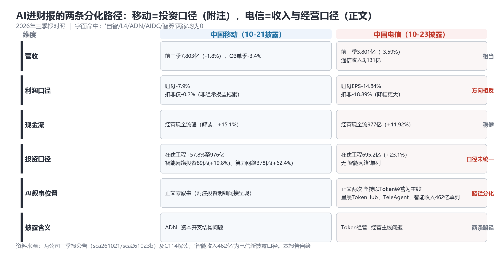
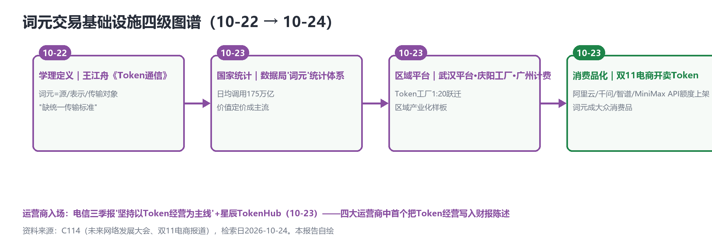

# 财报叙事分化：电信把"Token经营"写进三季报——AI进财报从个例变成两条路径

> **分析对象**：2026年10月23日18:00—10月24日18:00窗口的公开增量——中国电信三季报公告原文（sca261023b，10-23晚间披露，恰在昨日检索窗口截止后）及C114深度解读、UBBF 2026华为演讲（10-23）、双11电商Token销售报道、TM Forum inform索引、移动汽车AI基座发布。三视角来源清单第四轮执行。
> **系列定位**：智能体技术洞察系列·ADN专题"新场景×新技术"系列的**完整报告第4篇**（前三篇见GitHub main：场景×技术版图v2.1、叙事换挡日、主战场换位）。
> **判定依据**：重大增量——①**电信三季报把"坚持以Token经营为主线"写入正文、智能收入462亿单列**（三大运营商首个把Token/智能体写进三季报董事会陈述）②UBBF三个"R"提出ADN叙事升维与多个量化锚点③Token消费品化（双11电商开卖）④知识平面获TMF内容收录（离立项一步之遥）。
> **口径约定**：【首发】【重申】【反向】【待核实】沿用系列口径；"智能收入462亿"为电信本季新披露口径【转述】；电信扣非与表观EPS差异显著，引用财报数字必须注明口径（归母/扣非/可比）；arXiv为预印本。
> **术语消歧**：ADN指自动驾驶网络/自智网络（TM Forum AN L0-L5）；"词元"=Token官方译名；"TokenHub/TeleAgent"为中国电信星辰品牌下的Token运营平台与超级智能体。
> **立场**：设备商（ADN解决方案提供方）视角。

## 一、趋势判断

### 1.1 头号判定点落定：电信三季报——"Token经营"进正文主线【首发·口径】

中国电信三季报（10-23晚间公告，10-22董事会决议）：前三季营收3,801亿元（-3.59%）、主营3,593亿元（可比口径基本稳定）、**通信收入3,131亿元与智能收入462亿元分列（新披露口径）**；归母净利262亿元（表观EPS-14.84%）、**扣非前三季232.8亿元（-18.89%）、Q3单季-17.04%**；经营现金流977亿元（+11.92%）；在建工程695.2亿元（较年初+23.1%），无"智能网络"单列口径。**叙事核对与移动零叙事截然相反**：正文两次出现"**坚持以Token经营为主线**"，并点名"持续升级星辰TokenHub平台，Token日调用量高速增长""发布星辰超级智能体TeleAgent""五位一体智能云""智改"；字面零命中项两家一致（自智/L4/ADN/AIDC/智算）。

*图1：移动vs电信三季报六维对照——投资口径与收入口径的分化（本报告自绘）*

**"AI进财报"从个例变成两条分化路径**：移动把AI写进**投资口径**（附注在建工程明细——智能网络投资89亿+19.8%、算力网络378亿+62.4%，ADN是资本开支结构问题）；电信把AI写进**收入与经营口径**（正文主线+智能收入单列——Token经营是经营主线问题）。电信由此成为三大运营商中**首个把Token/智能体写进三季报董事会陈述**者。联通截至10-24仍未披露（历年窗口10/22-10/28，预计下周初）——若联通再提供第三种口径（其白皮书强项是数字员工与流程分级），"财报叙事光谱"将凑齐三个样本。

**引用纪律警示**：电信扣非降幅（-18.89%）大于表观（EPS-14.84%），与移动（归母-12.2%但扣非仅-0.2%）**方向相反**——"可比口径保持良好增长"的管理层表述与EPS-14.84%并存，A股周一反应是口径之争的市场裁决，引用时必须三口径并注。

### 1.2 系列主线的今日兑现："价值可记账"从断点变成口径竞赛

系列2.1诉求1/诉求7（价值可记账——"KBI↔财报科目对接"）连续四天走完了从断点、精化到分化的完整弧线：10-21移动"零叙事"（断点实证）→10-22"口径半开"（投入侧已进财报）→10-23"叙事换挡"（产业/学术五重验证）→**今日两条分化路径落定**。但仍要指出：**两家都没有披露"ADN成效"科目**——移动的智能网络投资是投入、电信的智能收入462亿是"智能业务"而非"自智网络成效"，诉求7的最终形态（KBI式成效进财报）依然缺位。第三种可能正在浮现：**成效侧单独披露**（如"智能体处置工单量/自动修复率"进入业绩说明会口径）——这是设备商财报映射模板的真正用武之地。

### 1.3 UBBF三个"R"：ADN叙事升维到"重建网络"【首发·锚点】

UBBF 2026华为演讲给出三个"R"：**Rebuild**（以AIDC为中心重建网络，"1-5-20"毫秒时延圈）；**Reshape**（多量纲专线——时延/抖动/丢包/算力分别计价，"卖网络+算力+模型/应用"一体化）；**Redefine**（规建营维优全生命周期智能化——家宽故障三级闭环：**智能体自动修复→NOC远程处置→Copilot辅助上门**；AI Wi-Fi体验+20%、节能-20%）。量化锚点：大模型参数从10万亿走向2030年**100万亿**、**Token消耗一年50倍**、智能体连续工作20小时+；电信16个百兆瓦级数据中心园区（全国最大AIDC服务商）、新八纵八横、800G骨干、中卫智算流量占全国10%（[C114，2026-10-23](https://www.c114.com.cn/news/126/a1319595.html)，【首发·锚点】）。**点评**：三级闭环是系列"孪生闸门"（变更域）与"技能资产"（工单域）主张的家庭级合并形态——"智能体先修、修不好远程、再不行上门"的分层SLA第一次被产品化表述；"Token消耗一年50倍"为Token经营的需求侧给出增速锚点。

### 1.4 词元消费品化：双11开卖Token——四级图谱成形【首发·场景】

阿里云/千问/智谱/MiniMax的API额度在双11电商平台上架销售（[C114，2026-10-23](https://www.c114.com.cn/news/16/a1319598.html)，【首发·场景】）。词元经济四级图谱就此闭合：**学理定义**（王江舟，10-22）→**国家统计**（数据局，10-23）→**区域平台**（武汉/庆阳/广州，10-23）→**消费品化**（电商渠道，10-23）。

*图2：词元交易设施四级递进——消费品化补齐最后一环（本报告自绘）*

**点评**：Token从"计费新维度"（王江舟）到"打折促销的消费品"只用了两天——供给过剩的信号与需求爆发的信号同时出现；对运营商Token经营（电信财报主线）而言，电商渠道证明词元零售的基础设施已经成熟，但**电信级SLA与消费级弹性供给的计费鸿沟**（可审计对账vs大促折扣）仍需要计量网关弥合——词元计量对账的空白点价值再+1。

### 1.5 智能体产业化出电信域：移动汽车行业AI基座【首发·场景】

中国移动发布业内首个汽车行业AI基座：112.7 EFLOPS、6大智能体覆盖4大领域、10余家车企落地（[C114，2026-10-23](https://www.c114.com.cn/news/100/a1319601.html)，【首发·场景】）。**点评**：行业智能体（观海类，10-14首发收入样本）之后的垂直深化样本——"6大智能体×4领域"的矩阵化交付与昨日报告3.6"模型+智能体+工具集"形态完全一致；智能体经济的下游（汽车）开始以运营商为基座供应商——ADN的"智能底座"叙事从核心网（AgenticCore）向行业底座横向复制。

### 1.6 知识平面获TMF内容收录：离立项一步之遥【重申·推进】

TM Forum inform已上线知识平面相关案例研究与特稿各一篇（标题经DDG索引确证，正文因反爬待人工核）（【待核实·进展】）。**点评**：从10-23"拟提交"到10-24"已有案例库内容"，TMF对知识平面的吸收速度异常快——可能部分内容系同期独立产出（Telstra是TMF AN项目深度参与者），但方向一致：**知识治理进TMF议程的概率已接近确定**，设备商的TMF知识分类法贡献窗口比预期更窄。

### 1.7 汇聚点：新场景×新技术映射与"口径竞赛"结论

| 新场景/信号 | 靠什么技术兑现 | 关键技术 | 验证状态 |
|---|---|---|---|
| Token经营进财报（电信） | 星辰TokenHub+词元计量对账 | 词元经济·统计体系 | 首发·财报口径（10-23） |
| 家宽故障三级闭环 | 智能体自动修复+NOC+Copilot分层 | 全生命周期智能化（Redefine） | 首发·产品化（UBBF，10-23） |
| 词元消费品化 | 电商API额度零售 | 词元经济·消费品化 | 首发·渠道（双11，10-23） |
| 汽车行业智能基座 | 6大智能体×4领域+112.7 EFLOPS | 行业AI基座 | 首发·场景（10-23） |
| 知识平面标准化 | 统一分类法+可信度+溯源 | 知识平面 | 推进·TMF收录（10-24） |

汇聚结论：**"价值可记账"之争已从"要不要"进入"谁家口径先被市场接受"**——移动押投资口径、电信押收入与经营口径，联通的第三票与周一A股的裁决都在路上。对设备商：财报映射模板必须同时备两版（投资口径版/收入口径版），并预研第三版（成效口径版，含智能体处置量/自动修复率等KBI级指标）——**谁帮运营商把口径做成模板，谁的KBI公式就随口径一起进财报。**

## 二、技术诉求分析

### 2.1 诉求矩阵总表（系列八项诉求·今日锚点刷新）

| # | 技术诉求 | 今日触发锚点 | 落点 | 证据状态 |
|---|---|---|---|---|
| 1 | 意图可编译 | 知识平面TMF收录推进（10-24） | 知识分类法草案 | 立项窗口收窄 |
| 2 | 知识可治理 | 同上 | 可信度分级+溯源交互 | 案例库已收录 |
| 3 | 数据面换代 | 词元消费品化（10-23）——词元计量需求侧倍增 | Token遥测/对账网关 | 渠道成熟、对账空白 |
| 4 | 闭环可验证 | 家宽三级闭环（10-23）——"自动修复率"成新KBI候选 | 分层SLA | 产品化表述首现 |
| 5 | 智能体可互联 | OpenAN周末暂停（10-24，正常节奏） | 东京F2F（12-11） | 连续三日后休整 |
| 6 | 能力可复制 | 移动汽车AI基座"6智能体×4领域"矩阵（10-23） | 行业基座交付形态 | 10余家车企落地 |
| 7 | 价值可记账 | **电信Token经营主线+智能收入462亿单列（10-23）** | 财报口径 | **两路径分化落定** |
| 8 | 监督可执行 | 扣非/表观/可比三口径分化（10-24） | 审计级对账 | 口径纪律警示 |

### 2.2 内在张力表

| 张力 | 表现 | 对设备商的后果 |
|---|---|---|
| 收入口径 vs 投资口径 | 电信正文主线（智能收入462亿） vs 移动附注明细（智能网络投资+19.8%） | 两套财报话术并行——映射模板必须双版本，联通披露后可能出第三套 |
| 表观EPS vs 可比口径 | 电信EPS-14.84% vs "可比口径良好增长"；扣非-18.89%与移动扣非-0.2%方向相反 | 引用纪律三口径并注；周一A股反应是口径之争的市场裁决——影响运营商ADN预算信心 |
| 消费品弹性 vs 电信级确定性 | 双11电商Token折扣零售 vs 电信级计费的可审计对账 | 词元计量网关（SLA对账/账单级审计）的空白点价值上升 |
| 成效披露仍缺位 | 两家口径都未含"ADN成效"科目（智能≠自智） | KBI↔财报对接的最终一跳仍无人完成——成效口径版映射模板是先发机会 |

## 三、关键技术分析（当期增量优先）

### 3.1 电信星辰TokenHub与"智能收入"新口径【首发·口径】

"以Token经营为主线"进入董事会陈述意味着：TokenHub从平台产品升格为**经营战略载体**；智能收入462亿单列意味着运营商财务报表开始为"智能业务"划出独立行——虽然口径仍宽（含云/智算服务），但**分列本身是KBI式成效披露的前置条件**。**点评**：系列此前建议的"财报映射模板"在电信这里已自发出现雏形——设备商应尽快把KBI-KEI-KCI公式层映射到"通信收入/智能收入"二分框架上，让"自智网络贡献"成为智能收入下的可见子项；星辰TokenHub的"Token日调用量高速增长"若在业绩说明会给出基数，将成为第二个可引用的调用锚点（第一是175万亿全国口径）。

### 3.2 UBBF三级故障闭环与全生命周期智能化【首发·锚点】

"智能体自动修复→NOC远程→Copilot上门"的分层设计有三个值得记下的工程含义：①**智能体处置率成为可量化新KPI**（第一级闭环占比即"自动修复率"——诉求4闭环可验证的天然度量）；②Copilot从"辅助人"降级为"兜底工具"——人机边界重新划定，与系列SkillHub篇"技能成为网络第四类资产"完全同构；③全生命周期（规建营维优）智能化=ADN从"运维域产品"升格为"网络生命周期方法论"。**点评**：三个"R"实质是把ADN叙事从"网优自动化"扩展到"以AI为中心重建网络"（Rebuild）——这与英伟达"电信网络→分布式智能平台"（10-23）是同一命题的厂商版与芯片版；设备商要在两版之间站稳，靠的正是Redefine层的运维闭环实证。

### 3.3 Token消费品化：渠道成熟与计费鸿沟并存【首发·场景】

电商API额度零售补齐词元经济第四级，同时把"词元计量对账"的工程需求推到台前：消费级（弹性折扣、无SLA）与电信级（可审计、账单级、SLA绑定）之间需要**计量网关**完成协议转换——这正是系列10-23判断的空白点，如今需求侧已经可视化。**点评**：设备商/运营商的词元计量网关若在2027年前形成事实标准（参考OpenAN registry模式），将同时卡住诉求3（数据面）与诉求7（价值记账）两条线。

### 3.4 移动汽车行业AI基座：智能底座横向复制【首发·场景】

112.7 EFLOPS+6大智能体×4领域+10余家车企——与观海（10-14）的"模型+智能体+工具集"形态一脉相承，但首次进入跨行业复制阶段。**点评**：行业AI基座与ADN的关系是"同一套智能体底座、不同垂直模板"——汽车行业样本验证了底座可复制性，也预示电信/政企/能源等行业模板将批量出现；设备商宜按"一行业一模板"评估自家智能体工厂（Co-Sight类[p30]）的行业适配成本。

### 3.5 来源体检：周末节奏与来源降权建议【负结果】

OpenAN连续三日推送后周末暂停（最后10-23 07:16Z，开源项目正常节奏）；arXiv周末无新submission；MSR/亚信无新条目；**6GWorld断更已超4个月**——建议每日清单中将其降权至"每周一查"。**点评**：来源清单的"活性体检"应纳入每周流程：连续断更>1月的来源降权，抓取失败率>50%的来源移入人工通道——本轮三视角清单首周即完成一次自然筛选。

## 四、总结思考

### 4.1 核心命题

**AI进财报的叙事竞赛正式开赛**：移动以投资口径入场（附注在建工程）、电信以收入与经营口径入场（正文Token经营主线+智能收入单列）——系列连续四天追踪的"价值可记账"诉求，从断点走到分化只用了四天。但真正的终点仍无人抵达：**"ADN成效"科目（自动修复率、智能体处置量、Token经营增收归因）还没有出现在任何一张三季报里**。联通的第三票、周一A股的裁决、业绩说明会的口径展开，将决定这场竞赛的下一个节点。

### 4.2 关键判断

1. **财报口径竞赛的赢家是"先被审计接受者"而非"先披露者"**——扣非/表观/可比三口径分化（电信-18.89%vs移动-0.2%）说明市场会惩罚口径模糊；设备商财报映射模板的审计兼容性比叙事华丽更重要。
2. **"智能收入"单列是KBI式成效披露的前置条件**——设备商应立即把KBI公式层映射到通信收入/智能收入二分框架，抢占"自智网络贡献"子项的定义权。
3. **家宽三级闭环确立"自动修复率"为新KPI候选**——分层SLA（智能体→NOC→上门）的分级度量将在集采条款中出现，仿真闸门之后第二个"门槛化"候选。
4. **词元经济四级图谱闭合，计量对账成为最短板**——消费品化渠道已成熟，电信级可审计对账仍是空白；词元计量网关是同时卡住数据面与价值记账两条线的枢纽组件。
5. **知识平面TMF立项窗口比预期更窄**——案例库已收录，贡献者窗口可能只有数周。
6. **联通披露是下一个头号判定点**（预计下周初）——三种口径凑齐后，"财报叙事光谱"将首次完整，届时宜出对照篇（与移动/电信并列的三方口径矩阵）。

### 4.3 对不同主体的启示

**运营商**：口径竞赛的教训是"审计兼容性优先"——披露智能收入时同步给出统计方法与归因边界，避免重演"可比口径"争议；"自动修复率"等成效KPI宜在业绩说明会先行试水。

**设备商**：财报映射模板三版本并行（投资/收入/成效口径）；KBI公式对齐"智能收入"子项；词元计量网关与"自动修复率"度量工具是两个立即可开工的组件；UBBF三个"R"说明客户叙事已升维——投标话术要从"降本自动化"切换到"生命周期智能化"。

**开发者**：词元对账SDK（SLA级审计日志→统计体系接口）与"自动修复率"评测断言（复用智枢杯赛题库）是两个可开源空白点。

**标准组织**：TMF宜在知识平面立项时同步吸纳"成效口径"议题（KBI↔财报对接是ANLAV认证的自然延伸）；CCSA可牵头"词元计量对账"与"智能收入统计口径"两个行业规范——国家统计体系已有总纲，行业层缺的只是执行细则。
