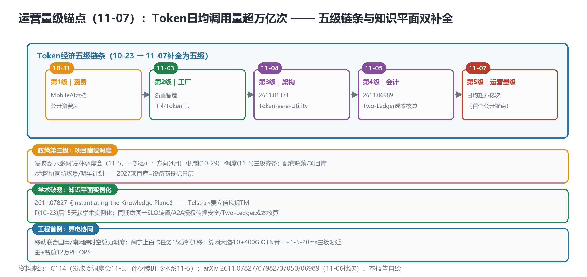

# Token日均调用量超万亿次（首个公开运营锚点），知识平面首篇实例化，六张网进入项目建设调度——五级链条与KP学术线双补全

> **分析对象**：2026年11月6日18:00—11月7日18:00窗口的公开增量——MobileLink收官日（孙少陵BITS全栈智算体系披露：Token日均超万亿/算电协同首例/算网大脑4.0）、发改委"六张网"项目建设总体调度会议（十部委）、arXiv周五批次13篇（知识平面首篇实例化+A2A安全+Two-Ledger成本会计）、兑现跟踪首查0/3。三视角来源清单第十七轮执行。
> **系列定位**：智能体技术洞察系列·ADN专题"新场景×新技术"系列的**完整报告第16篇**——本篇补全**Token经济五级链条**（运营量级锚点）与**知识平面学术实例化**双线，并见证六张网政策线进入第三级。
> **判定依据**：重大增量——①**Token日均调用量超万亿次**（首个公开运营量级锚点）②**2611.07827《Instantiating the Knowledge Plane》**（KP主线首篇实例化）③**发改委六张网项目建设总体调度会**（政策线第三级）④**算电协同首例**（国网/南网跨时空调度）。
> **口径约定**：【首发】【重申】【反向】【待核实】沿用系列口径；Token万亿为运营商高管公开发言口径（孙少陵，11-5 MobileLink）；AIDN消歧沿用11-06口径；兑现跟踪首查0/3为<48小时空窗（非证伪）。
> **术语消歧**：ADN指自动驾驶网络/自智网络；BITS=移动全栈智算体系（B算网大脑/I算力底座/T Token/S行业解决方案）；KP=知识平面（Knowledge Plane）；Two-Ledger=双账本成本核算模型。
> **立场**：设备商（ADN解决方案提供方）视角。

## 一、趋势判断

### 1.1 Token日均超万亿：首个公开运营量级锚点【首发·运营·重点】

孙少陵（MobileLink收官日）披露BITS全栈智算体系：**智算总规模12万PFLOPS、Token日均调用量超万亿次**（**首个公开运营量级锚点**）；智谱/DeepSeek/阿里**全量接入零日发布**；算网大脑4.0发布（[C114，2026-11-05](https://www.c114.com.cn/news/16/a1320092.html)，【首发·运营】）。**点评**：Token经济的**五级链条就此补全**（图1）：资费（MobileAI六档，10-31）→工厂（浙里智造，11-03）→架构（Token-as-a-Utility，11-04）→会计（Two-Ledger，2611.06989）→**运营量级（万亿/日，11-07）**——从价格表到调用量，词元经济完成了"可购买→可核算→可运营"的闭环。**万亿次/日的量级解读**：按MobileAI零售锚价（约2元/百万Token）粗算，万亿级日均对应**年化千亿元级调用量**（企业侧批发价更低、量级更大）——Token经营从"叙事"进入"可核算的运营资产"；"全量接入零日发布"=三大头部模型商对运营商分发渠道的**零日依赖**——分发层的卡位价值（11-03"股东+分发"判断）获运营数据支持。**设备商含义**：万亿级Token流量的承载网=分发层（AIDN/IoA/G-SRv6/空芯）的容量与确定性需求有实数支撑——**11-02空芯光纤、11-06 OISA的投入产出模型可首次用真实调用量校准**。

*图1：Token经济五级链条（10-23→11-07补全）×政策/学术/工程三块补全——本报告自绘*

### 1.2 知识平面学术实例化：产业概念15天获学术落地【首发·学术·重点】

arXiv周五批次（周六补扫13篇）：**2611.07827《Instantiating the Knowledge Plane》**——KP主线**首篇实例化论文**；同批**2611.07982**意图→SLO转译（意图接口量化层）、**2611.07050《A2A系统授权传播安全评估》**（A2A安全**首篇直接对标**）、**2611.06989《Two-Ledger Model》**多智能体交易粒度成本核算（Token成本会计，呼应Token-as-a-Utility）；暗面+2：调度器比例公平记忆攻击+签名不安全交接（arXiv，11-06批次，【首发·学术】）。**点评**：①Telstra×爱立信拟提TMF的知识平面（10-23）至今**15天获学术实例化**——产业概念→学术落地的速度创系列纪录（对照ACN：概念与产业同周共振），**知识平面从"提案"变成"可引用的技术对象"**；②Four-piece组合（实例化/SLO转译/授权安全/成本会计）恰好覆盖知识平面的运营闭环——**KP的学术栈一天内成形**（对照A2A-T学术栈三层用了三天）；③授权传播安全是A2A-T部署的**前置安全件**（权限随任务传播的风险——与42号文身份码、Airlock爆炸半径构成身份-权限-遏制链）；④暗面+2（调度器记忆攻击/签名交接）使治理测试用例清单增至**十二类**。

### 1.3 六张网第三级：项目建设总体调度【首发·政策】

发改委"六张网"重大项目建设**总体调度会议**（11-5，岳修虎副主任）：听取牵头部门+资金/土地要素部门汇报；**"抓紧出台配套政策、加快项目库建设和信息共享、支持'六网协同'新场景培育、研究制定明年工作计划"**；**十部委司局参加**（[C114，2026-11-06](https://www.c114.com.cn/news/7/a1320094.html)，【首发·政策】）。**点评**：六张网政策线**第三级**：方向（4月政治局）→机制（10-29座谈会：要素+财政金融）→**项目建设总体调度（11-5）**——从"开会"到"调度项目"，政策进入执行粒度；**"明年工作计划"=2027年项目库**——设备商的投标日历有了政策层输入（项目库清单发布即为投标启动信号）；"六网协同新场景培育"提示**跨网协同场景**（水网×算力网/物流网×通信网）将是项目库的增量方向——ADN的第六域（机器人）之后，"六网协同"可能是第七域的入口。

### 1.4 算电协同首例与BITS全栈【首发·工程】

移动联合国网/南网实现**跨时空算力调度**：闽宁（宁夏）上百卡任务**15分钟迁移**至低谷电价时段；八大枢纽5个G瓦级园区投产+中卫全国首个源网荷储园区；**全球首个400G OTN骨干+1-5-20ms三级时延圈**（【首发·工程】）。**点评**：①**算电协同**把"利用率期"（11-04）与能源维度接上——利用率的最优解不在算力侧而在**电力侧的时空套利**（低谷电价迁移），这为"利用率经营"产品线增加能源协同模块（电价预测×任务迁移调度——两级优化）；②1-5-20ms三级时延圈是**确定性网络的运营化表述**（与光电融合/确定性网络线直接对接）；③12万PFLOPS+5个G瓦级园区=Token万亿流量的物理底座——BITS四层（B/I/T/S）是11-06智能网"三网三层"的落地细节版（智能网=任务路由，BITS=算力供给侧的对应分层）。

### 1.5 兑现跟踪0/3与说明会第9天【反向】

兑现跟踪首查：**OISA伙伴/吉瓦园区开工/OpenAN复制省份均无披露（0/3）**——<48小时空窗属正常（发布会后白皮书挂网需数日），**非证伪**；下周一（11-9）起白皮书挂网+月度数据为观察点；若持续两周无兑现披露，11-06反弹（+4.22%）存在被重定价风险。联通说明会**第9天未定档**——下周一为"披露后10个交易日"整点锚点；arXiv监控规则修正（recent页扫至最新h3分组——周五13篇昨日漏扫已补）；TR291M第14日pending。

### 1.6 汇聚点：新场景×新技术映射与"双补全"结论

| 新场景/信号 | 靠什么技术兑现 | 关键技术 | 验证状态 |
|---|---|---|---|
| Token运营量级 | BITS全栈+全量接入 | 万亿/日锚点 | 首发·运营（11-07） |
| 知识平面实例化 | KP首篇+三件套 | KP学术栈成形 | 首发·学术（11-06批次） |
| 六网协同新场景 | 项目库+调度会 | 六张网第三级 | 首发·政策（11-05） |
| 算电协同 | 国网/南网跨时空调度 | 15分钟百卡迁移 | 首发·工程（11-05） |
| Token成本会计 | Two-Ledger | 交易粒度核算 | 首发·学术（11-06批次） |

汇聚结论：**11-07是"双补全日"**——Token经济补上运营量级（五级链条闭合），知识平面补上学术实例化（产业-学术双轨同频），六张网补上项目调度（政策三级齐备），算力补上电力维度（算电协同首例）。四个补全的共同指向：**智能体经济的"底座层"（算/电/网/知识/账）在一天内完成最后拼装**——底座已齐，下一阶段的竞争全部发生在"运营"（利用率/任务路由/成效KBI）层。

## 二、技术诉求分析

### 2.1 诉求矩阵总表（系列八项诉求·今日锚点刷新）

| # | 技术诉求 | 今日触发锚点 | 落点 | 证据状态 |
|---|---|---|---|---|
| 1 | 意图可编译 | 2611.07982意图→SLO转译 | 意图量化层 | 学术补位 |
| 2 | 知识可治理 | **2611.07827 KP实例化** | 知识平面学术栈 | **首篇落地** |
| 3 | 数据面换代 | **Token万亿/日（运营锚点）** | 分发层容量与确定性 | **实数支撑** |
| 4 | 闭环可验证 | StarWorld跨层（延续） | 跨层保真 | 学术延续 |
| 5 | 智能体可互联 | 2611.07050授权传播安全 | A2A权限链 | 安全前置件 |
| 6 | 能力可复制 | BITS四层（B/I/T/S） | 全栈复制模板 | 模板化 |
| 7 | 价值可记账 | **2611.06989 Two-Ledger** | 交易粒度成本会计 | **会计学补位** |
| 8 | 监督可执行 | 暗面+2（调度器记忆/签名交接） | 测试用例十二类 | 清单+2 |

### 2.2 内在张力表

| 张力 | 表现 | 对设备商的后果 |
|---|---|---|
| 运营量级 vs 兑现缺位 | Token万亿/日锚点 vs 兑现跟踪0/3 | 锚点来自存量（智算+模型接入），兑现看增量（OISA/园区/OpenAN）——锚点不能替代兑现，两者分开核对 |
| 知识双刃 | KP实例化 vs 调度器记忆攻击同批 | 知识/记忆是能力底座也是攻击面——KP部署必须内置记忆审计（四联→十二类） |
| 算电套利 vs 绿电约束 | 低谷电价迁移 vs 源网荷储园区绿电优先 | 调度算法双目标（成本+绿电占比）——中卫模式是约束版标杆 |
| 政策项目库 vs 投标日历 | 六网协同新场景培育 vs 设备商产品线排期 | 项目库清单发布=投标启动信号——"六网协同"场景预研提前布局 |

## 三、关键技术分析（当期增量优先）

### 3.1 万亿锚点与产能三指标的校准【首发·运营·重点】

Token日均超万亿次为11-06"产能三指标"（Token产能/智能体工时/知识资产收益率）提供了**第一个可校准的真实数据点**。**点评**：①Token产能的运营口径成立（万亿/日=移动全量智算+模型分发的合计吞吐）；②设备商的ADN方案可据此建立**产能换算表**（每G瓦时电力/每PFLOPS算力/每公里空芯光缆→日均Token供给量）——把基础设施参数换算为智能经济产能，是"智能经济报价语言"（11-05）的量化工具；③对照联通万亿级（-36.2%投入约束）与电信千亿指引：**运营量级锚点应成为三家财报"成效账"的首个行业基准**——建议系列后续核对各家Token调用量披露（成效账的第一行）。

### 3.2 KP学术栈与知识资产四件套【首发·学术·重点】

2611.07827（实例化）+2611.07982（意图→SLO）+2611.07050（授权传播）+2611.06989（Two-Ledger）四篇构成KP运营闭环。**点评**：①**实例化论文回答了KP"长什么样"**（数据结构/接口/部署形态——精读重点）；②Two-Ledger（交易粒度成本核算）与Token-as-a-Utility组合，**词元会计学成立**：Token计量（网关）→Token会计（双账本）→Token审计（治理）——词元经济的财务三件套齐备，个人粒度（MobileAI）/企业粒度/交易粒度三层计量的规格书可直接引用；③授权传播安全是A2A-T**部署前必答题**（权限随任务链传播的失控风险——与42号文身份码衔接：身份码校验×授权传播评估×爆炸半径遏制=互联安全三闸）。设备商动作：KP实例化论文精读+TMF提案引用+A2A-T安全附件吸收授权传播评估方法。

### 3.3 算电协同：利用率期的能源解【首发·工程】

15分钟百卡跨省迁移（闽宁）证明**任务级算力调度的电力时空套利**可行。**点评**：①利用率经营（11-04提出）的完整解=**算力调度×电力调度双域优化**：电价预测（分时/跨省价差）→任务迁移窗口规划→网络确定性保障（1-5-20ms时延圈是迁移可行性的网络前提）——**确定性网络从"性能卖点"变成"算电协同的使能条件"**（设备商的光传输/OTN方案应绑定电价套利ROI模型报价）；②中卫"源网荷储"园区=绿电约束下的利用率样本（绿电占比与算力利用率的联合优化——政策"跟风扎堆"警示的最优回应是"绿电+高利用率"双指标）；③"六网协同"（1.3）中的算力网×电网协同正是算电协同的项目化入口——2027项目库的高概率条目。

### 3.4 暗面十二类与记忆攻击的调度器变体【首发·学术】

调度器比例公平记忆攻击（公平算法的记忆注入变体）+签名不安全交接（A2A-T会话交接的签名缺陷）——攻击面随互联架构演进而**结构性增长**（每新增一个系统环节新增1-2类攻击）。**点评**：治理测试用例十二类的增长曲线提示：**治理不是一次性合规而是跟随架构的持续工程**——互联协议每次升级（A2A-T→IoA→跨域L4）都应附攻击面增量评估；签名交接缺陷直指A2A-T会话机制的实现安全——**OpenAN贡献者的安全测试用例提交**是高杠杆动作（1.3OpenAN策略的第四级：贡献安全用例）。

## 四、总结思考

### 4.1 核心命题

11-07的四项补全画出同一幅底座图：**Token有了运营量级（万亿/日）、知识有了学术实例（KP栈）、政策有了项目调度（三级齐备）、算力有了电力维度（算电协同）**——智能体经济的底座层（算/电/网/知识/账）在MobileLink收官日完成最后拼装。系列16篇的追踪至此可以给出一个阶段性判词：**ADN目标态从"愿景"到"底座"的建设期基本完成（10-20→11-07），下一阶段的全部竞争发生在运营层**——利用率（算电协同）、任务路由（智能网）、成效披露（KBI/说明会）、知识治理（KP+登记）是四个可预期的战场。联通说明会第9天缺位与兑现跟踪0/3是底座齐备后的两个"运营欠账"——它们将在下周一（10交易日锚点、白皮书挂网观察点）迎来第一次集中检验。

### 4.2 关键判断

1. **Token万亿/日是成效账的第一个行业基准**——三家Token调用量披露应成为后续财报核对的新增行；产能换算表（电力/算力/光缆→Token产能）是设备商报价的量化工具。
2. **KP学术栈一天成形（四篇）**——产业提案→学术实例仅15天；TMF提案宜引用2611.07827并吸收Two-Ledger为词元会计参考模型。
3. **六张网三级齐备，2027项目库是投标日历**——"六网协同新场景"是第七域入口；算力网×电网协同为高概率条目。
4. **算电协同使确定性网络成为使能条件**——光传输/OTN方案绑定电价套利ROI模型；中卫"绿电+高利用率"双指标是政策警示的最优回应。
5. **授权传播评估是A2A-T部署前置件**——身份码×授权评估×爆炸半径=互联安全三闸；OpenAN贡献升级至安全用例级。
6. **兑现跟踪0/3与说明会第9天是运营欠账**——下周一双锚点（10交易日+白皮书挂网）检验；持续缺位则11-06反弹面临重定价。

### 4.3 对不同主体的启示

**运营商**：Token调用量宜进入定期披露（万亿/日已公开，月度环比是成效账首行）；算电协同扩省复制（闽宁→多枢纽）宜配节省金额KPI；联通说明会下周一整点锚点前定档为宜。

**设备商**：①产能换算表+电价套利ROI模型进入报价模板；②KP实例化精读+TMF提案引用+Two-Ledger吸收；③互联安全三闸（身份/授权/遏制）进入A2A-T方案基线；④六网协同场景预研（算力×电力/物流×通信）对准2027项目库。

**开发者**：Token产能监测面板（对接运营商披露口径）与KP实例化复刻（2611.07827复现）是两个新空白点；Two-Ledger核算SDK（交易粒度）可开源。

**标准组织**：TMF知识平面立项文件正式引用2611.07827实例化与2611.07050授权安全（学术-标准互证）；CCSA"智能收入统计口径"规范增加"Token调用量"统计项；3GPP波士顿立场吸收"算电协同"（6G-SA能耗KPI）。
