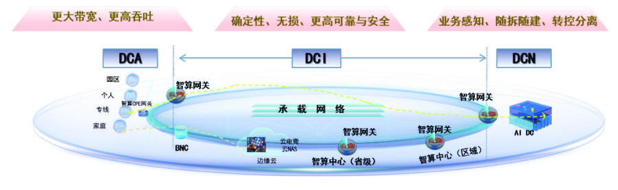
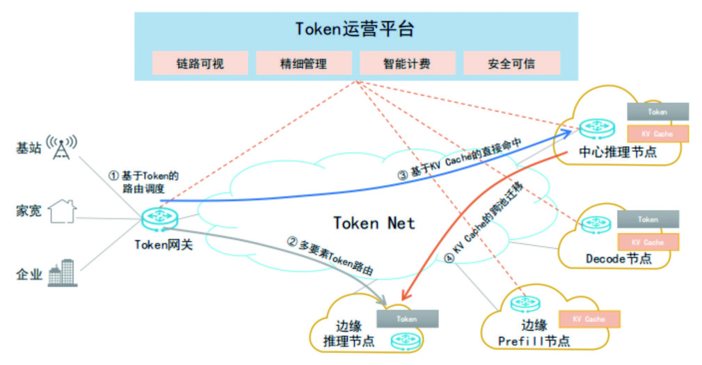

# 以Token运营为核心驱动力的原生智网——Token Net

> **分析对象**：《通信世界》2026年第7期 专题"Token变革"，第12–15页（中国联通 唐雄燕、韩梦瑶、庞冉、曹畅）
> **主题概述**：AI产业从训练主导转向推理主导，Token调用量两年增长超千倍，网络从"信息管道"演变为连接分布式Token服务的"神经中枢"。原文给出中国联通 **Token Net** 技术体系与可运营的 **Token分发网络（TDN）**，主张以"算网存"协同支撑Token规模化生产、分发与治理，完成商业模式从"卖流量"到"卖Token"的体系化重构。本报告在通读原文与同期专题的基础上，给出独立的趋势判断、技术点评与战略思考。

---

## 一、趋势判断

### 1.1 产业重心转移：从"训练主导"到"推理主导"，算力消费从建设侧转向运营侧
AI产业正经历从训练主导向推理主导的历史性转变。随着《国务院关于深入实施"人工智能+"行动的意见》与三部门《智能体规范应用与创新发展实施意见》落地，AI能力释放"不再依赖单点算力的突破，转而寻求多个算力节点间的高效协同"。这意味着：
- **竞争焦点从"单点算力规模"转向"协同效率"**——谁能把分布式算力组织起来，谁就掌握智能服务供给权；
- 智能体成为核心应用形态，推动生产力要素从"算力"向"智力"跃迁。

### 1.2 Token升维：从技术计量单位到"数字燃料"与"通用货币"
Token已从技术术语演变为**全新的价值度量和交换体系**——衡量与调度AI计算能力的核心单元、"数字燃料"与智能经济的"通用货币"；数据、服务、资产"Token化"后可实现开放调用和实时交易，计量交易模式正"从'算力券'向Token交易转变"。这是全文最具战略纵深的判断：**计费与结算的原子单位正在从"比特/流量"迁移到"Token/智能"**。

### 1.3 增长曲线：日均Token调用量两年增长超1000倍
关键数据：日均Token调用量从2024年初的1000亿增长至2026年3月的140万亿，**增长超过1000倍**。这一量级跃迁不是流量增长的重演——流量的增长是"用户数×时长"的线性增长，而Token增长是"智能体规模 × 多轮调用 × 长上下文"的乘数级增长（结合产业公开数据，智能体单次任务周期的Token消耗可达百万量级）。基础设施必须按"千倍级"而非"百倍级"冗余来规划。

### 1.4 基础设施范式跃迁：宽带联网 → 弹性云网 → 智能算网 → 原生智网
四阶段演进脉络清晰可辨：

| 阶段 | 核心范式 | 代表技术 |
|---|---|---|
| 宽带联网 | 连通性优先，"尽力而为"分组交换 | 传统IP网络 |
| 弹性云网 | 业务感知、差异化服务 | "IPv6+"（SRv6、网络切片、随流检测） |
| 智能算网 | 算力使能网络 | AI WAN（广域RDMA无损传输、流级精准控制：数百千米跨域计算性能损失<5%，200km+拉远训练效率从25%提升至97%） |
| 原生智网（AI Native） | **Token运营驱动** | 2024年联通AINet → 2026年Token Net |

演进主线是网络目标函数的持续改写：**连通性 → 服务质量 → 算力效率 → Token经济性**。

### 1.5 网络角色重定义：从"信息管道"到"智能神经中枢"
网络已不再是单纯的"信息管道"，而是成为连接分布式Token服务的"神经中枢"，成为决定未来AI业务效能的关键基础设施。这是对运营商战略位置的重估——在"卖流量"模式见顶的背景下，**网络能力第一次有机会直接进入智能服务的价值分配环节**。

### 1.6 商业模式重构：从"卖流量"到"卖Token"
Token Net不仅是技术架构的升级，更意味着商业模式从"卖流量"到"卖Token"的体系化重构，最终指向从"连接信息"向"连接智能"的范式质变。

### 1.7 趋势的汇聚点：Token Net
推理主导、Token升维、千倍增长、网络成为神经中枢、商业模式从卖流量到卖Token——**五条趋势交汇于同一个基础设施形态：以Token运营为核心驱动力的原生智网，即Token Net**。

Token Net由中国联通2026年在AINet（2024）基础上提出：AINet解决"算力如何互联"，Token Net回答"**Token如何生产、分发与结算**"——运营对象从算力升级为Token，以"**低成本、高安全、高质量、多生态**"的Token运营为目标。AINet→Token Net是"原生智网"阶段的落子，是"网络神经中枢"的架构承载，是"卖Token"商业模式的技术底座。

| 趋势 | 落在Token Net的哪一层 |
|---|---|
| 推理主导、多节点算力协同 | 算网资源层（DCA-DCI-DCN一体贯通、跨池协同） |
| 千倍增长曲线 | 大模型服务层（PD分离、云边端弹性推理）+ Token运营层（TDN调度分发） |
| Token升维 | Token运营层（统一度量计费、TDN） |
| 网络成为神经中枢 | 四层整体（确定性承载+调度中枢） |
| 卖流量→卖Token | Token Hub聚合与运营体系（商业模式载体） |

五条趋势最终沉淀为Token Net四层架构与TDN四项关键技术——完整拆解见第二章（图1）。

---

## 二、关键技术分析

Token Net总体架构自下而上分四层，打通"算网资源→AI大模型→智能服务→用户"的价值闭环：

*图1 中国联通Token Net技术体系*

### 2.1 算网资源层：DCA-DCI-DCN一体贯通的智算网络底座
面向智能体和大模型推理业务，采用三段一体架构：

*图2 智算网络基础资源架构*

- **DCA（数据中心接入网）**：面向园区、家庭、专线、个人等多类型用户接入，智算网关完成**业务识别、会话接入、SLO表达、就近调度**——把"用户意图"翻译成网络可执行的调度语言；
- **DCI（数据中心互联）**：跨区域大带宽互联，通过**SRv6、确定性承载、广域无损传输、流级遥测与拥塞控制**，保障长上下文推理、KV缓存迁移和跨池协同的低时延、低抖动、高可靠；
- **DCN（数据中心内部网络）**：面向GPU集群、存储系统、推理服务，提供高吞吐、低损耗的东西向流量，支撑**PD分离、分布式推理、多模型服务部署**。

三层联动形成"**业务可感知、资源可编排、质量可保障**"的算网底座。**点评**：这一设计的实质是把"接入网—承载网—数据中心网"的既有三段式资产重新锚定到Token业务语义上，是运营商"以网强算"路线的具体化。

### 2.2 大模型服务层：面向Token运营的推理优化
- **PD分离推理架构**：将Prefill（计算密集）与Decode（访存密集）阶段分离，按GPU硬件特性差异化分配资源，实现算力与访存的最优匹配，最大化Token产出效率；
- **"云边端"协同分布式推理**：发挥运营商广域网络与边缘算力优势；
- **分割学习**：模型按层分割，首层/尾层放边侧、中间层在云端，**实现数据不出域**——用模型流向的调整替代数据流向的开放，是对"数据主权 vs 云端算力"矛盾的工程化解法；
- **MEC+CDN构建推理网络**：就近推理、提升缓存调度效率、降低时延。

**点评**：运营商把CDN的运营范式迁移到推理服务（Token Delivery Network的命名与CDN形成明确对标），"内容分发"升级为"推理中间态分发"，这是最具想象空间的战略隐喻。

### 2.3 智能服务层：智能体互联网的六大关键能力
智能体是Token的**主要生产者和消费者**，智能服务层不仅要承载单个智能体应用，还要形成服务网络：

*图3 智能体服务关键能力*

1. **动态组网**——面向多智能体协作任务按需建立临时协作网络，灵活实现连接、能力组合和资源调度；
2. **全场景泛在接入**——多种入口兼容，用户以统一方式调用智能体服务；
3. **智能体注册发现**——能力目录与服务索引，通过语义化描述、能力标签、接口信息发布实现按需发现；
4. **多协议适配互通**——统一协议映射、消息适配、语义转换，降低跨系统协同成本；
5. **可信身份认证**——为智能体、用户、设备、服务提供统一身份标识、认证授权和可信凭证，实现"身份可确认、权限可控制、行为可追溯"；
6. **智能体构建与协同**——工具调用、流程编排、角色分工、多智能体协作，使大模型能力"从单轮问答升级为可执行的业务流程"。

**点评**：这一层是Token Net与纯算力方案的分野——它回答的是"智能体之间如何互联互通"，定位类似"智能体时代的DNS+CA+应用商店"，是标准话语权争夺最激烈的层面。

### 2.4 Token运营层：可运营的Token分发网络（TDN）
TDN依托运营商算网一体化资源优势，以**Token感知路由和智能分发**为核心，实现Token分发、KV缓存与算网资源的协同调度：

*图4 可运营的Token分发网络*

#### （1）路由调度技术
- **多要素Token路由**：综合用户请求特征、网络状态、算力状态、Token消耗量多维因素精准调度，实现"算网模"一体化协同；
- **Token Hub核心枢纽**：汇聚多家供应商Token资源，实现算力与模型的多样化供给。相比传统"Token直通访问"模式，通过**全网Token聚合**提供更好的Token供应服务。
- **点评**：Token Hub是商业模式的枢纽——它把运营商从"模型销售渠道"升格为"Token调度与结算平台"，掌握聚合权即掌握议价权。

#### （2）KV缓存分发技术——全文技术含金量最高部分
核心判断：**当大模型推理服务从"单点优化"迈向"系统级工程化"，KV缓存已不再是简单的性能加速器，而成为构建吞吐、时延与成本"三角平衡"的核心基础设施**。基于前缀匹配实现缓存复用（命中即跳过Prefill，大幅降低TTFT），按传输需求分三类：
1. **长期保存与跨数据中心KV缓存流转**：存放价值高、复用概率大的长上下文缓存；网络空闲时异步复制、提前预热，业务迁移时减少重复Prefill计算；
2. **短周期热点KV缓存复用**：高频调用的提示词/行业知识库/智能体任务链缓存加载至CPU内存并在区域节点快速同步，降低TTFT；须管理热点识别、缓存有效期、内存占用；
3. **实时推理中的高速复用**：PD分离架构下，Prefill生成的KV缓存尽量靠近Decode实例，在GPU显存内完成快速交接，减少CPU回拷与跨节点搬迁开销；多轮会话热KV Cache优先保留在大带宽内存。

三类机制协同，按**缓存价值、访问热度、上下文长度、服务时延要求**合理分发，在推理成本、响应时延、资源利用率之间取得平衡，实现"**网存换算**"（用网络与存储资源置换算力消耗）。
- **点评**：这是CDN逻辑在AI时代的复刻——热点识别、分级存储、就近命中、预热下沉，只是缓存对象从"内容文件"变成了"推理中间态"。跨智算中心的KV缓存广域级分发调度，是运营商网络存量能力最自然的变现路径。

#### （3）度量计费技术
建立**统一的Token度量与计费机制**，实现Token运营的**可量化、可比对、可结算**；精确区分Token不同类型（如输入/输出、缓存命中/未命中）为差异化计费提供依据；智能计费引擎支持**按量计费、按质计费**等多种模式。
- **点评**：度量是生态化的前置条件——不同模型的Token不等价（同一语义的输出Token数在不同模型间可差数倍），"按质计费"必须先解决"质"的可定义、可验证问题，这是标准化攻坚点。

#### （4）安全保障技术
构建智能监控体系，实现Token运营全链路**可视化、可追溯、可优化**；覆盖Token"**生成—传输—分发—计费—运维**"全生命周期的安全防护；支持Token流转全链路追踪，确保生产、分配、消费各环节安全合规。

### 2.5 技术体系小结
| 层级 | 关键技术 | 解决的核心矛盾 |
|---|---|---|
| 算网资源层 | DCA/DCI/DCN一体贯通、SRv6、确定性承载、广域无损、流级遥测 | 分布式算力 vs 端到端确定性连接 |
| 大模型服务层 | PD分离、分割学习、云边端协同、MEC+CDN推理网络 | 算力/访存错配、数据主权 vs 云端算力 |
| 智能服务层 | 动态组网、注册发现、多协议互通、可信身份 | 智能体孤岛 vs 生态互联 |
| Token运营层 | 多要素路由、Token Hub、KV缓存三类分发、统一度量计费、全链路安全 | Token供需错配、成本-质量-安全三角平衡 |

---

## 三、对运维智能体的新要求

> 运维智能体指电信设备商随网交付的智能运维体——网管内的智能助手、自治闭环的执行体、设备内置的运维Agent。Token运营改变的不只是网络架构，还有"谁来运维、按什么目标运维、以什么方式运维"。

### 3.1 运维对象：Token成为一等运维对象
运维智能体的对象模型从"网元-端口-链路"扩展到"**Token流-推理会话-KV缓存-模型服务实例**"：必须能解析Token级遥测（请求ID、模型标识、Token类型、缓存命中率随流携带），以"Token交付质量"为故障定位起点——**告警不再起于端口Down，而起于TTFT劣化与缓存命中率下跌**。

### 3.2 运维目标函数：从网络KPI到Token体验KPI
健康度模型、告警阈值、优化方向全部按"**每Token交付成本×TTFT达标率×SLA达成率×单位Token能耗**"重建——运维智能体的北极星指标从"网络可用率"变为"Token SLA达成率"。目标函数不改，自动化越快偏离越远。

### 3.3 闭环等级：出生即L4
Token运营域没有人工过渡期——运维智能体必须按"意图→感知→分析→决策→执行"全闭环设计，从"辅助人工"升级为"自主执行"；同时支持分域分速：同一网络传统域L2~L3、Token域L4并存，按域设定自治等级并跨域协同。每个自动化动作留存决策依据与回滚路径——**可解释、可审计、可回滚是L4的准入条件，不是可选特性**。

### 3.4 经济性内建：运维决策带价格标签
调度迁移、缓存放置、算力调整都有经济后果——运维智能体必须内置成本模型，决策前输出"该动作预计节省/增加多少每百万Token成本"，并与Token Hub/运营系统对接读取计费数据；运维操作日志同时构成"**决策即计费**"的运维账本。

### 3.5 确定性运维能力
单帧多突发次数、上行开窗、弹性通道、队列调度等确定性参数成为常规运维变量——智能体必须能自动下发、自动验证、动态调整；变更约束升级为"**不得破坏在途确定性流**"：变更前数字孪生预演、灰度执行、失败自动回滚构成标准动作序列。

### 3.6 多智能体协同与治理
设备商运维智能体不是孤岛——要与运营商ADN智能体、网管智能体、第三方运维智能体协作（故障协查、跨域资源调度）。三项硬要求：**标准化的注册发现与能力声明**（入网即登记）、**调用链预算与熔断遵循**（跳数限制、预算逐跳递减，防调用风暴）、**凭证传递与操作存证**（跨智能体协作链上责任可追溯）。

### 3.7 安全内建：智能体自身是被治理对象
运维智能体权限高（可改配置、可调度资源），必须具备：主体-代理双层身份（谁授权、谁执行）、最小权限与工具调用白名单、操作全程存证、提示词注入自检与异常行为自检——**运维智能体既是治理的执行者，也是被治理的对象**。

### 3.8 新旧要求对照
| 维度 | 传统运维智能体 | Token运营下的运维智能体 |
|---|---|---|
| 运维对象 | 网元/端口/链路 | + Token流/推理会话/KV缓存/模型服务实例 |
| 目标函数 | 网络可用率/时延/丢包 | 每Token交付成本/TTFT达标率/SLA达成率/单位能耗 |
| 自治等级 | 辅助人工（L2~L3） | Token域出生即L4，分域分速 |
| 决策依据 | 告警关联/经验规则 | + 成本模型/孪生预演/经济后果评估 |
| 变更方式 | 变更窗口+人工审批 | 孪生预演→灰度→自动回滚，不破坏在途确定性流 |
| 协作方式 | 单系统内工具调用 | 跨智能体协作：注册发现/预算熔断/凭证存证 |
| 安全模型 | 账号权限管理 | 双层身份/最小权限/注入自检/全程存证 |

---

## 四、总结思考

### 4.1 核心贡献：一份"运营商AI时代生存路线图"
这份工作的价值不在于提出某项单点技术，而在于给出**完整的战略叙事**：以"日均Token调用两年增长千倍"为事实起点，以"网络从管道升格为神经中枢"为角色重估，以Token Net四层架构为能力蓝图，以TDN四项关键技术为落地抓手，最终收束于"卖流量→卖Token"的商业模式重构。**逻辑链完整：增长事实 → 需求推演 → 架构设计 → 关键技术 → 商业闭环。**

### 4.2 三个值得追问的开放问题
1. **Token度量与"质"的定义尚未统一**。按量/按质计费的设想虽已提出，但"质"缺乏可验证的行业标准（不同模型Token不等价、中文Token效率迷思尚存）。统一的度量基准、Token类型的可区分计费、跨供应商的结算规则，是Token Hub成立的前提，需要标准化先行——建议关注运营商在CCSA及国际标准组织的推进节奏。
2. **KV缓存跨域流转的安全与合规边界**。缓存即上下文，"长期保存与跨DC流转""区域热点同步"与"数据不出域"（分割学习所保障的）之间存在张力：全局调度效率与用户数据主权如何兼得？脱敏、加密分片、可用不可见等具体机制在现有方案中尚不明晰，这是TDN从架构图走向商用必须补齐的一环。
3. **商业闭环的议价权来源**。Token Hub汇聚"多家供应商的Token资源"，但若供给以第三方模型为主，运营商的价值捕获取决于聚合规模与调度智能；对照业界"套餐直售→能力平台→智能体生态"的三路径演进分析，单纯"卖Token"（路径A）无法摆脱管道化命运，**TDN必须向智能体互联网（Token Net第三层）延伸才能进入高附加值区**。

### 4.3 对不同主体的启示
- **对运营商**：以网强算是确定性最高的路径——网络感知、确定性承载、广域无损、缓存调度、可信认证都是存量能力的AI化重构；应尽快把"Token运营服务"产品化（度量、计费、结算、SLA、安全审计），抢占"智能经济结算单位"的卡位。
- **对设备商**：Token Net实质是对设备商的一份"需求预告书"——智算网关、KV缓存基础设施、Token级遥测探针等新品类已在架构中被点名定义；设备商的竞争坐标系将从"端口带宽×时延"切换为"每百万Token综合成本"。
- **对监管与标准组织**：Token度量与计费规范、智能体身份认证体系、KV缓存/上下文流转的数据安全规则、智能体互联网互操作协议，是四项亟需前置的标准议题。
- **对行业用户**：评估AI基础设施供给时，指标体系应从"带宽数"转向"单位Token成本 × TTFT/P99 × SLA达成率 × 数据安全等级"。

### 4.4 结语
从AINet到Token Net的演进，标志着互联网基础设施的评价体系发生根本切换：**过去以"带宽×时延"衡量网络价值，未来以"单位Token成本×服务质量×安全可信×生态规模"衡量基础设施价值**。Token Net的深层意义在于把算力的生产（推理）、流转（分发）、消费（智能体调用）组织成一张可运营、可计量、可结算的网络——如果这一愿景成立，运营商将不只是智能时代的"管道提供者"，而是**智能经济的"电网运营商"与"中央结算系统"**。"连接信息"到"连接智能"的范式跃迁，成败关键不在单项技术突破，而在度量标准、安全规则与商业生态能否同步成熟。
