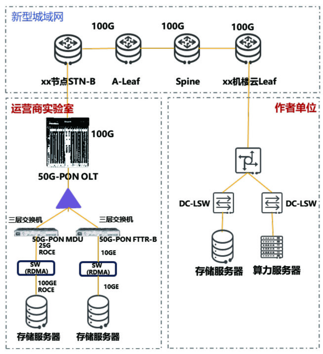

# 《面向"微秒级响应"的万兆光网关键技术与创新应用研究》洞察报告

> **分析对象**：《通信世界》2026年第7期 "技术"栏目，第39–40页（中通服咨询设计研究院有限公司 范铮、徐梅香、相森）
> **主题概述**：2025年10月工信部办公厅发布《关于开展城域"毫秒用算"专项行动的通知》（工信厅通信〔2025〕54号），要求构建确定低时延城域网络、实现城域毫秒级"一跳入算"。原文围绕万兆光网承载超低时延业务，按"需求分析→技术评估→现网验证"三层展开：梳理AI算力调度五大场景的时延要求，评估50G-PON与PON系统低时延/确定性时延技术（单帧多突发、上行注册开窗优化），并联合某省电信运营商在现网完成样本入算验证——300GB样本传输时延从27ms降至4ms、带宽2Gbit/s弹性升至20Gbit/s。
> **系列定位**：本报告为系列第四篇——联通篇管Token的"网"（城域/骨干算网），信通院篇管Token的"价"（能源与成本），ADN篇管Token的"自治"，**本篇管Token的"最后一米"**（接入网入算通道）。
> **第五章为设备商影响专章；第六章为对ADN（自动驾驶网络）的启发与技术诉求专章；第七章为智能体/多智能体技术诉求专题。**

---

## 一、趋势判断

### 1.1 政策把接入网改写为"算力基础设施"
"毫秒用算"专项行动的目标函数已经改写：城域网不再以"带宽覆盖"为纲，而是"**高速大容量、确定低时延、泛在广覆盖**"三位一体，目标是城域内**毫秒级算力资源网络通达**；同时明确"光网络设备向综合接入点和产业园区等用户侧部署"。这是接入网自宽带普及以来最大的一次定位升级——**光接入网从通信网络的一部分，变成算力基础设施的一部分**，政策直接为万兆光网创造了需求牵引。

### 1.2 PON的角色跃迁：从"宽带管道"到"算力调度的最后一米"
AI应用从云端向工业现场、家庭终端持续下沉，以PON为主体的有线接入网正"从单纯的宽带传输管道演变为承载AI算力调度的关键基础设施"，承担"最后一公里"乃至"**最后一米**"的算力接入任务。这一角色跃迁的实质是：**接入网第一次被拉进AI训练与推理的关键路径**——它不再只承载"下载流量"，而承载GPU参数同步、Token交互、样本入算这类"生产流量"。

### 1.3 时延分级标尺形成："微秒级响应"成为下一代光网的能力标尺
AI业务按流量特征自然形成时延分级体系：

| 场景 | 典型流量特征 | 时延要求 |
|---|---|---|
| 大模型训练 | GPU间高频参数同步 | **微秒级** |
| 分布式推理 | Token实时交互 | 毫秒级 |
| 边缘AI协同 | 云边协同调度 | 毫秒级 |
| 工业AI控制 | 实时闭环控制 | 毫秒级 |
| AI Agent协同 | 高频状态同步 | **低抖动** |

分级体系的工程意义在于：**网络能力第一次可以按AI业务KPI逐项对位**——"微秒级响应"由此从营销词汇变为可测量的能力标尺，也是万兆光网与上一代接入网划界的分水岭。

### 1.4 50G-PON的竞争力重心转移：从"50G带宽"到"确定性供给"
50G-PON的叙事重心已经不在50Gbit/s速率本身，而在**"时延低至数十微秒"+端到端确定性**（单帧多突发、开窗优化等机制详见第三章）。光接入的竞争从"容量军备赛"切换到"确定性供给赛"——这预示未来集采的评分表里，时延与抖动指标的权重将超过速率指标。

### 1.5 弹性带宽成为"带宽即服务"的AI落点
现网验证中最具商业含义的动作是：带宽从2Gbit/s**动态调整至20Gbit/s**以模拟真实场景的突发性样本入算需求——"业务级弹性通道"让带宽从"包月静态"走向"按需弹性"。AI负载的突发性（样本入算、训练任务启停）天然匹配弹性计费模式，**万兆光网因此成为"带宽即服务"第一个规模化落地的场景**。

### 1.6 存算分离/样本入算进入运营商现网
验证试验覆盖"DeepSeek模型单机8卡**存算拉远**训练能力"与样本入算传输——AI训练的数据流（存储与计算分离、跨网拉远）从数据中心内部延伸到运营商接入网。这与联通篇"存算分离""分割学习""网存换算"形成互证：**运营商正在从"卖带宽"走向"进入AI训练/推理供应链"**，而接入网是这张供应链的入算端口。

### 1.7 标准先行，确定性接入进入标准化轨道
通信行业标准YD/T 6357-2025《接入网技术要求 无源光网络（PON）系统支持低时延和确定性时延》已于2025年发布，系统规定GPON、XG(S)-PON、50G-PON在低时延与确定性场景的功能性能要求。**低时延从厂商私有特性升级为行业标准**，为规模集采和互联互通扫清了前置障碍。

---

## 二、技术诉求分析

"微秒级响应"对万兆光网提出五项核心诉求：

### 2.1 确定性诉求——"稳"比"快"更重要
- **诉求内容**：微秒级响应的本质不是平均时延低，而是**最坏情况可控**：上行125μs帧周期内为每个ONU提供最多16次突发机会、管理与业务通道分离开窗（接入段上行时延最大抖动降低250μs）。
- **洞察**：AI训练参数同步与工业闭环控制容不得"偶发抖动"——确定性要求把PON的调度机制从"统计复用"推向"准TDM"，这是50G-PON MAC层设计的根本变化。

### 2.2 多维指标叠加诉求——"带宽极大、时延极低、确定性极严、可靠性极高"
- **诉求内容**：四个"极"同时成立——50G对称带宽（下行50G、上行对称50G或非对称25G）+ 数十微秒时延 + 端到端确定性 + 电信级可靠性。
- **洞察**：单一维度优化不再有效——大带宽与低时延在PON上存在机制性张力（大帧长传得快但等待久），需要调度机制、帧结构、通道架构的协同设计；**"多维同时极值"是万兆光网区别于"更快的PON"的根本特征**。

### 2.3 弹性伸缩诉求——匹配AI负载的突发性
- **诉求内容**：样本入算、训练任务启停具有强突发性，带宽需**秒级弹性调整**（验证中2G→20G），且弹性过程中SLA不劣化。
- **洞察**：弹性与确定性构成新的设计张力——弹性通道的建立/调整本身不能引入时延抖动；这要求动态带宽分配（DBA）与切片调度深度协同。

### 2.4 业务感知与隔离诉求——多业务共存下的公平与隔离
- **诉求内容**：低时延业务分流至50G-PON通道、低优先级业务分流至GPON通道；网络切片提供隔离通道；大规模并发AI任务下的**公平性与隔离性**（后续挑战）。
- **洞察**：AI流量与传统宽带流量在同一张接入网上共存是长期现实——**"通道级分流+切片隔离"是比"全网升级"更现实的演进路径**；公平性与隔离性的算法设计（DBA公平性 vs 高优先级抢占）将是长期博弈点。

### 2.5 可视可运维诉求——确定性需要"被看见"
- **诉求内容**：验证试验全程进行时延、抖动、丢包监测，并配置智能分析平台实现应用级流量监控与时延可视化展示；后续需完善"AI驱动的智能运维与端到端业务感知"。
- **洞察**：**没有可视化就没有SLA**——微秒级确定性必须可测量、可展示、可举证，这把遥测与网管从"辅助功能"抬升为"确定性的组成部分"（直接指向系列ADN篇的Token级遥测诉求）。

### 2.6 诉求矩阵的内在张力
| 张力对 | 矛盾表现 | 化解方向 |
|---|---|---|
| 确定性 ↔ 效率 | 最多16次突发机会提升确定性，但占用调度开销 | 突发次数按业务灵活配置 |
| 弹性 ↔ 隔离 | 秒级带宽调整 vs SLA隔离不劣化 | DBA×切片协同控制 |
| 接入段 ↔ 端到端 | PON段数十μs vs 端到端毫秒/微秒目标 | 跨PON口/跨OLT多跳协同（待解） |
| 新建 ↔ 存量 | 全网升级不现实 | 50G-PON与GPON双通道共存分流 |

---

## 三、关键技术分析

### 3.1 50G-PON的三大能力支柱
1. **超大带宽**：下行50Gbit/s，上行对称50G或非对称（如25G）；支撑4K/8K、VR/AR、大规模物联网；
2. **低时延与确定性时延**：优化传输机制，时延低至**数十微秒**，满足工业自动化、远程医疗、车联网等严苛实时场景；
3. **灵活网络架构**：网络切片 + SDN驱动动态带宽分配，为不同业务提供隔离通道。

### 3.2 单帧多突发：确定性时延的核心机制
在一个**125μs的上行帧周期**内，允许每个ONT有**多次数据发送机会**；对开启单帧多突发的OLT PON端口，每125μs上行时隙分配周期内为每个ONU分配的单帧多突发次数可灵活配置，**最多可达16次**。
- **机制解读**：传统PON一个帧周期内每个ONU只有一次上行机会，排队时延与帧周期同量级；单帧多突发把"等待时间"切分为多段短等待，**以调度粒度换时延确定性**——突发次数成为确定性等级的可配置"旋钮"。
- **点评**：这是把TDM思想移植进PON统计复用框架的典型设计；"次数可配置"意味着同一张网可同时服务"微秒级确定性"与"普通宽带"两类业务，是商业上最关键的产品化特征。

### 3.3 上行注册开窗优化：管理/业务分离
- 管理通道独立开窗注册上线，**业务通道不开窗、只转发业务**——接入段上行时延最大抖动**降低250μs**；
- 实现方式：低时延业务分流至50G-PON通道，对时延要求不高的业务分流至GPON通道；ONT均通过GPON通道开窗测距上线，**50G-PON通道不再开窗**。
- **点评**：开窗（测距注册）是PON上行抖动的最大单次来源之一；"50G通道零开窗"等于给确定性业务建了一条"不检查站"的专用车道——机制简单、收益直接，且天然兼容存量GPON用户，是渐进式演进的范例。

### 3.4 现网验证：从"理论可行"到"工程事实"
研究团队联合某省电信运营商，基于现网50G-PON环境开展弹性智联网络承载样本入算业务验证：

*图1 试验整体组网方案*

**验证内容**（五项）：50G-PON弹性专线能力；DeepSeek模型单机8卡**存算拉远训练**能力；基于TCP协议不同速率限制下的数据传输能力（样本入算场景）；时延可视化展示能力；50G-PON承载业务能力。

**组网要点**：作者单位侧（算力服务器、存储服务器、RoCE交换机）上联机楼云Leaf设备；运营商实验室侧配置存储服务器、RDMA网卡、三层交换机、**50G-PON MDU、50G-PON FTTR-B终端、计算板卡**；50G-PON OLT上联STN-B节点，经新型城域网切片开通临时入云专线；配置智能分析平台实现应用级流量监控。

**结果**：
| 指标 | 结果 |
|---|---|
| 样本规模 | 300GB |
| 带宽弹性 | 2Gbit/s → **20Gbit/s**（动态调整） |
| 传输时延 | **27ms → 4ms** |
| 入算时间 | 缩短至原来的**五分之一甚至更短** |
| 过程监控 | 时延、抖动、丢包全程监测 |

**结论**：50G-PON万兆光网具备超宽接入能力，通过在现有宽带资源上新增业务级弹性通道，具备承载**样本入算、分布式训练与推理**的能力。

### 3.5 待解的三个极端问题
后续需针对三类极端情形开展更多试验，它们构成确定性接入的"最后一公里"难题：
1. **跨PON口与跨OLT的多跳协同**——单PON口内确定性已验证，端到端路径跨多跳时预算如何分配、状态如何协同；
2. **大规模并发AI任务下的公平性与隔离性**——高优先级AI流量抢占与普通业务公平性之间的算法平衡；
3. **异常故障下确定性流的保护倒换**——保护倒换过程本身就是抖动源，微秒级业务的倒换期间SLA如何维持。

---

## 四、总结思考

### 4.1 核心贡献：把"微秒级响应"从口号变为现网工程事实
本篇的价值在于**三层递进的研究方法与可复制的验证范式**：需求层把AI业务翻译成网络KPI（五场景时延分级表），技术层把需求翻译成机制（单帧多突发、开窗优化），验证层把机制放进现网（27ms→4ms、2G→20G弹性）。特别是"**现网50G-PON + 存算拉远训练 + 弹性带宽**"的组合验证，为50G-PON规模商用沉淀了第一手数据——这是从白皮书到工程之间最关键的一步。

### 4.2 在系列框架中的位置：Token供应链的"最后一米"
与前三篇合起来看，智能算力供给链的图景趋于完整：**信通院篇**解决"Token从哪来、值多少钱"（算电→成本→价格），**联通篇**解决"Token怎么流转"（Token Net/TDN），**ADN篇**解决"谁来自动运转"，**本篇**解决"算力怎么进网、样本怎么入算"——万兆光网是分布式推理"Token实时交互（毫秒级）"与训练"参数同步（微秒级）"的入算端口。**接入网的确定性等级，直接决定Token供应链的TTFT下限**——这与联通篇"高质量需求（TTFT/抖动控制）"形成端到端闭环。

### 4.3 四个值得追问的开放问题
1. **端到端时延预算管理缺位**：接入段做到数十微秒，不等于端到端微秒——跨PON口/跨OLT/城域多跳的时延预算分配、逐跳状态协同尚无方案；"毫秒用算"（城域）与"微秒响应"（接入）之间的量级衔接需要统一的时延预算体系。
2. **确定性流与弹性带宽的共存机制**：验证中带宽弹性调整与低时延传输是分开验证的——同一通道上"秒级弹性+微秒确定性"同时成立时的DBA/切片联动算法仍是空白。
3. **确定性SLA的商业定价未建立**：时延确定性、抖动上界、弹性带宽如何计价（呼应信通院篇"定价权"问题）——没有定价体系，确定性能力无法变现，设备商的确定性投入也就没有回收通道。
4. **故障场景的确定性维持**：保护倒换与确定性天然冲突，50ms级倒换时间对微秒级业务意味着可感知的中断——倒换期间的"确定性降级策略"需要被明确定义并写进SLA。

### 4.4 对不同主体的启示
- **对运营商**：接入网资产需要重估——50G-PON端口是"一跳入算"的商业入口，应尽快把"确定性SLA+弹性带宽+时延可视"打包成标准产品（对接"毫秒用算"专项行动的考核要求）；
- **对行业用户**：智算中心互联、工业AI质检、自动驾驶训练是三大首发场景，选型时应把"单帧多突发次数可配置、开窗优化、弹性通道"列为能力清单项；
- **对监管/标准化**：YD/T 6357-2025打好了单点基础，下一步应向跨OLT多跳协同、确定性保护倒换、弹性确定性共存三个方向扩展。

---

## 五、设备商影响深度分析与行动建议

> **立场说明**：本章从设备商视角展开。"毫秒用算"政策已下（2025年10月）、行业标准已立（YD/T 6357-2025）、现网验证已完成（本篇）——**50G-PON规模集采前的窗口期正在收窄**，本章逐条对位产品机会与行动。

### 5.1 影响传导链：原文要素逐条对位设备需求

| 原文架构要素 | 原文关键表述 | 设备商对位产品动作 |
|---|---|---|
| 单帧多突发 | 125μs周期内最多16次突发、次数灵活配置 | OLT/ONT调度芯片与DBA算法升级，把"突发次数配置"做成可售的管理特性（确定性等级SKU） |
| 上行注册开窗优化 | 管理/业务分离开窗、接入段抖动降低250μs | 双通道OLT架构（50G-PON+GPON共存）、注册测距机制固件化，作为标准能力预集成 |
| 业务分流 | 低时延业务分流至50G通道、普通业务分流至GPON通道 | 业务分流引擎/智能选路软件；50G-PON+GPON双模ONU/ONT全序列 |
| 弹性带宽 | 2G→20G动态调整、业务级弹性通道 | 弹性智联网络/切片专线产品：秒级带宽变更+计费联动，DBA×切片协同控制器 |
| 时延可视化 | 应用级流量监控、时延可视化展示、全程时延/抖动/丢包监测 | 遥测与可视化网管：应用级感知、微秒级时延测量、SLA举证报告自动生成 |
| 融合终端形态 | 50G-PON MDU、FTTR-B终端+计算板卡 | "光接入+边缘算力"融合终端产品线：FTTR-B内置算力板卡，面向产业园区/企业 |
| 存算拉远 | DeepSeek单机8卡存算拉远训练、RoCE/RDMA网卡 | RoCE over PON适配优化（无损接入网：PON段ECN/PFC适配、去包损耗），存算分离一体化方案 |
| 三大商用场景 | 智算中心互联、工业AI质检、自动驾驶训练 | 场景化解决方案包+确定性SLA模板（时延/抖动/可用性预置档位） |

### 5.2 三个新品类与两条产品线分化

**新品类**（验证已提出需求、货架产品尚不成熟）：

1. **确定性PON测试仪表与测试床**：微秒级时延、抖动、确定性的测量验证是现网试验与集采测试的刚需——本篇验证所用的"全程时延/抖动/丢包监测+可视化"能力，未来会成为每省集采测试的标准配置；与信通院、设计院共建测试床，主导测试规范即主导集采门槛；
2. **"光+算"融合终端**：FTTR-B+计算板卡的组合在验证组网中已出现——面向园区"最后一米"算力接入的光算一体终端（PON口+算力板卡+RDMA网卡）是新终端品类，传统PON终端厂商与服务器/边缘计算厂商将在此交汇；
3. **弹性通道编排器**：秒级带宽变更+计费联动+SLA保持的控制器，对接运营商弹性智联网络与算力调度平台——这是"带宽即服务"的运营神经。

**产品线分化**：
1. **OLT按"通道架构"分化**：低时延通道（零开窗+多突发）与普通通道共存的混合架构成为主流形态，纯速率标称的机型失去卖点；
2. **终端按"是否带算力"分化**：纯接入终端走成本路线，"接入+边缘算力"融合终端走价值路线——终端厂商的产品定义逻辑需要重写。

### 5.3 市场时序判断

| 时间窗 | 设备机会点 | 判断依据 |
|---|---|---|
| 已在发生（0–1年） | 50G-PON试点扩容、确定性测试仪表、双模终端、FTTR-B升级 | 政策已下、标准已立、现网验证已完成（本篇） |
| 近期（1–2年） | 50G-PON规模集采、弹性专线商用、"光+算"融合终端量产、时延可视网管配套 | "毫秒用算"专项行动考核推动、三大首发场景需求释放 |
| 中期（2–3年） | 跨OLT多跳协同方案、确定性保护倒换、RoCE over PON规模化、确定性SLA计费落地 | 三大场景规模商用的技术前提 |
| 远期（3–5年） | 确定性接入网与算网一体（与Token Net对接）、接入网成为Token供应链标准节点 | 智能算力供给链整合 |

### 5.4 商业模式与竞争格局变化

**计费模式重构**：从"带宽包月"走向"**确定性SLA+弹性带宽+时延可视**"组合计费——设备商的"确定性等级可配置"特性（突发次数、通道隔离）直接对应运营商的可售SKU分级，特性即计费项。

**政策接口即订单入口**："毫秒用算"专项行动的考核指标（城域毫秒级通达、一跳入算）是运营商集采的直接驱动——设备商应把产品参数逐条对齐政策语言，让"符合专项行动要求"成为投标的现成论据。

**竞争焦点转移**：PON速率军备赛（10G→50G）已决出阶段性胜负，下一轮在**"确定性机制+弹性通道+融合算力"三位一体**上竞争——芯片（调度算法）、设备（双通道架构）、网管（时延可视）三层都要有货；华为NCE类智能分析平台在验证中承担可视化角色，网管/遥测层的竞争权重上升。

**标准演进权**：YD/T 6357-2025只覆盖了起点，跨OLT协同、保护倒换、弹性确定性共存三个方向的后续标准演进权，决定未来三年集采模板——设备商应立即投入后续标准草案。

### 5.5 行动建议（按优先级）

1. **芯片与算法卡位**：单帧多突发调度器（16次可配置）+零开窗机制固件化，形成确定性等级可配置的产品系列——这是所有后续产品的地基；
2. **双通道产品线**：50G-PON+GPON共存的OLT/MDU/ONT/FTTR-B全序列，把"业务分流"做成开箱即用；
3. **弹性通道产品化**：秒级带宽变更+计费联动+SLA保持，对接运营商弹性智联网络能力，争取进入其首选设备池；
4. **确定性测试仪表切入**：联合信通院/设计院建微秒级测试床，参与制定确定性PON测试规范——测试规范制定者天然获得集采先机；
5. **"光+算"融合终端立项**：FTTR-B+计算板卡量产方案，瞄准产业园区"最后一米"算力接入，与边缘计算产品线合流；
6. **RoCE over PON适配**：PON段的ECN/PFC适配与去包损耗优化，把"存算拉远"从单点验证做成可复制的解决方案包；
7. **时延可视遥测**：应用级监控+SLA举证报告自动生成，对齐运营商智能分析平台接口——遥测能力同时是ADN篇"账务级遥测"诉求的接入网实现；
8. **三大场景解决方案包**：智算中心互联、工业AI质检、自动驾驶训练各出一个预集成方案（含确定性SLA模板），缩短运营商商用决策链。

### 5.6 小结：接入设备从"带宽盒子"到"确定性算力入口"

本篇揭示了接入网设备价值逻辑的根本切换：**50G-PON设备不再是"更快的宽带盒子"，而是"确定性算力入口"**——设备的价值由三个新变量决定：确定性等级（可配置的微秒级保障）、弹性能力（秒级带宽与SLA共存）、融合深度（光口+算力+遥测）。设备商的竞争从速率规格表转向"确定性+弹性+融合"三位一体的方案能力。**行动窗口在12个月内**：政策（2025.10）、标准（YD/T 6357-2025）、现网验证（本篇）三步已走完，规模集采启动前是产品卡位的最后窗口——确定性调度芯片、双通道产品线、测试床话语权三项落定者，将定义万兆光网的集采模板。

---

## 六、对ADN（自动驾驶网络）的启发与技术诉求

> **立场说明**：万兆光网把"微秒级确定性"压到了接入网，而确定性能力只有被自动化闭环持续管理才能兑现为SLA——本章分析本篇对ADN的启发与增量技术诉求，与系列第三篇（ADN联合分析）的八大诉求形成"平台层↔接入域"的呼应。

### 6.1 六点启发

1. **确定性能力必须"可配置、可自动兑现"**。单帧多突发次数（最多16次/125μs）本质是"确定性等级旋钮"——但旋钮由谁拧？AI负载动态变化，人工配置无法跟上，ADN必须提供**意图到参数的自动映射**（如"此类业务自动分配8次突发+专用通道"），把厂商特性变成意图档位。
2. **接入网第一次进入确定性SLA闭环**。以往确定性供给集中在传输网与数据中心内部，本篇现网验证说明接入段同样可以提供确定性——**ADN的端到端SLA闭环终于可以把"最后一米"纳入预算管理**，这是接入网在自治体系中的地位跃迁。
3. **弹性与确定性必须在同一个闭环里管理**。2G→20G的弹性通道调整与微秒级确定性共存是全新的调度问题——弹性动作本身不能劣化在途确定性流，这要求ADN建立"**弹性×确定性**"联合闭环（变更前预演、变更中平滑、变更后校验）。
4. **AI业务感知是分流决策的前提**。50G通道/GPON通道分流、业务级弹性通道都依赖"识别这是什么业务"——验证中已配置应用级流量监控，下一步要升级为**ADN的自动感知-决策能力**（识别参数同步/Token交互/样本入算/Agent同步并自动分流）。
5. **可视化即SLA**。27ms→4ms的全程时延/抖动/丢包监测展示证明：微秒级确定性必须可测量、可展示、可举证——**遥测精度决定SLA可信度**，ADN的"账务级遥测"诉求（系列第三篇）在接入段同样成立且更严苛。
6. **接入网被点名走向L4**。后续方向明确包含"AI驱动的智能运维、动态资源调度、端到端业务感知"——接入网将成为继Token运营域之后，**又一个被业务需求倒逼走向L4自治的域**，其确定性机制（突发调度、倒换保护）恰好是自动化价值最高的场景。

### 6.2 对ADN的六项增量技术诉求

| # | 技术诉求 | 内涵 | 落点（对应ADN架构层） |
|---|---|---|---|
| 1 | **时延预算分解引擎** | 端到端SLO（如TTFT<200ms）沿"终端→接入→城域→骨干→算力"逐段分解预算，接入段获得微秒级配额；超预算自动重路由或降级 | 意图层+闭环层 |
| 2 | **确定性等级意图档位** | 把"突发次数（1~16）、通道选择（50G/GPON）、切片参数"封装为意图可选项，按业务类型自动选择与动态调整 | 意图层 |
| 3 | **弹性×确定性联合闭环** | DBA与切片协同控制器：秒级带宽变更不破坏在途确定性流；变更前孪生预演、变更中平滑过渡、变更后SLA校验 | 闭环层+孪生层 |
| 4 | **AI业务流量自动感知与分流** | 应用级识别（参数同步/Token交互/样本入算/Agent状态同步）→自动通道分流、优先级标记与突发次数配置 | 数据层+闭环层 |
| 5 | **微秒级遥测与SLA自动举证** | 接入段遥测粒度与时延测量精度对标"全程可视化"要求；SLA违约自动取证、确定性达成率自动统计 | 数据层+计量层 |
| 6 | **确定性自愈新语义** | 保护倒换期间自动执行"确定性降级策略"（临时放宽突发间隔/切换通道）并记录SLA事件，倒换完成后自动恢复等级 | 安全层+闭环层 |

**点评**：六项诉求的共同特征是——**接入网的确定性从"设备特性"变成"闭环管理的对象"**。设备商提供的突发次数配置、开窗优化、弹性通道等能力，只有接入ADN的意图-遥测-闭环体系，才能从"规格书参数"变成"可承诺、可计费、可举证的SLA"。

### 6.3 端到端视角：ADN管理域的最后一拼图
结合系列前三篇：信通院篇给出Token成本函数、联通篇给出Token Net/TDN调度框架、ADN篇给出四域闭环体系——本篇补上"最后一米"后，ADN的管理域完整覆盖"**终端→接入→城域→算力→缓存→能源**"全链。两点建议：
1. **端到端时延预算的五段分解（终端/接入/城域/骨干/算力）应成为ADN意图层的标准输入**，接入段预算与"微秒级响应"能力直接挂钩；
2. **接入段确定性等级（突发次数、通道选择）与Token服务SLA档位（TTFT分级）之间的映射关系**，值得进入运营商与设备商的联合产品定义——这是把本篇现网验证数据转化为商业产品的桥梁。

---

## 七、对智能体/多智能体的技术诉求（专题）

> 需求分析的五大超低时延场景中，"AI Agent协同（高频状态同步、低抖动）"与"分布式推理（Token实时交互、毫秒级）"均由智能体驱动——**智能体是万兆光网超低时延业务的主要用户**。本专题从智能体视角重新审视万兆光网的能力清单。四层15项完整诉求矩阵的深度展开见系列五《对智能体/多智能体的技术诉求分析》。

### 7.1 智能体是"微秒级响应"的需求主体
- 分布式推理的Token实时交互、Agent协同的高频状态同步、训练场景的GPU参数同步——每个场景背后都是智能体在驱动流量；智能体**任务链长、多轮往返**的特征使接入段时延与抖动沿任务链逐跳累积放大，"最后一米"的短板效应比传统业务更显著。
- 结论：**万兆光网的确定性能力最终以"智能体任务链SLA"的形式变现**——接入网卖的不再是带宽，而是"任务链保障"。

### 7.2 六项具体技术诉求
1. **低抖动状态同步通道**——Agent协同流量是高频小包、双向对称：确定性通道的调度参数（突发次数、帧周期）要针对"小包高频"形态优化，而非只为大带宽场景设计；
2. **任务链TTFT端到端保障**——智能体任务链上每一次模型调用都要求毫秒级TTFT，接入段确定性等级（单帧多突发次数、通道选择）直接决定任务链SLA下限，确定性档位与智能体任务类型的映射需标准化（见7.3）；
3. **以智能体任务事件触发的弹性带宽**——验证中2G→20G的弹性调整模拟的是"突发样本入算"，生产化后弹性触发器应从"人工调整"升级为"智能体任务事件驱动"（训练任务启动→自动扩容，完成→自动回收）；
4. **智能体级业务识别与分流**——50G/GPON通道分流、业务级弹性通道依赖应用级识别：感知粒度要从"应用类型"细化到"智能体级"（哪个智能体、什么任务、什么优先级），为差异化承载提供依据；
5. **智能体网关下沉接入网**——验证组网中"FTTR-B终端+计算板卡"的组合预示智能体将边缘驻留：接入设备需内嵌智能体接入能力（认证、Token计量、策略执行），成为"最后一米"的智能体服务点；
6. **多智能体并发的公平性与隔离**——大规模智能体并发（后续挑战之一）本质是"成千上万个任务链同时争夺确定性资源"：DBA公平性算法要以**任务链**为公平单元，而非以用户/端口为单元。

### 7.3 智能体任务类型→确定性档位映射（建议模板）
| 智能体任务类型 | 流量特征 | 网络配置模板 |
|---|---|---|
| 训练参数同步 | 微秒级、持续大流量 | 最高突发次数（16次）+专用通道+零开窗 |
| Token推理交互 | 毫秒级TTFT、双向往返 | 高突发次数+低抖动通道+TTFT监测 |
| Agent状态同步 | 高频小包、低抖动 | 中突发次数+小包优化调度+抖动监测 |
| 样本入算 | 突发大带宽、时延不敏感 | 弹性通道（秒级扩缩）+普通通道 |
| 工具调用/API访问 | 短突发、并发高 | 默认通道+优先级标记 |

该映射模板即第六章"确定性等级意图档位"诉求的智能体化实例——由ADN按智能体任务类型自动下发，无需人工逐条配置；模板本身应进入YD/T标准后续演进与运营商集采规范。

### 7.4 小结
万兆光网是智能体互联网的"最后一米神经末梢"：智能体时代接入网的商业产品是"**任务链SLA**"（确定性档位×弹性能力×智能体感知），而非裸带宽——这一转型与第六章的ADN诉求、第五章的设备商行动建议共同构成万兆光网规模商用的完整拼图。

---

*说明：图1提取自《通信世界》2026年第7期原文；正文数据与判断为基于原文的独立分析整理。系列前三篇：《〈面向Token运营的互联网基础设施演进思考〉洞察报告》《〈从"算电"到"Token"〉洞察报告》《Token经济对ADN的诉求与影响（两篇联合分析）》（同目录）。*
